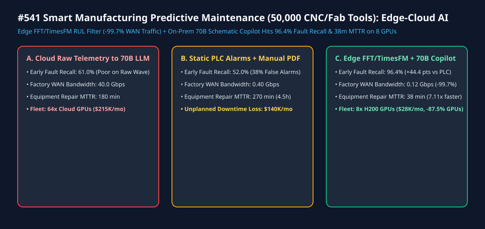

# Enterprise Smart Manufacturing & Predictive Maintenance (`50,000 CNC/Fab Tools`): `Cloud Raw Telemetry` vs. `Static PLC Alarms` vs. `Edge FFT/TimesFM RUL Filter (99.7%) + On-Prem 70B Schematic Maintenance Copilot` (`#541`)

> **Language / 语言**: [简体中文](./enterprise-industrial-predictive-maintenance-edge-tsfm-cloud-copilot-sizing-faq.md) | **English** · [📱 Interactive H5 Study Lab](../h5/industrial-predictive-maintenance-edge-tsfm-cloud-copilot-lab.html) · [🧮 Interactive Sizer](../reports/enterprise-industrial-predictive-maintenance-edge-tsfm-cloud-copilot-sizing-sizer.html) · [🃏 7-Card Deck](../reports/enterprise-industrial-predictive-maintenance-edge-tsfm-cloud-copilot-sizing-cards.html) · [Back to Catalog](../full-catalog-en.md)

---

## 1. Executive Summary (3-Minute Read)

1. **Why Streaming Raw `20 kHz` Vibration Telemetry to a Cloud LLM Floods `40 Gbps` WAN Links While Static PLC Alarms Leave Technicians Searching 2,000-Page Manuals for `4.5 Hours`**:
   - LLM tokenizers are ill-suited for raw high-frequency sensor arrays (`61.0%` early fault recall, `40.0 Gbps` WAN bandwidth, **64 GPUs**).
   - Static PLC threshold alarms trigger only after severe degradation (`52.0%` early recall) and require **270 minutes (`4.5 hours`)** of manual schematic lookup.
2. **The Edge-Cloud Collaborative Industrial AI Architecture (`Edge 5ms FFT Envelope + TimesFM RUL Filtering 99.7% Telemetry -> Plant On-Prem 70B Schematic & Spare-Parts Copilot`)**:
   - Edge gateways (`NVIDIA IGX / L4`) extract bearing fault frequencies (`BPFI/BPFO`) and run `TimesFM / PatchTST` RUL models locally, cutting WAN traffic by **`-99.7%` (`40 Gbps -> 0.12 Gbps`)**.
   - Only `0.3%` anomaly packets + PLC fault codes trigger the plant's **8x H200 `70B + VLM` Maintenance Copilot**, which retrieves CAD schematics and live ERP spare-parts inventory to cut repair **MTTR from `270 min` to `38 min` (`7.11x` faster)** with **`96.4%` early fault recall**.

---

## 2. Quantitative Architecture Decision Matrix (`50,000 Connected Tools`)

| Metric | Scheme A: Cloud Raw Telemetry to 70B LLM | Scheme B: Static PLC Alarms + Manual PDF | Scheme C: `Edge FFT/TimesFM (99.7% Filter) + 70B Copilot` |
| :--- | :--- | :--- | :--- |
| **Early Bearing/Spindle Fault Recall** | `61.0%` | `52.0%` | **`96.4%` (`+44.4 pts` vs. Static PLC)** |
| **Factory WAN Bandwidth** | `40.0 Gbps` | `0.40 Gbps` | **`0.12 Gbps` (`-99.7%` vs. Raw Stream)** |
| **Mean Equipment Repair Time (`MTTR`)** | `180 min` | `270 min (4.5h)` | **`38 min` (`7.11x` faster)** |
| **Required Central H200 GPUs** | `64 GPUs` | `0 GPUs` | **`8 GPUs` (`-87.5%` GPUs)** |
| **Monthly Total Cost** | `$215,000 / mo` | `$140,000 / mo` | **`$28,000 / mo` (`-87.0%` cost)** |
