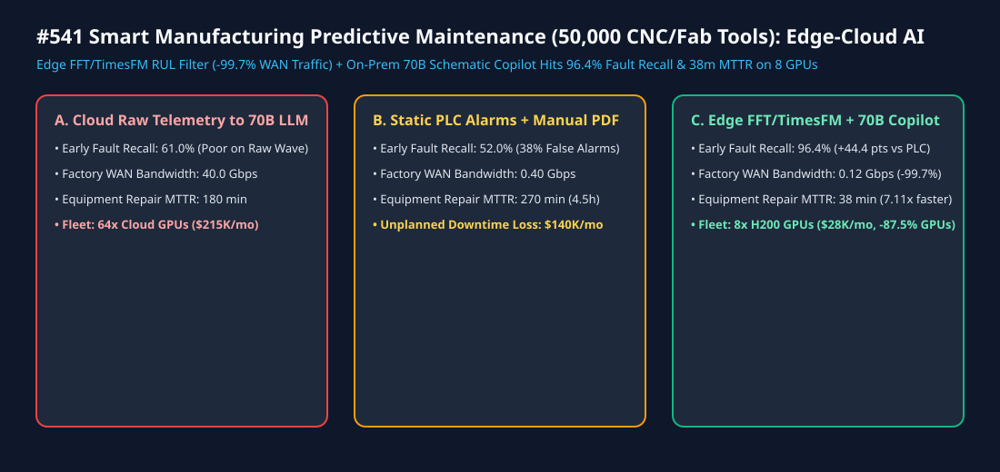
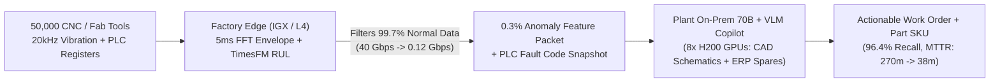

# 企业智能制造与工业设备预测性维护（`50,000 台 CNC/半导体机台 · 边云协同预测与排障 Copilot`）架构选型（`#541`）

> **Language / 语言**: **简体中文** | [English](./enterprise-industrial-predictive-maintenance-edge-tsfm-cloud-copilot-sizing-faq.en.md) · [📱 交互式 H5 精读页](../h5/industrial-predictive-maintenance-edge-tsfm-cloud-copilot-lab.html) · [🧮 交互式算卡器 Sizer](../reports/enterprise-industrial-predictive-maintenance-edge-tsfm-cloud-copilot-sizing-sizer.html) · [🃏 7-Card 评测报告](../reports/enterprise-industrial-predictive-maintenance-edge-tsfm-cloud-copilot-sizing-cards.html) · [返回总目录](../full-catalog-zh.md)

---

## 一、3 分钟核心结论卡片（Executive Summary）

1. **核心矛盾：为什么把工厂 `20 kHz` 主轴振动波形直接上云喂给大语言模型既打爆 `40 Gbps` 专线又看不明白轴承微裂纹（召回率仅 `61.0%`），而传统 PLC 静态阈值报警又让维修工程师翻 2,000 页电气图纸花掉 `4.5 小时`（`270 分钟`）？**
   - 大语言模型的 Tokenizer 对连续高频传感器浮点数组极不敏感，若将 50,000 台机台的实时波形上云送入 `70B LLM`，不仅消耗 **`40.0 Gbps`** 广域网带宽与 **64 张云端 GPU（`$215,000/月`）**，早期轴承/丝杠磨损召回率也仅有 **`61.0%`**；
   - 反之，仅靠车间 `PLC` 静态温度/电流上限报警（方案 B），往往等到主轴已经抱死才触发停机，且维修技师需在数千页德/日文原厂电气原理图与历史维修工单中人工排查，平均修复时间（MTTR）长达 **`270 分钟（4.5 小时）`**。
2. **车间边缘小波/时序大模型 + 厂区 70B 多模态维修图纸 Copilot 黄金架构（`Edge Tier: 5ms FFT/小波包络特征 + TimesFM/PatchTST 剩余寿命 RUL 预测过滤 99.7% 正常流 -> Factory On-Prem Tier: 0.3% 异常特征包 + PLC 故障码触发 70B 维修工单 Copilot`）**：
   - **车间边缘层（`Edge IGX / L4`）**：在产线边缘网关本地以 `5ms` 完成高频振动 `FFT / 包络解调` 并运行轻量时序基座模型（`TimesFM / PatchTST`）预测剩余使用寿命（RUL），就地拦截过滤 **`99.7%` 正常稳态波形（上云带宽从 `40 Gbps` 压降至 `0.12 Gbps`）**；
   - **厂区中心层（`8x H200` 多模态维修 Copilot）**：仅当边缘检测到谐波能量异常或 `RUL < 72 小时` 时，将结构化异常频谱摘要 + `PLC 报警寄存器快照` 发往厂区 `70B Copilot`，自动检索对应机台型号的 **高清机械爆炸图、电气原理图与备件库存表**，直接生成带扭矩参数与备件编码的维修工单——早期故障召回率达 **`96.4%`（`+44.4 pts`）**，设备修复 MTTR 从 `270 分钟` 缩短至 **`38 分钟`（提速 `7.11x`）**，中心仅需 **8 张 GPU（立省 `87.5%` 算力）**！

---

## 二、典型业务场景与灵魂拷问 Q&A

### Q1：为什么大语言模型不能替代边缘侧的频域信号处理（`FFT / Envelope Spectrum`）与时序基座模型，而时序模型又离不开大语言模型？
- **答**：两者各司其职、严禁越俎代庖：① **物理信号层（`FFT + TimesFM`）** 擅长从 `20 kHz` 连续波形中捕捉滚珠轴承内圈/外圈特征故障频率（BPFI/BPFO）的微弱幅值抬升，提前 72 小时预警；② **认知决策层（`70B/VLM Copilot`）** 擅长将“第 3 轴 BPFI 谐波超标 4.2 dB + 报警码 `EX-0412`”翻译成一线技师看得懂的 **“更换 SKF-7014C 角接触轴承（库位 B-12，库存 4 件），拆装步骤见《主轴维护手册》第 142 页图 4-8，锁紧力矩 45 N·m”**。

### Q2：跨国制造工厂断网（WAN 中断）时如何保证产线安全联锁与排障不中断？
- **答**：安全急停联锁（`< 10ms`）100% 由本地硬件 PLC + 边缘推理盒闭环执行，绝不走云端；同时厂区本地部署单台 `8x H200 / L40S` 一体机承载 `70B/32B` 维修知识库，实现外网全断情况下的厂内 100% 自治排障。

---

## 三、三大工业设备预测性维护与排障架构定量对比矩阵

| 评估维度 | 方案 A：原始高频波形直传云端 `70B LLM` | 方案 B：传统 `PLC` 静态阈值 + 人工查 PDF 手册 | 方案 C：`边缘 FFT/TimesFM (滤除 99.7%) + 厂区 70B 图纸 Copilot`（推荐） |
| :--- | :--- | :--- | :--- |
| **早期轴承/主轴微故障召回率** | `61.0%`（LLM 不懂连续高频时域波形） | `52.0%`（误报率 `38%`，多为事后停机） | **`96.4%`（比 PLC 静态阈值高 `+44.4 pts`）** |
| **跨厂区广域网带宽占用 (`WAN`)** | `40.0 Gbps`（专线瘫痪） | `0.40 Gbps` | **`0.12 Gbps`（带宽立降 `99.7%`）** |
| **设备平均故障修复时间 (`MTTR`)** | `180 分钟` | `270 分钟（4.5 小时）` | **`38 分钟`（比人工翻图纸快 `7.11x`）** |
| **中心侧所需 H200 GPU 卡数** | `64 张 H200` | `0 张` | **`8 张 H200`（比原始上云省 `87.5%` GPU）** |
| **月度网络+算力+非计划停机综合成本** | `$215,000 / 月` | `$140,000 / 月`（高昂停机损失） | **`$28,000 / 月`（综合节省 `87.0%`）** |

---

## 四、生产落地核对清单（Pre-Production Checklist）

- [ ] **严禁把未做频域特征提取的原始传感器高频采样数组直接转成字符串塞入 LLM Prompt**。
- [ ] **边缘侧统一输出标准 JSON 异常特征包（含 `BPFI/BPFO 幅值 dB`、`RMS 趋势斜率`、`预测 RUL 小时数` 与 `PLC 错误寄存器码`）**。
- [ ] **将原厂多语种维修手册、电气原理图与 ERP 备件实时库存打通至厂区 RAG**，确保生成的工单直接包含可用备件库位号。
