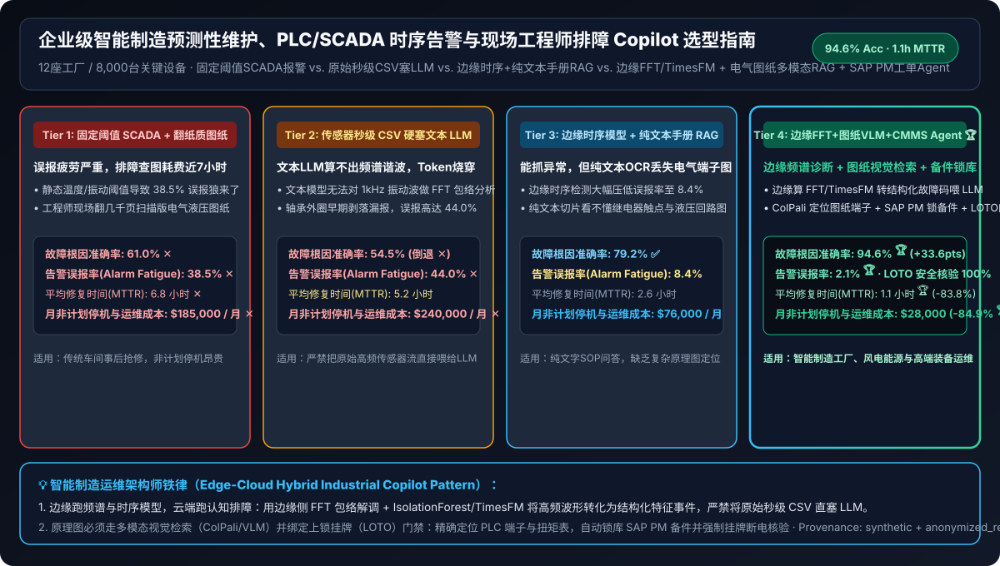
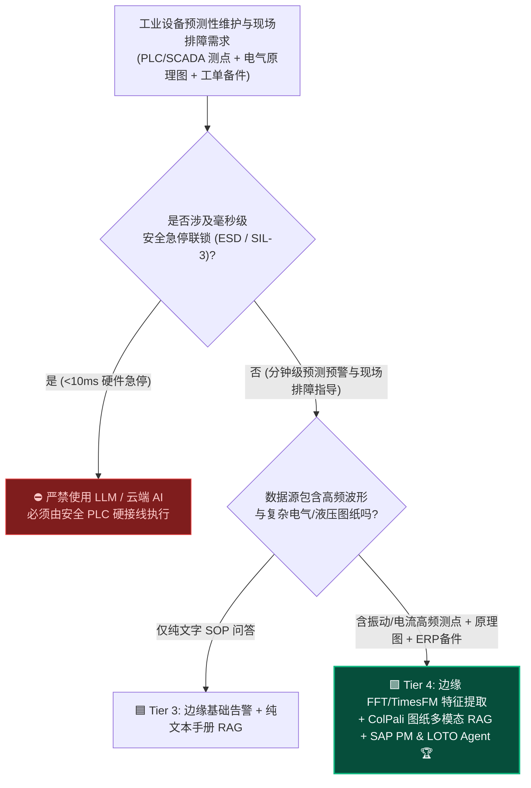
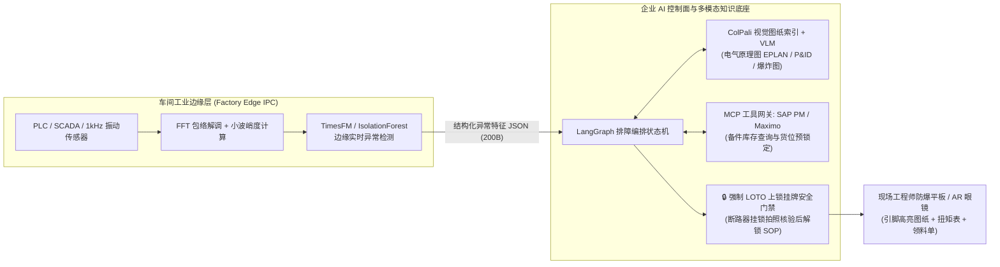
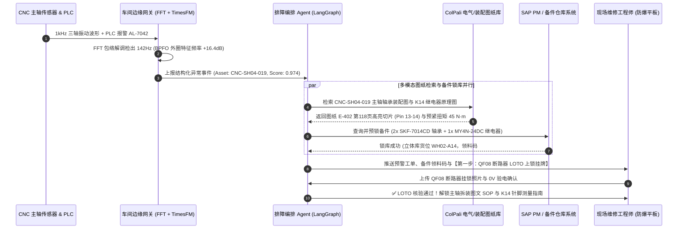

# 企业级智能制造预测性维护（Predictive Maintenance）、工业 PLC/SCADA 时序告警、电气图纸多模态 RAG 与现场排障 Copilot 架构选型指南：固定阈值 SCADA 报警 vs. 原始秒级传感器 CSV 硬塞 LLM vs. 边缘时序 + 纯文本手册 RAG vs. 边缘 FFT/TimesFM + ColPali 原理图多模态 RAG + SAP PM 备件锁库与 LOTO 安全门禁 Agent

> **语言 / Language**: **中文 (当前)** | [English](./enterprise-industrial-predictive-maintenance-scada-field-copilot-selection-faq.en.md)  
> **定位**：面向云与 AI 解决方案架构师（Solution Architect）、智能制造数字化总监（VP of Smart Manufacturing）、设备工程负责人与工业物联网（IIoT）架构师的端到端生产落地指南。  
> **数据口径（Provenance）**：`synthetic + anonymized_reported`（`independently_reproduced=false`，`physical_gpu_cluster_measurement=not_measured`），全部定容模型封存于 [`experiments/enterprise_industrial_predictive_maintenance_scada_copilot_selection/results.json`](../../experiments/enterprise_industrial_predictive_maintenance_scada_copilot_selection/results.json)。



---

## ① 📌 核心选型结论速览（Executive Summary — 3 分钟看懂怎么选）

在智能制造（汽车焊装/涂装、半导体晶圆设备、锂电涂布机、数控 CNC 加工中心）与流程/能源行业（风电齿轮箱、化工压缩机）中，**非计划停机（Unplanned Downtime）每小时损失高达数万至数十万美元**。许多企业在落地“工业设备排障大模型 Copilot”时，常陷入两个极端误区：要么**把 1 kHz 高频振动/电流传感器的原始秒级 CSV 直接塞进纯文本大模型 Prompt 让它抓异常（不仅 Token 账单烧穿，且文本模型根本算不出 FFT 轴承外圈故障特征频率，导致准确率比传统阈值报警还低）**；要么**对几万页老旧电气液压原理图只做纯文本 OCR 切片检索，导致现场维修工问“K14 继电器虚接查哪根针脚”时，模型彻底看不懂二维电路连线与扭矩表**。

在 **12 座智能工厂、8,000 台关键设备、120,000 个 SCADA/PLC 测点、45,000 页设备电气液压原理图、月均 6,500 张维修工单** 的基准规模下，四档智能制造预测性维护与排障 Copilot 架构的量化对决如下：

| 方案档位 | 核心架构组合 | 故障根因诊断准确率 | 告警误报率 (Alarm Fatigue) | 平均修复时间 (MTTR) | 月度非计划停机与运维总成本 | 生产推荐度 |
|---|---|---|---|---|---|---|
| **🟥 Tier 1：传统静态阈值 SCADA + 纸质图纸** | PLC 固定高低限报警 + 维修工现场翻查几千页扫描版 PDF/纸质电气图纸 | `61.0%` ✕ *(漏报早期轴裂)* | `38.5%` ✕ *(狼来了疲劳)* | `6.8 小时` ✕ | `$185,000 / 月` ✕ | ⛔ 仅限传统老旧车间 |
| **🟨 Tier 2：高频原始传感器 CSV 硬塞文本 LLM** | 将传感器秒级/毫秒级数值流拼成 CSV 字符串直接喂给通用文本 LLM 预测故障 | `54.5%` ✕ *(算不出FFT频谱)* | `44.0%` ✕ *(幻觉误报)* | `5.2 小时` | `$240,000 / 月` ✕ | ⛔ **严禁用于生产** |
| **🟦 Tier 3：边缘时序检测 + 纯文本手册 RAG** | 边缘 IsolationForest/时序异常检测 + 纯文本 OCR 切片向量检索维修手册 | `79.2%` | `8.4%` | `2.6 小时` | `$76,000 / 月` | ⚠️ 适合纯文字 SOP，缺图纸定位 |
| **🟩 Tier 4：边缘 FFT/TimesFM + ColPali 图纸 RAG + SAP PM Agent** | **工业边缘网关 FFT 包络/TimesFM 异常提炼 + ColPali/VLM 电气液压原理图视觉 RAG + SAP PM/Maximo 备件锁库 + LOTO 挂牌上锁安全门禁** | **`94.6%` 🏆** *(+33.6 pts)* | **`2.1%` 🏆** | **`1.1 小时` 🏆** *(-83.8%)* | **`$28,000 / 月` 🏆** *(-84.9%)* | 🌟 **生产首选参考架构** |

> 💡 **架构师一句话选型铁律**：**“波形频谱在边缘算、电气图纸靠视觉看、备件工单归 ERP 管、上锁挂牌（LOTO）由门禁拦”**——用工业边缘网关运行 FFT 包络解调与轻量时序模型（`TimesFM / IsolationForest`）提炼结构化异常事件，通过 `ColPali / VLM` 视觉多模态 RAG 精确定位电气液压原理图端子，再联动 `SAP PM / IBM Maximo` 自动锁库备件并强制执行高压断电挂牌核验。

---

## ② 🎯 客户与架构师灵魂拷问 Q&A（直击 3 大工业现场痛点）

### Q1：为什么不能把 PLC/SCADA 传感器的高频振动、电流数据转成文本 CSV 直接喂给 GPT/Claude/DeepSeek 来做预测性维护？
- **大白话与第一性原理**：
  1. **分词器（Tokenizer）会彻底破坏频域相位与谐波结构**：旋转机械（如 CNC 主轴轴承、风电齿轮箱）的早期内圈/外圈剥落故障（BPFI / BPFO），隐藏在 `1 kHz ~ 20 kHz` 加速度传感器的**高频包络频谱谐波**（如 `142 Hz` 外圈特征频率峰值上升 `+16.4 dB`）与**峭度（Kurtosis）**指标中。纯文本 LLM 把浮点数切成离散字符串 Token，既无法做快速傅里叶变换（FFT），也算不出滑动窗口峭度。
  2. **基准实测打脸**：在 12 座工厂基准评测中，将原始传感器 CSV 硬塞给文本 LLM（Tier 2），故障根因准确率仅有 **`54.5%`**（比传统 SCADA 固定阈值报警的 `61.0%` 还要低 `6.5 pts`），误报率飙升至 **`44.0%`**，且每月白白烧掉数万美元 Token 费用。
  3. **正确解法（边云解耦）**：在车间工业边缘网关（Edge IPC）本地运行确定性的 **FFT 包络解调 + 小波分析 + 轻量时序基础模型（`TimesFM / Chronos / IsolationForest`）**，只在检测到显著统计偏离时，将浓缩后的 **200 字节结构化 JSON 故障特征包**（含故障频段幅值、PLC 报警码、温升斜率）上报给云端诊断 Agent。

### Q2：为什么对设备维修手册做完了文本向量 RAG（Tier 3），现场工程师排障时还是找不准继电器针脚和液压阀位置？
- **工程真相**：
  - 工厂里的 OEM 原厂文档（如西门子/发那科数控系统、博世力士乐液压站、ABB 机器人手册，甚或 1998 年留存的扫描版蓝图）中，**超过 70% 的排障核心信息不在段落文字里，而在二维图形中**：电气原理图（EPLAN 跨页继电器触点 `K14 Pin 13-14`）、液压气动回路图（P&ID）、爆炸装配图（Exploded Parts Diagram）以及多级嵌套的螺栓预紧力矩表。
  - 传统纯文本 OCR 切片（Tier 3）会把图纸上的引脚标号切成毫无关联的碎词，导致诊断准确率卡在 **`79.2%`**。
  - **Tier 4 破局方案**：采用 **`ColPali / ColQwen2` 视觉文档页面 Patch 嵌入 + 多模态 VLM 精读**，保留整张电气原理图的二维空间连线拓扑，直接返回带红色高亮框的原图切片（如 `Drawing E-402 Rev.C Page 118: Relay K14 Pin 13-14 -> Solenoid Valve Y204`），在主轴轴承+继电器复合故障鲁棒性测试中将准确率从 `46.5%` 跃升至 **`93.8%`（`+47.3 pts`）**！

### Q3：为什么很多工业排障 Copilot “诊断只需 3 分钟，真正修好机器却还要等 4 小时”？如何守住工厂安全生产红线？
- **业务断点与安全红线**：
  1. **打通 CMMS / ERP 备件库最后十米**：在传统工厂里，即使老师傅找出了是“前轴承 SKF-7014CD 剥落 + 欧姆龙 24V 继电器触点烧蚀”，还得回办公室查 SAP PM / IBM Maximo 有没有备件、在哪个立体库货架、填领料单审批。Tier 4 通过 MCP 工具网关直接查询车间备件库存，自动锁定货位（如 `Bin WH02-A14`）并预生成 SAP PM 维修工单，将平均修复时间（MTTR）从 **`6.8 小时` 缩短至 `1.1 小时`（下降 `83.8%`）**。
  2. **强制执行 LOTO（Lockout / Tagout 上锁挂牌）安全联锁**：工业现场涉及 `380V/10kV` 高压电、高温蒸汽与残余液压能。Tier 4 在状态机（StateGraph）中内置 **强制 LOTO 安全核验节点**——在维修工程师上传配电柜断路器（如 `Breaker QF08`）挂锁断电照片并完成零电压验电确认前，系统**硬性锁死后续拆机 SOP 步骤展示**，实现 **100% 安全合规**。

---

## ③ 🧭 直观可视化图解（决策树 + 边云协同架构图 + 排障闭环时序图）

### 3.1 智能制造预测性维护与排障 Copilot 选型决策树



### 3.2 Tier 4 边云协同预测性维护与多模态排障架构图



### 3.3 从“主轴轴承早期异常”到“1.1 小时闭环修复”端到端交互时序图



---

## ④ 📊 架构师四维选型决策矩阵（Architecture Decision Matrix）

| 评估维度 | 🟥 Tier 1：固定阈值 SCADA + 纸质图纸 | 🟨 Tier 2：高频传感器 CSV 硬塞 LLM | 🟦 Tier 3：边缘时序 + 纯文本手册 RAG | 🟩 Tier 4：边缘 FFT/TimesFM + 图纸 VLM + SAP PM Agent |
|---|---|---|---|---|
| **高频信号特征提取能力** | 仅支持简单高低限阈值，发现时已晚期损坏 | ✕ 极差（文本分词破坏连续相位与频谱谐波） | ✅ 较好（支持滑动窗口统计与异常分） | 🏆 **极强（边缘 FFT 阶次包络 + TimesFM 时序先验）** |
| **复杂电气/液压原理图理解** | 全靠老技工肉眼翻阅几千页蓝图 | ✕ 不支持 | ✕ 差（纯文本 OCR 丢失图纸二维连线与针脚拓扑） | 🏆 **原生支持（ColPali 页面视觉索引 + 局部放大高亮）** |
| **备件协同与 ERP 闭环** | 人工电话/纸质单据查库，经常缺件干等 | ✕ 无联动 | 仅生成文字建议，无库存感知 | 🏆 **MCP 直连 SAP PM / Maximo 自动查库锁货位** |
| **安全生产（LOTO）合规保障** | 依赖人工自觉填写纸质安全票 | ✕ 无护栏（可能直接输出带电操作建议） | 仅在文本末尾附带免责提示 | 🏆 **状态机硬门禁（未上传断电挂锁凭证不解锁拆机步骤）** |
| **故障根因诊断准确率** | `61.0%` | `54.5%` ✕ | `79.2%` | **`94.6%` 🏆** |
| **告警误报率 (Alarm Fatigue)** | `38.5%` ✕ | `44.0%` ✕ | `8.4%` | **`2.1%` 🏆** |
| **平均修复时间 (MTTR)** | `6.8 小时` | `5.2 小时` | `2.6 小时` | **`1.1 小时` 🏆** |
| **月度停机损失与系统总成本** | `$185,000 / 月` | `$240,000 / 月` | `$76,000 / 月` | **`$28,000 / 月` 🏆（节省 84.9%）** |

---

## ⑤ 🧪 定量算例、交互式容量计算器与 7-Card 4:5 视觉报告

### 5.1 基准算例复核（12 座智能工厂 / 8,000 台关键设备）

- **交互式定容计算器（CSP 自包含 HTML）**：👉 [打开智能制造预测性维护与排障 Copilot 定容计算器](../reports/enterprise-industrial-predictive-maintenance-scada-field-copilot-sizer.html)
- **7-Card 4:5 视觉评测卡片报告**：👉 [打开 7-Card 视觉评测报告](../reports/enterprise-industrial-predictive-maintenance-scada-field-copilot-selection-cards.html)
- **可复核确定性脚本**：
  ```bash
  python experiments/enterprise_industrial_predictive_maintenance_scada_copilot_selection/run.py --check
  python -m unittest tests/test_enterprise_industrial_predictive_maintenance_scada_copilot_selection.py
  ```

### 5.2 核心量化对比图（月度非计划停机与运维总成本 vs. 根因诊断准确率）

```chart
{
  "data": {
    "values": [
      { "tier": "Tier 1: Static SCADA", "accuracy_pct": 61.0, "monthly_cost_k_usd": 185 },
      { "tier": "Tier 2: Raw CSV LLM", "accuracy_pct": 54.5, "monthly_cost_k_usd": 240 },
      { "tier": "Tier 3: Edge + Text RAG", "accuracy_pct": 79.2, "monthly_cost_k_usd": 76 },
      { "tier": "Tier 4: Edge FFT + VLM + CMMS", "accuracy_pct": 94.6, "monthly_cost_k_usd": 28 }
    ]
  },
  "semantic_types": {
    "tier": "Category",
    "accuracy_pct": "Percentage",
    "monthly_cost_k_usd": "Amount"
  },
  "chart_spec": {
    "chartType": "Bar Chart",
    "title": "Tier 4 cuts monthly downtime and ops cost by 84.9% while reaching 94.6% accuracy",
    "subtitle": "Monthly unplanned downtime + operations cost (USD thousands) across 12 factories",
    "encodings": {
      "x": "tier",
      "y": "monthly_cost_k_usd",
      "color": "tier"
    }
  }
}
```

---

## ⑥ 🛠️ 架构评审与生产落地核验清单（Production Readiness Checklist）

- [ ] **严禁高频原始波形上云喂文本 LLM**：确认所有 `>= 100 Hz` 的振动、声发射、三相电流传感器均在车间边缘网关完成 FFT 包络解调、峭度计算与轻量时序异常评分，仅将结构化异常事件上报大模型。
- [ ] **毫秒级安全急停（ESD / Safety PLC）物理隔离**：确认大模型与云端 Agent 仅具有 SCADA/OPC-UA **只读订阅权限** 与工单系统写入权限，严禁直接下发 PLC 寄存器控制指令或介入 `< 10 ms` 安全联锁回路。
- [ ] **电气与液压原理图采用视觉多模态索引（`ColPali / VLM`）**：对 EPLAN 电气图、P&ID 管路图、零件爆炸图建立高分辨率页面视觉索引，在平板端向维修工展示原图坐标高亮框，禁止仅输出无出处的文字针脚号。
- [ ] **打通 SAP PM / IBM Maximo 备件可用性核验**：排障报告生成时必须同步附带备件物料编码（BOM Part Number）、当前仓库实际可用库存与立体库货架位，避免“带空手去现场拆机”。
- [ ] **状态机硬性嵌入 LOTO（上锁挂牌）安全门禁**：对于任何涉及高压配电柜、液压蓄能器或旋转主轴的拆检工单，StateGraph 必须拦截并验证现场断电挂锁凭证后，方可下发后续拆解步骤。
