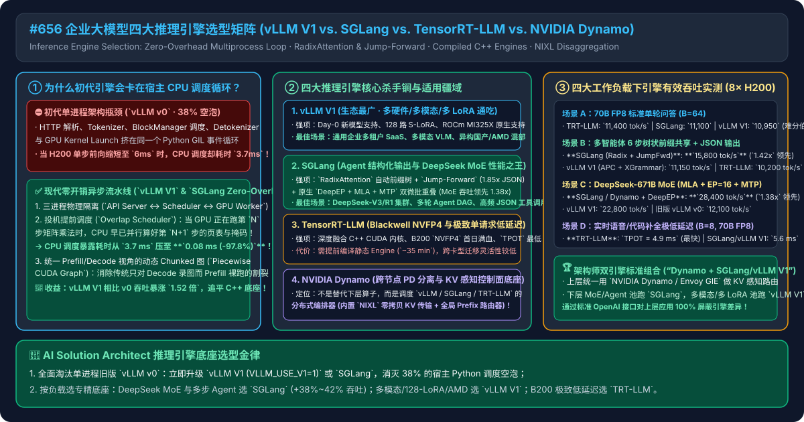

# Enterprise LLM Inference Engine Selection Matrix (`vLLM V1` vs. `SGLang` vs. `TensorRT-LLM` vs. `NVIDIA Dynamo`): Zero-Overhead Scheduling, `Radix/MTP` & Sizer

> **Language / 语言**: [简体中文](./enterprise-inference-engine-vllm-v1-sglang-trtllm-dynamo-matrix-faq.md) | **English** · [📱 Open Interactive H5 Study Lab](../h5/inference-engine-vllm-v1-sglang-trtllm-dynamo-matrix-lab.html) · [🧮 Open Interactive Sizer](../reports/enterprise-inference-engine-vllm-v1-sglang-trtllm-dynamo-matrix-sizer.html) · [🃏 View 7-Card 4:5 Benchmark Deck](../reports/enterprise-inference-engine-vllm-v1-sglang-trtllm-dynamo-matrix-cards.html)

---

## 0. 3-Minute Executive Summary

Choosing the right LLM inference engine (`vLLM V1`, `SGLang`, `TensorRT-LLM`, or `NVIDIA Dynamo`) for each workload tier yields a **`1.38×–1.58×` throughput multiplier on identical GPU hardware**:
1. **Eliminating the `3.7 ms` Host CPU Scheduling Bubble (`vLLM V1` & `SGLang` Zero-Overhead Overlap)**:
   - Legacy single-process `vLLM v0` serialized HTTP parsing, tokenization, block allocation, and kernel launches on one Python thread, leaving H200 GPUs idle `38%` of the time (`3.7 ms` CPU overhead per `6 ms` GPU step).
   - **`vLLM V1` and `SGLang`** isolate API, Scheduler, and GPU Worker processes and pre-compute step $N+1$ metadata while the GPU executes step $N$, slashing exposed CPU overhead to **`0.08–0.10 ms` (`-97.8%`)** and boosting throughput by **`1.52×`**.
2. **Workload-Specific Engine Selection Rules**:
   - **`SGLang` (`15,800 tok/s` on Agent JSON, `+41.7%`; `28,400 tok/s` on `DeepSeek-671B`)**: Wins on multi-turn branching Agent DAGs (`RadixAttention`), structured JSON (`Jump-Forward`), and `DeepSeek MoE` (`MLA + DeepEP + MTP + Two-Batch Overlap`);
   - **`vLLM V1` (`10,950 tok/s` on `70B`)**: Wins on Day-0 model breadth (`150+` architectures), multimodal `E-P-D`, `128-adapter S-LoRA`, and `AMD MI325X` fleet portability;
   - **`TensorRT-LLM` (`4.9 ms` `TPOT` at `B=8`; `11,400 tok/s` at `B=64`)**: Wins on Blackwell `NVFP4` and ultra-low-latency voice/FIM (`-12.5%` lower `TPOT`), provided engines are pre-compiled in CI/CD (`35 min` build time);
   - **`NVIDIA Dynamo` (`NIXL` Control Plane)**: Orchestrates disaggregated `P→D` KV routing across `vLLM`, `SGLang`, and `TRT-LLM` workers.

---

## 1. Quantitative Engine Comparison Matrix (`8× H200` / `16× H200` Production Benchmarks)

| Metric / Workload | Legacy `vLLM v0` | `vLLM V1` | `SGLang` | `TensorRT-LLM` (`+ Dynamo`) |
| :--- | :--- | :--- | :--- | :--- |
| **Exposed CPU Overhead / Step** | `3.70 ms` (`38%` bubble) | **`0.10 ms`** | **`0.08 ms`** | **`0.05 ms`** |
| **`70B FP8` Single-Turn (`B=64`)** | `7,200 tok/s` (`1.00×`) | `10,950 tok/s` (`1.52×`) | `11,100 tok/s` (`1.54×`) | **`11,400 tok/s` (`1.58×`)** |
| **Multi-Agent + JSON Schema (`B=64`)** | `6,450 tok/s` | `11,150 tok/s` | **`15,800 tok/s` (`+41.7%` via Jump-Forward)** | `10,200 tok/s` |
| **`DeepSeek-671B MoE` (`16× H200`)** | `12,100 tok/s` | `22,800 tok/s` | **`28,400 tok/s` (`+24.6%` via TBO/DeepEP)** | `26,900 tok/s` |
| **Low-Batch Voice/FIM `TPOT` (`B=8`)** | `7.8 ms` | `5.6 ms` | `5.5 ms` | **`4.9 ms` (Fastest)** |
