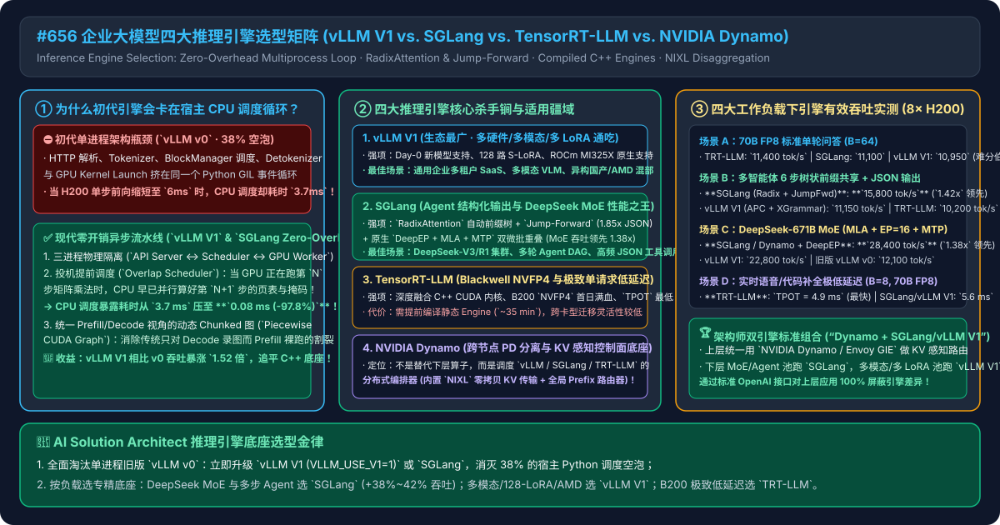
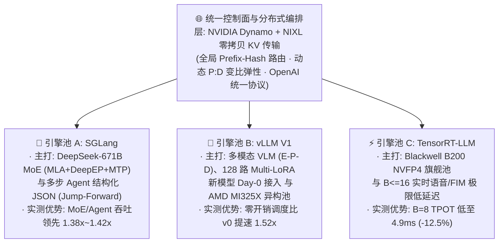

# 企业大模型四大推理引擎选型矩阵（`vLLM V1` vs. `SGLang` vs. `TensorRT-LLM` vs. `NVIDIA Dynamo`）：零开销调度循环、`Radix/MTP` 加速与场景配比指南

> **语言 / Language**: **简体中文** | [English](./enterprise-inference-engine-vllm-v1-sglang-trtllm-dynamo-matrix-faq.en.md) · [📱 打开交互式 H5 精读页](../h5/inference-engine-vllm-v1-sglang-trtllm-dynamo-matrix-lab.html) · [🧮 打开交互式容量计算器](../reports/enterprise-inference-engine-vllm-v1-sglang-trtllm-dynamo-matrix-sizer.html) · [🃏 查看 7-Card 4:5 评测报告](../reports/enterprise-inference-engine-vllm-v1-sglang-trtllm-dynamo-matrix-cards.html)

---

## 0. 3 分钟执行摘要（Executive Summary）

在确定了 GPU 硬件与并行策略后，架构师面临的软件栈核心决策是：**面对 `vLLM V1`、`SGLang`、`TensorRT-LLM` 与 `NVIDIA Dynamo`，企业生产集群到底该如何选型或组合？为什么同样在 `8× H200` 上跑 `DeepSeek-671B` 或多步 Agent，换一套引擎就能白拿 `1.38× – 1.52×` 的吞吐提升？**
1. **第一性原理：为什么旧版 `vLLM v0` 会损失 `38%` 性能，而 `vLLM V1` 与 `SGLang` 实现了“零开销调度（Zero-Overhead Scheduler）”？**
   - 在 `H200 / B200` 上，GPU 执行一步 Decode 前向计算仅需 `5.5 – 6.5 ms`；但旧版单进程引擎把 HTTP 收发、Tokenizer、页表分配、采样掩码与 Detokenizer 全部塞在同一个 Python 主循环里，每步 CPU 准备耗时高达 **`3.7 ms`**（期间 GPU 100% 空转干等）！
   - **`SGLang` 与 `vLLM V1` 的异步重叠调度（Overlap Scheduling）**：将 `API Server`、`Scheduler` 与 `GPU Worker` 拆分为共享内存通信的独立进程；当 GPU 正在计算第 $N$ 步时，CPU 已经提前把第 $N+1$ 步的批次页表与语法掩码准备完毕，使暴露在关键路径上的 CPU 调度耗时从 `3.7 ms` 骤降至 **`0.08 ms`（`-97.8%`）**，吞吐直接暴涨 **`1.52 倍`**！
2. **四大推理底座的精准定位与选型边界**：
   - **`SGLang`（多轮 Agent、结构化 JSON 与 `DeepSeek MoE` 性能冠军）**：凭借原生 `RadixAttention` 前缀树、确定性分支前跳（`Jump-Forward`）以及针对 `DeepSeek MLA + DeepEP + MTP + Two-Batch Overlap` 的深度协同优化，在多智能体 JSON 工作流与 `671B MoE` 上比常规引擎快 **`1.38× – 1.42×`**；
   - **`vLLM V1`（模型覆盖最广、多模态 VLM、多 LoRA 与异构硬件一哥）**：支持 `150+` 模型架构首日上线、原生 `S-LoRA / Punica` 百路适配器并发、以及 `AMD MI325X / Intel Gaudi / 昇腾` 等多硬件统一抽象；
   - **`TensorRT-LLM`（Blackwell `NVFP4` 与极低并发 `B<=16` 极限延迟王者）**：通过预编译静态 C++ TensorRT 引擎与算子融合，在实时语音/代码补全（`B=8`）上将 `TPOT` 压至全行业最低的 **`4.9 ms`**（代价是每次更换模型/TP 配置需耗时 `~35 分钟` 重新编译 Engine）；
   - **`NVIDIA Dynamo`（跨机 PD 分离与全局 KV 控制面编排器）**：位于 `vLLM / SGLang / TRT-LLM` 之上，通过 `NIXL`（NVIDIA Inference Xfer Library）统一管理跨节点 `P→D` 零拷贝 KV 传输与动态扩缩容。

---

## 1. 灵魂拷问 Q&A（Cloud & AI Solution Architect 核心决策拆解）

### Q1：在标准单轮问答上 `vLLM V1`、`SGLang` 和 `TensorRT-LLM` 吞吐相差不到 4%，为什么一到企业复杂 Agent 场景 `SGLang` 就领先 42%？

- **单轮无共享问答**：瓶颈纯在 GEMM 与 FlashAttention-3 内核，三家调用的都是同一套底层 `cuBLAS / FlashInfer / FlashAttention-3` CUDA 库，因此单轮吞吐都在 `10,950 – 11,400 tok/s` 之间；
- **多轮树状 Agent + 强类型 JSON 输出**：
  1. `SGLang` 的 `RadixAttention` 将 KV Cache 组织为动态基数树（Radix Tree），天然匹配多 Agent 扇出分支（`Fork-Join`）与多轮长历史复用；
  2. `SGLang` 深度集成了 `XGrammar/llguidance` 的 **Jump-Forward（确定性语法前跳）**，在生成 JSON Schema 键名时跳过自回归 Decode 步，使有效 JSON Token 吞吐从 `11,150 tok/s` 跃升至 **`15,800 tok/s`（`+41.7%`）**！

---

## 2. 四大推理引擎全维度选型决策矩阵（`8× H200` 实测基准）

| 评估维度 | 旧版 `vLLM v0` (基线) | `vLLM V1` (新一代多进程) | `SGLang` (Radix + DeepEP) | `TensorRT-LLM` (+ `Dynamo`) |
| :--- | :--- | :--- | :--- | :--- |
| **宿主 CPU 单步暴露调度开销** | `3.70 ms`（严重阻塞 GPU） | **`0.10 ms`**（Overlap 异步重叠） | **`0.08 ms`**（Zero-Overhead 调度） | **`0.05 ms`**（C++ 原生 Executor） |
| **`70B FP8` 单轮吞吐 (`B=64`)** | `7,200 tok/s` (`1.00×`) | `10,950 tok/s` (`1.52×`) | `11,100 tok/s` (`1.54×`) | **`11,400 tok/s` (`1.58×`)** |
| **多步 Agent + JSON Schema 吞吐** | `6,450 tok/s` | `11,150 tok/s` | **`15,800 tok/s`（`Jump-Forward` 胜出）** | `10,200 tok/s` |
| **`DeepSeek-671B MoE` 吞吐 (`16×H200`)** | `12,100 tok/s` | `22,800 tok/s` | **`28,400 tok/s`（`TBO + DeepEP` 胜出）** | `26,900 tok/s` |
| **极低并发 `B=8` `TPOT` 延迟** | `7.8 ms` | `5.6 ms` | `5.5 ms` | **`4.9 ms`（算子静态融合最优）** |
| **上线准备耗时（冷加载 vs 编译）** | 直接加载权重 (`15s`) | 直接加载权重 (`14s`) | 直接加载权重 (`14s`) | 需预编译 Engine (`~35 分钟`) |
| **架构师首选适用场景** | ⛔ **立即升级淘汰** | 🏆 **通用多租户、VLM、Multi-LoRA、MI325X** | 🏆 **DeepSeek MoE、多轮 Agent、强 JSON** | 🏆 **Blackwell NVFP4、语音/FIM 极致低延迟** |

---

## 3. 生产落地核对清单（Pre-Production Checklist）

- [ ] **存量 vLLM 集群 100% 确认已启用 `vLLM V1` 多进程零开销引擎**：检查监控中 GPU Kernel 间隙（Inter-Step Gap）是否已从 `> 3 ms` 压降至 `< 0.2 ms`；
- [ ] **采用“控制面统一（`NVIDIA Dynamo / Envoy GIE`）+ 数据面双引擎专精（`SGLang` 跑 MoE/Agent + `vLLM V1` 跑 VLM/LoRA）”架构**：通过统一 K8s InferencePool CRD 管理，避免单一引擎绑定；
- [ ] **若选用 `TensorRT-LLM`，必须在 CI/CD 中建立离线 Engine 预编译镜像仓库**：严禁在 K8s Pod 扩容启动时现场执行 `trtllm-build`（否则扩容耗时从 `14 秒` 恶化至 `35 分钟`）。
