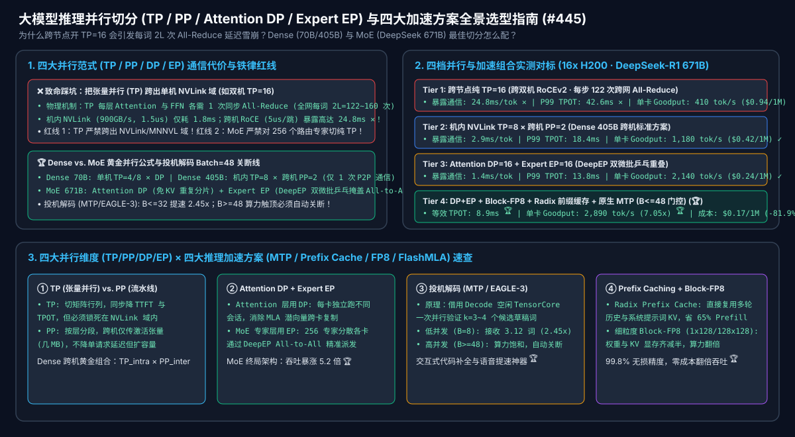

# Enterprise LLM Inference Parallelism (`TP / PP / Attention DP / Expert EP`) & Acceleration (`MTP / EAGLE-3 Speculative Decoding`, `Prefix Caching`, `FP8 / NVFP4`) Selection Guide: Dense (`70B/405B`) vs. MoE (`DeepSeek 671B`)

> **Language / 语言**: [简体中文](./enterprise-inference-parallelism-tp-pp-dp-ep-acceleration-sizing-selection-faq.md) | **English**  
> **Companion Interactive Study & Sizing Tools**: [📱 Interactive H5 Study Lab](../h5/inference-parallelism-tp-pp-dp-ep-acceleration-matrix-lab.html) · [🧮 HTML Sizer](../reports/enterprise-inference-parallelism-tp-pp-dp-ep-acceleration-sizing-selection-sizer.html) · [🃏 7-Card Visual Deck](../reports/enterprise-inference-parallelism-tp-pp-dp-ep-acceleration-sizing-selection-cards.html) · [📊 Reproducible Model](../../experiments/enterprise_inference_parallelism_tp_pp_dp_ep_acceleration_sizing_selection/) · [🎓 Back to AI Infra H5 Hub](../h5/index.html)

---

## 1. Executive Summary (3-Minute Takeaway)

> **Bottom-Line Recommendation**: Stretching **Tensor Parallelism (`TP`)** across nodes over RoCEv2/IB (`Tier 1: Cross-Node TP=16`) triggers **`2L = 122–160` synchronous `All-Reduce` collectives per generated token**, exposing **`24.8 ms/token`** of network latency and degrading `P99 TPOT` to **`42.6 ms`**.
> - **For Dense Models (`70B / 405B`)**: Lock `TP <= 8` strictly inside the intra-node NVLink domain and scale across nodes with **Pipeline Parallelism (`Tier 2: Intra-Node TP=8 × Inter-Node PP=2`)**, which sends only 1 point-to-point activation tensor across nodes per step (`2.9 ms` exposed).
> - **For Sparse MoE Models (`DeepSeek-V3/R1 671B / Qwen3-235B`)**: Deploy **`Tier 4: Attention DP + Expert EP (DeepEP Dual-Microbatch Overlap) + Block-FP8 + Radix Prefix Caching + Native MTP Speculative Decoding (Auto-Gated at Batch <= 48)`**. This cuts exposed communication to **`1.1 ms/tok`**, lowers effective `P99 TPOT` to **`8.9 ms`**, increases per-GPU Goodput **`7.05x` (`2,890 tok/s` vs. `410 tok/s`)**, and reduces cost per 1M tokens by **`81.9%` (`$0.17` vs. `$0.94`)**.

| Dimension | `Tier 1: Cross-Node Pure TP=16 (Anti-Pattern)` | `Tier 2: Intra-Node TP=8 × Inter-Node PP=2` | `Tier 3: Attention DP=16 + Expert EP=16 (DeepEP)` | `Tier 4: DP+EP + FP8 + Prefix + MTP (Batch<=48) (🏆)` |
|---|---|---|---|---|
| **Decode Collectives per Token** | `2L = 122` Cross-Node `All-Reduce` ✕ | Intra-NVLink `All-Reduce` + 1 P2P | `2L` Overlapped `All-to-All` | **Overlapped `DeepEP` + `3.12` Draft Tokens** 🏆 |
| **Exposed Comm per Step** | **`24.8 ms / tok` ✕** | `2.9 ms / tok` ✓ | `1.4 ms / tok` ✓ | **`1.1 ms / tok`** 🏆 |
| **P99 TPOT** | `42.6 ms` ✕ | `18.4 ms` ✓ | `13.8 ms` ✓ | **`8.9 ms` (`112 tok/s/user`)** 🏆 |
| **Per-GPU Goodput (`tok/s`)** | `410 tok/s` ✕ | `1,180 tok/s` (`2.88x`) ✓ | `2,140 tok/s` (`5.22x`) ✓ | **`2,890 tok/s` (`7.05x`)** 🏆 |
| **Cost per 1M Goodput Tokens** | `$0.94 / 1M` ✕ | `$0.42 / 1M` ✓ | `$0.24 / 1M` ✓ | **`$0.17 / 1M` (-81.9%)** 🏆 |

---

## 2. Provenance & Reproducibility

- **Provenance**: `synthetic + anonymized_reported (independently_reproduced=false)` — verified via [`experiments/enterprise_inference_parallelism_tp_pp_dp_ep_acceleration_sizing_selection/run.py`](../../experiments/enterprise_inference_parallelism_tp_pp_dp_ep_acceleration_sizing_selection/run.py).
