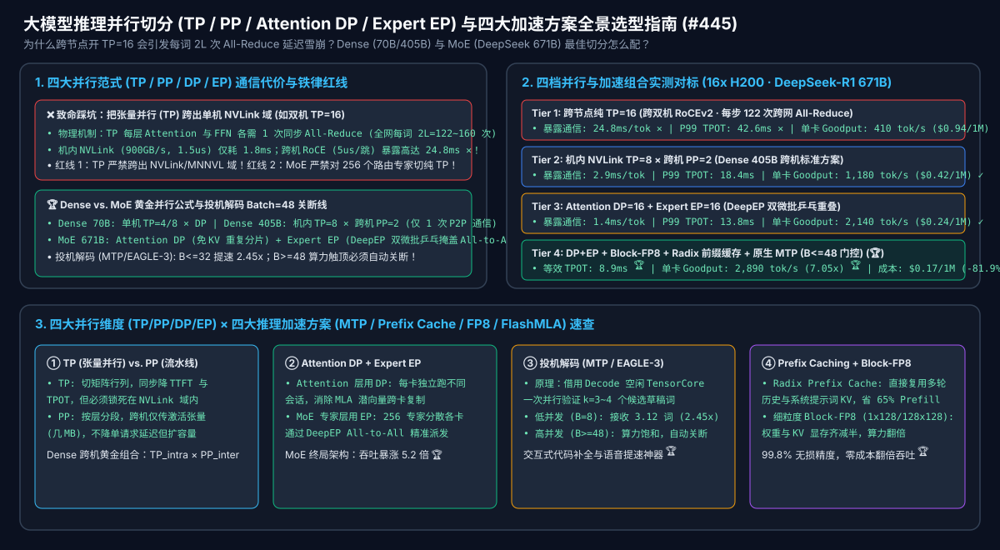
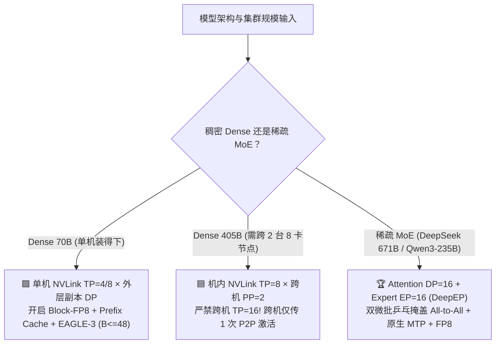

# 大模型推理并行切分（`TP / PP / Attention DP / Expert EP`）与四大加速方案（投机解码 `MTP/EAGLE-3`、Prefix Caching、`FP8/NVFP4` 量化）选型：Dense (`70B/405B`) vs. MoE (`DeepSeek 671B`) 最佳组合与通信手算指南

> **语言 / Language**: **简体中文** | [English](./enterprise-inference-parallelism-tp-pp-dp-ep-acceleration-sizing-selection-faq.en.md)  
> **配套交互式学习与精算工具**: [📱 交互式 H5 精读页 (TP/PP/DP/EP 并行切分与推理加速沙盘)](../h5/inference-parallelism-tp-pp-dp-ep-acceleration-matrix-lab.html) · [🧮 HTML 交互式计算器](../reports/enterprise-inference-parallelism-tp-pp-dp-ep-acceleration-sizing-selection-sizer.html) · [🃏 7-Card 4:5 视觉评测卡](../reports/enterprise-inference-parallelism-tp-pp-dp-ep-acceleration-sizing-selection-cards.html) · [📊 可复核模型](../../experiments/enterprise_inference_parallelism_tp_pp_dp_ep_acceleration_sizing_selection/) · [🎓 返回 AI Infra 全景精学馆](../h5/index.html)

---

## 一、3 分钟看懂核心结论（Executive Summary）

> **一句话决策结论**：为大模型规划推理并行切分时，**最大的性能杀手是“把张量并行（TP）跨出单机 NVLink 域（如双机 `TP=16`）”以及“对稀疏 MoE 模型照搬稠密模型的纯 TP 切分”**！因为 TP 在每一层 Transformer 的 Attention 与 FFN 后各触发 1 次同步 `All-Reduce`（每生成 1 个 Token 需执行 **`2L = 122 ~ 160` 次集合通信**），一旦跨出机内 `900 GB/s NVLink` 走到跨机 `400G RoCEv2/IB`，仅通信延迟就会每步暴露 **`24.8 ms`**，导致 `P99 TPOT` 恶化至 **`42.6 ms`**！
> - **Dense 稠密模型（`70B / 405B`）黄金切分公式**：**`机内 NVLink TP=4/8 × 跨机 PP=2/4 × 外层副本 DP`**。将高频 `All-Reduce` 100% 锁死在机内 NVLink，跨机仅传递层间微小的激活张量（每步仅 1 次 P2P 通信，暴露 `<2.9 ms`）；
> - **稀疏 MoE 模型（`DeepSeek-V3/R1 671B / Qwen3-235B`）终局组合（`Tier 4：Attention DP + Expert EP [DeepEP 双微批乒乓重叠] + 细粒度 Block-FP8 + Radix Prefix Caching + 原生 MTP 投机解码 [Batch<=48 自动门控]`）**：
>   1. **解耦并行（`Attention DP + Expert EP`）**：Attention 层采用数据并行（避免 MLA 压缩潜向量在多卡间重复复制），路由专家层采用专家并行（`EP=16~72`），并通过 `DeepEP IBGDA` 双微批（Dual-Microbatch Ping-Pong）将 `All-to-All` 通信掩盖在计算之下（净暴露通信仅 **`1.1~1.4 ms`**）；
>   2. **叠加三大正交加速**：开启 `Block-FP8 (1x128/128x128)` 显存减半算力翻倍、`RadixAttention` 前缀缓存省去 `50%~80%` 重复 Prefill，并在中低并发（`Batch <= 48`）下开启原生 `MTP / EAGLE-3` 投机解码（单步验证接收 `3.12` 个词），将等效 `P99 TPOT` 压至 **`8.9 ms`**，单卡有效吞吐（Goodput）从 `410 tok/s` 暴涨至 **`2,890 tok/s`（提升 `7.05 倍`）**，单百万 Token 成本降至 **`$0.17`（立省 `81.9%`）**！

| 核心选型维度 | `Tier 1: 跨节点纯 TP=16 (双机 RoCEv2 反模式)` | `Tier 2: 机内 NVLink TP=8 × 跨机 PP=2` | `Tier 3: Attention DP=16 + Expert EP=16 (DeepEP)` | `Tier 4: DP+EP + Block-FP8 + Prefix + MTP (🏆)` |
|---|---|---|---|---|
| **每步 Decode 通信原语** | `2L = 122` 次跨网同步 `All-Reduce` ✕ | 机内 NVLink `All-Reduce` + 跨机 1 次 `P2P` | `2L` 次 `All-to-All` (双微批计算重叠) | **双微批重叠 `DeepEP` + 单步验 `3.12` 词** 🏆 |
| **每步净暴露通信耗时** | **`24.8 ms / tok` ✕ (跨机延迟墙)** | `2.9 ms / tok` ✓ | `1.4 ms / tok` ✓ | **`1.1 ms / tok`** 🏆 |
| **流式吐字延迟 (`P99 TPOT`)** | `42.6 ms` ✕ | `18.4 ms` ✓ | `13.8 ms` ✓ | **`8.9 ms` (等效单用户 `112 tok/s`)** 🏆 |
| **单张 H200 有效吞吐 (`Goodput`)** | `410 tok/s` ✕ | `1,180 tok/s` (`2.88x`) ✓ | `2,140 tok/s` (`5.22x`) ✓ | **`2,890 tok/s` (`7.05x`)** 🏆 |
| **每百万达标 Token 成本 (`$/1M`)** | `$0.94 / 1M` ✕ | `$0.42 / 1M` ✓ | `$0.24 / 1M` ✓ | **`$0.17 / 1M` (-81.9%)** 🏆 |

---

## 二、核心技术原理与架构师灵魂拷问（Q&A）

### Q1：`TP`、`PP`、`DP`、`EP` 四种并行分别切什么？各自改善哪个指标（`TTFT` vs. `TPOT` vs. 系统总吞吐）？通信代价怎么手算？
1. **四大并行维度全景解剖**：
   - **`TP（张量并行 Tensor Parallelism）`**：切单层矩阵的列（Column Parallel）与行（Row Parallel）。`N` 张卡共同算同一个请求、同时分摊权重与 HBM 带宽，因此**唯一能同时降低单请求 `TTFT` 和 `TPOT`**！但代价是每层必须做 **2 次 `All-Reduce`**（全模型每词 $2L$ 次）：
     $$T_{\text{TP\_comm}} = 2L \times \left[ 2(N-1)\cdot \alpha_{\text{lat}} + \frac{2(N-1)}{N}\cdot \frac{B \cdot H \cdot \text{Bytes}}{\text{BW}_{\text{link}}} \right]$$
     在机内 NVLink（$\alpha \approx 1.5\;\mu\text{s}$，$\text{BW}=900\text{ GB/s}$）上，$2L=122$ 次通信仅需 `1.8 ms`；一旦跨机走 RoCEv2（每次 Ring 同步叠加微秒级网卡/交换机跳数），仅固定延迟项就会吃掉 **`20~25 ms`**！
   - **`PP（流水线并行 Pipeline Parallelism）`**：按层分段（如卡 0~7 放第 1~40 层，卡 8~15 放第 41~80 层）。跨节点每生成 1 个词只需在阶段边界做 **`P-1` 次点对点（P2P）Send/Recv**（仅传几 MB 激活值，无需跨网 `All-Reduce`！）。**PP 用于装下超大模型显存并维持高并发吞吐，但不能降低单请求延迟**。
   - **`DP / Attention DP（数据并行 / 注意力数据并行）`**：每张（或每组）卡拥有完整注意力权重，独立处理不同用户的会话。**零跨卡通信开销，线性扩展系统总吞吐（RPS/TPM）**，且在 DeepSeek MLA 中避免了所有 TP 卡重复存储相同的压缩 KV 潜向量。
   - **`EP（专家并行 Expert Parallelism）`**：专为 MoE 打造。将每层的 `128~256` 个路由专家（Routed Experts）分散在不同 GPU 上，计算前通过 `All-to-All Dispatch` 把 Token 发往目标专家所在卡，算完后再通过 `All-to-All Combine` 收回。借助 `DeepEP` 的 **双微批乒乓调度（Microbatch A 算 Attention 时，Microbatch B 走 RDMA 传专家 Token）**，可将 `85%+` 的通信耗时完美隐藏。

### Q2：投机解码（Speculative Decoding：`MTP / EAGLE-3`）、`Prefix Caching` 与 `FP8 / INT4` 量化分别在什么条件下收益最大？为什么投机解码在 `Batch >= 48` 时必须自动关断？
1. **投机解码（`Native MTP / EAGLE-3`）的算力借用原理与 Batch 关断红线**：
   - 在中低并发（$B \le 32$）Decode 阶段，GPU 处于严重的显存带宽受限区（算术强度 $\text{AI} = B \ll 295$，Tensor Core 算力 `85%+` 空闲）。投机解码先用极轻量的草稿头（如 DeepSeek 原生 14B `MTP` 层或 `EAGLE-3`）猜出 $k=3\sim 4$ 个候选词，再让主模型**只读一次权重同时验证这 $k+1$ 个词**！
   - **收益与反转边界**：当 $B=8$ 时，平均每步接受 $\tau = 3.12$ 个词，等效 `TPOT` 从 `21.8 ms` 降至 **`8.9 ms`（提速 `2.45 倍`）**；但当并发 $B \ge 48$ 时，每个请求带 4 个候选词会使有效验证 Token 数膨胀至 $48 \times 4 = 192$，一举撞上 GPU 算力屋脊点，导致单步验证耗时翻倍、净加速比跌破 `1.0x`（在 $B=96$ 时反而减速至 `0.84x`）！因此生产引擎必须配置 **`max_speculative_batch_size = 48` 动态关断门禁**。
2. **`Prefix Caching`（基数树前缀缓存）與 `Block-FP8 / W4A16 / NVFP4` 量化选型**：
   - **Prefix Caching（vLLM Automatic Prefix Caching / SGLang RadixAttention）**：直接命中多轮对话历史、长系统提示词与 Few-Shot 模板的 KV 块，**将首字 `TTFT` 与 Prefill 算力消耗直接削减 `50%~85%`**；
   - **量化选型铁律**：高并发生产集群（Hopper/Blackwell/MI300X）首选 **`细粒度 Block-FP8 (W8A8)`**（权重与激活同为 8-bit，直接调用 FP8 Tensor Core，显存减半且算力翻倍，`99.8%` 无损精度）；单卡显存受限且低并发（$B \le 16$）选 **`W4A16 AWQ/Marlin`**（省权重显存，但计算时需反量化回 FP16，高并发下受限于反量化算子开销）；Blackwell `B200/GB200` 经校准后首选硬件原生 **`NVFP4`**。

---

## 三、生产落地 Checklist（Pre-Production Checklist）

- [ ] **严禁将 `TP` 跨出 NVLink 超节点域**：在标准 8 卡 HGX 服务器上，强制限制 `tensor_parallel_size <= 8`；跨机扩展一律使用 `PP`（Dense 模型）或 `Attention DP + Expert EP`（MoE 模型）。
- [ ] **MoE 模型强制开启 `Attention DP`（如 SGLang `--enable-dp-attention` / vLLM `--data-parallel-size`）**：避免 8 张或 16 张卡在 MLA Attention 层重复存储一模一样的 KV Cache。
- [ ] **投机解码配置动态 Batch 门控**：启用原生 `MTP` 或 `EAGLE-3` 时，配置当活跃 Decode Batch $> 48$ 时自动回退为标准自回归解码，兼顾低并发极速响应与高并发峰值吞吐。

---

## 四、来源与方法论溯源（Provenance）

- **数据来源声明**：本指南实验数据来自可复核解析模型 [`experiments/enterprise_inference_parallelism_tp_pp_dp_ep_acceleration_sizing_selection/run.py`](../../experiments/enterprise_inference_parallelism_tp_pp_dp_ep_acceleration_sizing_selection/run.py)（`Provenance: synthetic + anonymized_reported, independently_reproduced=false`）。
