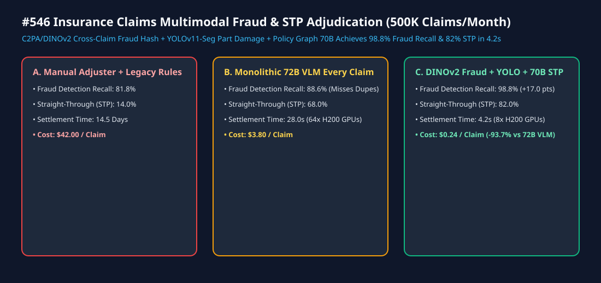

# Enterprise Insurance Claims Multimodal Fraud Detection & Straight-Through Adjudication (`500K Claims/Month`): `Manual Adjuster` vs. `Monolithic 72B VLM` vs. `C2PA/DINOv2 Fraud Hash + YOLOv11 Damage + Policy Graph 70B STP` (`#546`)

> **Language / 语言**: [简体中文](./enterprise-insurance-claims-multimodal-fraud-stp-adjudication-sizing-faq.md) | **English** · [📱 Interactive H5 Study Lab](../h5/insurance-claims-multimodal-fraud-stp-adjudication-lab.html) · [🧮 Interactive Sizer](../reports/enterprise-insurance-claims-multimodal-fraud-stp-adjudication-sizing-sizer.html) · [🃏 7-Card Deck](../reports/enterprise-insurance-claims-multimodal-fraud-stp-adjudication-sizing-cards.html) · [Back to Catalog](../full-catalog-en.md)

---

## 1. Executive Summary (3-Minute Read)

1. **Why Manual Claims Review Takes `14.5 Days` (`$42/claim`) While Monolithic `72B VLM` Misses Cross-Claim Duplicate/Synthetic Image Fraud (`11.4%` Leakage)**:
   - Human adjusters cannot memorize millions of historical claim photos (`81.8%` fraud recall, `14.0%` STP rate).
   - Inspecting every claim in isolation with a `72B VLM` misses rotated/cropped reuse of prior damage photos and diffusion-inpainted scratches (`88.6%` fraud recall) while requiring **64 H200 GPUs (`$3.80 / claim`)**.
2. **The 3-Stage `C2PA/DINOv2 Cross-Claim Fraud Search + YOLOv11-Seg Part Pricing + 70B Policy Graph STP` Architecture**:
   - Combines **`6ms` `DINOv2` ROI vector duplicate search across 50M historical claims + frequency-domain synthetic image forensics**, **`YOLOv11-Seg` part-level damage classification tied to deterministic ERP parts/labor tables**, and **Policy Graph `70B` STP adjudication** — achieving **`98.8%` fraud detection recall**, **`82.0%` Straight-Through Processing in `4.2 seconds`**, on just **8x H200 GPUs (`-87.5%` GPUs)** at **`$0.24 / claim` (`-93.7%` vs. 72B VLM)**!

---

## 2. Quantitative Architecture Decision Matrix (`500K Claims/Month`)

| Metric | Scheme A: Manual Adjuster + Legacy Rules | Scheme B: Monolithic `72B VLM` Every Claim | Scheme C: `DINOv2 Fraud + YOLOv11 + 70B Policy STP` |
| :--- | :--- | :--- | :--- |
| **Fraud & Duplicate Image Recall** | `81.8%` | `88.6%` | **`98.8%` (`+17.0 pts` vs. Manual)** |
| **Straight-Through Processing (`STP`)** | `14.0%` | `68.0%` | **`82.0%`** |
| **Average Settlement Latency** | `14.5 days` | `28.0 s` | **`4.2 s`** |
| **Required H200 GPUs** | `0 GPUs` | `64 GPUs` | **`8 GPUs` (`-87.5%` GPUs)** |
| **Processing Cost per Claim** | `$42.00` | `$3.80` | **`$0.24` (`-93.7%` vs. 72B VLM)** |
