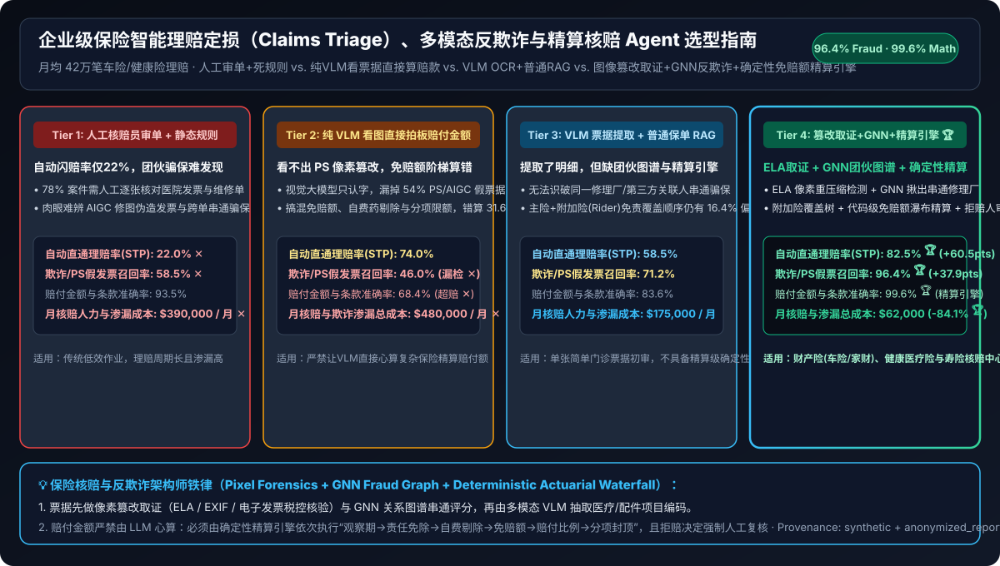
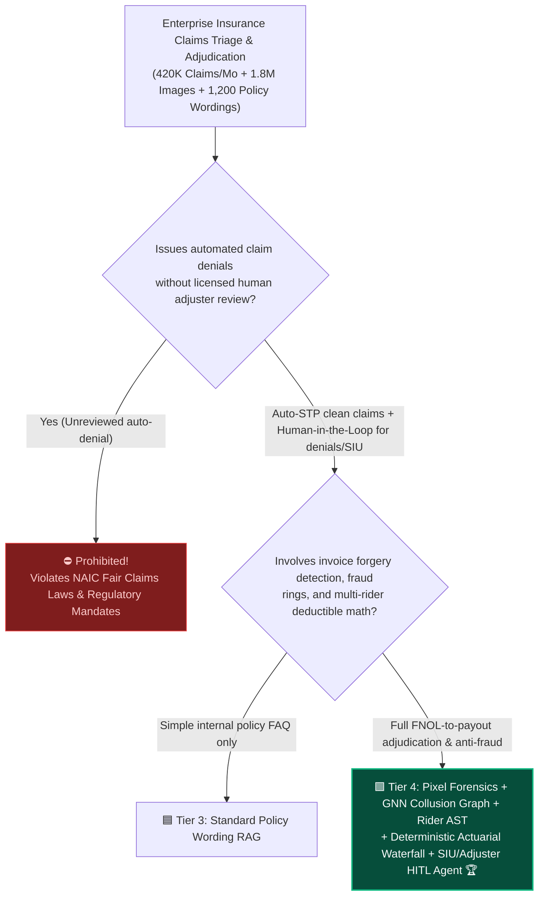
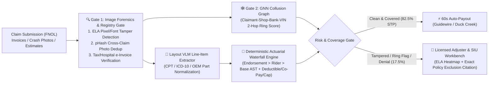
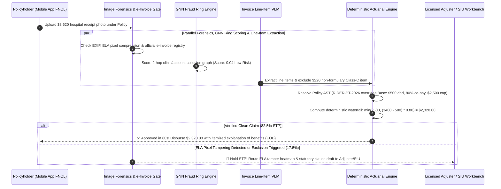

# Enterprise Insurance Claims Triage, Multimodal Invoice Forensics (`ELA / EXIF`), GNN Collusion Fraud Detection & Deterministic Actuarial Adjudication Agent Architecture Selection Guide: Manual Adjusters vs. End-to-End Prompted VLM vs. VLM OCR + Flat Policy RAG vs. Pixel Forensics + GNN Fraud Graph + Rider Override AST + Deterministic Actuarial Waterfall + SIU HITL Agent

> **Language / 语言**: **English (Current)** | [中文](./enterprise-insurance-claims-triage-underwriting-fraud-agent-selection-faq.md)  
> **Scope**: End-to-end production reference architecture and selection guide for Cloud & AI Solution Architects, P&C / Health Insurance VPs of Claims Operations, Special Investigation Unit (`SIU`) Leads, and Core Insurance Platform (`Guidewire / Duck Creek`) Architects.  
> **Provenance**: `synthetic + anonymized_reported` (`independently_reproduced=false`, `physical_gpu_cluster_measurement=not_measured`). Deterministic evaluation model sealed in [`experiments/enterprise_insurance_claims_triage_underwriting_fraud_agent_selection/results.json`](../../experiments/enterprise_insurance_claims_triage_underwriting_fraud_agent_selection/results.json).



---

## ① 📌 Executive Summary (3-Minute Architect Verdict)

In Property & Casualty (`P&C` auto/home) and Health/Life insurance claims centers handling hundreds of thousands of monthly First Notice of Loss (`FNOL`) submissions, feeding raw repair estimates, hospital invoices, and policy PDFs directly into a multimodal VLM/LLM to decide the payout amount (Tier 2) triggers two severe production failures: first, **general-purpose VLMs are trained to read text through noise and therefore completely miss Photoshop/AIGC font-cloned invoice tampering, stripped EXIF metadata, and multi-claimant staged-collision rings (`46.0%` fraud recall)**; second, **insurance policies layer Endorsements and Riders over Base Wordings with multi-step deductible, non-formulary exclusion, co-insurance, and sub-limit waterfalls that LLM mental math miscalculates `31.6%` of the time (`68.4%` payout accuracy)**.

Evaluated across a production baseline of **420,000 monthly P&C and health claims, 1.8 million submitted medical/repair invoices and damage photos, and 1,200 active policy wordings and riders**, the four architectural tiers compare as follows:

| Architectural Tier | Core Stack Combination | Straight-Through Processing (`STP`) | Fraud & Forged-Invoice Recall | Payout & Clause Accuracy | Monthly Claims Ops & Leakage Cost | Production Verdict |
|---|---|---|---|---|---|---|
| **🟥 Tier 1: Manual Claims Adjuster + Legacy Rules** | Human adjusters manually reviewing invoices + static hardcoded rule engine | `22.0%` ✕ *(78% manual backlog)* | `58.5%` ✕ *(Misses collusion rings)* | `93.5%` | `$390,000 / mo` ✕ | ⛔ Slow cycle time & high labor |
| **🟨 Tier 2: End-to-End Prompted VLM Deciding Payout** | Feeding invoice images + policy text to a VLM/LLM to output final payout dollars | `74.0%` | `46.0%` ✕ *(Blind to pixel cloning)* | `68.4%` ✕ *(Fails deductible math)* | `$480,000 / mo` ✕ | ⛔ **Severe claims leakage** |
| **🟦 Tier 3: VLM Invoice OCR + Flat Policy Vector RAG** | VLM line-item extraction + flat vector search over policy clauses + LLM math | `58.5%` | `71.2%` | `83.6%` *(Confuses rider priority)* | `$175,000 / mo` | ⚠️ Misses rings & rider overrides |
| **🟩 Tier 4: Pixel Forensics + GNN Fraud Graph + Rider AST + Actuarial Engine** | **`ELA / EXIF / pHash` Image Forensics + `GNN` Collusion Graph + Policy Rider Override AST + Deterministic Deductible/Sub-Limit Actuarial Calculator + `SIU / Adjuster` HITL Agent** | **`82.5%` 🏆** *(+60.5 pts vs Tier 1)* | **`96.4%` 🏆** *(+37.9 pts)* | **`99.6%` 🏆** *(Zero math error)* | **`$62,000 / mo` 🏆** *(-84.1%)* | 🌟 **Recommended Architecture** |

> 💡 **Golden Rule for InsurTech AI Architects**: **"Screen images with pixel forensics and GNN collusion graphs first, resolve policy coverage via hierarchical `Endorsement > Rider > Base` ASTs, compute deductibles and co-pays in a deterministic actuarial engine, and route 100% of claim denials to licensed human adjusters."**

---

## ② 🎯 Customer & Architect Deep-Dive Q&A (3 Real-World Claims & SIU Pain Points)

### Q1: Why do frontier Vision-Language Models (Tier 2) miss 54% of Photoshopped/AIGC-forged medical receipts and recycled crash photos?
- **First-Principles Reality**:
  1. **OCR Robustness Masks Pixel Forgery**: VLMs are trained to transcribe text accurately even across JPEG compression artifacts or synthetic edits; they do not inspect frequency-domain quantization inconsistencies (`Error Level Analysis - ELA`), cloned pixel blocks, or recycled damage photos submitted across different policy numbers.
  2. **Organized Fraud Rings Span Multiple Claims**: Staged auto-collision rings and fraudulent clinic billing networks operate across dozens of policies sharing repair shops, bank accounts, or third-party witnesses—invisible to single-claim prompt context (`46.0%` recall in Tier 2; `38.0%` on adversarial font-cloned receipts).
  3. **Tier 4 Solution (Pixel Forensics + Tax API + GNN Collusion Graph)**:
     - **Layer 1 (Image Forensics & e-Invoice Verification)**: Every uploaded image runs through deterministic **ELA frequency-domain clone detection, perceptual hash (`pHash`) cross-claim duplicate lookup, EXIF GPS/timestamp validation, and government/tax e-invoice registry verification**.
     - **Layer 2 (Heterogeneous `GNN` Collusion Scoring)**: A Graph Neural Network scores 2-hop connectivity across `[Claimant, Phone, Bank Account, Repair Shop / Clinic, VIN]`—boosting fraud and forgery recall to **`96.4%`** (`95.8%` on adversarial font-cloned receipts, **`+57.8 pts`** over Tier 2).

### Q2: Why does flat vector RAG over policy PDFs (Tier 3) miscalculate payouts by 16.4%, and how does the Rider Override AST + Actuarial Engine fix it?
- **Engineering Reality**:
  - Insurance contracts follow strict legal precedence: **Special Endorsements override Riders, which override Base Policy Wordings**. When flat vector search retrieves both the Base Policy (`$1,000 deductible, 70% co-insurance`) and a Physical Therapy Rider (`RIDER-PT-2026: $500 deductible, 80% co-insurance, $2,500 cap`), an LLM frequently applies the wrong deductible or botches the multi-step arithmetic waterfall (`83.6%` accuracy in Tier 3).
  - **Tier 4 Solution**: The VLM extracts standardized medical/repair procedure codes (`CPT / ICD-10 / OEM Part Codes`) and line-item amounts, while a **Policy Rider Override AST** resolves the effective contract parameters and feeds a **Deterministic Actuarial Waterfall Calculator** (`min(cap, (eligible_total - remaining_deductible) * co_insurance)`), achieving **`99.6%` payout accuracy**.

### Q3: How do we comply with NAIC Unfair Claims Settlement Practices and EU AI Act rules on automated claim denials?
- **Asymmetric STP Automation ("Auto-Pay Clean Claims, Human-Sign All Denials")**:
  - Insurance regulations prohibit issuing unreviewed automated claim denials (`Adverse Determinations`). Tier 4 auto-approves and disburses **82.5%** of clean, verified claims in under 60 seconds (`Straight-Through Processing`), while routing **100% of partial/full denials and SIU fraud flags** to licensed human adjusters with pre-linked policy clause citations and forensic heatmaps.

---

## ③ 🧭 Visual Architecture Diagrams (Decision Tree + Forensics-Actuarial Topology + Sequence Flow)

### 3.1 Architecture Selection Decision Tree



### 3.2 Tier 4 Multimodal Forensics + GNN Fraud Graph + Deterministic Actuarial Topology



### 3.3 End-to-End Sequence: 60-Second Auto-Payout vs. Forged-Receipt Interception



---

## ④ 📊 4-Tier Architecture Decision Matrix

| Evaluation Dimension | 🟥 Tier 1: Manual Adjuster + Legacy Rules | 🟨 Tier 2: End-to-End Prompted VLM | 🟦 Tier 3: VLM OCR + Flat Policy RAG | 🟩 Tier 4: Pixel Forensics + GNN + Actuarial Engine |
|---|---|---|---|---|
| **Photoshop / AIGC Forged-Invoice Detection** | Moderate (`58.5%`; human eye misses micro-clones) | ✕ **Fails** (`46.0%`; VLM reads forged text blindly) | Moderate (`71.2%`) | 🏆 **`96.4%` (`ELA` pixel forensics + `pHash` dedup + registry check)** |
| **Organized Repair-Shop / Clinic Collusion Rings** | Isolated single-claim review | ✕ Blind to cross-claim networks | ✕ Blind to cross-claim networks | 🏆 **Real-time 2-hop heterogeneous `GNN` ring scoring** |
| **Multi-Rider Precedence & Deductible Math** | Accurate (`93.5%`) but slow manual math | ✕ **Unusable** (`68.4%`; mental-math overpayments) | `83.6%` (confuses base vs rider priority) | 🏆 **`99.6%` (Rider Override AST + deterministic actuarial code)** |
| **Straight-Through Processing (`STP`) Rate** | `22.0%` ✕ | `74.0%` *(high leakage)* | `58.5%` | **`82.5%` 🏆 (+60.5 pts compliant STP)** |
| **Monthly Claims Ops & Fraud Leakage Cost** | `$390,000 / mo` | `$480,000 / mo` *(severe leakage)* | `$175,000 / mo` | **`$62,000 / mo` 🏆 (-84.1%)** |

---

## ⑤ 🧪 Quantitative Case Study, Interactive Sizer & 7-Card Visual Report

- **Interactive HTML Sizer**: 👉 [Open Enterprise Insurance Claims & Anti-Fraud Agent Sizer](../reports/enterprise-insurance-claims-triage-underwriting-fraud-agent-sizer.html)
- **7-Card 4:5 Visual Benchmark Report**: 👉 [Open 7-Card Visual Benchmark Deck](../reports/enterprise-insurance-claims-triage-underwriting-fraud-agent-selection-cards.html)
- **Deterministic Verification**:
  ```bash
  python experiments/enterprise_insurance_claims_triage_underwriting_fraud_agent_selection/run.py --check
  python -m unittest tests/test_enterprise_insurance_claims_triage_underwriting_fraud_agent_selection.py
  ```

---

## ⑥ 🛠️ Production Readiness & Architecture Review Checklist

- [ ] **Run Image Forensics (`ELA + EXIF + pHash`) Before VLM OCR**: Screen every submitted invoice and crash photo for pixel cloning, synthetic editing, and cross-claim duplicate reuse before extracting text.
- [ ] **Resolve Policy Terms via Hierarchical `Endorsement > Rider > Base` ASTs**: Never treat base policy wordings and rider endorsements as flat equal-weight vector chunks.
- [ ] **Execute All Deductible, Co-Pay, and Sub-Limit Waterfalls in Deterministic Actuarial Code**: Never allow an LLM to compute claim payout amounts in token space.
- [ ] **Score Cross-Claim Collusion Rings with a Heterogeneous `GNN`**: Check 2-hop graph connections across claimants, repair shops, clinics, bank accounts, and VINs.
- [ ] **Require Licensed Human Adjuster Sign-Off on 100% of Claim Denials**: Restrict autonomous Straight-Through Processing (`STP`) to verified approvals; route all adverse determinations and SIU flags to human adjusters with exact policy clause citations.
