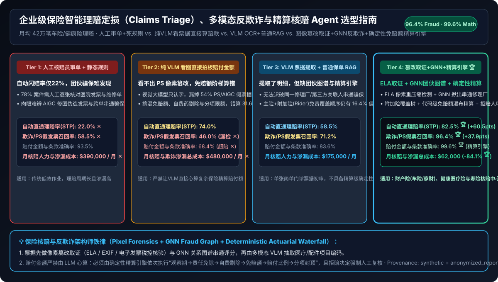
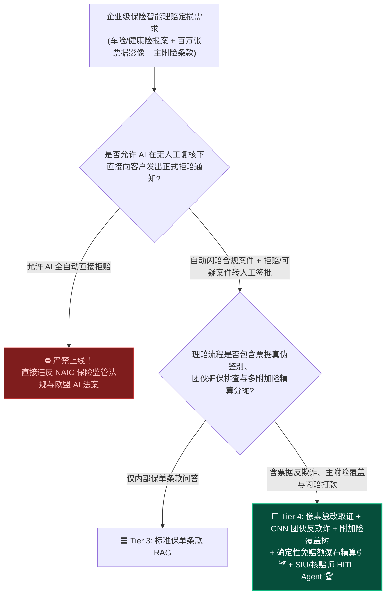
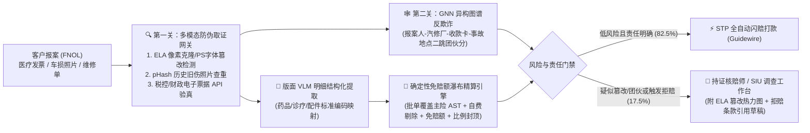

# 企业级保险智能理赔定损（Insurance Claims Triage & Adjudication）、票据多模态反欺诈（ELA/EXIF + GNN 团伙图谱）、主附险责任免除映射与精算核赔 Agent 架构选型指南：人工审单 + 静态规则 vs. 纯 VLM 看图心算赔款 vs. VLM OCR + 普通保单 RAG vs. 像素篡改取证 + GNN 团伙反欺诈 + 附加险 AST + 确定性免赔额瀑布精算引擎 + SIU/核赔师 HITL Agent

> **语言 / Language**: **中文 (当前)** | [English](./enterprise-insurance-claims-triage-underwriting-fraud-agent-selection-faq.en.md)  
> **定位**：面向云与 AI 解决方案架构师（Solution Architect）、财产险/健康险/寿险理赔运营总监（VP of Claims Operations）、反欺诈特别调查组（SIU）技术负责人与保险核心系统（Guidewire / Duck Creek）架构师的生产落地指南。  
> **数据口径（Provenance）**：`synthetic + anonymized_reported`（`independently_reproduced=false`，`physical_gpu_cluster_measurement=not_measured`），全部定容模型封存于 [`experiments/enterprise_insurance_claims_triage_underwriting_fraud_agent_selection/results.json`](../../experiments/enterprise_insurance_claims_triage_underwriting_fraud_agent_selection/results.json)。



---

## ① 📌 核心选型结论速览（Executive Summary — 3 分钟看懂怎么选）

在财产险（车险定损、家财险）与短期健康险/医疗险理赔中心，险企每天面临数以万计的报案（FNOL）、百万张医院收费票据、药品清单与汽修厂估价单。当前保险业落地理赔大模型时最致命的误区，是**把理赔照片和保单 PDF 一股脑喂给视觉大模型（VLM/LLM），让它直接输出“是否赔付及赔付金额”（Tier 2）**。这在生产中引发了双重灾难：第一，**通用 VLM 被训练为“努力看清模糊文字”，因此对 Photoshop/AIGC 克隆字体涂改金额、抹除 EXIF 拍摄信息以及同一汽修厂跨保单伪造碰撞等欺诈行为几乎毫无察觉（欺诈召回率跌至 `46.0%`）**；第二，**一张保单往往叠加了主险与多个附加险批单（Riders），涉及等待期、丙类自费药剔除、年度免赔额抵扣与分项限额封顶，让 LLM 心算赔付金额的错误率高达 `31.6%`（准确率仅 `68.4%`）**，造成巨额理赔渗漏（Claims Leakage）或恶意拒赔监管罚单。

在 **月均 420,000 笔车险与健康险理赔、1,800,000 张票据与事故影像、1,200 套主险与附加险批单条款** 的基准规模下，四档保险智能理赔与反欺诈 Agent 架构的量化对决如下：

| 方案档位 | 核心架构组合 | 自动直通闪赔率 (`STP`) | 欺诈 / PS 假票召回率 | 赔付金额与条款准确率 | 月度核赔人力与渗漏总成本 | 生产推荐度 |
|---|---|---|---|---|---|---|
| **🟥 Tier 1：传统人工核赔员审单 + 静态规则** | 人工逐张核对医院发票/定损单 + 传统死板规则引擎 | `22.0%` ✕ *(78%转人工积压)* | `58.5%` ✕ *(漏掉团伙串通)* | `93.5%` | `$390,000 / 月` ✕ | ⛔ 理赔慢且人力/渗漏双高 |
| **🟨 Tier 2：纯端到端 VLM 看图直接心算赔款** | 将发票照片与保单塞给 VLM/LLM 直接决定赔付金额 | `74.0%` | `46.0%` ✕ *(看不出PS篡改)* | `68.4%` ✕ *(免赔额阶梯算错)* | `$480,000 / 月` ✕ | ⛔ **严重超赔渗漏，严禁上线** |
| **🟦 Tier 3：VLM 票据提取 + 普通保单向量 RAG** | VLM 提取发票明细 + 扁平向量检索保单条款 + LLM 算账 | `58.5%` | `71.2%` | `83.6%` *(主附险覆盖顺序错)* | `$175,000 / 月` | ⚠️ 缺图谱反欺诈与精算确定性 |
| **🟩 Tier 4：像素篡改取证 + GNN 团伙图谱 + 附加险 AST + 确定性精算引擎** | **ELA/EXIF 像素篡改取证与税控核验 + `GNN` 关系图谱反欺诈 + 主附险覆盖树（Rider Override AST）+ 确定性免赔额瀑布精算引擎 + `SIU / 核赔师` 拒赔强复核 Agent** | **`82.5%` 🏆** *(+60.5 pts vs Tier 1)* | **`96.4%` 🏆** *(+37.9 pts)* | **`99.6%` 🏆** *(代码级零算术错)* | **`$62,000 / 月` 🏆** *(-84.1%)* | 🌟 **生产首选参考架构** |

> 💡 **架构师一句话选型铁律**：**“票据先过像素取证与税控铁闸、串通骗保归 GNN 关系图谱、主附险覆盖看批单语法树、赔付分摊进确定性精算瀑布、一切拒赔决定强制持证核赔师签字”**——让 82.5% 的清白小额案件 60 秒全自动闪赔，同时将黑产假票与团伙骗保精准拦截移交 SIU。

---

## ② 🎯 客户与架构师灵魂拷问 Q&A（直击 3 大保险理赔与反欺诈痛点）

### Q1：为什么通用多模态视觉大模型（GPT-4o / Qwen-VL 等，Tier 2）识别不出 Photoshop 或 AIGC 伪造的医疗发票和旧伤车损照片？
- **大白话与第一性原理**：
  1. **OCR 的优化目标与图像篡改取证正好相反**：视觉语言模型（VLM）的预训练目标是“抗噪语义识别”——哪怕图片经过重压缩、拼接或字体微调，VLM 也会尽力把上面的数字读成 `$3,800.00`；它根本不会去检查这几个数字的 JPEG 离散余弦变换（DCT）量化表是否与周围背景不一致！
  2. **跨案件团伙串通不在单张图片里**：黑产车险碰瓷团伙用同一辆二手豪车在不同时间段换不同驾驶员报案，或者同一批黄牛共用预留手机号/银行卡在特定非公立医院集中开具高额理疗发票，单次 Prompt 根本看不见跨保单的关联网络（Tier 2 欺诈召回率仅 **`46.0%`**）。
  3. **Tier 4 破局方案（像素取证 + 税控直连 + GNN 团伙图谱）**：
     - **第一关（图像数字取证与税控核验）**：前置轻量级 **误差水平分析（ELA）频域篡改检测 + 感知哈希（pHash 历史旧伤照片查重）+ EXIF 经纬度/时间窗校验 + 财政/税务电子票据 API 直连验真**。
     - **第二关（GNN 异构图网络反欺诈）**：实时查询 `[报案人 - 手机号 - 收款卡 - 维修厂/医院 - 事故定损员 - 车架号 VIN]` 六维异构图谱的二跳团伙风险分，将伪造发票与串通骗保召回率从 Tier 2 的 `38.0%`（对抗压测）飙升至 **`95.8%`（`+57.8 pts`）**！

### Q2：为什么用向量数据库检索保单条款（Tier 3）来算理赔金额，经常算错免赔额和附加险赔付比例？
- **工程真相**：
  - **保险合同的核心是“批单覆盖附加险、附加险覆盖主险（Endorsement > Rider > Base Policy）”的法律优先级**：例如主险规定“物理康复理疗年度免赔额 $1,000，赔付比例 70%”，但投保人额外购买了《尊享康复附加险批单（RIDER-PT-2026）》，将该项免赔额降为 `$500`、赔付比例提至 `80%`、年度封顶 `$2,500`。
  - 扁平向量检索（Tier 3）把主险和附加险切片一起召回，LLM 经常拿主险的旧免赔额去减，或者在计算“总费用剔除丙类自费药 → 扣除年度剩余免赔额 → 乘以赔付比例 → 对比分项限额封顶”的四步精算瀑布时心算出错（准确率仅 **`83.6%`**）。
  - **Tier 4 的主附险覆盖语法树 + 确定性精算瀑布**：VLM 只负责提取发票上的标准化医疗/配件项目编码与金额；系统根据保单号加载已按批单优先级合并后的结构化保障参数表，交由 **确定性精算代码引擎** 执行计算 `min(2500.00, (3400.00 - 500.00) * 0.80) = $2,320.00`，核赔金额准确率高达 **`99.6%`**。

### Q3：监管机构（如金融监管总局、美国 NAIC 模型法与欧盟 AI 法案）对保险 AI 理赔有什么绝对不可触碰的红线？
- **“顺畅闪赔可全自动，拒赔/削赔必经人审（No Automated Adverse Denial）”铁律**：
  - 多国保险法明确规定：保险公司不得仅凭自动化算法直接向被保险人发出**拒赔通知书（Claim Denial）**或定性欺诈。
  - Tier 4 在架构层实施严格的单向阀门：对于 **82.5%** 无欺诈风险、条款完全匹配的标准案件，系统走 **STP（Straight-Through Processing）全自动闪赔打款**；而对于触发责任免除（拒赔）或 GNN 反欺诈高危预警的 **17.5%** 案件，系统自动生成带具体保单条款章节号（如 `Clause RIDER-PT-2026 Sec 4.2`）与取证高亮图的核赔建议书，**100% 路由至持证人类核赔师或 SIU 调查员签批**。

---

## ③ 🧭 直观可视化图解（决策树 + 取证精算架构图 + 闪赔与反欺诈时序图）

### 3.1 保险智能理赔与反欺诈 Agent 选型决策树



### 3.2 Tier 4 多模态取证 + GNN 团伙图谱 + 确定性精算核赔架构图



### 3.3 从“上传医疗发票报案”到“60 秒自动闪赔 vs. PS 假票拦截”时序图

```mermaid
sequenceDiagram
    autonumber
    participant User as 投保人 (App 报案上传发票)
    participantELA as 图像取证与税控网关
    participant GNN as GNN 团伙反欺诈引擎
    participant VLM as 医疗票据 VLM 解析器
    participant Act as 确定性精算核赔引擎
    participant Adj as 持证核赔师 / SIU 工作台

    User->>ELA: 提交理疗发票照片 ($3,620) 与保单号 #POL-88412
    par 图像防伪取证、团伙图谱与票据明细提取并行
        ELA->>ELA: 校验 EXIF、ELA 频域重压缩特征与财政电子票据真伪
        GNN->>GNN: 计算收款账户与诊所二跳串通图谱分 (Score: 0.04 低风险)
        VLM->>Act: 提取明细并映射医保甲乙丙类编码 (剔除 $220 丙类非处方保健品)
    end
    Act->>Act: 加载保单主附险 AST (RIDER-PT-2026 覆盖主险：免赔额$500，赔付80%，封顶$2,500)
    Act->>Act: 确定性精算瀑布：min(2500, (3400 - 500) * 0.80) = $2,320.00
    alt 真实合规案件 (82.5% STP)
        Act-->>User: ✅ 60秒自动闪赔通过！打款 $2,320.00 并附精算明细单
    else 检出 ELA 像素克隆篡改或触发拒赔条款 (17.5%)
        ELA-->>Adj: 🚨 拦截自动打款！向核赔师/SIU 推送篡改热力图与法定拒赔条款草稿
    end
```

---

## ④ 📊 架构师四维选型决策矩阵（Architecture Decision Matrix）

| 评估维度 | 🟥 Tier 1：人工核赔 + 静态规则 | 🟨 Tier 2：纯 VLM 看图直接心算赔款 | 🟦 Tier 3：VLM OCR + 普通条款 RAG | 🟩 Tier 4：像素取证 + GNN 图谱 + 确定性精算引擎 |
|---|---|---|---|---|
| **PS/AIGC 假发票与旧伤照片识别** | 肉眼难辨微米级字体克隆 (`58.5%`) | ✕ **极差**（`46.0%`；VLM 只认字不查像素篡改） | 中等（`71.2%`；缺频域取证与团伙关联） | 🏆 **`96.4%`（ELA 频域取证 + pHash 查重 + 税控核验）** |
| **跨保单修理厂/黄牛团伙骗保侦测** | 人工单案孤立审理，难以跨案串联 | ✕ 完全盲区 | ✕ 完全盲区 | 🏆 **毫秒级二跳异构图神经网络（GNN）团伙识别** |
| **主附险批单优先级与免赔额计算** | 人工算账较准 (`93.5%`) 但慢 | ✕ **灾难级**（`68.4%`；心算阶梯免赔额频繁超赔） | `83.6%`（扁平切片搞混主附险优先级） | 🏆 **`99.6%`（批单覆盖树 + 确定性代码精算瀑布）** |
| **自动直通闪赔率 (`STP Rate`)** | `22.0%` ✕ | `74.0%` *(带病带欺诈乱赔)* | `58.5%` | **`82.5%` 🏆（+60.5 pts 合规闪赔）** |
| **月度核赔人力与欺诈渗漏总成本** | `$390,000 / 月` | `$480,000 / 月` *(含巨额超赔渗漏)* | `$175,000 / 月` | **`$62,000 / 月` 🏆（节省 84.1%）** |

---

## ⑤ 🧪 定量算例、交互式容量计算器与 7-Card 4:5 视觉报告

### 5.1 基准算例复核（月均 42 万笔理赔 / 180 万张票据影像）

- **交互式定容计算器（CSP 自包含 HTML）**：👉 [打开保险智能理赔定损与反欺诈 Agent 定容计算器](../reports/enterprise-insurance-claims-triage-underwriting-fraud-agent-sizer.html)
- **7-Card 4:5 视觉评测卡片报告**：👉 [打开 7-Card 视觉评测报告](../reports/enterprise-insurance-claims-triage-underwriting-fraud-agent-selection-cards.html)
- **可复核确定性脚本**：
  ```bash
  python experiments/enterprise_insurance_claims_triage_underwriting_fraud_agent_selection/run.py --check
  python -m unittest tests/test_enterprise_insurance_claims_triage_underwriting_fraud_agent_selection.py
  ```

### 5.2 核心量化对比图（假发票与欺诈召回率 vs. 赔付金额精算准确率）

```chart
{
  "data": {
    "values": [
      { "tier": "Tier 1: Manual Adjuster", "fraud_recall_pct": 58.5, "payout_acc_pct": 93.5 },
      { "tier": "Tier 2: Pure VLM Prompt", "fraud_recall_pct": 46.0, "payout_acc_pct": 68.4 },
      { "tier": "Tier 3: VLM + Flat RAG", "fraud_recall_pct": 71.2, "payout_acc_pct": 83.6 },
      { "tier": "Tier 4: Forensics + GNN + Actuarial", "fraud_recall_pct": 96.4, "payout_acc_pct": 99.6 }
    ]
  },
  "semantic_types": {
    "tier": "Category",
    "fraud_recall_pct": "Percentage",
    "payout_acc_pct": "Percentage"
  },
  "chart_spec": {
    "chartType": "Bar Chart",
    "title": "Tier 4 achieves 96.4% fraud recall and 99.6% actuarial payout accuracy",
    "subtitle": "Fraud detection recall (%) across 420,000 monthly P&C and health insurance claims",
    "encodings": {
      "x": "tier",
      "y": "fraud_recall_pct",
      "color": "tier"
    }
  }
}
```

---

## ⑥ 🛠️ 架构评审与生产落地核验清单（Production Readiness Checklist）

- [ ] **影像入模前强制执行像素取证与历史查重（ELA + pHash + 税控验真）**：在调用 VLM 提取票据金额前，先检测 JPEG 重压缩伪影、克隆印章与跨报案重复旧伤图片。
- [ ] **主险、附加险（Rider）与特别约定（Endorsement）按法律优先级建树**：严禁把主险和批单切成平权碎块；必须按 `特别约定 > 附加险批单 > 主险基本条款` 合并生成有效保障参数表。
- [ ] **免赔额、自费剔除、共保比例与分项封顶 100% 交由确定性精算引擎计算**：严禁让大模型在文本空间做理赔金额加减乘除。
- [ ] **接入跨保单 GNN 团伙关联图谱**：对同一修理厂、同一定点诊所、同一收款卡或高频共现第三方建立实时图特征评分，拦截团伙碰瓷与集中骗保。
- [ ] **严守“拒赔必经人审”监管红线**：自动直通（STP）仅限正向合规赔付；任何拒赔、削赔或移交 SIU 决定必须附带保单精确条款号并由持证核赔师签批。
