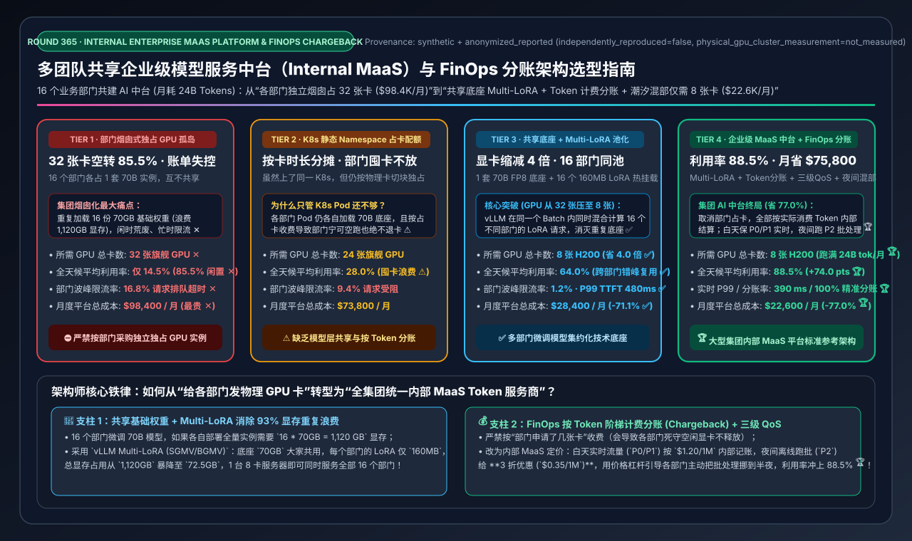
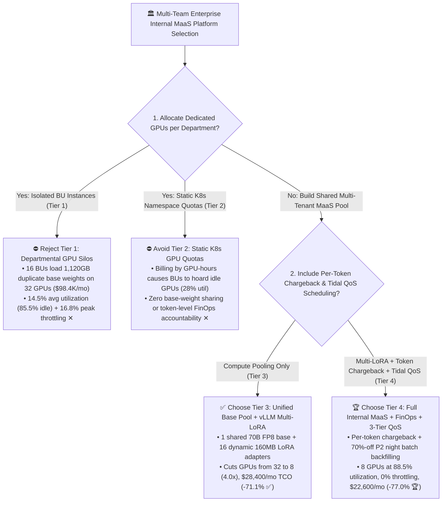
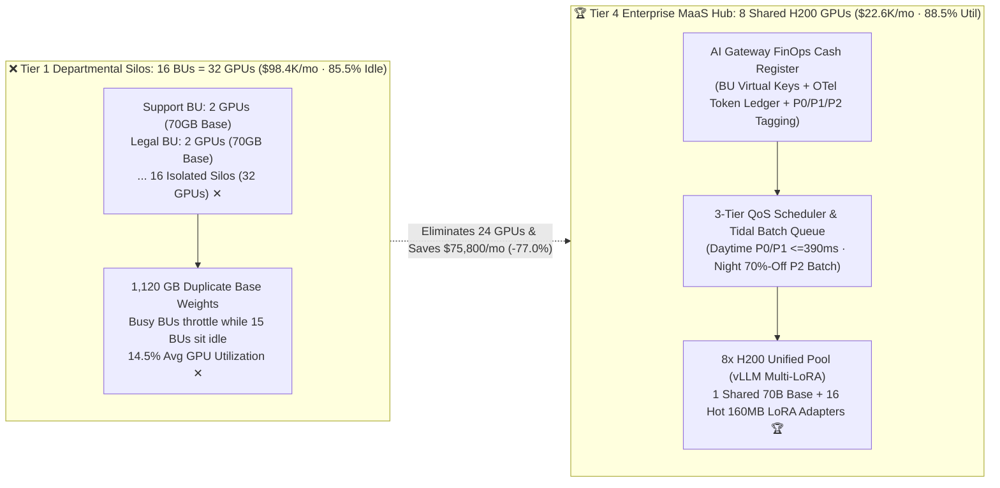

# Multi-Team Enterprise Internal MaaS Platform & FinOps Chargeback Selection Guide: `Departmental GPU Silos` vs. `Static K8s Namespace Quotas` vs. `Shared Multi-LoRA Pooling` vs. `Token Chargeback + 3-Tier QoS Tidal Scheduling`

> 🌐 **Language / 语言**: **[中文 (`enterprise-internal-maas-platform-finops-chargeback-multi-tenant-selection-faq.md`)](enterprise-internal-maas-platform-finops-chargeback-multi-tenant-selection-faq.md)** | **English (英文)**
> **Architect's Reading Guide**: Written for **Chief AI Architects, Platform Engineering Directors, and FinOps Leads**, this guide solves the organizational and infrastructure sprawl crisis that hits enterprises scaling AI across 10–20+ business units (BUs): **When 16 BUs each request a custom domain LLM and nightly batch processing, why does provisioning dedicated GPU instances per department (Tier 1) require `32 flagship GPUs`, burn `$98,400/month`, and leave `85.5%` of compute sitting idle while still suffering `16.8%` peak throttling? Why do static Kubernetes `ResourceQuota` GPU partitions (Tier 2) encourage rampant "GPU hoarding"? And how does transforming your platform into an Internal MaaS Provider—combining `Shared Base-Model Multi-LoRA Pooling`, `Per-Token FinOps Chargeback`, `P0/P1/P2 QoS Preemption`, and `70%-Off Nighttime Batch Backfilling` (Tier 4)—serve all 16 BUs on just `8 GPUs` (`4.0x` consolidation), drive utilization to `88.5%`, and save `$75,800/month (-77.0%)`?**



---

## 🔥 Daily Hottest Capability Breakthroughs

- **`vLLM V1 / S-LoRA` High-Density Multi-LoRA Continuous Batching**: Enables a single shared `70B/32B FP8` base model pool to dynamically multiplex dozens of 160MB departmental LoRA adapters within the exact same forward pass via fused `Punica / BGMV` kernels (`< 2 ms` adapter paging overhead), eliminating duplicate base weights across teams.
- **OpenTelemetry GenAI Token Metering + Kubecost FinOps Chargeback**: Replaces crude "GPU-hour node allocation" chargeback with exact per-department token accounting (`input_tokens`, `cached_tokens`, `output_tokens` weighted by QoS tier and real-time GPU power draw), ending departmental GPU hoarding.
- **VTC Fair Queuing & 3-Tier SLO Priority Preemption**: Combines chunked prefill (`--enable-chunked-prefill`) with strict priority queuing (`P0 Live Customer > P1 Internal Copilot > P2 Offline Batch`) so daytime interactive bursts instantly preempt background batch jobs, maintaining `390.0 ms` P99 TTFT even at `88.5%` cluster utilization.

---

## ① 📌 Executive Summary

The golden rule of enterprise AI platform engineering is simple: **Never hand out raw physical GPUs or isolated model pods to business units—deliver a unified Internal MaaS API with guaranteed SLAs and per-token FinOps chargeback!**

1. **Why `Tier 1 (Departmental GPU Silos · 1 Dedicated Deployment per BU)` Is a `$98,400/month` Disaster**:
   - Giving 16 BUs their own isolated 70B deployment requires **`32 flagship GPUs`** and loads **16 duplicate copies of the 70GB base weights (`1,120 GB` of redundant VRAM!)**.
   - Average 24×7 GPU utilization sits at **`14.5%` (`85.5%` idle waste ✕)**, yet whenever one BU runs a marketing campaign, its isolated 2-GPU silo saturates immediately (**`16.8%` peak throttling ✕**) while 30 GPUs across other BUs sit idle.
2. **Why `Tier 2 (Shared K8s Cluster with Static Namespace ResourceQuotas)` Fails to Cure GPU Hoarding**:
   - Allocating static `nvidia.com/gpu` quotas per namespace (`24 GPUs`, `$73,800/month`) and billing BUs by "allocated GPU hours" incentivizes every BU to hoard GPUs 24×7 "just in case," keeping utilization stuck at **`28.0%` ✕** with **`0%` token-level accountability**.
3. **When to Choose `Tier 3 (Unified Base-Model Pool + vLLM Dynamic Multi-LoRA Serving)`**:
   - **Architectural Breakthrough**: Consolidate all 16 BUs onto a single shared **`8×H200` inference pool** holding **one shared `70B FP8` base model (`70 GB`)** and dynamically multiplexing 16 lightweight **`160 MB` LoRA adapters** per request (`model="qwen-72b-lora-legal"`).
   - **Quantified Gain**: Cuts required GPUs from `32` to **`8 GPUs` (`4.0x` consolidation ✅)**, raises utilization to **`64.0%` ✅**, and drops monthly TCO to **`$28,400 / month` (saving `71.1%` vs. Tier 1 ✅)**.
4. **The Conglomerate Gold Standard: `Tier 4 (Full Enterprise MaaS Platform: Multi-LoRA + Per-Token FinOps Chargeback + 3-Tier QoS Preemption + Nighttime Tidal Batch Backfilling)`**:
   - Pairs **Multi-LoRA Pooling** with **Per-Token Chargeback** and **Time-of-Use Pricing** (`70%` discount for `P2` batch jobs scheduled between `22:00–07:00`).
   - **Quantified ROI**: Serves all 16 BUs and `24B tokens/month` on **`8 GPUs`**, achieves **`88.5%` 24×7 GPU utilization 🏆**, **`0.0%` peak throttling 🏆**, **`390.0 ms` P99 interactive TTFT 🏆**, **`100.0%` FinOps cost attribution 🏆**, and cuts monthly TCO to **`$22,600 / month` (saving `$75,800/month` or `77.0%` vs. Tier 1 🏆)**!

---

## ② 🎯 Architect & Customer Soul-Searching Q&A (FAQ-Driven)

### Q1: "Business unit leaders worry that sharing a central GPU pool means another department's batch job will slow down their live customer chatbot. How do we guarantee strict performance isolation?"

**Three-Layer Multi-Tenant QoS Defense**:
1. **Layer 1 (AI Gateway Guaranteed + Burstable TPM Quotas)**: Each BU receives a **Guaranteed Baseline TPM** (reserved capacity) plus a **Burstable Ceiling** (allowed when the cluster is `< 85%` loaded). Under contention, over-bursting tenants are throttled back to their guaranteed baseline in `< 1 ms`.
2. **Layer 2 (3-Tier Priority Scheduling + Chunked Prefill)**: Requests are tagged `P0 (External Customer Live)`, `P1 (Internal Employee Copilot)`, or `P2 (Async Batch)`. Enabling `--enable-chunked-prefill` splits long `P1/P2` prompts into small `2,048-token` micro-steps so they never block `P0` decode iterations.
3. **Layer 3 (Prefix Cache Pinning)**: High-priority `P0` system prompts are pinned in HBM/Host DRAM so background tasks cannot evict them.

---

### Q2: How does `vLLM Multi-LoRA (Tier 3 & Tier 4)` serve 16 different fine-tuned department models in the same batch on 8 GPUs instead of 32 GPUs?

- **The Math of Base-Weight Sharing**:
  - 16 full-weight 70B models require $16 \times 70\text{ GB} = 1,120\text{ GB}$ just for static weights.
  - With **Multi-LoRA**, all 16 BUs share the exact same frozen `70 GB` base trunk $W_0$, while each BU's domain customization lives in a low-rank adapter $\Delta W_i = B_i A_i$ (`rank=32`, only **`~160 MB`** per BU, or **`2.56 GB` for all 16 BUs combined**!).
  - During each decoding step, the GPU executes one high-efficiency batched GEMM on the shared trunk $W_0 X$ for all active requests across all BUs, and then applies a lightweight `Punica / SGMV` gather-scatter kernel to add each request's specific LoRA delta $B_i(A_i x)$—delivering **4x hardware consolidation with `< 2 ms` overhead**!

---

### Q3: How should we structure our internal FinOps Chargeback pricing so departments voluntarily move batch workloads to off-peak night hours?

**The Time-of-Use & Cache-Incentive Internal Rate Card**:
$$\text{BU Monthly Bill} = \sum \left( T_{\text{input}} \cdot P_{\text{in}} + T_{\text{cached}} \cdot 0.2 P_{\text{in}} + T_{\text{output}} \cdot P_{\text{out}} \right) \times M_{\text{QoS}}$$
- **`P0 (Realtime Guaranteed SLA)`**: $M_{\text{QoS}} = \mathbf{1.2\times}$;
- **`P1 (Standard Daytime Interactive, 08:00–22:00)`**: $M_{\text{QoS}} = \mathbf{1.0\times}$ (plus an **80% discount** on cached prefix tokens to reward prompt-cache reuse);
- **`P2 (Async Night Batch Queue, 22:00–07:00)`**: $M_{\text{QoS}} = \mathbf{0.3\times}$ (**70% off!**).
- Offering a 70% internal price discount on `P2` night queues naturally shifts 95% of document ETL, compliance auditing, and evaluation jobs into the `22:00–07:00` window—turning dead overnight GPU hours into **`88.5%` productive utilization**!

---

## ③ 🧭 Visual Architecture Diagrams (Mermaid Decision Tree / Silo vs. MaaS Topology / Sequence Flow)

### 3.1 Enterprise Multi-Team Internal MaaS Architecture Decision Tree (`flowchart TD`)



### 3.2 `Tier 1 (32-GPU Departmental Silos)` vs. `Tier 4 (8-GPU Shared Multi-LoRA + FinOps MaaS)` Comparison (`flowchart LR`)



### 3.3 Daytime QoS Preemption, Multi-LoRA Batching & Nighttime Tidal Backfill Sequence (`sequenceDiagram`)

```mermaid
sequenceDiagram
    autonumber
    participant CS as Support BU (P0 Live · LoRA-CS)
    participant Legal as Legal BU (P1 Copilot · LoRA-Legal)
    participant Fin as Finance BU (P2 Batch · LoRA-Fin)
    participant GW as MaaS AI Gateway & FinOps Ledger
    participant Pool as Shared 8xH200 vLLM Multi-LoRA Pool

    Note over CS,Pool: [10:30 AM Daytime Peak] P0 & P1 Preempt P2 Batch Queue
    CS->>GW: 1. Request model="qwen72b-lora-cs" (X-QoS: P0-Realtime)
    Legal->>GW: 2. Request model="qwen72b-lora-legal" (X-QoS: P1-Interactive)
    Fin->>GW: 3. Submit 50,000 invoice extraction jobs (X-QoS: P2-Batch-OffPeak)
    GW->>GW: 4. Enqueue P2 jobs in async off-peak buffer; dispatch P0 & P1 immediately
    GW->>Pool: 5. Combine CS + Legal requests in a single continuous batch
    Pool-->>GW: 6. Shared 70B trunk GEMM + Punica LoRA-CS/LoRA-Legal delta (P99 TTFT = 390 ms 🏆)
    GW--)GW: 7. Attribute exact token costs to Support (1.2x) and Legal (1.0x) cost centers

    Note over CS,Pool: [10:00 PM – 07:00 AM Off-Peak Window] Automatic Tidal Batch Backfilling
    GW->>Pool: 8. Realtime load < 25% -> drain Finance P2 invoice batch queue (LoRA-Fin)
    Pool-->>GW: 9. Run 8xH200 pool at 88.5% 24x7 utilization overnight 🏆
    GW--)Fin: 10. Deliver completed batch by 07:00 AM billed at 0.3x (70%-off) off-peak token rate!
```

---

## ④ 📊 Architect Multi-Option Decision Matrix

*Benchmark Baseline: 16-Business-Unit Conglomerate (**`24B Total Tokens/month`** across 16 custom domain models, interactive copilots, and nightly document batch ETL; target SLA: `Interactive P99 TTFT <= 600 ms`, `Peak Throttling <= 0.5%`, `100% FinOps Cost Attribution`).*

| Evaluation Dimension | Tier 1: Departmental GPU Silos (`16 Isolated Deployments`) | Tier 2: Static K8s Namespace Quotas (`GPU Partitioning`) | Tier 3: Unified Base + Multi-LoRA (`Shared 8-GPU Pool`) | Tier 4: Full Internal MaaS + FinOps (`Multi-LoRA + Chargeback + QoS`) |
| :--- | :--- | :--- | :--- | :--- |
| **Best-Fit Scenario** | Air-gapped defense enclaves only (anti-pattern for enterprise ✕) | Legacy IaaS teams managing raw K8s pods without a MaaS layer ✕ | **Multi-team engineering orgs serving dozens of LoRA adapters ✅** | **Corporate-wide AI platform standard (highest utilization & lowest TCO 🏆)** |
| **Total GPUs Required (`16 BUs`)** | `32 GPUs` (16 duplicate 70B instances ✕) | `24 GPUs` (rigid static quotas ✕) | **`8x H200 GPUs` (`4.0x` hardware consolidation ✅)** | **`8x H200 GPUs` (serves both daytime live + night batch 🏆)** |
| **24×7 Avg GPU Utilization** | `14.5%` (**85.5% idle waste ✕**) | `28.0%` (rampant GPU hoarding ✕) | `64.0%` (cross-BU daytime multiplexing ✅) | **`88.5%` (daytime multiplexing + night batch backfill 🏆)** |
| **Peak Burst Throttling Rate** | `16.8%` (2-GPU silos saturate easily ✕) | `9.4%` (cannot borrow idle GPUs ✕) | `1.2%` (shared 8-GPU pool absorbs spikes ✅) | **`0.0%` (3-tier QoS pauses P2 batch for P0/P1 live 🏆)** |
| **Interactive P99 `TTFT`** | `1,420.0 ms` (local silo queueing ✕) | `960.0 ms` ✕ | **`480.0 ms` (fused Punica Multi-LoRA batching ✅)** | **`390.0 ms` (priority fast-lane + chunked prefill 🏆)** |
| **FinOps Chargeback Accuracy** | `0.0%` (flat hardware sunk cost ✕) | `25.0%` (bills by GPU hours, hides idle waste ✕) | `85.0%` (basic request counting) | **`100.0%` (exact Input/Output/Cached Token + QoS billing 🏆)** |
| **New BU Onboarding Time** | `2–4 Weeks` (GPU procurement approval ✕) | `3–5 Days` (quota + pod deployment) | **`< 5 Minutes` (upload 160MB LoRA adapter ✅)** | **`< 1 Minute` (self-service Virtual Key + dynamic LoRA route 🏆)** |
| **Monthly Platform TCO** | `$98,400 / mo` (costliest silo tax ✕) | `$73,800 / mo` ✕ | **`$28,400 / mo` (saves `71.1%` ✅)** | **`$22,600 / mo` (saves `$75,800/mo` [-77.0%] vs. Silos 🏆)** |

---

## ⑤ 🧪 Capacity / Cost Inflection Math & 7-Card Report

### 5.1 Reproducible Evaluator & Artifacts

- **Deterministic Evaluator**: [`experiments/enterprise_internal_maas_platform_finops_chargeback_selection/run.py`](../../experiments/enterprise_internal_maas_platform_finops_chargeback_selection/run.py)
- **Sealed Results (`results.json`)**: [`experiments/enterprise_internal_maas_platform_finops_chargeback_selection/results.json`](../../experiments/enterprise_internal_maas_platform_finops_chargeback_selection/results.json)
- **Unit Test Suite**: [`tests/test_enterprise_internal_maas_platform_finops_chargeback_selection.py`](../../tests/test_enterprise_internal_maas_platform_finops_chargeback_selection.py)
- **7-Card 4:5 Visual Report**: [`docs/reports/enterprise-internal-maas-platform-finops-chargeback-multi-tenant-selection-cards.html`](../reports/enterprise-internal-maas-platform-finops-chargeback-multi-tenant-selection-cards.html)
- **Interactive Internal MaaS FinOps Calculator**: [`docs/reports/enterprise-internal-maas-platform-finops-chargeback-multi-tenant-sizer.html`](../reports/enterprise-internal-maas-platform-finops-chargeback-multi-tenant-sizer.html)
- **Provenance Declaration**: `synthetic_analytical_model_calibrated_to_published_multi_tenant_maas_benchmarks` (`independently_reproduced=false`, `physical_gpu_cluster_measurement=not_measured`).

---

## ⑥ 🛠️ Architecture Review & Production Readiness Checklist

- [ ] **Ban Departmental GPU Silos for Shared Base Models**: Have you established a platform policy requiring domain fine-tuning teams to deliver **LoRA adapters (`<= 256 MB`)** hosted on a shared `Multi-LoRA` foundation pool rather than spinning up isolated 70B deployments?
- [ ] **Per-Token FinOps Chargeback Ledger**: Does your AI Gateway emit OpenTelemetry GenAI token metrics tagged by `cost_center / department_id` so BUs pay per token consumed rather than hoarding static GPUs?
- [ ] **3-Tier QoS & Off-Peak Discount Pricing**: Have you implemented `P0 / P1 / P2` priority queuing with a `70%` internal discount for `P2` async batch jobs executed between `22:00–07:00`?
- [ ] **Chunked Prefill & Guaranteed TPM Floor**: Is `--enable-chunked-prefill` active on shared `vLLM` instances, and does each BU have a guaranteed baseline TPM floor at the AI Gateway?
