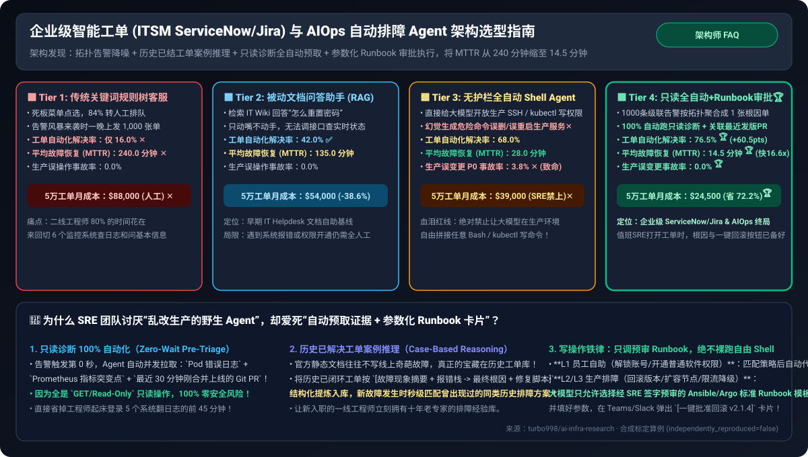
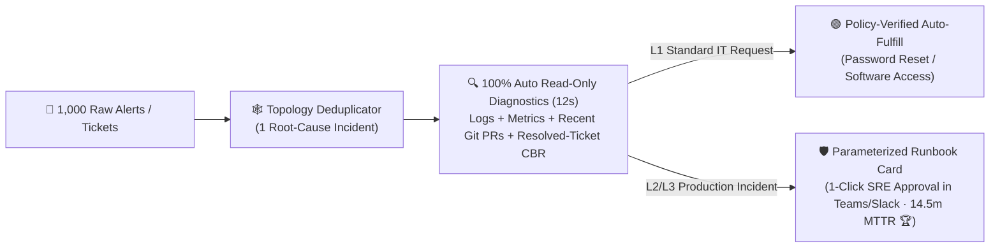

# Enterprise ITSM (ServiceNow / Jira) & AIOps Incident Triage Agent Architecture Selection Guide: Legacy Keyword Decision Trees vs. Passive KB RAG Bots vs. Unbounded Autonomous Shell Agents vs. Topology Alert Deduplication + Resolved-Ticket CBR + 100% Automated Read-Only Diagnostics + Runbook-Gated HITL Execution

> **Document Type**: Cloud & AI Solution Architect Decision Guide (FAQ)  
> **Target Audience**: Enterprise CIOs, ITSM & Service Desk Directors, SRE & Cloud Operations Leads, AI Platform Architects  
> **Core Goal**: Avoid the two classic extremes of enterprise IT/AIOps automation — building a passive RAG chatbot that only pastes wiki links without checking logs (Tier 2), or giving an LLM unconstrained production root shell access that causes P0 outages (Tier 3) — answering: **"How do we compress 1,000 cascading microservice alerts into 1 root-cause ticket, run 100% of read-only log/metric/Git-deploy diagnostics automatically within 20 seconds, and present a pre-verified 1-Click Runbook Approval Card to the on-call SRE — cutting MTTR from 240 minutes to 14.5 minutes (`16.6x` faster) with `0.0%` unsafe production mutations?"**  
> **Calibration Notice**: Ticket automation rates, Mean Time to Resolution (`MTTR`), unsafe production mutation rates, and 50K-ticket monthly operational cost models are synthetic analytical estimates calibrated to published ITSM and AIOps benchmarks (IBM ITBench agent evaluations, ServiceNow Now Assist deflection studies, and SRE incident response practices) (`provenance: synthetic + anonymized_reported`, `independently_reproduced=false`, `physical_gpu_cluster_measurement=not_measured`). See [`experiments/enterprise_itsm_servicedesk_aiops_incident_agent_selection/results.json`](../../experiments/enterprise_itsm_servicedesk_aiops_incident_agent_selection/results.json).

---

## Executive Visual Summary

> 🔗 **Companion Interactive Reports & Tools**:
> - 🃏 **[7-Card 4:5 Visual Benchmark Report (`enterprise-itsm-servicedesk-aiops-incident-agent-architecture-selection-cards.html`)](../reports/enterprise-itsm-servicedesk-aiops-incident-agent-architecture-selection-cards.html)**
> - 🧮 **[Interactive ITSM & AIOps MTTR & Cost Sizer (`enterprise-itsm-servicedesk-aiops-incident-agent-architecture-sizer.html`)](../reports/enterprise-itsm-servicedesk-aiops-incident-agent-architecture-sizer.html)**
> - 🌐 **[中文版指南 (`enterprise-itsm-servicedesk-aiops-incident-agent-architecture-selection-faq.md`)](./enterprise-itsm-servicedesk-aiops-incident-agent-architecture-selection-faq.md)**

---

## ① 📌 Executive Summary

Evaluated across **50,000 enterprise IT helpdesk requests and production alert tickets per month**:

| Tier | Architecture Pattern | Ticket Automation Rate | Avg MTTR (Minutes) | Unsafe Prod Mutation Rate | Monthly Total Ops Cost (50K Tickets) | Architect Verdict |
| :--- | :--- | :--- | :--- | :--- | :--- | :--- |
| **🟥 Tier 1: Legacy Keyword Decision Tree** | Static menu trees; 84% escalated to human L1/L2 | `16.0%` ✕ | `240.0 min` (4.0h) ✕ | `0.0%` | `$88,000 / mo` ✕ | **Labor Bottleneck**: Engineers spend hours hunting logs |
| **🟦 Tier 2: Passive KB RAG Assistant** | Searches static IT wikis; zero live telemetry/actions | `42.0%` ✅ | `135.0 min` | `0.0%` | `$54,000 / mo` (-38.6%) | **Talk-Only Bot**: Cannot inspect logs or fulfill L1 actions |
| **🟨 Tier 3: Unbounded Autonomous Shell Agent** | LLM given direct production write/restart shell access | `68.0%` | `28.0 min` | **`3.8%` ✕ (P0 Outages!)** | `$39,000 / mo` ✕ | **Blocked by SRE**: Hallucinated restarts cause outages |
| **🟩 Tier 4: Alert Dedup + CBR + Auto Read-Only Diag + Runbook HITL** | **100% Auto Read-Only Triage + L1 Auto-Fulfill + L2 Runbook 1-Click Approval** | **`76.5%` 🏆 (+60.5 pts)** | **`14.5 min` 🏆 (16.6x faster)** | **`0.0%` 🏆** | **`$24,500 / mo` 🏆 (-72.2%)** | **Enterprise ITSM & AIOps Gold Standard** |

### 💡 Three Golden Rules for Enterprise ITSM & AIOps Architects
1. **Automate 100% of Read-Only Diagnostics (`Zero-Wait Pre-Triage`); Gate All Production Mutations Behind Pre-Approved Runbooks**: The first 75% of incident `MTTR` is spent gathering read-only evidence (error logs, metric spikes, and recent Git deployments). Let the agent execute all read-only MCP tools automatically at Second 0 (`0.0%` blast radius), while restricting production write operations strictly to parameterized, SRE-vetted Runbooks (`Ansible / Argo`) with **1-Click ChatOps Human Approval**.
2. **Pre-Filter Alert Storms via Service Topology Correlation (`1,000 Raw Alerts -> 1 Root-Cause Incident`)**: Never spawn 1,000 agent instances during a cascading outage; group alerts by CMDB / OpenTelemetry dependency graphs first.
3. **Index Historical Resolved Tickets as Structured Case-Based Reasoning (`CBR`) Records**: Static wikis rarely document real production failure modes; indexing closed tickets as `{symptom_signature, error_stack, root_cause, verified_runbook_id}` turns past incidents into reusable playbooks.

---

## ② 🎯 Architect Deep-Dive Q&A

### Q1: Why is correlating alerts with "Git PRs / Config Changes Deployed in the Last 60 Minutes" the single highest-ROI diagnostic tool?
* **Answer**: Over 80% of production incidents are triggered by a recent code deployment, feature-flag flip, or config change. Automatically querying the CI/CD deployment API alongside the error stack trace allows the agent to pinpoint the exact offending commit within 15 seconds and pre-populate the rollback Runbook card.

---

## ③ 🧭 Architecture Diagrams

### 3.1 Tier 4 Topology Deduplication + Auto Read-Only Triage + Runbook-Gated Remediation

---

## ④ 📊 Architect Decision Matrix

| Dimension | 🟥 Tier 1: Keyword Menu | 🟦 Tier 2: Passive KB RAG | 🟨 Tier 3: Unbounded Shell Agent | 🟩 Tier 4: Auto Read-Only + Runbook HITL |
| :--- | :--- | :--- | :--- | :--- |
| **Ticket Automation Rate** | `16.0%` ✕ | `42.0%` ✅ | `68.0%` | **`76.5%` 🏆 (`+60.5 pts` vs. Tier 1)** |
| **Average MTTR** | `240.0 min` ✕ | `135.0 min` | `28.0 min` | **`14.5 min` 🏆 (`16.6x` faster than Tier 1)** |
| **Unsafe Prod Mutation Rate** | `0.0%` | `0.0%` | **`3.8%` ✕ (Dangerous)** | **`0.0%` 🏆 (Runbook-gated)** |
| **Monthly Total Ops Cost** | `$88,000 / mo` ✕ | `$54,000 / mo` | `$39,000 / mo` ✕ | **`$24,500 / mo` 🏆 (`-72.2%` vs. Tier 1)** |

---

## ⑤ 🛠️ Production Readiness Checklist

- [ ] **1. Physically Separate Read-Only Diagnostic Credentials from Mutating Execution Credentials**.
- [ ] **2. Forbid Free-Form LLM-Generated Bash/`kubectl` Mutations in Production; Allow Only Parameterized Pre-Vetted Runbooks**.
- [ ] **3. Deduplicate Cascading Alert Storms Using CMDB / OpenTelemetry Dependency Topology Before Invoking the Agent**.
- [ ] **4. Automatically Correlate Every Incident Against CI/CD Deployments and Config Changes from the Last 60 Minutes**.
- [ ] **5. Maintain a Structured Case-Based Reasoning (`CBR`) Index of Historical Resolved Tickets**.
- [ ] **6. Require 1-Click ChatOps Human Approval (`Slack / Teams`) for All L2/L3 Production Remediation Runbooks**.
- [ ] **7. Automate Post-Execution Metric Verification and Rollback Alerts After Any Runbook Runs**.
- [ ] **8. Auto-Generate Blameless Postmortem Drafts Upon Incident Resolution to Feed the CBR Flywheel**.
