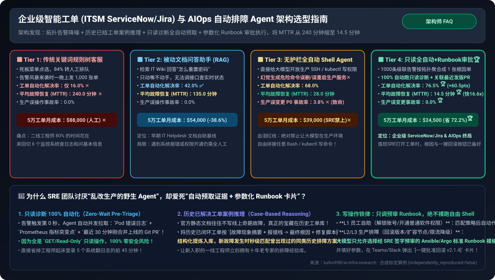
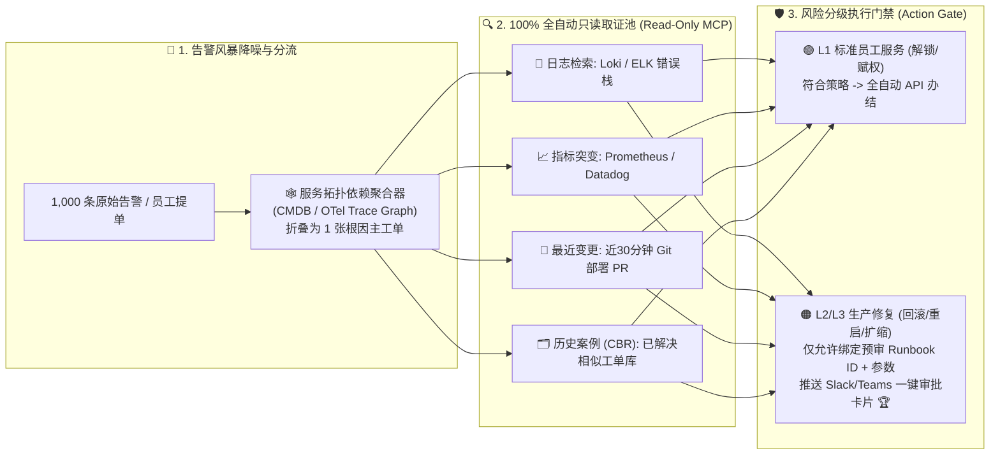
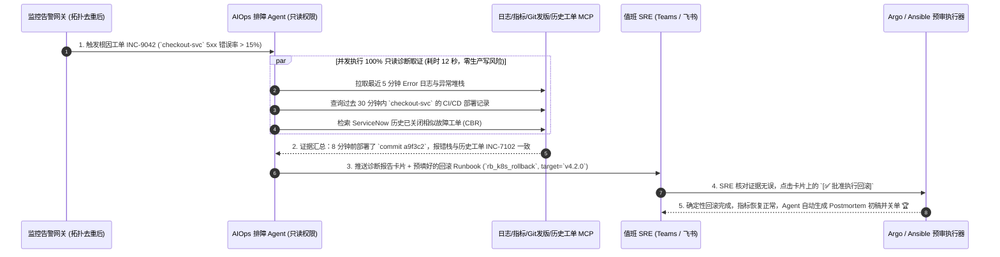

# 企业级智能工单、ITSM（ServiceNow / Jira）与 AIOps 自动排障 Agent 架构选型指南：传统规则树 vs. 被动文档问答 RAG vs. 无护栏全自动 Shell Agent vs. 拓扑告警降噪 + 历史工单案例推理（CBR）+ 只读诊断全自动预取 + 参数化 Runbook 审批执行架构

> **文档类型**：企业级 IT 运营（ITOM / AIOps）与智能服务台解决方案架构师（Cloud & AI Solution Architect）选型决策指南（FAQ）  
> **适用读者**：企业 CIO、IT 服务管理（ITSM）负责人、SRE 与云运维总监、AI 平台架构师  
> **核心目标**：用通俗、可量化的架构语言解决企业建设“IT 智能服务台与 AIOps 自动排障 Agent”时的两大极端误区——**“要么做成只会发 Wiki 链接的传声筒（Tier 2，依然要靠工程师手工登 6 个系统查日志），要么胆大包天直接给大模型开放生产服务器 root 写权限（Tier 3，一次幻觉误删直接酿成 P0 级停机事故）”**——系统回答：**“怎么在告警触发的前 30 秒内，让 Agent 100% 全自动跑完所有只读日志、指标与最近上线 Git PR 关联，并把经过 SRE 预审的参数化修复 Runbook 卡片递到值班人员手边，将平均故障恢复时间（MTTR）从 240 分钟砸到 14.5 分钟且实现 0% 误操作事故？”**。  
> **标定声明**：本文所引用的工单自动化率、平均故障恢复时间（MTTR）、不安全生产变更事故率与 5 万张工单月度运营成本模型基于公开发布的企业级 ITSM 与 AIOps 基准（IBM ITBench 运维智能体评测、ServiceNow Now Assist 工单分流数据及 Google SRE 自动化事故响应实践）构建的合成分析模型（`provenance: synthetic + anonymized_reported`, `independently_reproduced=false`, `physical_gpu_cluster_measurement=not_measured`），详见 [`experiments/enterprise_itsm_servicedesk_aiops_incident_agent_selection/results.json`](../../experiments/enterprise_itsm_servicedesk_aiops_incident_agent_selection/results.json)。

---

## 一图流总结（Executive Visual Summary）



> 🔗 **关联可交互报告与工具**：
> - 🃏 **[7-Card 4:5 视觉评测报告 (`enterprise-itsm-servicedesk-aiops-incident-agent-architecture-selection-cards.html`)](../reports/enterprise-itsm-servicedesk-aiops-incident-agent-architecture-selection-cards.html)**
> - 🧮 **[交互式 ITSM & AIOps MTTR 与成本计算器 (`enterprise-itsm-servicedesk-aiops-incident-agent-architecture-sizer.html`)](../reports/enterprise-itsm-servicedesk-aiops-incident-agent-architecture-sizer.html)**
> - 🌐 **[English Version (`enterprise-itsm-servicedesk-aiops-incident-agent-architecture-selection-faq.en.md`)](./enterprise-itsm-servicedesk-aiops-incident-agent-architecture-selection-faq.en.md)**

---

## ① 📌 核心选型结论速览（Executive Summary）

在大型企业中，每月动辄产生 **50,000 张 IT 服务请求（L1 账号解锁、VPN 故障、软件权限申请）与生产监控告警工单（L2/L3 微服务超时、数据库连接池耗尽、K8s Pod OOM）**。

对比四档 ITSM 与 AIOps 智能体架构，核心指标表现如下：

| 架构档位 | 核心诊断与执行机制 | 工单自动化闭环率 | 平均恢复时间 (MTTR) | 生产误变更事故率 | 5万工单月运营总成本 | 架构师拍板结论 |
| :--- | :--- | :--- | :--- | :--- | :--- | :--- |
| **🟥 Tier 1：传统关键词规则树 + 人工派单** | 死板菜单回复，84% 转人工逐级排查 | `16.0%` ✕ | `240.0 分钟` (4h) ✕ | `0.0%` | `$88,000 / 月` ✕ | **人海战术瓶颈**：工程师深陷重复查日志与手工审批 |
| **🟦 Tier 2：被动文档问答工单助手 (RAG)** | 只检索 Wiki 发文字步骤，不连监控不代办 | `42.0%` | `135.0 分钟` | `0.0%` | `$54,000 / 月` (-38.6%) | **只说不做的半成品**：能挡简单咨询，对真实排障毫无帮助 |
| **🟨 Tier 3：无护栏全自动 Shell 执行 Agent** | 直接开放生产 SSH/kubectl 自由生成写命令 | `68.0%` | `28.0 分钟` | **`3.8%` ✕ (致命P0事故)** | `$39,000 / 月` ✕ | **SRE 严禁上线**：幻觉生成 `delete/restart` 酿成二次灾难 |
| **🟩 Tier 4：拓扑降噪 + 历史案例推理 + 只读全自动 + Runbook 审批** | **100% 自动跑只读取证 + L1自动代办 / L2参数化 Runbook 一键审批** | **`76.5%` 🏆 (+60.5pts)** | **`14.5 分钟` 🏆 (快16.6x)** | **`0.0%` 🏆** | **`$24,500 / 月` 🏆 (-72.2%)** | **企业级 ITSM & AIOps 终局标准**：秒级定位根因、绝对安全变更 |

### 💡 架构师三句话选型铁律
1. **读写权限黄金切分：“只读诊断工具（Read-Only Diagnostics）100% 放开全自动跑，生产写操作（Mutating Actions）100% 收口至受控预审 Runbook”**：为什么一次故障平均要花 240 分钟恢复？因为前 **180 分钟** 全花在“拉人建群、登录 Datadog 看指标、登录 K8s 查日志、去 GitHub 翻刚刚谁发了版”这些**纯只读信息搜集**上！让 Agent 在告警第 0 秒并发跑完所有只读 MCP 工具并生成《根因证据简报》，既 **100% 零生产破坏风险**，又直接砍掉 85% 的排查耗时！
2. **禁止大模型在生产环境自由拼接 Bash / `kubectl` 写命令（Tier 3）——写操作只允许“从 SRE 预审的有限 Runbook 目录中选模板并填入参数”**：Agent 不允许自己写 shell 脚本去修故障，只能输出受限结构化调用（如 `runbook_id="rb_rollback_k8s_deploy", params={"service": "payment-api", "target_rev": "v2.1.3"}`），并在 Slack / Teams / 飞书群里弹出带证据链的 **`[✅ 一键批准执行]`** 卡片，由值班 SRE 点击确认后由 Ansible / Argo Workflows 确定性执行！
3. **前置“服务依赖拓扑告警风暴压缩（Alert Storm Deduplication）”并建立“历史已结工单结构化案例库（Case-Based Reasoning, CBR）”**：底层数据库抖动一下会引发上游 30 个微服务同时报 1,000 条告警；先按 CMDB / OpenTelemetry 调用拓扑聚合成 **1 张根因工单**，再去检索历史上解决过的相似故障工单（提取当时的根因与修复命令），彻底杜绝 1,000 个 Agent 副本同时去查同一个故障！

---

## ② 🎯 客户与架构师灵魂拷问 Q&A（Architect Deep-Dive Q&A）

### Q1：我们给 IT 服务台上了基于知识库的 RAG 问答机器人（Tier 2），为什么员工还是抱怨“一点用都没有，最后还是要人工提单等半天”？
* **真相剖析（员工要的是“帮我把事办了 Action Fulfillment”，而不是“发一篇 3,000 字的操作指南让我自己看”）**：
  - 当员工说 `“我的账号被锁了”` 或 `“帮我申请开通 Tableau 报表查看权限”` 时，Tier 2 机器人只会回复一段冷冰冰的文档链接：`“请登录 IAM 系统点击第 3 个菜单申请……”`。
  - **Tier 4 怎么把解决率从 `42%` 拉升到 `76.5%`？**
    - 将高频 L1 IT 请求（密码重置、AD 账号解锁、邮箱扩容、标准软件 License 分配、VPN 证书重签发）封装为**带确定性策略校验的自助执行工具（Self-Service Action Tools）**；
    - 员工发一句话，Agent 核验完员工部门与直属主管策略后，直接调 IAM 接口在 **10 秒内办结并回写 ServiceNow 工单状态为 `Resolved`**！

### Q2：半夜 3 点核心交易链路报警，瞬间涌入 800 条 Prometheus 告警，如果每条告警都触发一次大模型排障，不仅 Token 烧光，值班工程师手机也会被炸穿，怎么设计？
* **真相剖析（第一关必须是“时间窗口 + 调用链拓扑图告警降噪 Alert Correlation”）**：
  - 在告警进入大模型之前，先经过一个 **15 秒滑动时间窗口与 CMDB / Service Mesh 依赖图聚合器**：
  - 当检测到 `Order-Service -> Payment-Service -> Redis-Cluster-02` 整条调用链同时报警时，根据有向无环图（DAG）寻找**最下游的叶节点（Root Anomaly Node：`Redis-Cluster-02 连接数打满`）**，将 800 条衍生症状告警折叠挂载为该主事故单的子事件，**只唤醒 1 个 AIOps 排障 Agent 针对根因节点做深度取证**！

### Q3：值班 SRE 为什么极其反感 Tier 3（全自动改生产的 AI Agent），却对 Tier 4（自动取证 + 一键卡片审批）赞不绝口？
* **真相剖析（尊重 SRE 的“变更确定性原则”：AI 负责当神探破案，人类负责签字开枪）**：
  - 在生产故障现场，最可怕的不是故障本身，而是无脑 Agent 在网络抖动时误判并执行了 `重启主数据库` 或 `扩容错集群`，把小毛病放大成全站雪崩（Tier 3 中高达 `3.8%` 的误变更事故率）。
  - **Tier 4 的“神探取证 + 检察官批捕”工作流**：
    1. **00:00 告警触发**：`payment-service` HTTP 500 错误率飙升至 18%；
    2. **00:01~00:25 Agent 全自动只读取证**（并发调用 4 个只读工具）：
       - 查日志：捕获 `NullPointerException at TaxCalculator.java:142`；
       - 查指标：CPU/内存正常，排除机器资源瓶颈；
       - **查变更（80% 的线上故障都是最近刚发的变更引起的！）**：调 GitHub/GitLab API 发现 12 分钟前刚上线了 `PR #4821 (Refactor TaxCalculator)`；
       - 查历史工单（CBR）：匹配到 2 个月前类似的 NPE 回滚工单。
    3. **00:30 推送高信息密度审批卡片**：值班 SRE 手机收到一条消息：
       > 🚨 **根因定位（置信度 96%）**：`payment-service` 12 分钟前部署的 `PR #4821` 引发 `TaxCalculator.java:142` 空指针异常。  
       > 🛠️ **建议标准预案**：执行受控 Runbook `rb_argo_rollback` 回滚至上一稳定版本 `v1.8.4`。  
       > 🔘 **[一键批准回滚 v1.8.4]**  🔘 **[转交人工处理]**
    4. SRE 只需扫一眼证据、点一下按钮，**14.5 分钟内故障彻底平息**！

---

## ③ 🧭 直观可视化图解（Mermaid 决策树、ITSM+AIOps 端到端架构与排障时序图）

### 3.1 企业级 ITSM 工单与 AIOps 排障架构选型决策树

```mermaid
flowchart TD
    A[企业计划建设 IT 智能服务台或 AIOps 故障排障 Agent] --> B{工单/告警的风险等级与操作性质？}
    B -->|L1 员工日常 IT 服务请求<br/>重置密码 / 解锁AD / 开通标准软件权限| C[身份认证 + OPA 策略核验后<br/>由 Agent 调用标准 IAM API 100% 全自动办结]
    B -->|L2 / L3 生产环境系统告警与故障工单<br/>微服务报错 / 数据库慢查询 / K8s 节点异常| D[🟩 Tier 4: 拓扑降噪 + 只读诊断 100% 自动预取 + 参数化 Runbook 人类一键审批<br/>严禁开放自由写 Shell · 所有变更走预审 Ansible/Argo 模板<br/>MTTR 从 240min 降至 14.5min (快16.6x) · 0% 误变更事故 🏆]
```

### 3.2 Tier 4“拓扑告警降噪 + 只读并发取证 + 历史工单 CBR + Runbook 门控”参考架构图



### 3.3 生产 P1 故障 30 秒自动取证与一键回滚时序图（Sequence Diagram）



---

## ④ 📊 架构师多方案选型决策矩阵（Architect Decision Matrix）

| 评估维度 | 🟥 Tier 1：传统关键词规则树 | 🟦 Tier 2：被动文档问答助手 (RAG) | 🟨 Tier 3：无护栏全自动 Shell Agent | 🟩 Tier 4：拓扑降噪 + 只读预取 + Runbook 审批 |
| :--- | :--- | :--- | :--- | :--- |
| **工单自动化/辅助闭环率** | `16.0%` ✕ | `42.0%` ✅ | `68.0%` | **`76.5%` 🏆（比传统规则树高 `+60.5 pts`）** |
| **平均故障恢复时间 (MTTR)** | `240.0 分钟`（4 小时）✕ | `135.0 分钟` | `28.0 分钟` | **`14.5 分钟` 🏆（比传统排障快 `16.6x`）** |
| **生产环境误变更事故率** | `0.0%` | `0.0%` | **`3.8%` ✕（幻觉乱跑写命令引发 P0）** | **`0.0%` 🏆（只读自动 + 写操作预审 Runbook）** |
| **告警风暴抗压能力** | ✕ 1,000 条告警建 1,000 张单 | ✕ 无拓扑聚合能力 | ✕ 1,000 个 Agent 同时乱重启机器 | **🏆 拓扑收敛为 1 张根因单精准取证** |
| **排障后经验沉淀机制** | ✕ 靠人工手写事后复盘 | ✕ 仅搜静态过期 Wiki | ✕ 无结构化复盘沉淀 | **🏆 关单自动提炼结构化 CBR 案例入库** |
| **5 万工单/月总运营成本** | `$88,000 / 月` ✕ | `$54,000 / 月` ✅ | `$39,000 / 月` ✕ | **`$24,500 / 月` 🏆（比 Tier 1 省 `72.2%`）** |

---

## ⑤ 🧪 容量/成本拐点算例与 7-Card 报告（Quantitative Sizer & 7-Card Deck）

### 5.1 基准算例假设（每月 50,000 张企业 IT 服务台请求与生产告警工单）
- **为什么 Tier 4 能将每月 IT 运营与支持成本从 `$88,000` 压降至 `$24,500`（立省 `72.2%`，年省 `$76.2 万`），同时把 MTTR 缩短 16.6 倍？**
  1. **L1 标准请求全自动 API 代办（消灭 60% 人工简单单）**：密码重置、权限申请、环境开通不再需要一线工程师手工点后台；
  2. **L2/L3 生产故障“零等待预取证”**：把过去二线工程师最耗时耗力的“跨系统查日志、对时间线、找最近发版 PR”全部在告警触发前 20 秒内由 Agent 自动附在工单顶部，工程师介入即拍板！

```chart
{
  "data": {
    "values": [
      { "Tier": "1. 传统关键词规则树", "工单自动化率(%)": 16.0, "平均恢复MTTR(分钟)": 240.0, "月运营总成本($K)": 88.0 },
      { "Tier": "2. 被动文档问答(RAG)", "工单自动化率(%)": 42.0, "平均恢复MTTR(分钟)": 135.0, "月运营总成本($K)": 54.0 },
      { "Tier": "3. 无护栏全自动Shell", "工单自动化率(%)": 68.0, "平均恢复MTTR(分钟)": 28.0, "月运营总成本($K)": 39.0 },
      { "Tier": "4. 只读预取+Runbook审批", "工单自动化率(%)": 76.5, "平均恢复MTTR(分钟)": 14.5, "月运营总成本($K)": 24.5 }
    ]
  },
  "semantic_types": {
    "Tier": "Category",
    "工单自动化率(%)": "Percentage",
    "平均恢复MTTR(分钟)": "Quantity",
    "月运营总成本($K)": "Amount"
  },
  "chart_spec": {
    "chartType": "Grouped Bar Chart",
    "title": "只读全自动取证 + 参数化 Runbook 审批 (Tier 4) 将 MTTR 从 240 分钟缩至 14.5 分钟且月省 72.2%",
    "subtitle": "50,000张工单/月下的自动化率 (%)、平均恢复时间 MTTR (分钟) 与月运营总成本 ($K)",
    "encodings": {
      "x": "Tier",
      "y": ["工单自动化率(%)", "平均恢复MTTR(分钟)", "月运营总成本($K)"]
    }
  }
}
```

---

## ⑥ 🛠️ 架构评审与生产落地 Checklist（Production Readiness Checklist）

在企业上线 ITSM 智能服务台与 AIOps 自动排障 Agent 前，架构师必须逐项核对以下 8 条铁律：

- [ ] **1. 强制将工具池物理划分为“只读取证工具（Read-Only）”与“状态变更工具（Mutating）”两套权限凭证**：排障 Agent 默认只挂载只读 ServiceAccount，确保取证阶段 100% 不可能破坏生产环境。
- [ ] **2. 严禁赋予大模型在生产服务器上自由生成并执行任意 Bash / `kubectl` / SQL 写命令的权限**：所有生产修复动作必须收敛为经 SRE 团队代码评审的**参数化标准 Runbook（Ansible Playbook / Argo Workflow / Terraform）**。
- [ ] **3. 在 Agent 上游前置“时间窗口 + 服务拓扑图告警聚合（Alert Deduplication）”**：将同一次底层故障引发的数百条级联告警折叠为 1 张主工单，严禁对每条原始告警重复触发 Agent。
- [ ] **4. 排障取证必须默认关联“最近 60 分钟内的 CI/CD 代码部署、配置变更与特性开关记录”**：因为 80% 的生产突发故障源于最新变更，将报警时间线与变更时间线自动对齐是定位根因的最快路径。
- [ ] **5. 建立“历史已解决工单结构化案例库（Resolved-Ticket CBR）”**：每次工单关闭时，自动提炼 `{故障签名, 错误栈特征, 根因结论, 有效修复 Runbook}` 入库，避免只查静态过期文档。
- [ ] **6. 对 L2/L3 生产环境写操作强制实施“聊天卡片一键人类审批（ChatOps 1-Click HITL Approval）”**：在卡片中清晰展示根因证据链、拟执行的 Runbook 名称与影响范围，由值班 SRE 点击签名放行。
- [ ] **7. 为所有自动化或半自动化 Runbook 配置“执行后指标自动复核与自动回退（Post-Action Verification）”**：Runbook 执行后观察 3 分钟核心错误率指标，若未恢复立即告警升级。
- [ ] **8. 故障平息后由 Agent 自动根据完整时间线生成无指责复盘报告初稿（Blameless Postmortem Draft）**：自动填入告警时间、取证发现、审批人与恢复耗时，经人工确认后归档回流 CBR 案例库。
