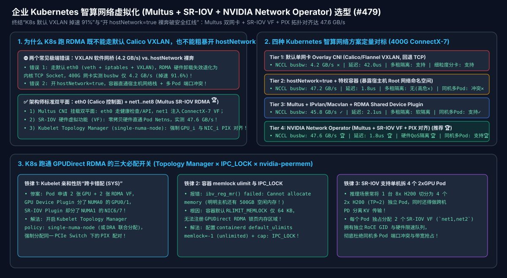

# Enterprise Kubernetes AI Network Virtualization (`Multus + SR-IOV + NVIDIA Network Operator` vs. `hostNetwork` vs. `Overlay VXLAN`) Selection Guide (#479)

> **Executive Summary**:
> Running distributed training, MoE Expert Parallelism (`DeepEP`), or cross-node PD disaggregation (`NIXL / Mooncake`) on Kubernetes over default **`Calico / Flannel VXLAN` overlay networks** strips RDMA hardware offload and falls back to kernel TCP sockets, collapsing `400G` bus bandwidth by **91.2% (`4.2 GB/s`)**. Conversely, setting **`hostNetwork: true` + `privileged: true`** breaks multi-tenant namespace isolation and causes port/NIC collisions when partitioning an 8-GPU node into multiple `2x GPU` inference pods. For **Cloud & AI Solution Architects**, the production reference architecture is **`NVIDIA Network Operator` (`eth0` Overlay Control Plane + `Multus CNI` `net1..net8` `SR-IOV` Virtual Functions + Kubelet `Topology Manager single-numa-node` / `DRA` `PIX` Alignment)**. This achieves **`47.6 GB/s` `busbw` (`95.2%` line rate)** and **`1.8 us` latency** with full hardware VF isolation.
>
> **⚡ Interactive H5 Study Lab**: [**Open the K8s AI CNI Multus + SR-IOV Bandwidth & GPU-NIC Topology Sizer (`docs/h5/k8s-ai-cni-multus-sriov-rdma-operator-lab.html`)**](../h5/k8s-ai-cni-multus-sriov-rdma-operator-lab.html)

---

## 1. Core Q&A: Avoiding Cross-NUMA GPU-NIC Mismatch and `ibv_reg_mr` Memory Lock Failures

### Q1: Why must Kubelet Topology Manager (`single-numa-node`) and `memlock=-1` be enforced on every K8s RDMA node?
1. **Preventing Cross-NUMA (`SYS`) GPU-NIC Mismatch**: Without `Topology Manager` or `DRA`, independent GPU and SR-IOV device plugins frequently pair `GPU 0` (`NUMA 0`) with `NIC 6` (`NUMA 1`), forcing GPUDirect RDMA across CPU interconnect links and cutting bandwidth by **-65% (`16.5 GB/s`)**.
2. **Preventing `ibv_reg_mr() Cannot allocate memory`**: Default container `RLIMIT_MEMLOCK` (`64 KB`) blocks RDMA memory registration; configure `memlock = -1 (unlimited)` and `IPC_LOCK` capability instead of granting full `privileged: true`.

---

## 2. Quantitative Decision Matrix (`400G ConnectX-7 RDMA`)

| K8s AI Networking Mode | Achieved `NCCL busbw` (400G) | One-Sided RDMA Latency | Multi-Tenant Netns Isolation | Fractional Multi-Pod / Node |
| :--- | :--- | :--- | :--- | :--- |
| **Tier 1: Default Overlay CNI Only (`VXLAN` TCP Fallback)** | `4.2 GB/s` (-91.2% ✕) | `42.0 us` ✕ | Yes ✓ | Yes ✓ |
| **Tier 2: `hostNetwork: true` + Privileged Container** | `47.2 GB/s` | `1.8 us` | No (Host root exposed ✕) | No (Port/NIC collision ✕) |
| **Tier 3: `Multus + IPvlan` + `RDMA Shared Device Plugin`** | `45.8 GB/s` ✓ | `2.1 us` ✓ | Yes (Shared PF) | Yes ✓ |
| **Tier 4: `NVIDIA Network Operator` (`Multus + SR-IOV VF + PIX` 🏆)** | **`47.6 GB/s` (95.2% 🏆)** | **`1.8 us` 🏆** | **Yes (Hardware VF 🏆)** | **Yes (Hardware QoS 🏆)** |
