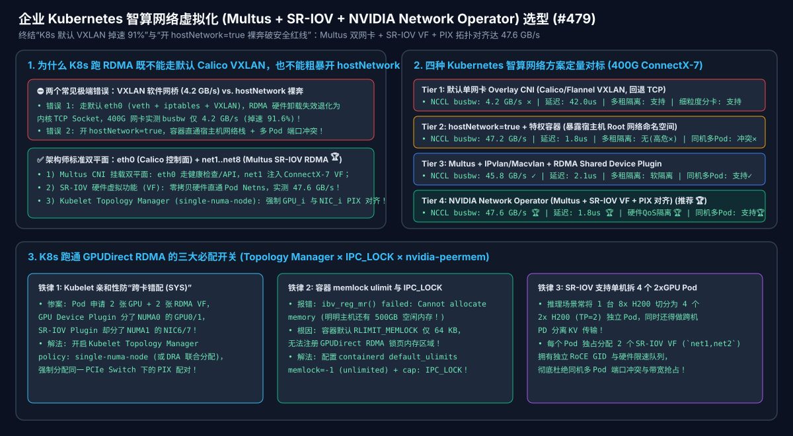
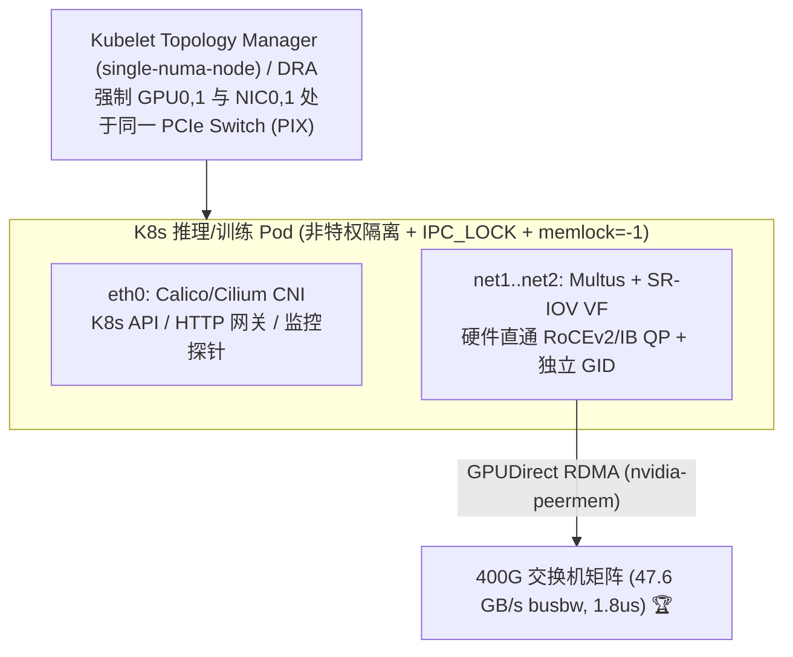

# 企业 Kubernetes 智算网络虚拟化（`Multus + SR-IOV + NVIDIA Network Operator`）选型：为什么 `VXLAN` 掉速 91%，而 `hostNetwork=true` 会引发多 Pod 冲突？ (#479)

> **核心观点（Executive Summary）**：
> 在把分布式训练、MoE 专家并行（`DeepEP`）或跨节点 PD 分离（`NIXL / Mooncake`）搬上 Kubernetes 时，许多平台团队要么直接用默认的 **`Calico / Flannel VXLAN` 容器网络**（导致 `400G RDMA` 硬件卸载失效并回退到内核 TCP Socket，带宽从 `47.6 GB/s` 暴跌 91.2% 至 **`4.2 GB/s`**），要么为了省事给所有 Pod 加上 **`hostNetwork: true` + `privileged: true`**（不仅让租户容器直接暴露宿主机 Root 网络栈，更导致同一台 8 卡节点上拆分多个 `2x GPU` 推理 Pod 时发生端口冲突与网卡抢占）。作为 **Cloud & AI Solution Architect**，生产级 K8s 智算集群必须采用 **`NVIDIA Network Operator` 标准双平面架构（`eth0` Calico 控制面 + `Multus CNI` 挂载 `net1..net8` `SR-IOV` 硬件虚拟功能 `VF` + Kubelet `Topology Manager` / `DRA` 强制 `GPU-NIC PIX` 对齐）**：在保持 **100% 命名空间安全隔离与单机多 Pod 细粒度切分** 的同时，跑满 **`47.6 GB/s`（`95.2%` 线速）** 总线带宽与 **`1.8 us`** 超低延迟！
>
> **⚡ 配套交互式 H5 精读沙盘**：[**打开 K8s 智算网络 Multus + SR-IOV 带宽与 GPU-NIC 拓扑对齐沙盘 (`docs/h5/k8s-ai-cni-multus-sriov-rdma-operator-lab.html`)**](../h5/k8s-ai-cni-multus-sriov-rdma-operator-lab.html)

---

## 一、 灵魂拷问：为什么 K8s 跑 RDMA 会有“三大新手必踩天坑”？

### Q1：为什么容器不能直接通过默认的 `veth + Linux Bridge + VXLAN` 跑 RDMA？`Multus + SR-IOV` 是怎么打通零拷贝的？
1. **传统内核 Overlay 网络对 RDMA 的屏蔽**：
   - RDMA（无论是 InfiniBand 还是 RoCEv2）依赖网卡硬件队列对（`Queue Pair, QP`）绕过操作系统内核直接读写 GPU HBM（`GPUDirect RDMA`）；
   - 而标准 K8s CNI 创建的虚拟以太网设备对（`veth pair`）是一段纯软件内核管道，根本没有硬件 RDMA Verbs 能力；一旦 NCCL / NIXL 探测不到 `/dev/infiniband/uverbs*` 与对应的硬件 RoCE GID，就会静默回退到慢速 TCP Socket（`4.2 GB/s`）！
2. **`Multus + SR-IOV` 硬件直通双平面**：
   - **第一平面（`eth0`）**：保持原有的 `Calico / Cilium` CNI，专门负责 K8s Service、Prometheus 指标抓取、网关 HTTP 路由与健康探针；
   - **第二平面（`net1..net8`）**：通过 PCIe **SR-IOV（Single Root I/O Virtualization）** 在每张 `400G ConnectX-7` 物理网卡（PF）上切分出多个硬件级虚拟网卡（VF），由 `Multus CNI` + `SR-IOV Network Device Plugin` 将独立的 VF 直接注入容器网络命名空间，实现 **与物理裸机完全一致的 `47.6 GB/s` 硬件零拷贝**！

### Q2：为什么在 K8s 里即使配好了 SR-IOV，跑 `nccl-tests` 带宽还是会莫名其妙腰斩到 `16 GB/s`？（跨 NUMA 错配惨案）
- **故障根因（Device Plugin 各自为政）**：
  - 当一个推理 Pod 申请 `nvidia.com/gpu: 2` 和 `nvidia.com/mlx5_sriov_rdma: 2` 时，默认情况下 K8s 的 GPU 插件和网卡插件是 **各自独立随机挑选空闲设备** 的！
  - 结果经常出现：**GPU 插件分配了插在 `NUMA 0 / PCIe Switch 0` 上的 `GPU 0, 1`，而网卡插件却分配了插在 `NUMA 1 / PCIe Switch 3` 上的 `NIC 6, 7`**！此时 GPUDirect RDMA 流量被迫跨越两颗 CPU 之间的 `UPI/xGMI` 总线（`SYS` 拓扑），带宽直接从 `47.6 GB/s` 跌至 **`16.5 GB/s`**！
- **架构师强制铁律**：
  - 在 Kubelet 开启 **`--topology-manager-policy=single-numa-node`（或 `best-effort` 配合 K8s 1.32+ `DRA` 联合拓扑分配）**，强制保证分配给同一个 Pod 的 GPU 与 RDMA VF 必须位于同一个 PCIe Root / Switch 域下！

### Q3：为什么容器跑 RDMA 经常报 `ibv_reg_mr() failed: Cannot allocate memory`，明明宿主机还有几百 GB 内存？
- **根因**：注册 RDMA 内存区域（Memory Region, MR）需要锁定物理内存页（Pinned Memory），而 Docker / containerd 默认给非特权容器设置的 **`ulimit -l` (`RLIMIT_MEMLOCK`) 只有区区 `64 KB`**！
- **解法**：无需开启危险的 `privileged: true` 全特权模式，只需在容器运行时或 Pod SecurityContext 中授予 **`IPC_LOCK` capability** 并将 `memlock` ulimit 设为 **`unlimited (-1)`**。

---

## 二、 四种 Kubernetes 智算网络方案选型决策矩阵（`400G ConnectX-7`）

| K8s 智算网络虚拟化档位 | 实测 `NCCL busbw` (400G) | 单边 RDMA 延迟 ($\mu\text{s}$) | 多租户网络命名空间隔离 | 支持单机切分多个多卡 Pod |
| :--- | :--- | :--- | :--- | :--- |
| **Tier 1: 默认单网卡 Overlay CNI（`VXLAN` 回退 TCP Socket）** | `4.2 GB/s` (-91.2% ✕) | `42.0 us` ✕ | 支持 ✓ | 支持 ✓ |
| **Tier 2: `hostNetwork: true` + 特权容器（共享宿主机网络栈）** | `47.2 GB/s` | `1.8 us` | 不支持（高危逃逸 ✕） | 不支持（端口与设备冲突 ✕） |
| **Tier 3: `Multus + IPvlan` + `RDMA Shared Device Plugin`** | `45.8 GB/s` ✓ | `2.1 us` ✓ | 支持（共享 PF 队列） | 支持 ✓ |
| **Tier 4: `NVIDIA Network Operator`（`Multus + SR-IOV VF + PIX 对齐` 🏆）** | **`47.6 GB/s` (95.2% 线速 🏆)** | **`1.8 us` 🏆** | **支持（硬件 VF 隔离 🏆）** | **支持（硬件 QoS 限速 🏆）** |

---

## 三、 生产落地核对清单（SA Production Checklist）

- [ ] **采用 `NVIDIA Network Operator` 统一托管驱动与插件**：一键自动化部署 `MOFED/DOCA` 驱动、`nvidia-peermem` 内核模块、`Multus CNI`、`SR-IOV Network Operator` 与 `Whereabouts IPAM`，告别手工改宿主机脚本。
- [ ] **开启 Kubelet Topology Manager 与 `memlock=-1`**：核验所有 GPU 工作节点已配置 `topologyManagerPolicy: single-numa-node`（或 DRA）以及 `containerd` 默认 `memlock = -1`。
- [ ] **显式注入 `NCCL_SOCKET_IFNAME=eth0` 与 `NCCL_IB_HCA=mlx5`**：在 Pod 环境变量中明确指定控制面握手走 `eth0`、数据面 RDMA 走 `mlx5_*` 硬件网卡，防止 NCCL 误选虚拟网桥。

---

## 四、 延伸阅读与配套工具

- **交互式 H5 精学沙盘**：[docs/h5/k8s-ai-cni-multus-sriov-rdma-operator-lab.html](../h5/k8s-ai-cni-multus-sriov-rdma-operator-lab.html)
- **7-Card 4:5 视觉评测卡片**：[docs/reports/enterprise-k8s-ai-cni-multus-sriov-rdma-network-operator-selection-cards.html](../reports/enterprise-k8s-ai-cni-multus-sriov-rdma-network-operator-selection-cards.html)
- **交互式 Sizer 测算器**：[docs/reports/enterprise-k8s-ai-cni-multus-sriov-rdma-network-operator-selection-sizer.html](../reports/enterprise-k8s-ai-cni-multus-sriov-rdma-network-operator-selection-sizer.html)
- **可复现实验模型**：[`experiments/enterprise_k8s_ai_cni_multus_sriov_rdma_network_operator_selection/run.py`](../../experiments/enterprise_k8s_ai_cni_multus_sriov_rdma_network_operator_selection/run.py)
