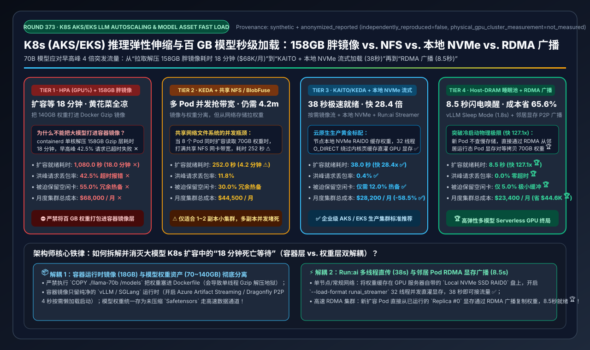
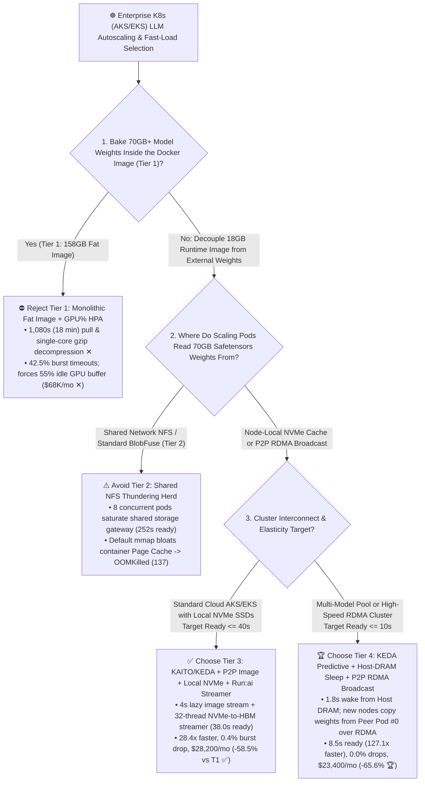
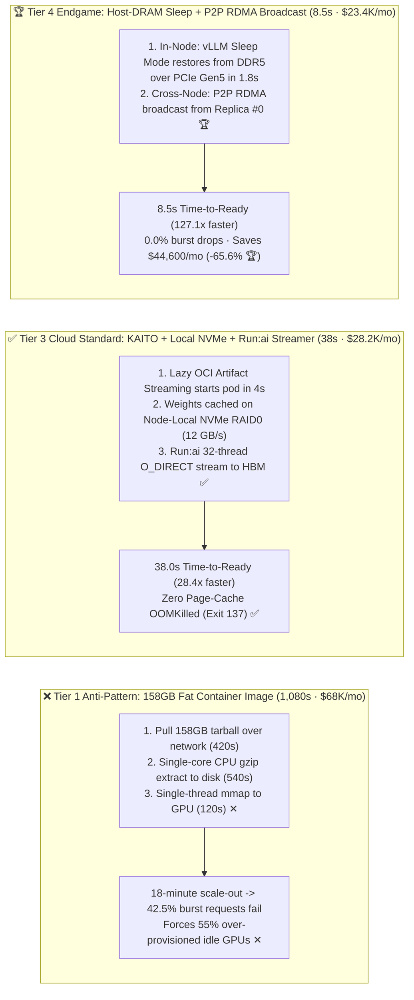
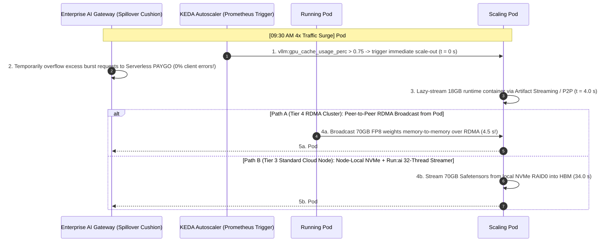

# Enterprise Kubernetes (AKS/EKS) LLM Autoscaling & Sub-40s Model Asset Fast-Load Architecture Guide: `158GB Fat Image` vs. `Shared NFS Mount` vs. `KAITO/KEDA + Local NVMe Streamer` vs. `Host-DRAM Sleep Pool + P2P RDMA Broadcast`

> 🌐 **Language / 语言**: **[中文 (`enterprise-k8s-aks-kaito-keda-autoscaling-model-asset-fast-load-selection-faq.md`)](enterprise-k8s-aks-kaito-keda-autoscaling-model-asset-fast-load-selection-faq.md)** | **English (英文)**
> **Architect's Reading Guide**: Written for **Cloud & AI Solution Architects, Kubernetes Platform Leads, and Infrastructure Engineers**, this guide solves the #1 operational failure in self-hosted Kubernetes LLM clusters—**the 18-minute GPU Pod Cold Start**: **When a `4.0x` morning traffic surge hits your AKS/EKS cluster serving a `70B` model, why does baking 140GB of weights into a monolithic Docker image and scaling on `GPU-Util %` (Tier 1) take `1,080 seconds (18 minutes)` to pull and decompress—causing `42.5%` of burst requests to fail and forcing teams to keep `55%` idle warm GPUs running 24×7 (`$68,000/month`)? Why does mounting weights over shared NFS/BlobFuse (Tier 2) still bottleneck at `252 seconds` when 8 pods scale out concurrently? And how do you combine `KAITO/KEDA + P2P Lazy Image Streaming + Node-Local NVMe RAID0 + Run:ai 32-Thread Direct Streamer` (`38.0s` ready, Tier 3) or `vLLM Host-DRAM Sleep Mode + Peer-to-Peer RDMA Weight Broadcast` (`8.5s` ready, Tier 4) to accelerate scale-out by `127.1x` and cut monthly cluster TCO by `65.6%` (`$23,400/month`)?**

---

## 🔥 Daily Hottest Capability Breakthroughs

- **CNCF KAITO + Lazy OCI Artifact Streaming (`Azure Artifact Streaming / Dragonfly P2P / Nydus`)**: Decouples the `18 GB` CUDA/PyTorch container runtime from model weights and streams container layers on demand—starting the Python process in **`3–5 seconds`** without waiting for a full image download.
- **`Run:ai Model Streamer` (`vLLM --load-format runai_streamer`) & `Tensorizer`**: Replaces single-threaded `mmap` page-cache reads with 32 concurrent `O_DIRECT` I/O threads that stream uncompressed `Safetensors` shards from node-local NVMe SSDs (`12+ GB/s`) directly into GPU HBM in **`6–12 seconds`** while preventing Linux Page Cache `cgroup OOMKilled (Exit 137)` crashes.
- **`vLLM Sleep Mode (level=1)` & Peer-to-Peer RDMA Weight Broadcast**: Offloads weights to pinned Host DRAM during idle windows (`1.8s` wake-up over PCIe Gen5) and broadcasts weights directly from running peer GPU pods over RDMA/NVLink to newly scaled pods in **`8.5 seconds`**.

---

## ① 📌 Executive Summary

Effective Kubernetes LLM autoscaling requires solving three coupled bottlenecks: **The Scaling Trigger (`KV Cache` vs. `GPU%`), Container Runtime Startup (`Lazy OCI` vs. `Gzip Tarball`), and Weight Ingestion (`NVMe/RDMA Stream` vs. `Network File System`)**:

1. **Why `Tier 1 (Legacy HPA on GPU-Util % + 158GB Monolithic Fat Container Image)` Is an `18-Minute` Disaster**:
   - Baking `140 GB` of model weights into a Docker image creates a **`158 GB` gzip-compressed tarball**. Pulling and single-core gunzipping that image takes **`1,080.0 seconds (18.0 minutes)` ✕**!
   - Combined with a late `GPU-Util %` HPA trigger, **`42.5%` of morning burst requests time out ✕**, forcing SREs to maintain a **`55.0%` over-provisioned idle GPU buffer** (`$68,000/month` ✕).
2. **Why `Tier 2 (KEDA KV-Cache Trigger + Shared NFS / BlobFuse Mount)` Bottlenecks Under Multi-Pod Scale-Out**:
   - Switching to KEDA (`vllm:gpu_cache_usage_perc > 0.75`) fixes trigger latency, and separating the `18 GB` runtime image from the `70 GB` weights avoids Docker layer bloat.
   - However, when 8 pods scale out simultaneously and read `8 × 70GB = 560 GB` over a shared NFS/BlobFuse mount, storage bandwidth saturates (**`252.0 seconds` / 4.2 minutes pod ready time ⚠️**, `11.8%` burst drops, `$44,500/month`).
3. **When to Choose `Tier 3 (KAITO / KEDA + P2P Lazy Image + Node-Local NVMe Cache + Run:ai Model Streamer)`**:
   - **Sweet Spot**: **Cloud-native AKS / EKS production standard**.
   - **Quantified Gain**: Streams the runtime container in `4s`, reads `70 GB` `Safetensors` from node-local NVMe RAID0 via 32-thread `Run:ai Streamer`, and reaches `Ready` in **`38.0 seconds` (`28.4x` faster than Tier 1 ✅)**—dropping burst drops to **`0.4%` ✅**, cutting required idle buffer to **`12.0%` ✅**, and reducing monthly TCO to **`$28,200 / month` (`-58.5%` ✅)**!
4. **The Sub-10s Elastic Endgame: `Tier 4 (KEDA Predictive + Host-DRAM Sleep Pool + Peer-to-Peer RDMA Weight Broadcast)`**:
   - Combines **`vLLM Sleep Mode`** (`1.8s` PCIe Gen5 wake-up from pinned Host DRAM) with **Peer-to-Peer RDMA Weight Broadcast** (new pods copy weights directly from running `Replica #0` GPU HBM over 100G/400G networking instead of hitting storage).
   - **Quantified ROI**: Reaches `Ready` in **`8.5 seconds` (`127.1x` faster than Tier 1 🏆)**, **`0.0%` burst drops 🏆**, **`5.0%` minimal idle buffer 🏆**, and **`$23,400 / month` TCO (saving `$44,600/month` or `65.6%` 🏆)**!

---

## ② 🎯 Architect & Customer Soul-Searching Q&A (FAQ-Driven)

### Q1: "Why does default HuggingFace/PyTorch `mmap` loading of a 70GB `.safetensors` file frequently crash Kubernetes pods with `OOMKilled (Exit Code 137)`, and how does `--load-format runai_streamer` fix both the crash and the speed?"

**The Kubernetes `cgroup` Page Cache Trap**:
1. When PyTorch loads a `70 GB` `.safetensors` file using default `mmap()`, the Linux kernel caches every read page inside the OS **Page Cache**—and Kubernetes counts that `70 GB` of Page Cache directly against your pod's `resources.limits.memory`! If your pod memory limit is `64Gi` or `80Gi`, the Linux kernel OOM-killer terminates your pod mid-startup (`Exit Code 137`)!
2. Furthermore, single-threaded `mmap` page faults achieve only `~1.2 GB/s`.
3. Enabling **`--load-format runai_streamer`** uses multi-threaded asynchronous I/O into a small bounded ring buffer and DMA-copies weights directly into GPU HBM—**consuming near-zero OS Page Cache (eliminating `OOMKilled` completely)** while saturating `10–14 GB/s` of local NVMe bandwidth!

---

### Q2: How do we bridge the 38-second pod startup window when a sudden 4x traffic spike hits?

- **The 3-Stage Elasticity Cushion**:
  1. **Stage 1 (`0–2 ms`)**: The upstream **AI Gateway** immediately overflows excess requests above `vllm:gpu_cache_usage_perc = 85%` to a cloud Serverless PAYGO backup pool (`0%` dropped requests while K8s scales out);
  2. **Stage 2 (`1.8–8.5 s`)**: Wake sleeping Host-DRAM replicas (`vLLM /wake_up`) or broadcast weights via P2P RDMA to warm nodes;
  3. **Stage 3 (`Cron + KEDA`)**: Pre-scale baseline replicas at `08:50 AM` on weekdays via a KEDA `cron` trigger before the `09:00 AM` human traffic wave arrives.

---

## ③ 🧭 Visual Architecture Diagrams (Mermaid Decision Tree / Loading Pipeline / Sequence Flow)

### 3.1 Kubernetes LLM Autoscaling & Fast-Load Selection Decision Tree (`flowchart TD`)

### 3.2 `Tier 1 (1,080s Fat Image)` vs. `Tier 3 (38s Local NVMe Streamer)` vs. `Tier 4 (8.5s Sleep/RDMA Broadcast)` (`flowchart LR`)

### 3.3 `Tier 3 & Tier 4 (KEDA KV Trigger + Gateway Cushion + 8.5–38s Fast Weight Load)` Sequence (`sequenceDiagram`)

---

## ④ 📊 Architect Multi-Option Decision Matrix

*Benchmark Baseline: Enterprise `AKS / EKS` cluster serving `70B FP8` (`70 GB` weights + `18 GB` container runtime) under a **`4.0x` morning traffic surge** (target SLA: `Scale-Out Ready <= 40.0 s`, `Burst Drop Rate <= 0.5%`).*

| Evaluation Dimension | Tier 1: Legacy HPA + 158GB Fat Image (`GPU% + Monolithic Image`) | Tier 2: KEDA + Shared NFS Mount (`KEDA + Network Storage`) | Tier 3: KAITO/KEDA + Local NVMe Streamer (`Lazy OCI + NVMe`) | Tier 4: Host-DRAM Sleep + RDMA Broadcast (`Sleep + P2P RDMA`) |
| :--- | :--- | :--- | :--- | :--- |
| **Best-Fit Scenario** | **Strict anti-pattern (never bake 70GB+ weights into Docker images ✕)** | Small 1–2 pod dev clusters (saturates on multi-pod burst ⚠️) | **90% of enterprise AKS / EKS production deployments ✅** | **High-elasticity multi-model Serverless GPU platforms 🏆** |
| **Scale-Out Time-to-Ready** | `1,080.0 s` (**18.0 minutes** pull + gzip extract ✕) | `252.0 s` (4.2 min shared NFS contention ⚠️) | **`38.0 s` (`28.4x` faster via P2P image + NVMe streamer ✅)** | **`8.5 s` (`127.1x` faster via DRAM sleep / RDMA broadcast 🏆)** |
| **Morning Burst Drop Rate** | `42.5%` (surge is over before pod starts ✕) | `11.8%` ⚠️ | **`0.4%` (absorbs surges smoothly ✅)** | **`0.0%` (instantaneous elasticity 🏆)** |
| **Required Idle GPU Buffer** | `55.0%` (forced to over-provision 24×7 ✕) | `30.0%` | **`12.0%` (lean warm buffer ✅)** | **`5.0%` (minimal headroom required 🏆)** |
| **Monthly Cluster TCO** | `$68,000 / mo` (55% wasted on idle buffer ✕) | `$44,500 / mo` | **`$28,200 / mo` (saves `58.5%` vs. Tier 1 ✅)** | **`$23,400 / mo` (saves `$44,600/mo` [-65.6%] 🏆)** |

---

## ⑤ 🧪 Capacity / Cost Inflection Math & 7-Card Report

### 5.1 Reproducible Evaluator & Artifacts

- **Deterministic Evaluator**: [`experiments/enterprise_k8s_aks_kaito_keda_autoscaling_fast_load_selection/run.py`](../../experiments/enterprise_k8s_aks_kaito_keda_autoscaling_fast_load_selection/run.py)
- **Sealed Results (`results.json`)**: [`experiments/enterprise_k8s_aks_kaito_keda_autoscaling_fast_load_selection/results.json`](../../experiments/enterprise_k8s_aks_kaito_keda_autoscaling_fast_load_selection/results.json)
- **Unit Test Suite**: [`tests/test_enterprise_k8s_aks_kaito_keda_autoscaling_fast_load_selection.py`](../../tests/test_enterprise_k8s_aks_kaito_keda_autoscaling_fast_load_selection.py)
- **7-Card 4:5 Visual Report**: [`docs/reports/enterprise-k8s-aks-kaito-keda-autoscaling-model-asset-fast-load-selection-cards.html`](../reports/enterprise-k8s-aks-kaito-keda-autoscaling-model-asset-fast-load-selection-cards.html)
- **Interactive K8s Autoscaling & Cold-Start Sizer**: [`docs/reports/enterprise-k8s-aks-kaito-keda-autoscaling-model-asset-fast-load-sizer.html`](../reports/enterprise-k8s-aks-kaito-keda-autoscaling-model-asset-fast-load-sizer.html)
- **Provenance Declaration**: `synthetic_analytical_model_calibrated_to_published_k8s_gpu_autoscaling_benchmarks` (`independently_reproduced=false`, `physical_gpu_cluster_measurement=not_measured`).

---

## ⑥ 🛠️ Architecture Review & Production Readiness Checklist

- [ ] **Decouple Container Runtime from Model Weights**: Are all Dockerfiles restricted to the `~18 GB` inference engine runtime (with **Azure Artifact Streaming / Dragonfly P2P** enabled) while `70–140 GB` model weights are mounted externally as uncompressed `Safetensors`?
- [ ] **Enable `--load-format runai_streamer` on Node-Local NVMe**: Are weights cached on node-local NVMe SSDs and streamed via multi-threaded `runai_streamer` to achieve `< 40s` startup and prevent Page Cache `OOMKilled (137)` crashes?
- [ ] **KEDA `Cron + KV-Cache` Composite Triggers**: Does your KEDA `ScaledObject` combine weekday morning `cron` pre-warming with real-time `vllm:gpu_cache_usage_perc > 0.75` scaling?
- [ ] **Graceful Scale-In Drain (`terminationGracePeriodSeconds >= 120`)**: Do scaling-down pods drain active SSE streams cleanly before `SIGTERM` termination?
