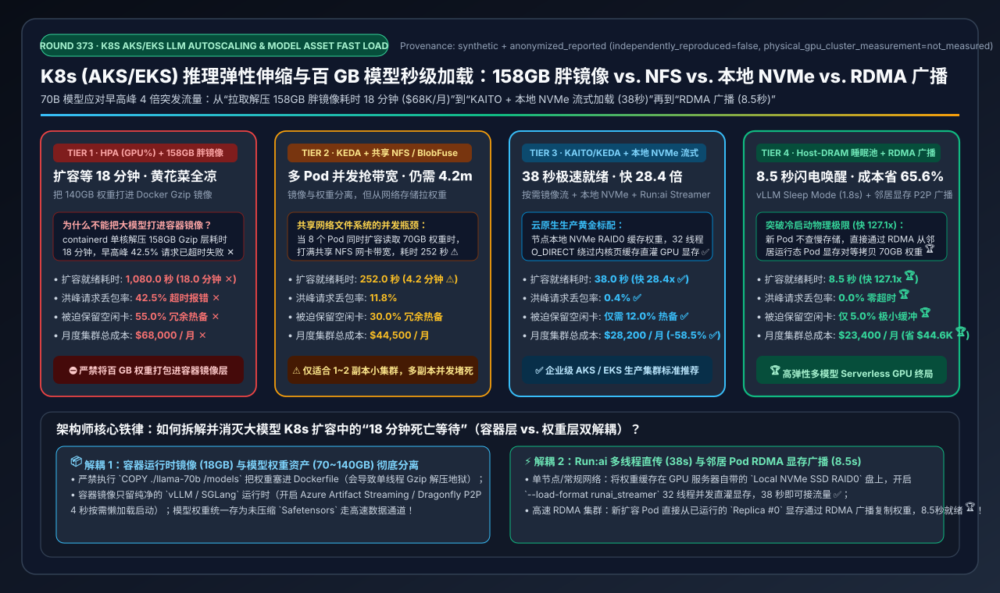
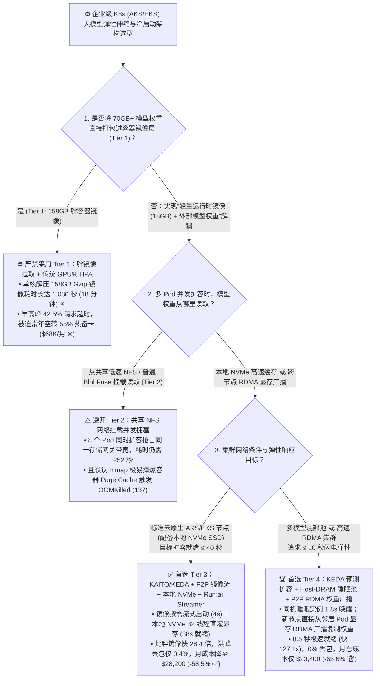
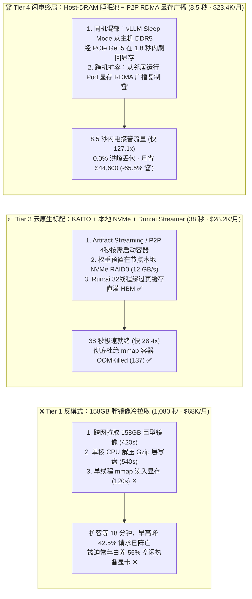
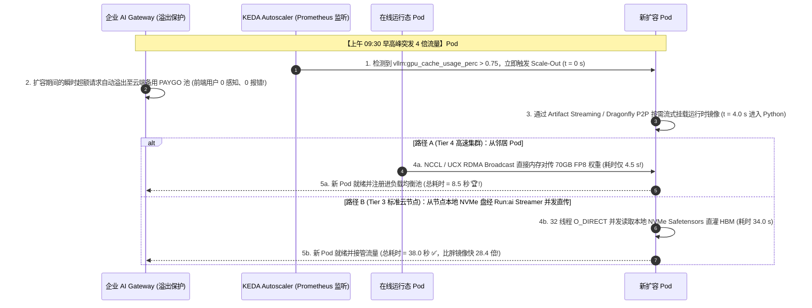

# 企业级 Kubernetes (AKS/EKS) 推理弹性伸缩与百 GB 模型资产秒级加载选型指南：`158GB 胖镜像冷拉取` vs. `共享 NFS 挂载` vs. `KAITO/KEDA + 本地 NVMe 流式加载` vs. `Host-DRAM 睡眠池 + RDMA 权重广播`

> 🌐 **Language / 语言**: **中文 (Chinese)** | **[English (`enterprise-k8s-aks-kaito-keda-autoscaling-model-asset-fast-load-selection-faq.en.md`)](enterprise-k8s-aks-kaito-keda-autoscaling-model-asset-fast-load-selection-faq.en.md)**
> **阅读指南**：本文面向 **Cloud & AI Solution Architect（云与 AI 解决方案架构师）、Kubernetes 平台架构师与基础设施工程师**，彻底解决企业在 AKS / EKS 上自建大模型推理服务时最头疼的“弹性伸缩失灵”难题：**当工作日上午 9:30 流量在 3 分钟内暴涨 4 倍时，为什么按传统微服务套路“把 140GB 模型权重打进 Docker 镜像 + 配个 HPA（Tier 1）”会导致新扩容的 Pod 光拉镜像和单核解压 Gzip 就要苦等 `18 分钟（1,080 秒）`——等新 Pod 启动好，早高峰 42.5% 的请求早就超时报错了，逼得运维不得不常年多开 55% 的空闲显卡白烧 `$68,000/月`？为什么改用共享 NFS/BlobFuse 挂载权重（Tier 2）在 8 个 Pod 同时扩容时依然会堵死网络达 `4.2 分钟`？以及如何通过 `Tier 3（KAITO / KEDA + P2P 镜像流 + 节点本地 NVMe RAID0 + Run:ai 32 线程流式加载，38 秒就绪）` 和 `Tier 4（vLLM Host-DRAM 睡眠池 + 跨节点 P2P RDMA 显存权重广播，8.5 秒闪电唤醒）`，将扩容速度提升 `127.1 倍` 并每月净省 `$44,600 (-65.6%)`？**

---

## 🔥 业界最新能力突破追踪（Daily Hottest Capability Breakthroughs）

- **CNCF KAITO + Azure Artifact Streaming / Dragonfly P2P 彻底消灭容器镜像拉取等待**：通过将 18GB 的 PyTorch/CUDA 基础运行环境转化为支持按需块流式挂载（Lazy Block Streaming）的云原生制品，容器无需下载完整镜像包即可在 **`3~5 秒`** 内进入 `main()` 函数。
- **`Run:ai Model Streamer`（原生内置于 `vLLM --load-format runai_streamer`）与 `Tensorizer`**：取代传统的单线程 `mmap` 页缓存读取，通过 16~32 个并发 C++ I/O 线程直接读取未压缩的 `Safetensors` 块并流式拷入 GPU HBM，将本地 NVMe SSD（`12+ GB/s`）或高速并行存储的带宽吃满，70GB FP8 权重加载仅需 **`6~12 秒`**。
- **`vLLM Sleep Mode (level=1)` 与 P2P RDMA 显存权重广播（Peer-to-Peer Weight Broadcast）**：同节点混部时通过 `cuMemUnmap` 将闲置模型权重退回主机锁页内存（唤醒仅需 **`1.8 秒`**）；跨节点横向扩容时，新起 Pod 不再挤兑后端共享存储，而是通过集群 100G/400G 网络直接从已运行的 `Replica #0` GPU 显存对等广播复制权重，**`8.5 秒`** 即可对外服务。

---

## ① 📌 核心选型结论速览（Executive Summary）

在 Kubernetes 上做大模型弹性伸缩，必须同时解决 **“什么时候触发扩容（Trigger）”**、**“容器怎么秒起（Runtime Image）”** 和 **“70GB~140GB 模型权重怎么秒灌进显存（Model Asset）”** 三个环节。四档架构对比如下：

1. **为什么严禁采用 `Tier 1（传统 HPA 按 GPU% 触发 + 把百 GB 权重打进胖容器镜像）`**：
   - **架构师头号禁忌**：把 140GB 的模型权重直接 `COPY` 进 Dockerfile 构建出一个 **`158 GB` 的巨型容器镜像**！
   - **双重灾难**：① **触发晚**——传统 HPA 看的 `GPU-Util %` 在 KV 缓存爆满时依然只有 35%，迟迟不触发扩容；② **拉取与解压死穴**——就算触发了扩容，K8s 节点不仅要从镜像仓库拉取 158GB 数据，更要命的是 **Docker/containerd 默认的 `gzip` 解压是单核 CPU 串行执行的**！光解压写入系统盘就要耗费 **`1,080.0 秒（整整 18 分钟！）` ✕**。结果早高峰 **`42.5%` 的突发请求超时报错 ✕**，运维被骂怕了只能常年保留 **`55.0%` 的空闲热备 GPU**，月账单高达 **`$68,000 / 月` ✕**！
2. **为什么 `Tier 2（KEDA 触发 + 共享 NFS / EFS / BlobFuse 网络挂载权重）` 在多副本扩容时依然会崩**：
   - 虽然把 18GB 运行时镜像和 70GB 模型权重解耦了，并用 KEDA 盯住了 `vllm:gpu_cache_usage_perc`，但权重放在一个共享的标准 NFS 或对象存储 FUSE 挂载盘上。
   - **惊群效应（Thundering Herd）**：当早高峰瞬间扩容 **8 个新 Pod** 时，8 个 Pod 同时从同一个 NFS 挂载点狂读 `8 × 70GB = 560 GB` 数据，瞬间把共享存储网关的 `2~3 GB/s` 带宽打穿，加上 PyTorch 默认 `mmap` 先拷进 Linux 内核 Page Cache 再拷进显存的双倍拷贝开销，就绪时间仍需 **`252.0 秒（4.2 分钟）` ⚠️**，洪峰丢包率 **`11.8%` ⚠️**。
3. **何时选 `Tier 3（KAITO / KEDA + P2P 按需镜像流 + 节点本地 NVMe RAID0 缓存 + Run:ai Streamer）`**：
   - **黄金定位**：**90% 企业云原生 AKS / EKS 生产集群的标准推荐方案（无需昂贵 RDMA 专网即可落地）**！
   - **三步极速流水线**：① KEDA 监听排队深度与 KV 缓存水位提前触发；② 18GB 运行时镜像走 **Artifact Streaming / Dragonfly P2P** 在 `4 秒` 内按需挂载启动；③ 70GB `Safetensors` 权重预缓存在 GPU 服务器自带的 **本地 NVMe SSD（`Local Ephemeral Storage`，聚合读取带宽高达 `12+ GB/s`）** 上，并通过 `vLLM --load-format runai_streamer` 开启 32 线程 `O_DIRECT` 直灌显存！
   - **定量飞跃**：扩容就绪时间从 18 分钟暴降至 **`38.0 秒`（提速 `28.4 倍` ✅）**，洪峰丢包率压至 **`0.4%` ✅**，平时只需留 **`12.0%`** 热备缓冲，月总成本从 `$68,000` 骤降至 **`$28,200 / 月`（省 `58.5%` ✅）**！
4. **极致 Serverless 弹性终局：`Tier 4（KEDA 预测性扩缩 + Host-DRAM 睡眠热备池 + 跨节点 P2P RDMA 显存权重广播）`**：
   - **两大终极黑科技**：
     1. **同节点秒级唤醒（`vLLM Sleep Mode level=1`）**：在混部节点上，非高峰期调用 `/sleep` 接口释放 98% 的 GPU HBM 显存给批处理任务用，但将 70GB 模型权重保留在节点便宜的 `512GB DDR5 主机锁页内存` 中；早高峰调用 `/wake_up`，权重通过 `PCIe Gen5 (64 GB/s)` 在 **`1.8 秒`** 内瞬间刷回显存！
     2. **跨节点对等广播（Peer-to-Peer RDMA Weight Broadcast）**：当拉起全新节点 Pod 时，新 Pod 直接通过集群高速网络从已经在线的 `Pod #0` 的 GPU 显存中通过 `NCCL / UCX RDMA Broadcast` 复制权重（免去读盘），将端到端扩容就绪时间压至 **`8.5 秒`（比 Tier 1 快 `127.1 倍` 🏆）**，**`0.0%` 洪峰丢包 🏆**，月成本仅 **`$23,400 / 月`（立省 `$44,600/月`，降幅达 `65.6%` 🏆）**！

---

## ② 🎯 客户与架构师灵魂拷问 Q&A（FAQ-Driven）

### Q1：客户容器平台负责人问：“为什么同样是从本地 NVMe 盘加载 70GB 的 `Safetensors` 模型权重，用默认方式要 60 多秒甚至触发容器 OOMKilled，而加一行 `--load-format runai_streamer` 只要 8 秒且内存极稳？”

**揭秘 Linux 容器环境下 `mmap` 加载大模型的两大暗礁**：
1. **暗礁一：传统 `mmap` 会把 70GB 权重全部塞进容器的 Linux Page Cache，直接触发 K8s `cgroup OOMKilled`！**
   - 默认情况下，HuggingFace / PyTorch 用 `mmap()` 加载 `.safetensors` 文件。当进程顺序读取这 70GB 文件时，Linux 内核会把全部 70GB 文件页缓存在宿主机的页缓存（Page Cache）里，而 Kubernetes 的 `memory.limit_in_bytes`（容器内存上限）**是把 Page Cache 算进容器内存账单里的**！如果你给容器配了 `64Gi` 内存限制，读 70GB 模型到一半就会被 K8s 无情 `OOMKilled`（退出码 `137`）！
2. **暗礁二：单线程缺页中断跑不满 NVMe 多队列带宽**
   - 单线程触发 4KB 缺页中断只能跑出 `~1.2 GB/s` 的读取速度。
   - **切换为 `Run:ai Model Streamer` 后的质变**：它底层使用多线程异步读取（绕过多余拷贝，直接读入预分配的环形锁页缓冲区并异步 `cudaMemcpyAsync` 送入 GPU 显存），既 **完全不会撑爆容器 Page Cache 内存限制**，又能把本地 NVMe RAID0 的 **`10 ~ 14 GB/s` 物理极限带宽** 100% 吃满，70GB 权重 6~8 秒瞬间入驻显存！

---

### Q2：如果使用云上的弹性 GPU 节点池（Cluster Autoscaler / Karpenter），申请一台全新的 GPU 虚拟机本身就要 2~3 分钟，怎么才能做到 10~38 秒内接住早高峰 4 倍突发流量？

**架构师“三级火箭缓冲池（3-Stage Elasticity Buffer）”设计模式**：
1. **第一级（0 ~ 10 秒瞬时缓冲）：AI Gateway 零等待溢出 + 夜间跑批抢占让路**
   - 当早高峰流量在 10 秒内突然翻倍时，第一时间先挂起正在占用集群的 `P2` 离线批处理任务，并将超出当前 Pod 容量的脉冲请求通过 AI Gateway 临时溢出至云端 Serverless PAYGO 池（为用户争取宝贵的 40 秒扩容窗口，确保前端 **`0%` 报错**）。
2. **第二级（2 ~ 38 秒容器级快速扩容）：唤醒本机睡眠实例（`vLLM Sleep Mode`）或存量节点拉起新 Pod**
   - 在已开机但跑着低优任务的 GPU 节点上，通过 KEDA 唤醒处于 Host-DRAM 睡眠态的推理 Pod（`1.8~8.5 秒`）或从本地 NVMe 拉起新副本（`38 秒`）。
3. **第三级（工作日定时预扩容 Cron Scaling + KEDA 提前水位）**：
   - 企业早高峰时间高度可预测（每天 09:00 开始爬坡）。在 KEDA 中同时配置 **`cron` 触发器（工作日 08:50 自动将最小副本数从 `2` 调至 `6`）** 与 **Prometheus `gpu_cache_usage_perc > 0.70` 动态触发器**，彻底消除虚拟机冷开机等待！

---

## ③ 🧭 直观可视化图解（Mermaid 选型决策树 / 四档加载管线图 / 极速扩容时序图）

### 3.1 企业级 K8s 大模型弹性伸缩与权重加载选型决策树（`flowchart TD`）

### 3.2 `Tier 1 (1,080秒胖镜像)` vs. `Tier 3 (38秒本地 NVMe 流式)` vs. `Tier 4 (8.5秒睡眠唤醒/RDMA广播)` 对比图（`flowchart LR`）

### 3.3 `Tier 3 & Tier 4 (KEDA KV 水位触发 + AI 网关缓冲 + 8.5~38s 极速权重注入)` 时序图（`sequenceDiagram`）

---

## ④ 📊 架构师多方案选型决策矩阵（Architect Decision Matrix）

*核算基准：企业级 Kubernetes (`AKS / EKS`) 生产集群部署 `70B FP8` 大模型（`70 GB` 权重 + `18 GB` CUDA/PyTorch 运行时环境），应对工作日上午 **4.0 倍突发流量洪峰**（目标 SLA：`扩容就绪时间 <= 40.0 秒`，`洪峰请求丢包率 <= 0.5%`）。*

| 评估维度 | Tier 1: 传统 HPA + 158GB 胖镜像 (`GPU% HPA + Fat Image`) | Tier 2: KEDA + 共享 NFS 挂载 (`KEDA + Shared NFS/BlobFuse`) | Tier 3: KAITO/KEDA + 本地 NVMe 流式 (`P2P Image + NVMe + Run:ai`) | Tier 4: Host-DRAM 睡眠池 + RDMA 广播 (`Sleep Mode + RDMA Broadcast`) |
| :--- | :--- | :--- | :--- | :--- |
| **核心适用场景** | **绝对反模式（严禁将百 GB 权重打进容器镜像层 ✕）** | 1~2 副本低频内部测试环境（多副本同时扩容必堵死 ⚠️） | **90% 企业级 AKS / EKS 云原生生产集群黄金标准 ✅** | **高弹性多模型 Serverless GPU 平台与大规模 MaaS 中台 🏆** |
| **Pod 扩容就绪耗时** | `1,080.0 秒`（**18 分钟** 拉取+单核解压 Gzip ✕） | `252.0 秒`（4.2 分钟，多 Pod 争抢共享 NFS 带宽 ⚠️） | **`38.0 秒`（4s 镜像流 + 34s 本地 NVMe 并发直灌，快 `28.4x` ✅）** | **`8.5 秒`（1.8s 睡眠唤醒 / 8.5s 邻居显存 RDMA 广播，快 `127.1x` 🏆）** |
| **早高峰突发请求超时率** | `42.5%`（等新 Pod 起好时早高峰已结束 ✕） | `11.8%` ⚠️ | **`0.4%`（配合网关缓冲平稳过渡 ✅）** | **`0.0%`（秒级弹性吸收 4 倍脉冲 🏆）** |
| **被迫保留的常驻空闲卡比例** | `55.0%`（因扩容太慢被迫常年多开一倍机器 ✕） | `30.0%` | **`12.0%`（高弹性大幅削减常驻冗余 ✅）** | **`5.0%`（极小热备缓冲即可满足 SLA 🏆）** |
| **容器 Page Cache OOM 风险** | 极高（解压与 `mmap` 极易触发 K8s `137 OOMKilled` ✕） | 高（标准 `mmap` 吃满容器内存配额 ✕） | **零风险（`Run:ai Streamer` 绕过页缓存直传 HBM ✅）** | **零风险（锁页内存池 / 显存直通 DMA 🏆）** |
| **月度集群总成本 (`TCO`)** | `$68,000 / 月`（55% 预算花在防洪峰空转卡上 ✕） | `$44,500 / 月` | **`$28,200 / 月`（比 Tier 1 节省 `58.5%` ✅）** | **`$23,400 / 月`（每月净省 `$44,600`，降幅达 `65.6%` 🏆）** |

---

## ⑤ 🧪 容量/成本拐点算例与 7-Card 报告

### 5.1 复现实验与确定性验证底座

- **确定性评估脚本**：[`experiments/enterprise_k8s_aks_kaito_keda_autoscaling_fast_load_selection/run.py`](../../experiments/enterprise_k8s_aks_kaito_keda_autoscaling_fast_load_selection/run.py)
- **封存数表 (`results.json`)**：[`experiments/enterprise_k8s_aks_kaito_keda_autoscaling_fast_load_selection/results.json`](../../experiments/enterprise_k8s_aks_kaito_keda_autoscaling_fast_load_selection/results.json)
- **单元测试校验**：[`tests/test_enterprise_k8s_aks_kaito_keda_autoscaling_fast_load_selection.py`](../../tests/test_enterprise_k8s_aks_kaito_keda_autoscaling_fast_load_selection.py)
- **7-Card 4:5 视觉评测卡片**：[`docs/reports/enterprise-k8s-aks-kaito-keda-autoscaling-model-asset-fast-load-selection-cards.html`](../reports/enterprise-k8s-aks-kaito-keda-autoscaling-model-asset-fast-load-selection-cards.html)
- **交互式 K8s 弹性伸缩与冷启动计算器**：[`docs/reports/enterprise-k8s-aks-kaito-keda-autoscaling-model-asset-fast-load-sizer.html`](../reports/enterprise-k8s-aks-kaito-keda-autoscaling-model-asset-fast-load-sizer.html)
- **数据溯源声明（Provenance）**：`synthetic_analytical_model_calibrated_to_published_k8s_gpu_autoscaling_benchmarks`（`independently_reproduced=false`, `physical_gpu_cluster_measurement=not_measured`）。

---

## ⑥ 🛠️ 架构评审与生产落地 Checklist（Architect Checklist）

- [ ] **严禁将模型权重打包进 Docker 镜像层**：是否已强制实行 **“18GB 纯运行时镜像 + 外部未压缩 Safetensors 权重存储”** 分离规范，并为容器仓库开启了 **Azure Artifact Streaming / Dragonfly P2P / Nydus** 按需流式加载？
- [ ] **启用 `--load-format runai_streamer` 并挂载节点本地 NVMe 缓存**：在 `vLLM` 启动参数中是否已开启多线程流式加载（既将 70GB 权重读取提速至 `< 10 秒`，又彻底根除 `mmap` 引发的 K8s 容器 `OOMKilled`）？
- [ ] **KEDA 组合触发器（`Cron 定时预热 + KV Cache 显存水位`）**：KEDA `ScaledObject` 是否同时配置了工作日早高峰前 10 分钟的 `cron` 预扩容规则，以及基于 `vllm:gpu_cache_usage_perc > 0.75` 和 `vllm:num_requests_waiting > 5` 的实时指标规则？
- [ ] **优雅缩容排空保护（`terminationGracePeriodSeconds >= 120` + PreStop Hook）**：在 KEDA 缩容回收 Pod 时，是否配置了足够的优雅退出窗口等待在途长流式生成完成，严防缩容切断用户正在生成的回答？
