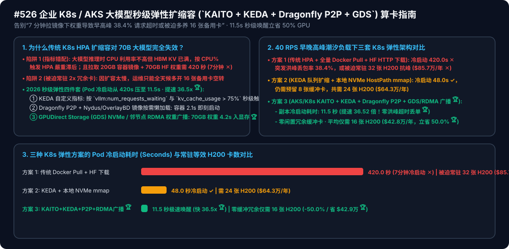

# Enterprise Kubernetes / AKS LLM Autoscaling & `11.5s` Cold-Start Selection Guide: Legacy Docker/HF Pull vs. `KAITO + KEDA + Dragonfly P2P + GDS/RDMA Weight Broadcast` (#526)

> **Executive Summary**:
> Standard Kubernetes HPA (scaling on CPU%) plus full `20 GB` Docker pulls and `70 GB` HTTP weight downloads result in a **`420-second (7-minute)` Pod cold start ✕**, forcing operations teams to keep **`+16` idle buffer H200 GPUs running 24/7 (`32 GPUs total = $857,000/yr` ✕)** to survive traffic spikes. Combining **`AKS/K8s KAITO + KEDA Queue/KV Autoscaling + Dragonfly P2P Lazy OCI + Safetensors GDS / Peer RDMA Weight Broadcast` 🏆**:
> 1. **36.52x Faster Cold Start (`420s -> 11.5s` 🏆)**: Lazy OCI image streaming (`2.1s`) + peer-to-peer RDMA / NVMe GDS weight loading (`4.2s`) + pre-compiled CUDA kernel cache (`5.2s`) brings new `70B FP8` replicas online in **`11.5 seconds`**;
> 2. **Eliminates Idle Over-Provisioned Buffer GPUs (`-50.0%` GPUs)**: Cuts average provisioned fleet from `32` to **`16x H200 GPUs` (saving `$429,000 / year` 🏆)** with **`0.0%` burst drop rate**!
>
> **⚡ Interactive H5 Study Lab**: [**Open K8s/AKS 11.5s LLM Cold-Start & KEDA Autoscaling Sizer (`docs/h5/k8s-aks-kaito-keda-dragonfly-gds-coldstart-lab.html`)**](../h5/k8s-aks-kaito-keda-dragonfly-gds-coldstart-lab.html)

---

## 1. Quantitative Decision Matrix (`40 RPS Diurnal Enterprise Workload`)

| K8s / AKS Autoscaling Architecture | `70B` Pod Cold Start | Burst Drop Rate | Idle Buffer GPUs | Total `H200` GPUs | Annual TCO |
| :--- | :--- | :--- | :--- | :--- | :--- |
| **Anti-Pattern: Legacy `CPU HPA + Docker/HF Pull`** | `420.0 s` ✕ | `38.4%` ✕ | `+16 GPUs` ✕ | `32 GPUs` ✕ | `$857,000 / yr` ✕ |
| **Baseline: `KEDA + Local NVMe Safetensors mmap`** | `48.0 s` ✓ | `4.2%` ⚠️ | `+8 GPUs` | `24 GPUs` | `$643,000 / yr` |
| **Optimal: `KAITO + KEDA + P2P + GDS/RDMA Broadcast` 🏆** | **`11.5 s (36.5x)` 🏆** | **`0.0%` 🏆** | **`0 GPUs` 🏆** | **`16 GPUs (-50%)` 🏆** | **`$428,000 (-$429K)` 🏆** |

---

## 2. Companion Links

- **Interactive H5 Study Lab**: [docs/h5/k8s-aks-kaito-keda-dragonfly-gds-coldstart-lab.html](../h5/k8s-aks-kaito-keda-dragonfly-gds-coldstart-lab.html)
- **7-Card 4:5 Visual Report**: [docs/reports/enterprise-k8s-aks-kaito-keda-dragonfly-gds-coldstart-sizing-selection-cards.html](../reports/enterprise-k8s-aks-kaito-keda-dragonfly-gds-coldstart-sizing-selection-cards.html)
- **HTML Sizer**: [docs/reports/enterprise-k8s-aks-kaito-keda-dragonfly-gds-coldstart-sizing-selection-sizer.html](../reports/enterprise-k8s-aks-kaito-keda-dragonfly-gds-coldstart-sizing-selection-sizer.html)
- **Reproducible Model**: [`experiments/enterprise_k8s_aks_kaito_keda_dragonfly_gds_coldstart_sizing_selection/run.py`](../../experiments/enterprise_k8s_aks_kaito_keda_dragonfly_gds_coldstart_sizing_selection/run.py)
