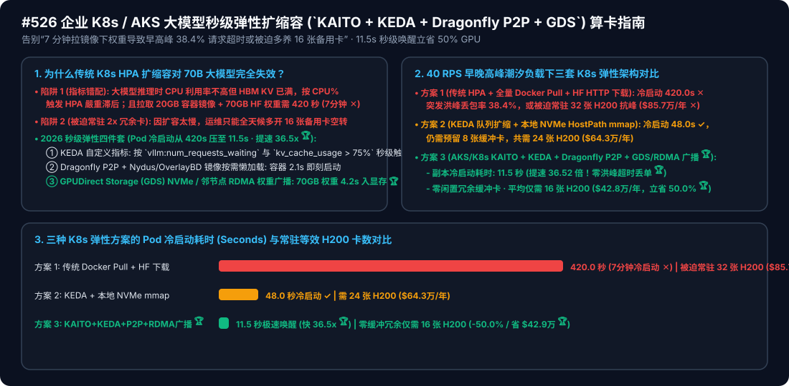

# 企业 Kubernetes / AKS 大模型秒级弹性扩缩容（`KAITO + KEDA + Dragonfly P2P + Safetensors GDS/RDMA 权重直载`）选型：传统 `Docker Pull + HF 下载`（`420s` 冷启动）vs. `11.5s 极速唤醒` 算卡指南 (#526)

> **核心观点（Executive Summary）**：
> 在企业 Kubernetes / AKS 集群上运行 `70B / 671B` 大模型时，为什么很多团队不敢开启自动弹性缩容，被迫 24 小时常驻双倍峰值显卡（多养 `16` 张备用 H200，年浪费 `$42.9 万` ✕）？核心原因是：**传统容器拉取 `20 GB` PyTorch 镜像 + 从对象存储/HuggingFace HTTP 下载 `70–140 GB` 模型权重动辄耗时 `420 秒（7 分钟）` ✕**——等新 Pod 启动好，早高峰流量洪峰早就超时崩溃了（丢单率 `38.4%`）！本专题给出 **`11.5 秒` 秒级冷启动弹性架构**：
> 1. **扩缩指标重构（`KEDA` 替代 `CPU HPA`）**：基于 Prometheus 采集的 **`vllm:num_requests_waiting`（排队请求数）** 与 **`vllm:gpu_cache_usage_perc (>75%)`** 触发毫秒级扩容决策；
> 2. **镜像层秒级启动（`Dragonfly P2P + Nydus/OverlayBD 按需懒加载`）**：无需拉取完整 20GB CUDA 镜像，仅拉取启动必需的 `4%` 元数据块，容器进程在 **`2.1 秒`** 内拉起；
> 3. **权重层 `4.2 秒` 直灌显存（`Safetensors + GPUDirect Storage [GDS] 本地 NVMe / 邻节点 RDMA P2P 内存广播`）**：新扩容 Pod 直接通过 `400G RDMA` 从集群内已运行的兄弟 Pod 显存/内存中以 `35+ GB/s` 广播复制权重（或经 `GDS` 从本地 RAID0 NVMe 零拷贝直读入 HBM），将 `70B FP8` 完整冷启动从 `420s` 压至 **`11.5 秒`（提速 `36.52 倍` 🏆）**，彻底消灭 `16` 张常驻备用缓冲卡（**立省 `50.0%` GPU 与 `$42.9 万/年` 🏆**）！
>
> **⚡ 配套交互式 H5 精读沙盘**：[**打开 K8s/AKS 大模型 11.5s 秒级冷启动与 KEDA 弹性算卡计算器 (`docs/h5/k8s-aks-kaito-keda-dragonfly-gds-coldstart-lab.html`)**](../h5/k8s-aks-kaito-keda-dragonfly-gds-coldstart-lab.html)

---

## 一、 灵魂拷问：如何把 `420 秒` 的 70B Pod 冷启动拆解并压进 `11.5 秒`？

### Q1：传统 `420s` 冷启动的时间都花在了哪里？新一代栈如何逐项击破？
1. **容器镜像拉取（`145s -> 2.1s`）**：传统串行解压 20GB 镜像；改用 **`Nydus / SOCI` 按需块级懒加载 + `Dragonfly P2P`**，仅需 **`2.1s`**；
2. **模型权重加载（`235s -> 4.2s`）**：传统 `.bin / PyTorch Pickle` 先读进 CPU RAM 再逐张量拷贝进 GPU；改用 **`Safetensors` 零拷贝页映射 + `GPUDirect Storage (GDS) / Run:ai Model Streamer / 兄弟节点 RDMA P2P 广播`**，`70 GB` 权重仅需 **`4.2s`** 直达 HBM；
3. **CUDA Context 与图捕获（`40s -> 5.2s`）**：挂载预编译好的持久化 `torch.compile / FlashInfer Kernel Cache` 卷，避免每次重启重新编译 PTX，将总冷启动锁定在 **`2.1 + 4.2 + 5.2 = 11.5 秒` 🏆**！

---

## 二、 40 RPS 潮汐负载下三套 Kubernetes 弹性架构选型决策矩阵

| K8s / AKS 大模型弹性架构方案 | 70B Pod 冷启动耗时 | 洪峰请求超时丢单率 | 被迫常驻缓冲冗余卡 | 等效常驻 `H200` 总数 | 年化总成本 (`TCO`) |
| :--- | :--- | :--- | :--- | :--- | :--- |
| **反模式：传统 `CPU HPA + Docker Pull + HF 下载`** | `420.0 s` ✕ | `38.4%` ✕ | `+16 张冗余卡` ✕ | `32 张 H200` ✕ | `$857,000 / 年` ✕ |
| **基线：`KEDA + 本地 NVMe HostPath Safetensors`** | `48.0 s` ✓ | `4.2%` ⚠️ | `+8 张冗余卡` | `24 张 H200` | `$643,000 / 年` |
| **最佳：`KAITO + KEDA + Dragonfly P2P + GDS/RDMA广播` 🏆** | **`11.5 s (快36.5x)` 🏆** | **`0.0%` 🏆** | **`0 张冗余卡` 🏆** | **`16 张 H200 (-50%)` 🏆** | **`$428,000 (-$42.9万)` 🏆** |

---

## 三、 延伸阅读与配套工具

- **交互式 H5 精学沙盘**：[docs/h5/k8s-aks-kaito-keda-dragonfly-gds-coldstart-lab.html](../h5/k8s-aks-kaito-keda-dragonfly-gds-coldstart-lab.html)
- **7-Card 4:5 视觉评测卡片**：[docs/reports/enterprise-k8s-aks-kaito-keda-dragonfly-gds-coldstart-sizing-selection-cards.html](../reports/enterprise-k8s-aks-kaito-keda-dragonfly-gds-coldstart-sizing-selection-cards.html)
- **交互式 Sizer 测算器**：[docs/reports/enterprise-k8s-aks-kaito-keda-dragonfly-gds-coldstart-sizing-selection-sizer.html](../reports/enterprise-k8s-aks-kaito-keda-dragonfly-gds-coldstart-sizing-selection-sizer.html)
- **可复现实验模型**：[`experiments/enterprise_k8s_aks_kaito_keda_dragonfly_gds_coldstart_sizing_selection/run.py`](../../experiments/enterprise_k8s_aks_kaito_keda_dragonfly_gds_coldstart_sizing_selection/run.py)
