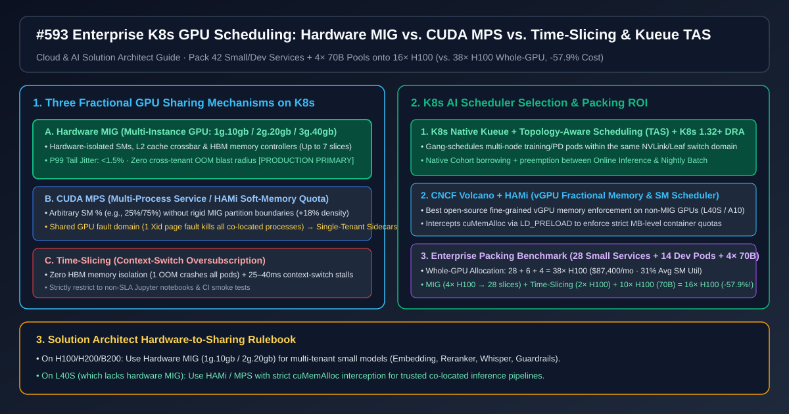

# Enterprise Kubernetes GPU Cluster Scheduling: `Hardware MIG vs. CUDA MPS vs. Time-Slicing` & `Kueue + Volcano + DRA` Sizing Guide

> **Target Persona**: Cloud & AI Solution Architect  
> **Core Scenarios**: Multi-team Kubernetes (`AKS / EKS / Self-Hosted K8s`) GPU clusters consolidating small microservices (`Embedding / Reranker / Guardrails / Whisper`), developer notebooks, and `70B/671B` LLM pools  
> **Interactive H5 Learning Workbench**: [`docs/h5/k8s-gpu-scheduling-mig-mps-kueue-sizer.html`](../h5/k8s-gpu-scheduling-mig-mps-kueue-sizer.html)

---

## 1. Executive Summary

1. **Why Whole-GPU K8s Allocation (`nvidia.com/gpu: 1`) Wastes `57.9%` of Enterprise GPU Budgets**:
   - Assigning a full `H100-80GB` (`$2,300/mo`) to each of `28` small inference microservices (`<8 GB` VRAM) and `14` developer notebooks requires **`38× H100` (`$87,400/mo`)** at `31%` average SM utilization.
   - **Consolidating via Hardware `MIG` (`4× H100` -> `28` `1g.10gb` slices) + `Time-Slicing` (`2× H100` for `14` dev pods) + `10× H100` (`70B` pools)** shrinks the cluster to **`16× H100` (`$36,800/mo`, saving `$50,600/mo` / `-57.9%`)**.
2. **Three GPU Sharing Mechanisms Selection Rules**:
   - **Hardware `MIG` (`A100 / H100 / H200 / B200`)**: Hardware-isolated HBM controllers, L2 cache, and SMs (`< 1.5%` P99 tail jitter, zero cross-slice OOM/fault blast radius). **Mandatory for multi-tenant production microservices**.
   - **CUDA `MPS + HAMi` (`L40S / H100`)**: Flexible SM % and intercepted `cuMemAlloc` limits (`+18%` packing density), but **shares the GPU fault domain** (a fatal Xid page fault terminates all co-located processes). Use for **trusted single-tenant sidecars or `L40S` nodes lacking hardware MIG**.
   - **`Time-Slicing`**: Zero memory isolation and `+25–40ms` context-switch stalls; restrict strictly to **non-SLA dev notebooks and CI smoke tests**.

---

## 2. GPU Sharing Comparison Matrix

| Dimension | Hardware `MIG` (`1g.10gb` / `2g.20gb`) | `CUDA MPS + HAMi vGPU` | `Time-Slicing` |
|---|---|---|---|
| **Memory Isolation** | **100% Hardware HBM Controller Isolation** | `LD_PRELOAD` `cuMemAlloc` soft cap | **None (1 OOM kills all pods)** |
| **P99 Tail Jitter** | **`< 1.5%`** | `5%–12%` (shared L2 cache) | `+25–40 ms` context switch |
| **Fault Blast Radius** | **Isolated per MIG slice** | **Whole GPU (shared page table)** | Whole GPU |
| **Best Fit** | **Multi-tenant production microservices** | **Trusted sidecars & `L40S` pools** | **Dev notebooks & CI tests** |

---

## 3. Production Checklist

- [ ] Enable **`mig.strategy = mixed`** via NVIDIA GPU Operator to carve `H100/H200` nodes into `1g.10gb` / `2g.20gb` slices for small models.
- [ ] Deploy **`Kueue` with Topology-Aware Scheduling (`TAS`)** to lock `TP` groups inside intra-node NVLink and enable overnight cohort borrowing.
