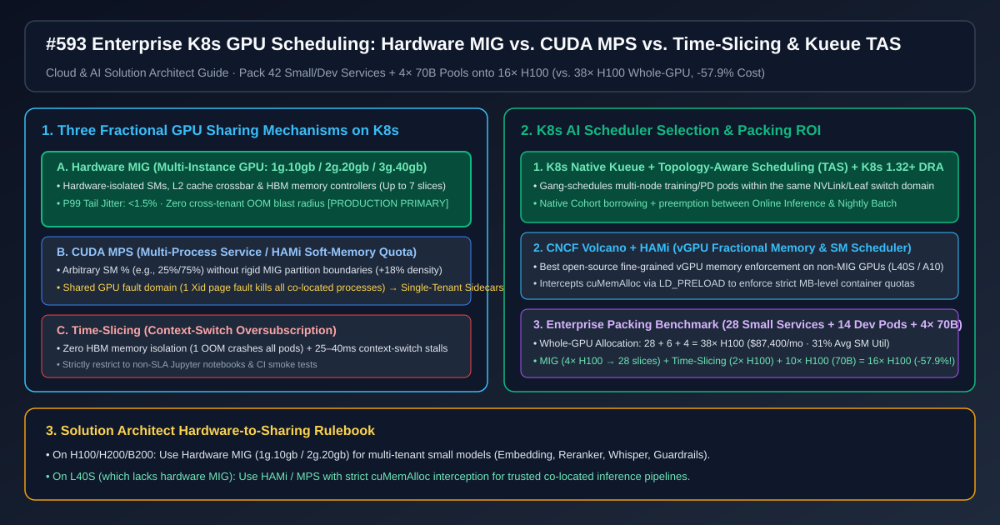
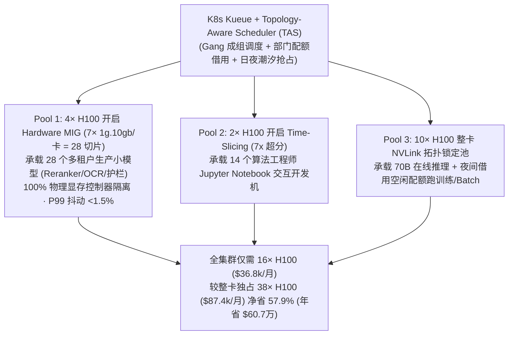

# 企业级 Kubernetes GPU 集群算力切分与调度架构选型：`硬件级 MIG vs. CUDA MPS vs. 时间片轮转` 与 `Kueue + Volcano + DRA` 容量测算指南

> **面向角色**：Cloud & AI Solution Architect（云与 AI 解决方案架构师）  
> **核心场景**：多部门共享 Kubernetes（`AKS / EKS / 自建 K8s`）智算底座，同时承载小模型微服务（Embedding/Reranker/OCR/护栏）、研发 Notebook 与 `70B/671B` 大模型分布式训推  
> **配套交互式 H5 精读工作台**：[`docs/h5/k8s-gpu-scheduling-mig-mps-kueue-sizer.html`](../h5/k8s-gpu-scheduling-mig-mps-kueue-sizer.html)

---

## 一、执行摘要（Executive Summary：3 分钟掌握核心架构结论）

1. **为什么企业 K8s 集群默认按整卡分配（`nvidia.com/gpu: 1`）会导致高达 `57.9%` 的显卡预算被小模型与开发容器白白吃掉？**  
   - 在典型企业 AI 平台中，除了少数 `70B/671B` 大模型需要多卡整卡并行外，往往同时存在 **`20–50` 个轻量级微服务**（如 `1.5B` Reranker、`0.6B` Embedding、`Whisper` 语音、安全护栏分类器、以及算法工程师的调试 Notebook）。如果每个 Pod 都申请 `nvidia.com/gpu: 1` 独占一张 `H100-80GB`（`$2,300/月`），单卡显存占用不足 `8 GB`、SM 算力利用率不足 `12%`！
2. **三大 GPU 细粒度切分技术黄金选型铁律（`Hardware MIG` vs. `CUDA MPS / HAMi` vs. `Time-Slicing`）**：
   - **路线 A：硬件级多实例切分 `NVIDIA MIG`（仅限 `A100 / H100 / H200 / B200`，生产首选）**：
     - 将单张 `H100-80GB` 物理切分为最多 **`7` 个 `1g.10gb`** 或 **`4` 个 `2g.20gb`** 硬件实例；每个切片拥有 **物理隔离的 HBM 显存控制器、L2 Cache 交叉开关与独立 SM 阵列**！
     - **核心优势**：切片 1 发生死循环或显存 OOM 崩溃时，对同卡切片 2 的 **P99 延迟抖动影响 `< 1.5%`**、故障爆炸半径为 **0**！是**多租户生产小模型微服务的唯一合规选择**。
   - **路线 B：CUDA 多进程服务 `MPS + HAMi 显存硬拦截`（适用于不支持硬件 MIG 的 `L40S / RTX 4090`）**：
     - 允许按任意百分比（如 `30% SM + 12GB 显存`）柔性切分，比固定规格的 MIG 提升 `+18%` 装箱密度；通过 `HAMi` 的 `LD_PRELOAD` 拦截 `cuMemAlloc` 实现容器级显存硬限额。
     - **致命红线**：所有同卡 MPS 进程**共享同一个 GPU 页表与错误域**，一旦某个容器触发底层 CUDA 非法地址访问（Xid 31），同卡所有其他容器将连坐崩溃！因此 **严禁用于跨部门不可信多租户隔离，仅限同业务内部可信 Sidecar 混部**（如主模型旁挂自己的草稿模型或护栏模型）。
   - **路线 C：时间片轮转 `Time-Slicing`**：无任何显存隔离且上下文切换带来 `25–40ms` 尾延迟毛刺，**仅限非生产 Jupyter Notebook 开发机或 CI 冒烟测试**。
3. **装箱收益手算**：将 `28` 个轻量生产微服务（迁入 **`4× H100` 的 `28` 个 `1g.10gb` MIG 切片**）+ `14` 个研发 Notebook（迁入 **`2× H100` Time-Slicing 池**）+ `10× H100`（`70B` 主力池）组合后，总卡数从整卡分配的 **`38× H100`（`$87,400/月`）骤降至 `16× H100`（`$36,800/月`，立省 `57.9%` / 年省 `$60.7 万`）**！

---

## 二、架构师灵魂拷问（Core Q&A）

### Q1：なぜ `L40S-48GB` 不支持硬件 MIG？在 `L40S` 节点池上如何安全混部多个小模型？
- **硬件架构差异**：NVIDIA 仅在计算卡（`A100 / H100 / H200 / B200`）的 HBM 显存交叉开关上设计了物理硬件分区（Hardware MIG），而基于 Ada Lovelace GDDR6 架构的 **`L40S` 不支持硬件 MIG**。
- **`L40S` 生产最佳实践**：
  1. 若在同一业务流水线内部（例如同一语音客服系统的 `Whisper STT + CosyVoice TTS`），启用 **`CNCF Volcano + HAMi vGPU`** 搭配 `CUDA MPS`，为每个容器设定硬性显存上限（如 `device-memory: 16384M`、`device-cores: 35`）；
  2. 更优方案是在 **推理引擎层合并（Engine-Level Multi-Model Consolidation）**：用同一个 `HuggingFace TEI`、`Triton Inference Server` 或 `vLLM` 进程独占整张 `L40S`，在引擎内部同时加载 `Embedding + Reranker + Prompt-Shield` 三个权重，既避免了跨容器 MPS 崩溃连坐，又实现了 `90%+` 的显存与算力复用！

### Q2：K8s 原生调度器（`kube-scheduler`）为什么无法直接调度多机大模型训练和 PD 分离集群？该选 `Kueue + DRA` 还是 `Volcano`？
1. **原生 `kube-scheduler` 的两大缺陷**：
   - **缺乏成组调度（Gang Scheduling / All-or-Nothing）**：一个需要 `16` 张卡的分布式任务如果只抢到 `12` 张卡，这 `12` 张卡会一直空转死等剩下 `4` 张卡（资源死锁）；
   - **拓扑盲目（Topology-Blind）**：把一个 `TP=4` 的推理实例分散调度到 2 台不同物理节点上，迫使高频 AllReduce 跨机走慢速网络，性能暴跌 5 倍。
2. **选型决策**：
   - **云原生标准首选：`Kubernetes Kueue + Topology-Aware Scheduling (TAS) + Dynamic Resource Allocation (DRA)`**：K8s 官方 SIG-Scheduling 亲儿子，原生支持多租户配额借用（Cohort Fair Sharing）、日夜潮汐抢占（Online Preempting Batch）以及基于机柜/NVLink/交换机层级的拓扑亲和分配。
   - **存量 HPC / 细粒度 vGPU 首选：`CNCF Volcano + HAMi`**：若急需在非 MIG 显卡上实现 MB 级 vGPU 显存切分，Volcano + HAMi 生态最为成熟。

---

## 三、三大 K8s GPU 共享切分技术横向选型矩阵

| 评估维度 | 方案 A：硬件级 `NVIDIA MIG` (`1g.10gb` / `2g.20gb` on H100/H200) | 方案 B：`CUDA MPS + HAMi` 软显存拦截 (适用于 H100 / L40S) | 方案 C：时间片轮转 `Time-Slicing` |
|---|---|---|---|
| **显存隔离级别** | **硬件物理隔离（独立 HBM 通道，绝不跨切片 OOM）** | API 拦截级软隔离（`LD_PRELOAD` 拦截 `cuMemAlloc`） | **无隔离（任一容器 OOM 全卡团灭）** |
| **算力与缓存隔离** | **硬件独立 SM 与 L2 Cache（P99 尾延迟抖动 `< 1.5%`）** | SM 按比例共享 L2 Cache（尾延迟抖动 `5%–12%`） | 时间片上下文切换（尾延迟毛刺 `+25–40ms`） |
| **故障爆炸半径** | **单切片独立（支持单切片重置，不影响同卡邻居）** | **整卡连坐（任一进程触发致命 Xid 崩溃全卡容器）** | 整卡连坐 |
| **切分粒度灵活性** | 固定档位（最多 7 份，如 `1g.10gb`, `2g.20gb`, `3g.40gb`） | **极高（任意 1% SM 与 MB 级显存配比）** | 任意超分倍数（如 `4x`, `8x`） |
| **最佳适用边界** | **多租户生产在线小模型微服务（金融/政企强制标准）** | **单团队内部可信 Sidecar 混部 / `L40S` 细粒度切分** | **研发调试 Notebook、CI/CD 单元测试** |

---

## 四、生产级 K8s GPU 调度落地 Checklist

- [ ] **通过 `NVIDIA GPU Operator` 启用动态 MIG 配置策略（`mig.strategy = mixed`）**：利用节点标签自动将集群中 20%–30% 的 `H100/H200` 切分为 `1g.10gb` / `2g.20gb` 专供小模型微服务，彻底杜绝小模型申请整张 `80GB/141GB` 大卡。
- [ ] **部署 `Kueue` 开启部门级 `Cohort` 弹性借用与 `TAS` 拓扑感知**：确保 `TP=2/4/8` 实例严格分配在同一节点的 NVLink 域内，并允许夜间批处理任务无偿借用其他部门白天的闲置配额。
- [ ] **严禁将 `Time-Slicing` 用于生产在线低延迟推理服务**：防止邻居容器突发大矩阵乘或显存溢出引发整卡级 SLA 雪崩。

---

## 五、配套资产索引

- **交互式 H5 精读工作台**：[`docs/h5/k8s-gpu-scheduling-mig-mps-kueue-sizer.html`](../h5/k8s-gpu-scheduling-mig-mps-kueue-sizer.html)
- **7-Card 4:5 评测报告**：[`docs/reports/enterprise-k8s-gpu-scheduling-mig-mps-kueue-dra-sizing-cards.html`](../reports/enterprise-k8s-gpu-scheduling-mig-mps-kueue-dra-sizing-cards.html)
- **交互式容量计算器**：[`docs/reports/enterprise-k8s-gpu-scheduling-mig-mps-kueue-dra-sizing-sizer.html`](../reports/enterprise-k8s-gpu-scheduling-mig-mps-kueue-dra-sizing-sizer.html)
- **可复现实验模型**：[`experiments/enterprise_k8s_gpu_scheduling_mig_mps_kueue_dra_sizing/run.py`](../../experiments/enterprise_k8s_gpu_scheduling_mig_mps_kueue_dra_sizing/run.py)
