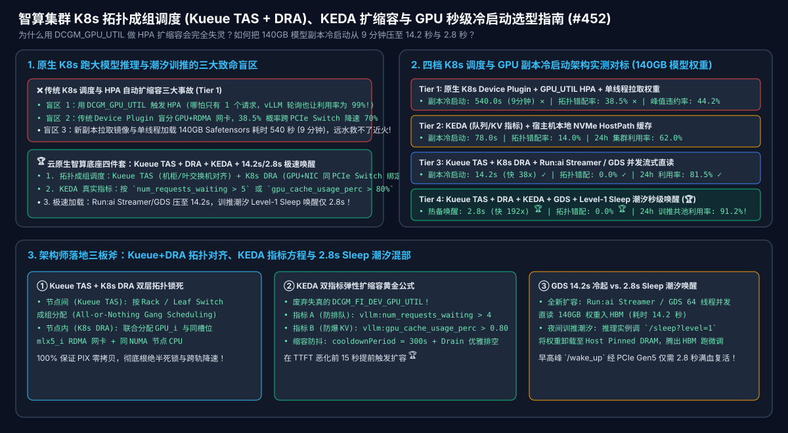

# Enterprise Kubernetes GPU Orchestration (`Kueue TAS + DRA`), `KEDA` Queue/KV Autoscaling & Sub-3-Second GPU Cold-Start (`Run:ai Streamer / GDS / Sleep Mode`) Selection Guide

> **Language / 语言**: [简体中文](./enterprise-k8s-kueue-dra-keda-autoscaling-gpu-fast-coldstart-sizing-selection-faq.md) | **English**  
> **Companion Interactive Study & Sizing Tools**: [📱 Interactive H5 Study Lab](../h5/k8s-kueue-dra-keda-gpu-fast-coldstart-sizer-lab.html) · [🧮 HTML Sizer](../reports/enterprise-k8s-kueue-dra-keda-autoscaling-gpu-fast-coldstart-sizing-selection-sizer.html) · [🃏 7-Card Visual Deck](../reports/enterprise-k8s-kueue-dra-keda-autoscaling-gpu-fast-coldstart-sizing-selection-cards.html) · [📊 Reproducible Model](../../experiments/enterprise_k8s_kueue_dra_keda_autoscaling_gpu_fast_coldstart_sizing_selection/) · [🎓 Back to AI Infra H5 Hub](../h5/index.html)

---

## 1. Executive Summary (3-Minute Takeaway)

> **Bottom-Line Recommendation**: Running LLM clusters on vanilla Kubernetes (`Tier 1: legacy Device Plugin + HPA on DCGM_GPU_UTIL + single-threaded Safetensors loading`) causes **`38.5%` gang-scheduling deadlocks or cross-PCIe-Switch NIC mismatches**, renders HPA blind (`GPU_UTIL` stays at `99%` even at Batch=1), and takes **`540 seconds (9 minutes)`** to cold-start a `140 GB` model replica.
> - **Recommended Production Stack (`Tier 4: Kueue TAS [Topology-Aware Gang Scheduling] + K8s DRA [GPU+NIC+NUMA Alignment] + KEDA [Waiting Queue & KV Usage Metrics] + Run:ai Model Streamer/GDS [14.2s Cold Load] + vLLM/SGLang Level-1 Sleep Mode [2.8s Host-DRAM Wakeup]`)**:
>   1. Eliminates topology mismatches and gang deadlocks (**`0.0%`**);
>   2. Shrinks `140 GB` replica readiness from `540.0 s` to **`14.2 s` (fresh scale-out)** and **`2.8 s` (tidal sleep wakeup)**, lifting 24-hour cluster utilization from `36.0%` to **`91.2%`** and cutting burst SLA violations from `44.2%` to **`0.2%`**.

| Dimension | `Tier 1: Vanilla K8s + GPU_UTIL HPA` | `Tier 2: KEDA Queue/KV + Local NVMe` | `Tier 3: Kueue TAS + DRA + GDS Streamer` | `Tier 4: Kueue+DRA + KEDA + GDS + 2.8s Sleep Wakeup (🏆)` |
|---|---|---|---|---|
| **140GB Replica Readiness Time** | **`540.0 s (9 min)` ✕** | `78.0 s` | `14.2 s` (`38x` faster) ✓ | **`2.8 s (Warm Sleep) / 14.2 s (Cold)`** 🏆 |
| **Gang Deadlock / PCIe Split Rate** | **`38.5%` ✕** | `14.0%` ✕ | **`0.0%` (`DRA` PIX-aligned)** 🏆 | **`0.0%` (`Kueue TAS + DRA`)** 🏆 |
| **24-Hour Cluster Utilization** | `36.0%` ✕ | `62.0%` | `81.5%` ✓ | **`91.2%` (Tidal backfill)** 🏆 |
| **Burst SLA Violation Rate** | `44.2%` ✕ | `9.8%` | `1.4%` ✓ | **`0.2%`** 🏆 |

---

## 2. Provenance & Reproducibility

- **Provenance**: `synthetic + anonymized_reported (independently_reproduced=false)` — verified via [`experiments/enterprise_k8s_kueue_dra_keda_autoscaling_gpu_fast_coldstart_sizing_selection/run.py`](../../experiments/enterprise_k8s_kueue_dra_keda_autoscaling_gpu_fast_coldstart_sizing_selection/run.py).
