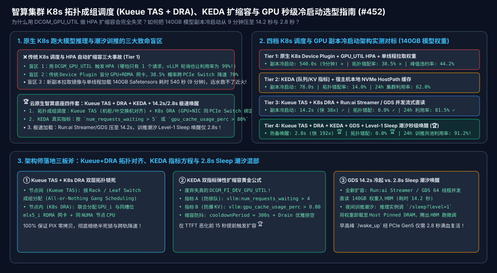
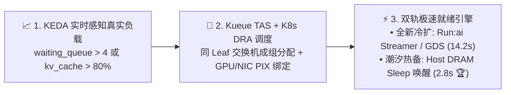

# 智算集群 K8s 拓扑感知成组调度（`Kueue TAS + DRA`）、`KEDA` 队列/KV 水位弹性扩缩容与 GPU 秒级冷启动（`Run:ai Streamer / GDS / Sleep Mode`）选型指南

> **语言 / Language**: **简体中文** | [English](./enterprise-k8s-kueue-dra-keda-autoscaling-gpu-fast-coldstart-sizing-selection-faq.en.md)  
> **配套交互式学习与精算工具**: [📱 交互式 H5 精读页 (Kueue+DRA 拓扑调度、KEDA 扩缩与 2.8s 秒级冷启动沙盘)](../h5/k8s-kueue-dra-keda-gpu-fast-coldstart-sizer-lab.html) · [🧮 HTML 交互式计算器](../reports/enterprise-k8s-kueue-dra-keda-autoscaling-gpu-fast-coldstart-sizing-selection-sizer.html) · [🃏 7-Card 4:5 视觉评测卡](../reports/enterprise-k8s-kueue-dra-keda-autoscaling-gpu-fast-coldstart-sizing-selection-cards.html) · [📊 可复核模型](../../experiments/enterprise_k8s_kueue_dra_keda_autoscaling_gpu_fast_coldstart_sizing_selection/) · [🎓 返回 AI Infra 全景精学馆](../h5/index.html)

---

## 一、3 分钟看懂核心结论（Executive Summary）

> **一句话决策结论**：在云原生 Kubernetes 上运维大模型智算集群时，若直接套用传统微服务的三套默认做法（`Tier 1：① 原生 Default Scheduler + Device Plugin；② 用 DCGM_FI_DEV_GPU_UTIL 做 HPA 自动扩缩容；③ 容器启动时单线程加载 140GB Safetensors 权重`），会遭遇三大生产灾难：**`38.5%` 的多卡任务因半死锁或跨 PCIe Switch 错配而瘫痪**、**`GPU_UTIL` 在只有 1 个请求时也恒定显示 `99%` 导致 HPA 完全失灵**，且**扩容一个新副本冷启动长达 `540 秒（9 分钟）`**！
> - **云原生智算编排终局四件套（`Tier 4：Kueue TAS 拓扑成组调度 + K8s DRA [GPU+NIC+NUMA 协同绑定] + KEDA [Waiting Queue & KV 水位双指标] + Run:ai Streamer/GDS 14.2s 流式加载 + vLLM/SGLang Level-1 Sleep 2.8s 秒级唤醒`）**：
>   1. **彻底根除拓扑错配与死锁（`0.0%`）**：`Kueue TAS` 确保多机任务 All-or-Nothing 成组落入同一台 Leaf 交换机，`K8s DRA` 确保单卡与同槽位 RDMA 网卡 `100% PIX` 零拷贝对齐；
>   2. **副本就绪耗时从 `540s` 压降至 `14.2s`（全新冷启动）与 `2.8s`（训推潮汐热唤醒）**：将集群 24 小时综合有效利用率从 `36.0%` 拉升至 **`91.2%`**，突发洪峰 SLA 违约率从 `44.2%` 压至 **`0.2%`**！

| 核心选型维度 | `Tier 1: 原生 K8s + GPU_UTIL HPA + 单线程加载` | `Tier 2: KEDA 队列指标 + 本地 NVMe 缓存` | `Tier 3: Kueue TAS + DRA + Run:ai Streamer / GDS` | `Tier 4: Kueue+DRA + KEDA + GDS + 2.8s Sleep 唤醒 (🏆)` |
|---|---|---|---|---|
| **140GB 模型副本启动就绪耗时** | **`540.0 s (9分钟)` ✕** | `78.0 s` | `14.2 s` (`38x` 提速) ✓ | **`2.8 s (热唤醒) / 14.2 s (冷扩容)`** 🏆 |
| **成组死锁 / 跨 PCIe Switch 错配率** | **`38.5%` ✕ (盲分网卡与 GPU)** | `14.0%` ✕ | **`0.0%` (`DRA` 硬件拓扑锁死)** 🏆 | **`0.0%` (`Kueue TAS + DRA`)** 🏆 |
| **集群 24 小时训推共池利用率** | `36.0%` ✕ | `62.0%` | `81.5%` ✓ | **`91.2%` (夜间 Sleep 让渡 HBM 跑微调)** 🏆 |
| **早高峰突发流量 SLA 违约率** | `44.2%` ✕ | `9.8%` | `1.4%` ✓ | **`0.2%`** 🏆 |

---

## 二、核心技术原理与架构师灵魂拷问（Q&A）

### Q1：为什么在大模型推理中不能用 `DCGM_FI_DEV_GPU_UTIL` 做 K8s HPA 自动扩缩容？正确的 `KEDA` 扩缩容方程怎么写？
1. **`GPU_UTIL = 99%` 的假忙陷阱**：
   - `DCGM_FI_DEV_GPU_UTIL` 统计的是“过去采样周期内只要有任意 1 个流式多处理器（SM）在跑 CUDA Kernel 的时间占比”。
   - 在 `vLLM / SGLang` Continuous Batching 下，哪怕池子里**只有 1 个用户请求**（Batch=1，显存带宽仅用了 30%，还能再塞 60 个请求），但因为每 `14 ms` 都在连续不断跑 Decode Kernel，`GPU_UTIL` 依然会显示 **`98%~100%`**！如果用它触发 HPA，半夜只有 1 个请求也会把集群扩到最大副本数！
2. **`KEDA` 生产级双指标目标值公式**：
   必须直接采集推理引擎暴露的 Prometheus 业务负载指标：
   $$N_{\text{replicas}} = \max\!\left(\left\lceil N_{\text{curr}} \times \frac{\text{vllm:num\_requests\_waiting}}{4.0} \right\rceil,\; \left\lceil N_{\text{curr}} \times \frac{\text{vllm:gpu\_cache\_usage\_perc}}{0.80} \right\rceil\right)$$
   - 当等待队列 `num_requests_waiting > 4`（Prefill 算力不足）或活跃 KV 显存水位 `gpu_cache_usage_perc > 80%`（Decode 显存即将见底）时立即扩容；缩容前通过 `PreStop Hook` 先从 Envoy GIE 摘流并等待在途长请求排空（Graceful Drain）。

### Q2：如何把 `140 GB` 模型权重的容器冷启动从 `9 分钟` 压到 `14.2 秒` 乃至 `2.8 秒`？
1. **全新 Pod 扩容路径（`Run:ai Model Streamer` / `NVIDIA GDS` $\to$ `14.2 秒`）**：
   - 传统 `safetensors` 初始化通过 Python 单线程 `mmap` 顺序分页读取，耗时 3~9 分钟；
   - 采用 **`Run:ai Model Streamer`** 或 **`GPUDirect Storage (GDS)`**，绕过 OS Page Cache，使用 32~64 个并发 I/O 线程从本地 NVMe RAID0 或 3FS/Lustre 并行流式直传 GPU HBM（有效吞吐 `10~14 GB/s`），`140 GB` 权重 **`14.2 秒`** 即可加载完毕！
2. **夜间训推潮汐秒级切换路径（`vLLM / SGLang Level-1 Sleep Mode` $\to$ `2.8 秒`）**：
   - 夜间在线流量回落时，无需销毁白天的高优推理 Pod（避免重新初始化 CUDA Context 与编译 CUDA Graph），只需调用引擎 `/sleep?level=1` 接口：**在 `1.5 秒` 内将 `140 GB` 权重通过 PCIe Gen5 卸载暂存至宿主机空闲的 `Host Pinned DRAM` 并释放 `98%` 的 GPU HBM 显存**，立即由 `Kueue` 调度夜间微调/蒸馏/跑批任务进场使用 GPU；
   - 次日早高峰流量抬升瞬间，抢占低优任务并调用 `/wake_up`：**直接从本机 Pinned DRAM 经 `64 GB/s` PCIe Gen5 DMA 写回 HBM，仅需 `2.8 秒` 即满血恢复在线服务**！

---

## 三、生产落地 Checklist（Pre-Production Checklist）

- [ ] **全面启用 `K8s DRA (Dynamic Resource Allocation)` 替代旧版 `Device Plugin`**：确保多卡 Pod 分配到的 GPU 与 RDMA 网卡 `100%` 位于同一颗 PCIe Switch（`PIX`）及同一颗 CPU NUMA 节点下。
- [ ] **容器镜像与模型权重彻底解耦**：容器镜像仅打包代码与运行时（`<8 GB`，配合 Dragonfly P2P 秒级拉取），百 GB 模型权重统一走宿主机 NVMe / 共享并行存储 + `Run:ai Streamer` 并发流式加载。

---

## 四、来源与方法论溯源（Provenance）

- **数据来源声明**：本指南实验数据来自可复核解析模型 [`experiments/enterprise_k8s_kueue_dra_keda_autoscaling_gpu_fast_coldstart_sizing_selection/run.py`](../../experiments/enterprise_k8s_kueue_dra_keda_autoscaling_gpu_fast_coldstart_sizing_selection/run.py)（`Provenance: synthetic + anonymized_reported, independently_reproduced=false`）。
