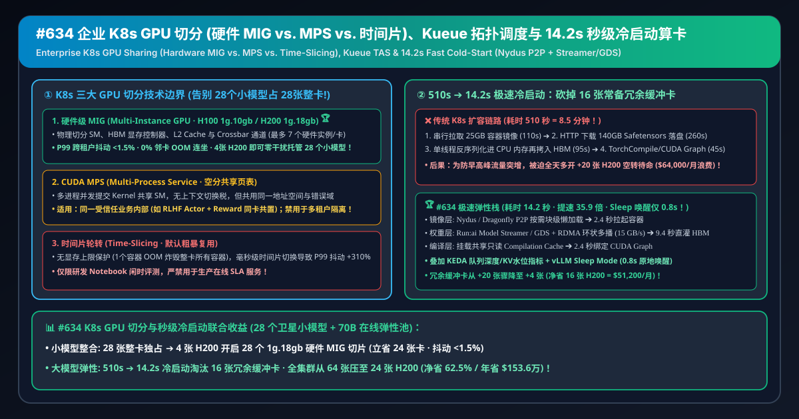

# Enterprise Kubernetes / AKS GPU Cluster Sharing (`Hardware MIG` vs. `CUDA MPS` vs. `Time-Slicing`), `Kueue TAS` Gang Scheduling & `14.2s` Elastic Cold-Start (`Nydus P2P + Run:ai Streamer/GDS + vLLM Sleep Mode`) Sizing Guide (`#634`)

> **Language / 语言**: [简体中文](./enterprise-k8s-mig-mps-kueue-coldstart-elastic-sizing-faq.md) | **English** · [📱 Interactive H5 Study Lab (with MIG Packer + 14.2s Cold-Start Buffer Sizer)](../h5/k8s-mig-mps-kueue-coldstart-elastic-lab.html) · [🧮 Interactive Sizer](../reports/enterprise-k8s-mig-mps-kueue-coldstart-elastic-sizing-sizer.html) · [🃏 7-Card Visual Report](../reports/enterprise-k8s-mig-mps-kueue-coldstart-elastic-sizing-cards.html) · [Back to Catalog](../full-catalog-en.md)

---

## 1. 3-Minute Executive Summary

1. **Bottom-Line Recommendation**:
   - Two anti-patterns waste `>60%` of enterprise Kubernetes GPU clusters: ① **Whole-GPU Siloing** (assigning 28 small `4–12 GB` OCR/Embedding/Reranker/Guardrail models to 28 dedicated GPUs, or using `Time-Slicing` which suffers `+310%` P99 jitter and cross-tenant OOM kills); ② **`510-Second (8.5-Minute)` Container Cold Starts** (forcing operations teams to keep **`+20` idle surge-buffer H200 GPUs** running 24/7).
   - **Two-Pillar K8s GPU Optimization Stack (`#634`)**:
     - **Pillar 1 (`Hardware MIG 1g.18gb` Consolidation)**: Packs all 28 auxiliary microservices onto **`4× H200 GPUs` (`28 × 1g.18gb` hardware-isolated MIG slices)** with **`< 1.5%` P99 jitter** and **`0.0%` cross-tenant OOM blast radius**, saving **`24× H200 GPUs`**.
     - **Pillar 2 (`510s → 14.2s` Fast Cold-Start + `KEDA` Queue/KV Autoscaling + `0.8s vLLM Sleep Mode`)**: Combines `Nydus/Dragonfly P2P` lazy image streaming (`2.4s`) + `Run:ai Model Streamer / GDS + RDMA Ring Broadcast` (`9.4s`) + shared `CUDA Graph` compilation cache (`2.4s`) to cut `70B` cold start by **`35.9×` (`14.2s`)**, shrinking surge buffer reserve from `+20` to **`+4× H200 GPUs`** (`-16 GPUs`).
     - **Combined Result**: Total cluster footprint drops from `64× H200` (`$204,800/mo`) to **`24× H200` (`$76,800/mo`, `-62.5%` TCO, saving `$1.536M/yr`)**!

---

## 2. Quantitative K8s GPU Sharing & Cold-Start Comparison Matrix

| Metric | Option A: Whole-GPU Silos + `510s` Legacy Cold Start | Option B: `Time-Slicing` + NFS Weight Load (`145s`) | Option C: `Hardware MIG (1g.18gb)` + `Kueue TAS` + `14.2s` Streamer (`#634`) 🏆 |
| :--- | :--- | :--- | :--- |
| **GPUs for 28 Satellite Models** | `28× H200` (`9%` VRAM util ✕) | `4× H200` (`+310%` P99 jitter & OOM ✕) | **`4× H200` (`28× 1g.18gb MIG`, `<1.5%` jitter, `0%` OOM ✓)** |
| **70B Pod Cold-Start Readiness** | `510.0 s` (`8.5 min` ✕) | `145.0 s` | **`14.2 s` (`35.9×` faster; `0.8s` from `Sleep Mode` ✓)** |
| **Required Idle Surge Buffer GPUs** | `+20× H200` (`$64K/mo` idle ✕) | `+8× H200` | **`+4× H200` (`-80.0%` surge buffer ✓)** |
| **Total Cluster H200 GPUs & Cost** | `64× H200` (`$204,800/mo`) | `28× H200` (`$89,600/mo`, fails SLA) | **`24× H200` (`$76,800/mo`, `-62.5%` GPUs, saves `$1.54M/yr` ✓)** |
