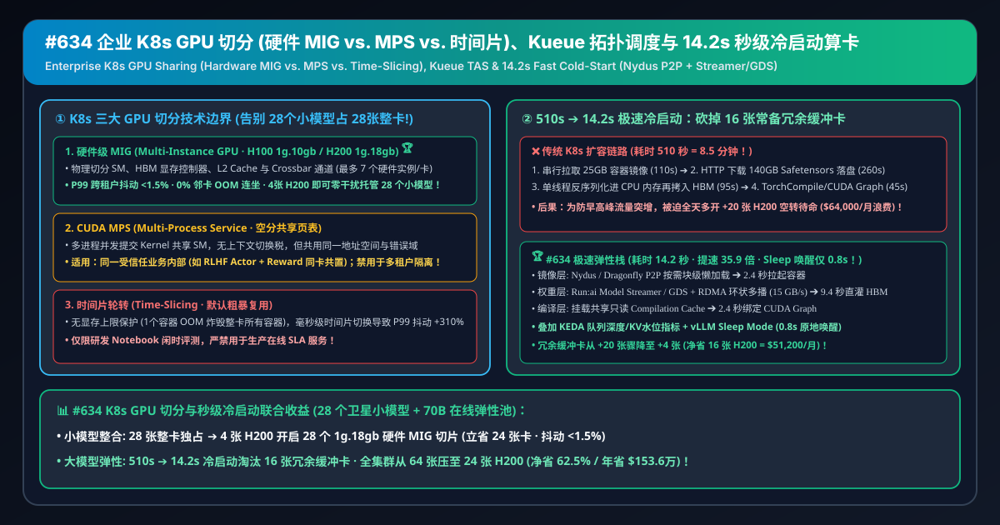

# 企业 Kubernetes / AKS 智算集群算力切分（`硬件 MIG` vs. `CUDA MPS` vs. `Time-Slicing`）、`Kueue TAS` 拓扑成组调度与 `14.2 秒` 极速冷启动（`Nydus P2P + Run:ai Streamer/GDS + vLLM Sleep Mode`）容量手算指南（`#634`）

> **Language / 语言**: **简体中文** | [English](./enterprise-k8s-mig-mps-kueue-coldstart-elastic-sizing-faq.en.md) · [📱 交互式 H5 精读页（含 MIG 切分器 + 14.2s 冷启动冗余算卡器）](../h5/k8s-mig-mps-kueue-coldstart-elastic-lab.html) · [🧮 交互式容量计算器 Sizer](../reports/enterprise-k8s-mig-mps-kueue-coldstart-elastic-sizing-sizer.html) · [🃏 7-Card 评测报告](../reports/enterprise-k8s-mig-mps-kueue-coldstart-elastic-sizing-cards.html) · [返回总目录](../full-catalog-zh.md)

---

## 一、3 分钟核心结论卡片（Executive Summary）

1. **一句话结论**：
   - 企业 K8s GPU 集群利用率长期低于 `35%` 的两大罪魁祸首是：**① “一模型一整卡”的静态碎片浪费**（28 个仅需 `4–12 GB` 显存的 OCR/Embedding/Reranker/护栏小模型各自独占 1 张 80G/141G 大卡，浪费 `85%` 显存与算力）；**② “8.5 分钟（`510 秒`）龟速容器冷启动”**（为防止早高峰突发流量在扩容完之前冲垮集群，运维被迫全天额外常备 **`+20 张 H200` 冗余缓冲卡** 空转待命）。
   - **架构师双轮驱动根治方案（`#634` 标准栈）**：
     - **第一轮（硬件级 `MIG` 切片收割碎片）**：将 28 个卫星小模型从“28 张整卡独占”或“充满 OOM 连坐风险的 `Time-Slicing`”迁移至 **`4 张 H200` 开启的 `28 个 1g.18gb Hardware MIG` 硬件物理切片**上，实现跨容器 **`< 1.5%` P99 尾延迟抖动** 与 **`0%` 跨租户 OOM 连坐**，直接省下 **`24 张 GPU`**；
     - **第二轮（`510s → 14.2s` 极速冷启动 + `KEDA` 队列水位触发 + `vLLM Sleep Mode 0.8s` 唤醒）**：通过 **`Nydus / Dragonfly P2P` 懒加载镜像（`2.4s`）+ `Run:ai Model Streamer / GDS + RDMA 环状广播` 直灌权重（`9.4s`）+ 预编译 `CUDA Graph` 缓存（`2.4s`）**，将 `70B` 实例扩容时间从 `510 秒` 压缩至 **`14.2 秒`（提速 `35.9 倍`）**，将常备突发缓冲卡从 `+20 张` 砍至 **`+4 张`（再省 `16 张 GPU`）**；
     - **综合收益**：全集群总卡数从 `64 张 H200`（`$204,800/月`）骤降至 **`24 张 H200`（`$76,800/月`，立省 `62.5%` GPU / 每年净省 `$153.6万`）**！

2. **Kubernetes 三大 GPU 共享切分技术选型红线表**：

| 评估维度 | **硬件级 `MIG` (`Multi-Instance GPU`)** 🏆 | **`CUDA MPS` (`Multi-Process Service`)** | **时间片轮转 (`Time-Slicing`)** |
| :--- | :--- | :--- | :--- |
| **隔离层级** | **物理硅片级硬隔离**（独立 SM、独立 HBM 内存控制器、独立 L2 Cache、独立页表） | 驱动进程级软共享（共享 SM 与 L2 Cache，共享同一 GPU 错误域） | 调度器分时抢占（无显存硬配额，共用全局 HBM 与错误域） |
| **H200 (141GB) 典型切法** | **`7 × 1g.18gb`** 或 **`3 × 2g.35gb`** 或 **`2 × 3g.71gb`** | 按算力百分比（如 `25% / 75%`）软配额 | `replicas: 4–8` 时间片轮询 |
| **邻卡高负载时 P99 抖动** | **`< 1.5%`（稳如独立物理卡 ✓）** | `8% – 18%`（L2 Cache 与带宽争抢） | **`+310%`（上下文频繁切换卡顿 ✕）** |
| **单容器 OOM / Xid 故障半径** | **严格限制在当前 MIG 切片内（其余 6 个切片 `0` 影响 ✓）** | 任一进程触发非法地址/Xid 会导致同卡所有进程同时崩溃 | **任一容器申请显存超标直接引发同卡所有容器连锁 OOM ✕** |
| **架构师最佳适用场景** | **多部门生产小模型（OCR / Embedding / Reranker / Guardrail / 3B–8B SLM）共卡托管首选** | **同一任务内部的协同进程（如 RLHF Actor + Reference，或主模型 + 独立小 Draft）** | **仅限非生产研发 Notebook 交互调试，严禁上生产 SLA 链路** |

---

## 二、灵魂拷问 Q&A：为什么 `GPU_UTIL` 不能做扩容指标？如何手算冷启动缓冲卡数？

### Q1：为什么用 Prometheus 的 `DCGM_FI_DEV_GPU_UTIL`（GPU 利用率 `>80%`）触发 K8s HPA 自动扩缩容在 LLM 推理中会彻底失效？
- **答**：这是无数企业 K8s 平台踩过的深坑！
  - 在持续批处理（Continuous Batching）的 Decode 阶段，哪怕卡上只有 **`1` 个并发请求（Batch=1）**，GPU 的每个周期也在不停启动 Kernel 从 HBM 搬运权重，因此 **`DCGM_FI_DEV_GPU_UTIL` 在 `Batch=1` 时就会显示高达 `95%–100%`**！如果拿它触发 HPA，半夜只有 1 个用户提问也会把集群扩容到最大上限！
  - **架构师唯一正确的 KEDA 扩容指标组合**：
    1. **活跃 KV 显存水位**：`vllm:gpu_cache_usage_perc > 0.75`（`75%`）；
    2. **等待队列深度**：`vllm:num_requests_waiting > 5`；
    3. **首字排队延迟**：网关侧 `P95 TTFT > 600 ms`。

### Q2：如何用数学公式手算“冷启动时间 $T_{\text{cold}}$”与“必须常备的突发冗余缓冲卡数 $N_{\text{buffer}}$”之间的定量关系？
- **答**：设早高峰流量爬坡速率为 $\Delta \text{QPS} / \text{min}$（例如每分钟新增 `6 QPS`，每 `1.5 QPS` 需要 `1` 张 H200，即每分钟需要新增 $r_{\text{scale}} = 4\text{ GPUs/min}$ 的算力）：
  $$N_{\text{buffer}} = \left\lceil r_{\text{scale}} \times \frac{T_{\text{cold}}}{60\text{ s}} \right\rceil_{\text{step}=4}$$
  1. **传统冷启动（$T_{\text{cold}} = 510\text{ s} = 8.5\text{ min}$）**：
     - 在新扩容的 Pod 历经 `8.5 分钟` 终于就绪之前，涌入的突发流量必须完全由预先常备的冗余卡扛住：$N_{\text{buffer}} = \lceil 4 \times 8.5 \rceil \rightarrow$ 被迫常备 **`20 张 H200`（仅防突发就要多花 `$64,000/月`）**！
  2. **`#634` 极速冷启动栈（$T_{\text{cold}} = 14.2\text{ s} = 0.237\text{ min}$）**：
     - **`2.4 s` 容器启动**：`Nydus / Dragonfly P2P` 仅拉取 Python 入口元数据（`< 80 MB`），无需等待 `25 GB` 完整 CUDA 镜像；
     - **`9.4 s` 权重直灌**：通过 `Run:ai Model Streamer / GDS` 从 `3FS / NVMe` 读取并结合主机间 `400G RDMA Ring Broadcast`（有效吞吐 `14.9 GB/s`）将 `140 GB` 权重直接灌入 HBM，跳过 Linux Page Cache 双拷贝；
     - **`2.4 s` 图绑定**：直接加载共享盘上的预编译 `TorchInductor / CUDA Graph` 缓存；
     - 此时缓冲窗口缩短至 `14.2 秒`（若采用 `vLLM Level-1 Sleep Mode` 从主机锁页内存唤醒甚至只需 **`0.8 秒`**），常备缓冲仅需 **`4 张 H200`（立省 `16 张 H200 = $51,200/月`）**！

---

## 三、企业 K8s GPU 集群三种编排与弹性方案定量对比矩阵

| 评估维度 | 方案 A：整卡独占 + 传统 `510s` Docker/HF 冷启动 | 方案 B：`Time-Slicing` 软复用 + 普通 SSD 挂载 (`145s`) | 方案 C：硬件 `MIG (1g.18gb)` + `Kueue TAS` + `14.2s` 极速冷启动 (`#634`) 🏆 |
| :--- | :--- | :--- | :--- |
| **28 个卫星小模型占用 H200 卡数** | `28 张 H200`（显存利用率仅 `9%` ✕） | `4 张 H200`（但 `P99` 抖动 `+310%` 且频发 OOM ✕） | **`4 张 H200`（`28× 1g.18gb MIG`，抖动 `<1.5%`，零连坐 ✓）** |
| **70B 大模型 Pod 冷启动就绪耗时** | `510.0 s`（`8.5 分钟` ✕） | `145.0 s` | **`14.2 s`（提速 `35.9 倍`；`Sleep Mode` 唤醒仅 `0.8 s` ✓）** |
| **应对早高峰突发需常备缓冲卡数** | `+20 张 H200`（空转浪费 ✕） | `+8 张 H200` | **`+4 张 H200`（削减 `80%` 冗余缓冲卡 ✓）** |
| **全集群总 H200 卡数与月度成本** | `64 张 H200`（`$204,800/月`） | `28 张 H200`（`$89,600/月`，SLA 不达标） | **`24 张 H200`（`$76,800/月`，立省 `62.5%` / 年省 `$153.6万` ✓）** |

---

## 四、K8s 智算集群调度与弹性上线核对清单（SA Pre-Production Checklist）

- [ ] **1. 生产在线服务严禁使用 `Time-Slicing`**：通过 `NVIDIA GPU Operator` 将卫星小模型节点统一声明为 `mig.strategy=mixed/single`（如 `1g.18gb`、`2g.35gb`）；
- [ ] **2. 多卡/多机任务强制启用 `Kueue Topology-Aware Scheduling (TAS)`**：在 `Topology` CR 中声明 `rack -> block -> node` 层级，确保多机训练与 `PD/EP` 推理成组（All-or-Nothing Gang Scheduling）落在同一台 Leaf 交换机下；
- [ ] **3. KEDA 扩缩容绑定 `vllm:gpu_cache_usage_perc` 与 `num_requests_waiting`**，并挂载持久化 `TORCHINDUCTOR_CACHE_DIR` 与 `VLLM_CACHE_ROOT` 消除重复算子编译。
