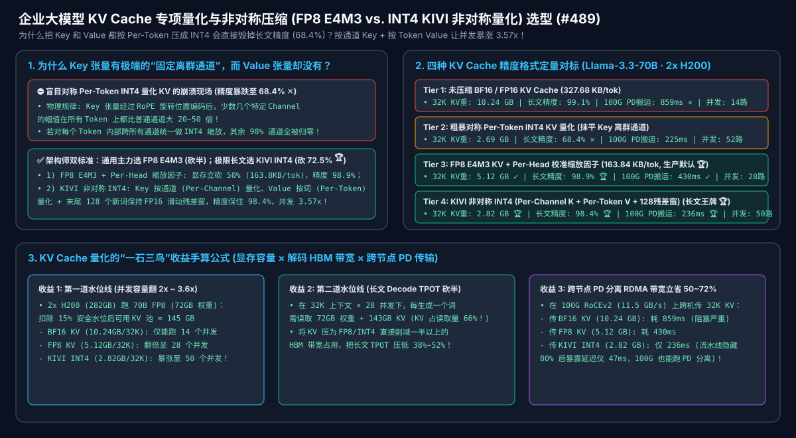

# Enterprise KV Cache Quantization Selection Guide: `BF16` vs. `FP8 E4M3 Per-Head` vs. `KIVI Asymmetric INT4` (#489)

> **Executive Summary**:
> At `32K+` context lengths, **KV Cache dominates VRAM capacity (Watermark 1), Decode HBM bandwidth (Watermark 2), and cross-node PD disaggregation RDMA traffic**. However, applying naive symmetric per-token `INT4` quantization to both Key and Value tensors collapses long-context retrieval accuracy from `99.1%` to **`68.4%`** because Key tensors exhibit severe **fixed channel-wise outliers** ($20\times\text{–}50\times$ larger amplitudes on specific RoPE channels). For **Cloud & AI Solution Architects**, two production tiers unlock the "Triple Dividend" of KV compression:
> 1. **Universal Production Default (Recommended Tier 3)**: **`FP8 E4M3` KV Cache with Per-Head Calibrated Scaling Factors (`163.84 KB/tok`, -50% size)** retains **`98.9%` accuracy** and doubles `32K` concurrency on `2x H200` (`14 -> 28` sessions);
> 2. **Ultra-Long Context & `100G` PD Disaggregation Champion (Recommended Tier 4)**: **`KIVI` Asymmetric `INT4` Quantization (Per-Channel Key + Per-Token Value + 128-Token `FP16` Sliding Residual Window = `90.1 KB/tok`, -72.5% size)** retains **`98.4%` accuracy**, boosts `2x H200` concurrency by **$3.57\times$ (`50` sessions)**, and cuts `32K` KV RDMA transfer over `100G` from `859ms` to **`236ms`**.
>
> **⚡ Interactive H5 Study Lab**: [**Open the KV Cache Quantization (FP8 E4M3 vs. KIVI INT4) Triple-Dividend Calculator (`docs/h5/kv-cache-quantization-fp8-int4-kivi-sizer-lab.html`)**](../h5/kv-cache-quantization-fp8-int4-kivi-sizer-lab.html)

---

## 1. Core Q&A: Why Key Must Be Quantized Per-Channel and Value Per-Token

### Q1: How does the 128-token `FP16` sliding residual window enable streaming per-channel Key quantization?
- Because per-channel Key quantization requires a block of tokens along the sequence dimension, newly generated tokens are buffered in a tiny **128-token `FP16` residual window (`41 MB`)** and quantized into `Per-Channel INT4` in contiguous 128-token chunks.

---

## 2. Quantitative Decision Matrix (`Llama-3.3-70B GQA-8 · 2x H200`)

| KV Cache Precision Format | Bytes / Token | `32K` KV Size / Req | LongBench / Needle Accuracy | `100G` PD Transfer (`32K`) | Max Concurrent `32K` Reqs (`2x H200`) |
| :--- | :--- | :--- | :--- | :--- | :--- |
| **Tier 1: Uncompressed `BF16 / FP16` KV Cache** | `327.68 KB` | `10.24 GB` ✕ | `99.1%` | `859.0 ms` ✕ | `14 sessions` ✕ |
| **Tier 2: Naive Symmetric `Per-Token INT4` KV** | `86.00 KB` | `2.69 GB` | `68.4%` (Outlier crash ✕) | `225.0 ms` | `52 sessions` |
| **Tier 3: `FP8 E4M3` KV + Per-Head Scaling (Default 🏆)** | **`163.84 KB` (-50%)** | **`5.12 GB` ✓** | **`98.9%` 🏆** | `429.5 ms` ✓ | **`28 sessions` (2.0x ✓)** |
| **Tier 4: `KIVI` Asymmetric `INT4` + 128 Residual Window 🏆** | **`90.10 KB` (-72.5%)** | **`2.82 GB` 🏆** | **`98.4%` 🏆** | **`236.0 ms` (3.64x 🏆)** | **`50 sessions` (3.57x 🏆)** |
