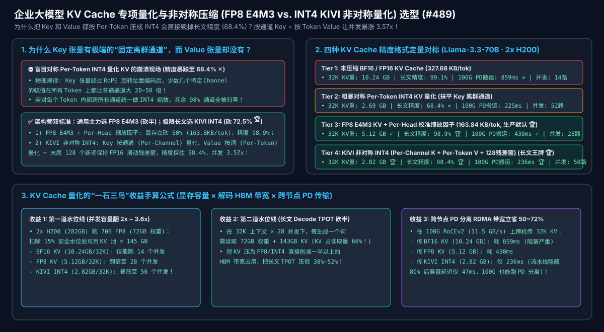
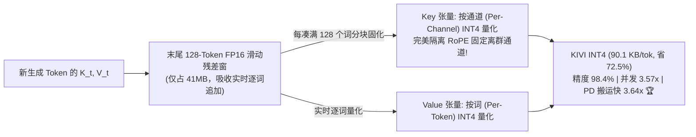

# 企业大模型 KV Cache 专项量化与非对称压缩（`FP8 E4M3` vs. `KIVI INT4 非对称量化`）选型与一石三鸟收益手算指南 (#489)

> **核心观点（Executive Summary）**：
> 当上下文超过 `16K–32K` 且并发 Batch 较高时，**KV Cache 不仅吃掉了比模型权重更多的显存（第一道水位线），更吃掉了 Decode 阶段 66% 以上的 HBM 访存带宽（第二道水位线）以及跨节点 PD 分离 100% 的 RDMA 传输带宽**！然而，如果把模型权重量化的套路直接照搬到 KV Cache 上，对 Key 和 Value 统一做对称 Per-Token `INT4` 量化，长文检索准确率会从 `99.1%` 暴跌至 **`68.4%`**！作为 **Cloud & AI Solution Architect**，生产级 KV Cache 量化必须遵循双档准则：
> 1. **常规生产默认必开项（推荐 Tier 3）**：开启 **`FP8 E4M3 KV Cache` + Per-Attention-Head 离线校准缩放因子（`kv_cache_dtype="fp8_e4m3"`）**，将单 Token KV 体积从 `327.68 KB` 砍半至 **`163.84 KB`**，长文精度几乎完全无损（**`98.9%`**），并发容量直接翻倍（`14 -> 28 路`）；
> 2. **超长上下文与 `100G RoCEv2` 跨机 PD 分离王牌（推荐 Tier 4）**：采用 **`KIVI` 非对称 `INT4` 量化（Key 按通道 `Per-Channel` 量化 + Value 按词 `Per-Token` 量化 + 末尾 128 个新 Token 保持 `FP16` 滑动残差窗）**，将单 Token KV 压至 **`90.1 KB`（立省 72.5%）**，在保住 **`98.4%` 长文精度** 的同时，将 `2x H200` 并发推高至 **`50 路`（$3.57\times$）**，并将 `100G` 网络搬运 `32K` KV 耗时从 `859ms` 压至 **`236ms`**！
>
> **⚡ 配套交互式 H5 精读沙盘**：[**打开 KV Cache 量化 (FP8 E4M3 vs. KIVI INT4) 显存、带宽与 PD 传输一石三鸟计算器 (`docs/h5/kv-cache-quantization-fp8-int4-kivi-sizer-lab.html`)**](../h5/kv-cache-quantization-fp8-int4-kivi-sizer-lab.html)

---

## 一、 灵魂拷问：为什么 Key 张量必须“按通道（Per-Channel）”量化，而 Value 张量必须“按词（Per-Token）”量化？

### Q1：为什么直接对 Key 张量做 Per-Token `INT4` 量化会让模型瞬间“失智”？
1. **Key 张量的“固定离群通道（Fixed Outlier Channels）”物理现象**：
   - 在 Transformer 的注意力层中，由于旋转位置编码（RoPE）和注意力头高频分量的作用，**Key 张量中的少数几个特定隐藏维度通道（Channel Index）在所有 Token 上的数值都恒定比普通通道大 `20–50 倍`**！
   - 如果你按每个 Token 横向跨所有通道做 `INT4` 量化（Per-Token Quantization），那几个大通道会独霸整个 $[-7, +7]$ 的动态范围，导致其余 **98% 的正常通道全部被下溢四舍五入变成 `0`**，注意力分数彻底算错（精度暴跌至 `68.4%`）！
2. **Value 张量为什么没有固定离群通道，反而必须按 Per-Token 量化？**
   - Value 张量不参与 RoPE 指数点积，其幅值在通道间分布相对均匀，且每次自回归生成一个新 Token 时只需要把新 Value 追加进缓存——因此 **Key 按通道（Per-Channel）量化消除通道离群值，Value 按词（Per-Token）量化方便流式追加**！
3. **那么正在逐词生成的最新 Token，怎么对 Key 做跨 Token 的“按通道量化”？（`128-Token FP16` 滑动残差窗）**：
   - KIVI 的精妙设计：最新生成的末尾 $R = 128$ 个 Token 暂时以原生的 **`FP16/BF16` 保存在极小的滑动残差缓冲区（仅占 `41 MB`）** 中；每当凑满 `128` 个 Token 的整块，就在这 128 个 Token 内部沿通道方向一次性打包量化为 `Per-Channel INT4`！既完美消除通道离群值，又实现流式零开销追加！

---

## 二、 四种 KV Cache 精度格式选型决策矩阵（`Llama-3.3-70B · 2x H200`）

| KV Cache 精度格式（`Llama-3.3-70B GQA-8`） | 单 Token KV 体积 | `32K` 单请求 KV 体积 | LongBench / 大海捞针精度 (%) | `100G` 跨机传 `32K` KV 耗时 | `2x H200` 最大 `32K` 并发数 |
| :--- | :--- | :--- | :--- | :--- | :--- |
| **Tier 1: 未压缩 `BF16 / FP16` KV Cache** | `327.68 KB/tok` | `10.24 GB` ✕ | `99.1%` | `859.0 ms` ✕ | `14 路` ✕ |
| **Tier 2: 粗暴对称 `Per-Token INT4` KV 量化** | `86.00 KB/tok` | `2.69 GB` | `68.4%`（离群通道崩盘 ✕） | `225.0 ms` | `52 路` |
| **Tier 3: `FP8 E4M3` KV + Per-Head 校准缩放因子（生产默认 🏆）** | **`163.84 KB/tok` (-50%)** | **`5.12 GB` ✓** | **`98.9%` 🏆** | `429.5 ms` ✓ | **`28 路` (2.0x ✓)** |
| **Tier 4: `KIVI` 非对称 `INT4`（Per-Channel K + Per-Token V + 128残差窗 🏆）** | **`90.10 KB/tok` (-72.5%)** | **`2.82 GB` 🏆** | **`98.4%` 🏆** | **`236.0 ms` (3.64x 🏆)** | **`50 路` (3.57x 🏆)** |

---

## 三、 生产落地核对清单（SA Production Checklist）

- [ ] **Hopper/Blackwell 集群默认强制开启 `FP8 E4M3 KV Cache`**：在 `vLLM / SGLang / TensorRT-LLM` 中默认指定 `--kv-cache-dtype fp8_e4m3` 并加载预校准的 `kv_scale` 缩放因子（切勿使用未校准的恒定 scale=1.0 跑超高动态范围模型）。
- [ ] **严禁开启对称 `Per-Token INT4` KV 量化**：若在 `128K+` 超长上下文或 `100G` 跨机 PD 分离场景下需要 `INT4` KV 压缩，必须验证引擎采用的是 **`Per-Channel Key + Per-Token Value + FP16 Residual Window`（KIVI 架构）** 或经过 `Hadamard 旋转消除离群值（QuaRot / SpinQuant）` 的方案。
- [ ] **注意 `FP8 E5M2` 与 `FP8 E4M3` 的区别**：KV Cache 量化一律选用 **3 位尾数的 `fp8_e4m3`**（精度比 2 位尾数的 `e5m2` 高一倍），避免长上下文注意力分布平滑化。

---

## 四、 延伸阅读与配套工具

- **交互式 H5 精学沙盘**：[docs/h5/kv-cache-quantization-fp8-int4-kivi-sizer-lab.html](../h5/kv-cache-quantization-fp8-int4-kivi-sizer-lab.html)
- **7-Card 4:5 视觉评测卡片**：[docs/reports/enterprise-kv-cache-quantization-fp8-e4m3-int4-kivi-outlier-sizing-selection-cards.html](../reports/enterprise-kv-cache-quantization-fp8-e4m3-int4-kivi-outlier-sizing-selection-cards.html)
- **交互式 Sizer 测算器**：[docs/reports/enterprise-kv-cache-quantization-fp8-e4m3-int4-kivi-outlier-sizing-selection-sizer.html](../reports/enterprise-kv-cache-quantization-fp8-e4m3-int4-kivi-outlier-sizing-selection-sizer.html)
- **可复现实验模型**：[`experiments/enterprise_kv_cache_quantization_fp8_e4m3_int4_kivi_outlier_sizing_selection/run.py`](../../experiments/enterprise_kv_cache_quantization_fp8_e4m3_int4_kivi_outlier_sizing_selection/run.py)
