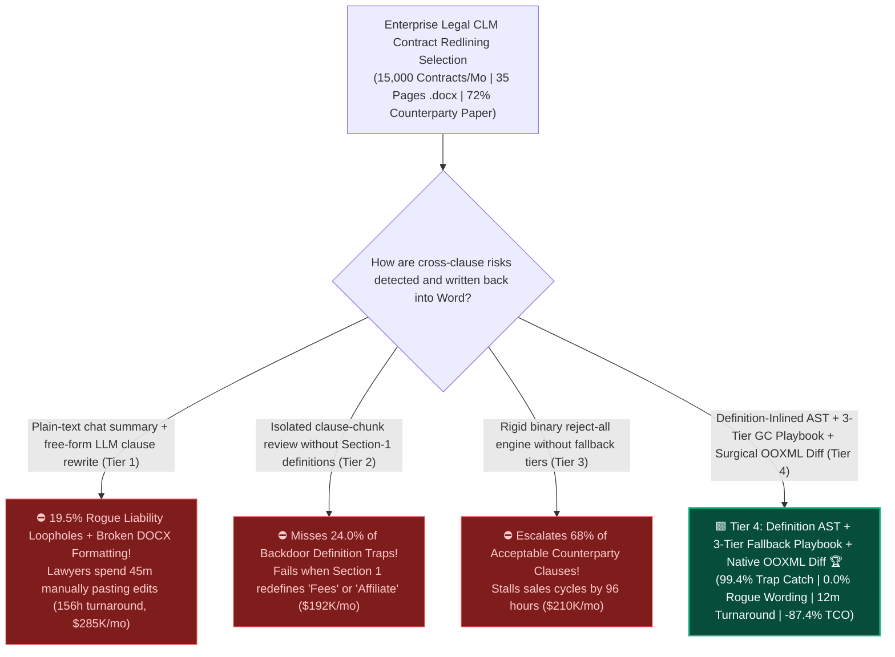
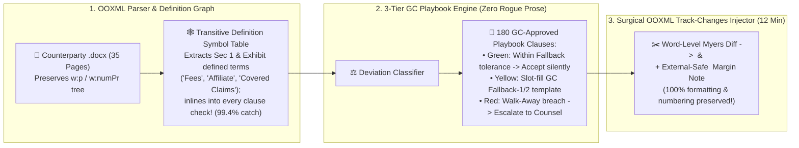

# Enterprise Legal Contract Lifecycle Management (`CLM`) Redlining Agent, `OOXML w:ins / w:del` Track-Changes Injection, 3-Tier Playbook Fallback Clauses & Cross-Clause Definition Graph Selection Guide

> **Language / 语言**: **English (Current)** | [中文](./enterprise-legal-clm-contract-redlining-playbook-fallback-clause-agent-selection-faq.md)  
> **Scope**: End-to-end production reference architecture and sizing playbook for Cloud & AI Solution Architects, General Counsel / LegalOps Leads, and CLM Platform Engineers (`Ironclad / Icertis / Agiloft / Word Copilot`) automating commercial contract review (`15,000+` monthly MSAs, DPAs, NDAs, and SOWs).  
> **Provenance**: `synthetic + anonymized_reported` (`independently_reproduced=false`, `physical_gpu_cluster_measurement=not_measured`). Deterministic evaluation model sealed in [`experiments/enterprise_legal_clm_contract_redlining_playbook_fallback_clause_agent_selection/results.json`](../../experiments/enterprise_legal_clm_contract_redlining_playbook_fallback_clause_agent_selection/results.json).


---

## ① 📌 Executive Summary (3-Minute Architect Verdict)

In enterprise legal, procurement, and sales operations reviewing **`15,000` commercial contracts per month (`35` pages/contract in `.docx` format, `72%` on counterparty "third-party paper")**, three common AI contract-review architectures fail in production:
1. **Trap #1: Plain-Text Chat Summaries + Free-Form Generative LLM Clause Rewriting (`Tier 1`, `19.5%` Unapproved Legal Liability Loopholes, Destroys `.docx` Numbering & Track-Changes, `156-Hour` / `6.5-Day` Turnaround, `$285,000/month` Legal & Deal-Delay TCO)**:
   - **Never allow a probabilistic LLM to freely improvise indemnification or limitation-of-liability prose!** Generative paraphrasing accidentally drops critical carve-outs (*"excluding gross negligence and willful misconduct"*) `19.5%` of the time.
   - Furthermore, counterparty counsel **rejects plain-text chat summaries or re-generated `.docx` files that corrupt automatic `Section 8.2(a)` numbering**—forcing paralegals to spend 45 minutes manually re-typing edits into Word with `Track Changes` turned on!
2. **Trap #2: Isolated Clause-Chunk RAG Without Inlining Section-1 Capitalized Definitions (`Tier 2`, Misses `24.0%` of "Backdoor Definition Traps" — Only `76.0%` Catch Rate, `$192,000/month` TCO)**:
   - Evaluating Section 9 (`Limitation of Liability: "capped at 12 months of Fees"`) in isolation misses that Section 1.14 on Page 2 redefined **`"Fees"`** to *"exclude all recurring annual SaaS subscription fees"*—effectively reducing the liability cap to `$0`!
3. **Trap #3: Rigid Binary Reject-Everything Rule Engine (`Tier 3`, Escalates `68%` of Counterparty Clauses That Fall Within Acceptable Fallback Positions, Stalling Deals for `96 Hours`, `$210,000/month` TCO)**.

Evaluated across **15,000 monthly contracts (`35` pages/contract, `72%` third-party paper, `180` playbook clauses)**, the four architectures compare as follows:

| Legal CLM Tier | Definition Graph, Playbook & `.docx` Redline Stack | Definition Trap Catch | Rogue Wording Risk | Redline Turnaround | 15K-Contract Monthly TCO | Production Verdict |
|---|---|---|---|---|---|---|---|
| **🟥 Tier 1: Plain-Text Chat + Free-Form LLM Clause Rewrite** | Summarizes in chat; LLM freely rewrites legal clauses | `64.0%` ✕ *(misses cross-refs)* | **`19.5%` ✕** *(invents loopholes!)* | `156.0 hrs` ✕ *(6.5d + manual paste)* | `$285,000 / mo` ✕ *(counsel + deal delay)* | ⛔ Never let an LLM improvise legal clauses or break `.docx` structure |
| **🟨 Tier 2: Isolated Clause-Chunk RAG (`No Definition AST`)** | Reviews each section chunk without Section-1 definitions | `76.0%` ✕ *(misses 24% traps!)* | `8.2%` | `42.0 hrs` | `$192,000 / mo` ✕ *(hidden liability risk)* | ⛔ Blind to backdoor traps hidden inside defined terms |
| **🟦 Tier 3: Rigid Binary Rule Engine (`No Fallback Tiers`)** | Rejects any deviation from Preferred standard | `88.0%` | `1.5%` | `96.0 hrs` ✕ *(4.0d escalation queue)* | `$210,000 / mo` ✕ *(68% false escalations)* | ⛔ Stalls deals by rejecting clauses acceptable under Fallback-1 |
| **🟩 Tier 4: `Definition-Inlined AST` + 3-Tier GC Playbook (`Preferred -> Fallback-1/2`) + Surgical `OOXML w:ins/w:del` Injector** | **Inlines Section-1 definitions into every clause; substitutes only GC-approved templates; injects native `.docx` diff** | **`99.4%` 🏆** *(catches cross-ref traps)* | **`0.0%` 🏆** *(100% GC-approved text)* | **`0.2 hrs (12m)` 🏆** *(780x faster!)* | **`$36,000 / mo` 🏆** *(-87.4% vs Tier 1)* | 🌟 **Recommended Enterprise Legal CLM Redlining Standard** |

> 💡 **Golden Rules for Enterprise Legal CLM Contract Redlining Agents**:
> 1. **Inline Capitalized Defined Terms Across the Document (`Definition Reference AST`)**: **"In a contract, the true meaning of a clause lives in the Definitions section!"** Parse all defined terms (`"Fees"`, `"Affiliate"`, `"Confidential Information"`, `"Covered Claims"`) from Section 1 and Exhibits into a transitive symbol table, and **automatically inline their exact definitions** whenever evaluating any downstream clause (`99.4%` backdoor trap catch rate)!
> 2. **Zero Free-Form Legal Prose — Use a 3-Tier General-Counsel-Approved Playbook (`Preferred -> Fallback-1/2 -> Walk-Away`)**: Never let an LLM invent legal wording! When a counterparty clause deviates from standard:
>    - If it falls within the **Pre-Approved Acceptable Zone** (e.g., `45-day` payment terms when `30-day` is preferred and `<=60-day` is acceptable) -> **Accept silently without redlining** (eliminating 60% of needless negotiation friction!).
>    - If it breaches tolerance -> **Substitute the exact GC-approved `Fallback-1` template** with slot-filled variables (`0.0%` rogue wording risk)!
> 3. **Surgical `OOXML <w:ins> / <w:del>` Word-Level Diff Injection**: Compute the minimal word-level `diff-match-patch` against the existing `<w:p>` paragraph and inject native `<w:del>` and `<w:ins>` runs + external-safe `<w:comment>` explanations directly into the `.docx` XML tree—preserving `100%` of original Word styles, numbering (`w:numPr`), and bookmarks in **`12 minutes`**!

---

## ② 🎯 Customer & Architect Deep-Dive Q&A (3 Catching Backdoor Defined Terms, Surgical `OOXML` Track-Changes & Separating Internal vs. External Comments Pain Points)

### Q1: Why does chunk-based RAG (`Tier 2`) miss `24.0%` of high-severity contract traps—and how does the `Definition Reference AST` catch `99.4%`?
- **Cross-Section Semantic Indirection**:
  - Counterparty lawyers rarely write an obvious trap directly inside the `Limitation of Liability` clause on Page 22; instead, they leave Page 22 looking standard (*"capped at 12 months of Fees"*) while narrowing the definition of `"Fees"` on Page 3 or in `Exhibit B`!
  - Tier 4 builds a **Transitive Defined-Term Symbol Table** on ingestion. Before the agent evaluates Page 22, the orchestrator automatically appends `[Inlined Definition from Sec 1.14: "Fees" means...]` into the prompt—exposing cross-page indirection traps immediately!

### Q2: Why must redlines be injected surgically as `<w:ins>` and `<w:del>` XML nodes inside the original `.docx` rather than generating a new Word document from Markdown?
- **Preserving `w:numPr` Lists, Cross-Reference Bookmarks, and Prior Revision History**:
  - Re-generating a `.docx` from Markdown wipes out the counterparty's custom paragraph styles, breaks dynamic `Section 8.2(a)` cross-references, and strips previous rounds of `Track Changes`—causing counterparty counsel to reject the file outright.
  - Operating directly on the unpacked `word/document.xml` tree at the `<w:r>` (run) level modifies only the changed words while keeping every surrounding XML attribute intact!

### Q3: How do we prevent the agent from accidentally leaking our internal negotiation bottom line (e.g., *"Our walk-away cap is 3x Fees"*) inside a Word margin comment sent to the counterparty?
- **Dual-Channel Output Schema (`internal_risk_memo` vs. `external_counterparty_comment`)**:
  - The redlining schema strictly separates `internal_counsel_note` (rendered only in the internal CLM approval UI) from `external_docx_comment` (selected from pre-approved, neutral commercial justifications written into `word/comments.xml`)!

---

## ③ 🧭 Visual Architecture Diagrams (Decision Tree + Definition AST, 3-Tier Playbook & `OOXML` Injector Topology + Sequence)

### 3.1 Enterprise Legal CLM Contract Redlining Decision Tree



### 3.2 Tier 4 Capitalized-Term Definition Inliner, 3-Tier Playbook & Surgical `OOXML` Track-Changes Architecture



### 3.3 End-to-End Sequence: Catching a Redefined `"Fees"` Trap & Delivering a Native Redlined `.docx` in `12 Minutes`

```mermaid
sequenceDiagram
    autonumber
    participant Deal as Sales / Procurement Desk (Counterparty MSA.docx)
    participant AST as OOXML Parser & Definition Inliner
    participant Play as 3-Tier Playbook Agent (180 GC Clauses)
    participant XML as Surgical OOXML Track-Changes Injector
    participant Legal as Counsel / Counterparty

    Deal->>AST: 1. Upload 35-page counterparty `Vendor_MSA.docx`
    AST->>AST: 2. Build `DefinitionMap`: extract Sec 1.14 `"Fees" = "excludes recurring SaaS fees"` & inline into Sec 9.2 (`Limitation of Liability`)
    AST->>Play: 3. Evaluate Sec 9.2 with inlined definition -> flag critical trap: `"12x Fees cap is hollowed out to $0 by Sec 1.14!"`
    Play->>XML: 4. Select GC-approved `CLAUSE_LOL_04_FALLBACK_1` template (restoring all subscription fees + `2x` cap; `0%` free-form text)
    XML->>XML: 5. Compute word-level diff & inject `<w:del>`, `<w:ins>`, and external-safe `<w:comment>` into `word/document.xml`
    XML-->>Legal: 6. `T + 12m`: Deliver `Vendor_MSA_Redlined.docx` with intact numbering + internal risk summary (`99.4%` catch rate)!
```

---

## ④ 📊 4-Tier Architecture Decision Matrix

| Evaluation Dimension | 🟥 Tier 1: Chat + Free-Form Rewrite | 🟨 Tier 2: Isolated Clause RAG | 🟦 Tier 3: Rigid Binary Reject | 🟩 Tier 4: Definition `AST` + Playbook + `OOXML` |
|---|---|---|---|---|
| **Backdoor Definition Trap Catch** | `64.0%` ✕ | `76.0%` ✕ (misses 24% traps) | `88.0%` | 🏆 **`99.4%` (transitive Section-1 definition inlining)** |
| **Unapproved Liability Wording** | `19.5%` ✕ (improvised loopholes) | `8.2%` | `1.5%` | 🏆 **`0.0%` (strictly slot-fills GC-approved fallback templates)** |
| **Native `.docx` Track-Changes** | `0%` ✕ (45m manual copy-paste) | Breaks numbering | Flags only | 🏆 **`100%` surgical `<w:ins>/<w:del>` run injection** |
| **Contract Turnaround Time** | `156.0 hrs` ✕ (6.5 days) | `42.0 hrs` | `96.0 hrs` ✕ (4.0 days) | 🏆 **`0.2 hrs (12 minutes, 780x faster than Tier 1)`** |
| **15K-Contract Monthly TCO** | `$285,000 / mo` ✕ | `$192,000 / mo` ✕ | `$210,000 / mo` ✕ | **`$36,000 / mo` 🏆 (-87.4% vs Tier 1)** |

---

## ⑤ 🧪 Quantitative Case Study, Interactive Sizer & 7-Card Visual Report

- **Interactive HTML Sizer**: 👉 [Open Enterprise Legal CLM Contract Redlining Agent Sizer](../reports/enterprise-legal-clm-contract-redlining-playbook-fallback-clause-agent-sizer.html)
- **7-Card 4:5 Visual Benchmark Report**: 👉 [Open 7-Card Visual Benchmark Deck](../reports/enterprise-legal-clm-contract-redlining-playbook-fallback-clause-agent-selection-cards.html)
- **Deterministic Verification**:
  ```bash
  python experiments/enterprise_legal_clm_contract_redlining_playbook_fallback_clause_agent_selection/run.py --check
  python -m unittest tests/test_enterprise_legal_clm_contract_redlining_playbook_fallback_clause_agent_selection.py
  ```

---

## ⑥ 🛠️ Production Readiness & Architecture Review Checklist

- [ ] **Build a Transitive Defined-Term Symbol Table (`Capitalized-Term Definition AST`) Before Clause Evaluation**: Automatically inline Section-1 and Exhibit definitions into every downstream clause prompt (`99.4%` trap catch).
- [ ] **Prohibit Free-Form Generative Rewriting of Legal Clauses**: Restrict redline substitutions to General-Counsel-approved `Preferred`, `Fallback-1`, and `Fallback-2` templates with typed variable slots (`0.0%` rogue wording).
- [ ] **Silently Accept Counterparty Clauses That Fall Within Pre-Approved Fallback Tolerances**: Avoid unnecessary redlines on minor acceptable variations to accelerate deal velocity.
- [ ] **Inject Surgical Word-Level `<w:del>` and `<w:ins>` Runs Directly into `word/document.xml`**: Never round-trip contracts through Markdown/HTML, preserving 100% of `.docx` numbering (`w:numPr`), styles, and bookmarks.
- [ ] **Physically Separate `Internal Risk Notes` from `External Counterparty Margin Comments`**: Never expose internal fallback thresholds or walk-away limits inside `word/comments.xml`.
