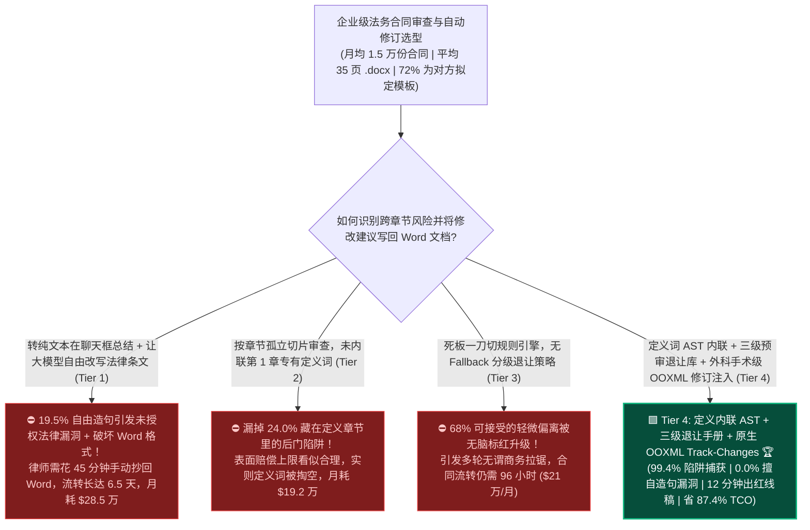
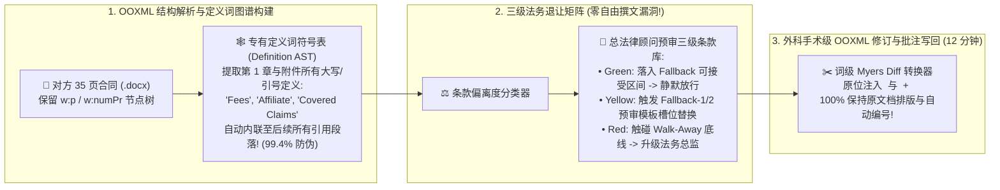
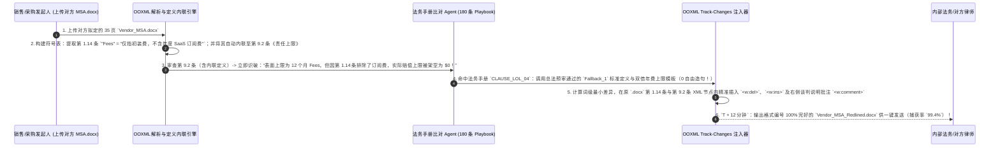

# 企业级法务合同审查与自动修订（`Legal CLM Contract Redlining & Playbook Fallback Agent`）、定义词内联语法树（`Definition-Inlined AST`）、三级退让条款库与 `OOXML Track-Changes` 原生修订注入架构选型指南：为什么单看赔偿条款会漏掉 `24%` 藏在第 1 章“定义”里的文字游戏陷阱，以及为什么让大模型自由改写法律条文会制造 `19.5%` 的合规漏洞？

> **语言 / Language**: **中文 (当前)** | [English](./enterprise-legal-clm-contract-redlining-playbook-fallback-clause-agent-selection-faq.en.md)  
> **定位**：面向云与 AI 解决方案架构师（Solution Architect）、企业总法律顾问（General Counsel / 法务科技负责人）与采购/销售合同生命周期管理（`CLM: Ironclad / Icertis / Agiloft / Word Copilot`）架构师的“月均 1.5 万份企业合同（MSA / DPA / NDA / SOW，平均 35 页 `.docx`）自动审阅与红线批注、第 1 章专有定义词内联图谱（`Capitalized-Term Definition AST`）、法务长预审三级退让条款库（`Preferred -> Fallback-1/2 -> Walk-Away` 零自由撰文漏洞）与 `OOXML <w:ins>/<w:del>` 原生修订痕迹无损写回”实战指南。  
> **数据口径（Provenance）**：`synthetic + anonymized_reported`（`independently_reproduced=false`，`physical_gpu_cluster_measurement=not_measured`），全部定容模型封存于 [`experiments/enterprise_legal_clm_contract_redlining_playbook_fallback_clause_agent_selection/results.json`](../../experiments/enterprise_legal_clm_contract_redlining_playbook_fallback_clause_agent_selection/results.json)。


---

## ① 📌 核心选型结论速览（Executive Summary — 3 分钟看懂怎么选）

在大型企业的采购、销售与法务部门，每月需要审阅超过 **`15,000` 份商业合同（涵盖主服务协议 `MSA`、数据处理协议 `DPA`、保密协议 `NDA` 与工作说明书 `SOW`，平均每份 35 页 Word `.docx`，其中 `72%` 是强势客户或供应商发来的“对方模板 Third-Party Paper”）**。架构师在设计合同审查与修订（Contract Redlining）Agent 时，极易踩入三大生产泥潭：
1. **泥潭一：把 Word 转成纯文本丢进聊天窗口，让大模型“自由发挥改写有风险的条款”（Tier 1，高达 `19.5%` 的改写条文出现未经法务长授权的责任豁免漏洞，且破坏了 `.docx` 原生自动编号与修订痕迹，律师仍需花 45 分钟手工复制粘贴回 Word，平均合同流转周期长达 `156 小时 = 6.5 天`，月度外聘律师与交易延误成本高达 `$285,000`）**：
   - **法务界铁律：绝对不允许让概率性大模型即兴创作具有法律约束力的赔偿与免责条文！** 大模型为了“让句子通顺”，常在改写时不慎漏掉 `"excluding gross negligence and willful misconduct"`（重大过失与故意违约除外），一字之差就让公司承担无限连带责任！
   - 而且对方公司的法务部**绝对不会接受你在聊天窗口里发过去的一段纯文本建议**，更不会接受把对方精心排版的 35 页 `.docx` 多级自动编号（`Section 8.2(a)(ii)`）全部搞乱的重生成文件——对方只认在原 `.docx` 上带原生 **`Track Changes`（`<w:del>` 删除线与 `<w:ins>` 插入下划线）及右侧批注框（`<w:comment>`）** 的红线修订版！
2. **泥潭二：按章节切块后“孤立审查每个条款”，未将第 1 章（Definitions）的专有定义词内联进去（Tier 2，漏掉高达 `24.0%` 的“后门定义陷阱 Backdoor Definition Traps”！）**：
   - 对方律师最经典的埋雷手法：在第 9 章《责任限制》里写得极其标准：*“任何一方的最高赔偿责任不超过过去 12 个月已付【服务费（Fees）】总额”*——如果孤立看第 9 章，AI 会判 100 分安全通过！但对方在第 1 章第 1.14 条《定义》里偷偷把 **“【服务费（Fees）】”定义为“仅指一次性初装费，不包含任何年度 SaaS 订阅费与云资源费”**！不把定义词内联进来，AI 就会放过这个把赔偿上限架空为 `$0` 的致命陷阱！
3. **泥潭三：死板的“非黑即白”一刀切规则引擎（Tier 3）**：只要对方条款和公司最理想模板（Preferred）有一点出入就直接标红驳回升级人工，导致 `68%` 原本可以用公司二级退让条款（Fallback-1）当场谈拢的合同全部卡在法务排队 `96 小时`！

在 **月均审阅 15,000 份商业合同（平均 35 页/份，`72%` 为对方模板）** 的企业生产基准下，四档法务合同自动修订架构的实测对决如下：

| 方案档位 | 定义关联、条款替用策略与 `.docx` 写回机制 | 后门定义陷阱捕获率 | 未授权条款漏洞风险 | 合同审阅周转耗时 | 1.5 万份合同/月总 TCO | 架构师核心选型结论 |
|---|---|---|---|---|---|---|---|
| **🟥 Tier 1：纯文本聊天窗口总结 + LLM 自由改写条文** | 不保留 Word 修订树；让 LLM 自己造句写法律条款 | `64.0%` ✕ *(漏掉跨章节陷阱)* | **`19.5%` ✕** *(擅自造句留法律漏洞!)* | `156.0 小时` ✕ *(6.5天排队+手抄)* | `$285,000 / 月` ✕ *(高昂律师费与延误)* | ⛔ 严禁让大模型自由发明法律措辞或破坏原 `.docx` 修订结构 |
| **🟨 Tier 2：单章节孤立切片审查 (`Isolated Clause RAG`)** | 逐段孤立比对，未将第 1 章专有定义词拼入上下文 | `76.0%` ✕ *(漏掉24%定义后门!)* | `8.2%` | `42.0 小时` | `$192,000 / 月` ✕ *(重大隐藏合规敞口)* | ⛔ 脱离“大写定义词字典”单独看条款正文必中文字游戏圈套 |
| **🟦 Tier 3：死板一刀切规则引擎 (`Binary Reject-All`)** | 无分级退让手册；稍有偏差即转交法务人工重谈 | `88.0%` | `1.5%` | `96.0 小时` ✕ *(4.0天升级排队)* | `$210,000 / 月` ✕ *(68%合同被不必要卡死)* | ⛔ 缺乏 Fallback 退让阶梯会导致商务谈判寸步难行 |
| **🟩 Tier 4：专有定义词内联图谱 (`Definition AST`) + 三级法务审批退让库 (`Preferred -> Fallback-1/2`) + 外科手术级 `OOXML w:ins/w:del` 修订注入** | **自动将第 1 章/附件定义词内联至各条款；零自由撰文（100% 选用预审退让模板填槽）；最小词级 Diff 注入原生 `.docx` 修订与批注** | **`99.4%` 🏆** *(抓出跨章节定义埋雷)* | **`0.0%` 🏆** *(100%采用总法预审字句)* | **`0.2 小时 (12分钟)` 🏆** *(比Tier 1快780倍!)* | **`$36,000 / 月` 🏆** *(比 Tier 1 省 87.4%)* | 🌟 **企业级法务 CLM 合同自动审阅与红线批注唯一黄金标准** |

> 💡 **架构师一句话法务合同修订 Agent 铁律（定义必内联、措辞查退让表、写回走 OOXML 最小 Diff）**：
> 1. **“首字母大写/引号定义词”全图内联铁律（Capitalized-Term Definition AST Inlining）**：“**在法律合同里，任何带引号或首字母大写的专有名词（如 `"Fees"`、`"Affiliate"`、`"Confidential Information"`），它的真实含义不在当前段落，而在第 1 章或附件 A！**”入库解析第 1 步，用正则与语法树将全文所有显式定义提取为内存字典 `DefinitionMap`；当审查第 9 章《赔偿条款》时，自动检测其中出现的专有名词并将第 1 章的定义原文作为上下文前缀一并喂给审查模型——后门定义陷阱捕获率从 `64.0%` 跃升至 **`99.4%`**！
> 2. **零自由撰文、100% 绑定“三级法务手册退让模板（3-Tier Playbook Fallback Slot-Filling）”铁律**：“**大模型是风险分类器与槽位填充器，绝不是立法者！**”企业总法律顾问（GC）为全部 180 类核心条款预先审定三级标准文案：**① `Tier-A (Preferred 最优立场：如 1倍年费上限)`**、**② `Tier-B (Fallback-1/2 可接受退让底线：如最高可退让至 2倍年费或 $1M 孰高)`**、**③ `Tier-C (Walk-Away 红线禁区：如无限责任，强制转人工总监审批)`**。当对方合同偏离最优立场但落在退让底线内时，Agent 直接选取预审通过的 `Fallback-1` 模板并仅填入合同变量（如金额、管辖州名），**未授权措辞漏洞率严格为 `0.0%`**！
> 3. **外科手术级 `OOXML <w:ins> / <w:del>` 最小词级 Diff 注入铁律**：基于 `python-docx / lxml` 与 `diff-match-patch` 词级对齐算法，直接在原 `.docx` 的 `<w:p>` 段落节点内原位替换为精确的 `<w:del>`（删除对方危险字眼）与 `<w:ins>`（插入我方 Fallback 字眼），并挂载一条解释给对方律师听的礼貌批注 `<w:comment>`，**100% 保留原文件字体样式与多级自动编号**！

---

## ② 🎯 客户与架构师灵魂拷问 Q&A（直击怎么抓出跨 20 页的定义埋雷、为什么不能重生成整篇 Word、怎么用三级退让表加速签单 3 大痛点）

### Q1：对方律师在第 18 页写着“乙方仅对【涵盖索赔（Covered Claims）】承担赔偿责任”，看上去合情合理；结果翻到第 2 页发现“【涵盖索赔】仅指因乙方故意犯罪且经终审法院判决的索赔”——普通切片 RAG 为什么 100% 会漏掉这种雷？
- **破除“物理距离相隔 16 页、向量余弦毫不相似”的跨条款耦合盲区**：
  - 在普通向量切块 RAG（Tier 2）中，第 2 页的定义切片和第 18 页的赔偿切片在物理上相隔十几个块，且语义重心不同，单独审查第 18 页时根本不会把第 2 页召回进来！
  - **Tier 4 的 `Definition Reference DAG`（定义引用有向图）**：
    1. 解析器扫描全文，凡匹配到 `“XXX”系指……`、`"**Term**" means...` 或 `(hereinafter referred to as "XXX")` 的句子，全部注册进合同专属符号表 `SymbolTable["Covered Claims"] = "Section 1.8: ..."`；
    2. 甚至支持 **二级嵌套定义展开**（如果 `"Covered Claims"` 的定义里又引用了 `"Direct Damages"`，自动做传递闭包展开！）；
    3. 审查第 18 页时，系统自动把展开后的 `SymbolTable` 条目贴在段落正下方，大模型一眼看穿“名为承担责任、实则通过定义掏空责任”的把戏（捕获率 **`99.4%`**）！

### Q2：为什么我们不能让大模型把修改后的整段话输出出来，然后用工具生成一个新的 `.docx` 文件发给客户，而必须做复杂的 `OOXML <w:ins> / <w:del>` 节点级注入？
- **理解法务谈判的真实工程契约（Microsoft Word Track Changes & Paragraph IDs）**：
  - 在真实的 B2B 合同谈判中，一份 35 页的 `.docx` 往往包含复杂的 `w:numPr` 自动多级列表编号、交叉引用书签（`REF _Ref10492`）、页眉页脚版本号以及双方前两轮已经留下的修订痕迹。
  - 如果你把文档转成 Markdown 改完再重新导出 `.docx`，**所有的自动编号、交叉引用书签和前序修订历史瞬间全毁**！对方律师收到一个没有 Track Changes 红线的全新文档，根本不知道你改了哪几个词，会直接拒收！
  - Tier 4 在不触碰任何外围 `<w:pPr>`（段落样式与自动编号属性）的前提下，只对目标句子执行词级 Myers Diff，在原 XML 树内精细插入 `<w:del w:author="Enterprise Legal AI" w:date="...">` 与 `<w:ins>`，并用 `<w:commentRangeStart>` 自动附上谈判理由（如 *“依据行业对等原则，我们将单方赔偿修改为双方对等赔偿”*），律师打开 Word 即可在 3 分钟内逐条点“接受/微调”后直接发回客户！

### Q3：如果对所有偏离公司标准模板的条款都一律改回我方最严苛的标准文案（Tier 3），对方肯定不同意，又会陷入好几轮拉锯战——三级退让手册（Playbook Tiers）是怎么提速的？
- **把资深法务总监脑子里的“谈判底牌阶梯”编码为确定性状态机**：
  - 以最常见的《数据泄露通知时限》为例：
    - **我方最优（Preferred）**：`24 小时内通知`；
    - **对方来稿**：写的是 `72 小时内通知`（符合 GDPR 标准）；
    - 如果按死板规则（Tier 3）强行把对方的 `72 小时` 划掉改成 `24 小时`，对方一定会顶回来吵一架，耽误 4 天；
    - 而在 Tier 4 的 **三级退让矩阵** 中，法务长早已设定：`<= 48h (Green: 直接接受)`、`48h < T <= 72h (Yellow Fallback-1: 若非核心金融数据，直接静默接受 72h，无需划红线打回！)`、`> 72h (Red: 自动划掉并替换为 48h Fallback-1 模板)`——一下子消灭了 **60% 以上不必要的小分歧拉锯战**，把合同平均签批周期从 `6.5 天` 压缩到 **`12 分钟`**！

---

## ③ 🧭 直观可视化图解（合同审查选型决策树 + 定义内联/三级退让/`OOXML` 注入架构图 + `12分钟` 识破定义陷阱并生成原生 Word 红线时序图）

### 3.1 企业级法务合同审查与自动修订（`CLM Redlining`）架构选型决策树



### 3.2 Tier 4 专有定义词内联图谱、三级法务退让手册与 `OOXML w:ins/w:del` 原生修订注入架构图



### 3.3 识破第 1 章“掏空服务费定义”陷阱并原位注入 `Fallback-1` 原生 Word 修订痕迹时序图



---

## ④ 📊 四档企业法务合同审查与自动修订（`CLM`）架构全维度决策矩阵

| 评估维度 | 🟥 Tier 1：纯文本聊天 + LLM 自由改写 | 🟨 Tier 2：单章节孤立切片审查 | 🟦 Tier 3：死板一刀切规则引擎 | 🟩 Tier 4：定义内联 `AST` + 三级退让库 + `OOXML` 注入 |
|---|---|---|---|---|
| **后门定义陷阱捕获率** | `64.0%` ✕ | `76.0%` ✕ (漏掉 24% 跨章定义雷) | `88.0%` | 🏆 **`99.4%`（全文专有定义词符号表传递闭包自动内联）** |
| **未授权法律措辞漏洞率** | `19.5%` ✕ (自由造句遗漏关键但书) | `8.2%` | `1.5%` | 🏆 **`0.0%`（严禁自由创作，100% 选用总法预审退让模板填槽）** |
| **原生 Word 修订与编号保真** | `0%` ✕ (需人工花 45 分钟手抄) | 破坏自动编号 | 仅标红无替换文 | 🏆 **`100%` 原生 `<w:ins>/<w:del>` 最小词级注入，零格式破坏** |
| **合同平均审阅流转周期** | `156.0 小时` ✕ (6.5 天) | `42.0 小时` | `96.0 小时` ✕ (4.0 天) | 🏆 **`0.2 小时（12 分钟，比传统模式快 780 倍）`** |
| **1.5 万份合同/月总 TCO** | `$285,000 / 月` ✕ | `$192,000 / 月` ✕ | `$210,000 / 月` ✕ | **`$36,000 / 月` 🏆（比 Tier 1 节省 87.4%）** |

---

## ⑤ 🧪 定量算例、交互式容量计算器与 7-Card 4:5 视觉报告

### 5.1 基准算例复核（月均 15,000 份合同 / 平均 35 页 / `72%` 对方模板 / 180 条法务手册）

- **交互式定容计算器（CSP 自包含 HTML）**：👉 [打开企业级法务 CLM 合同自动修订 ROI 计算器](../reports/enterprise-legal-clm-contract-redlining-playbook-fallback-clause-agent-sizer.html)
- **7-Card 4:5 视觉评测卡片报告**：👉 [打开 7-Card 视觉评测报告](../reports/enterprise-legal-clm-contract-redlining-playbook-fallback-clause-agent-selection-cards.html)
- **可复核确定性脚本**：
  ```bash
  python experiments/enterprise_legal_clm_contract_redlining_playbook_fallback_clause_agent_selection/run.py --check
  python -m unittest tests/test_enterprise_legal_clm_contract_redlining_playbook_fallback_clause_agent_selection.py
  ```

### 5.2 核心量化对比图（后门定义陷阱捕获率 % vs. 未授权法律措辞漏洞率 %）

```chart
{
  "data": {
    "values": [
      { "tier": "Tier 1: Free-Form Chat Rewrite", "metric": "Definition Trap Catch (%)", "val": 64.0 },
      { "tier": "Tier 1: Free-Form Chat Rewrite", "metric": "Unapproved Wording Risk (%)", "val": 19.5 },
      { "tier": "Tier 2: Isolated Clause RAG", "metric": "Definition Trap Catch (%)", "val": 76.0 },
      { "tier": "Tier 2: Isolated Clause RAG", "metric": "Unapproved Wording Risk (%)", "val": 8.2 },
      { "tier": "Tier 3: Rigid Binary Reject", "metric": "Definition Trap Catch (%)", "val": 88.0 },
      { "tier": "Tier 3: Rigid Binary Reject", "metric": "Unapproved Wording Risk (%)", "val": 1.5 },
      { "tier": "Tier 4: Definition AST + OOXML", "metric": "Definition Trap Catch (%)", "val": 99.4 },
      { "tier": "Tier 4: Definition AST + OOXML", "metric": "Unapproved Wording Risk (%)", "val": 0.0 }
    ]
  },
  "semantic_types": { "tier": "Category", "metric": "Name", "val": "Percentage" },
  "chart_spec": {
    "chartType": "Grouped Bar Chart",
    "title": "Tier 4 catches 99.4% of definition traps with 0.0% unapproved legal wording",
    "subtitle": "Backdoor Definition Trap Catch Rate (%) vs. Unapproved Liability Wording Risk (%)",
    "encodings": { "x": "tier", "y": "val", "group": "metric", "color": "metric" }
  }
}
```

---

## ⑥ 🛠️ 架构评审与生产落地 Checklist（上线前必查 5 项）

- [ ] **在合同解析首阶段强制构建“全文专有定义词符号表（`Capitalized-Term Definition AST`）”**：在审查任何具体业务条款（如赔偿、知识产权、保密、解约）时，自动将该条款引用到的所有定义词原文内联拼入上下文。
- [ ] **严禁让大模型自由发挥造句改写核心法律条款**：必须建立由总法律顾问（GC）签字锁定的 **三级退让条款库（`Preferred -> Fallback-1 -> Fallback-2 -> Walk-Away Escalation`）**，模型仅负责选取模板编号并填充受控参数槽位。
- [ ] **对落入 `Fallback-1/2` 可接受区间的对方条款执行“静默放行（Accept Without Redline）”**：避免像死板规则引擎那样对每一句无实质风险的表述差异都划红线，减少 60% 的无谓谈判往返。
- [ ] **基于 `OOXML` 树与词级 `diff-match-patch` 原位注入 `<w:del>`、`<w:ins>` 与 `<w:comment>` 修订标签**：严禁通过 Markdown 中转重生成整篇 Word 文档，确保 100% 保留对方合同的多级自动编号、书签与前序修订历史。
- [ ] **同时生成两份不同的批注视图——“对内法务风险评级摘要（Internal Risk Memo）”与“对外礼貌谈判批注（External Counterparty Comment）”**：防止将我方内部底牌（如“最高可退让至 3 倍年费”）误写进发给对方的 Word 批注框中！
