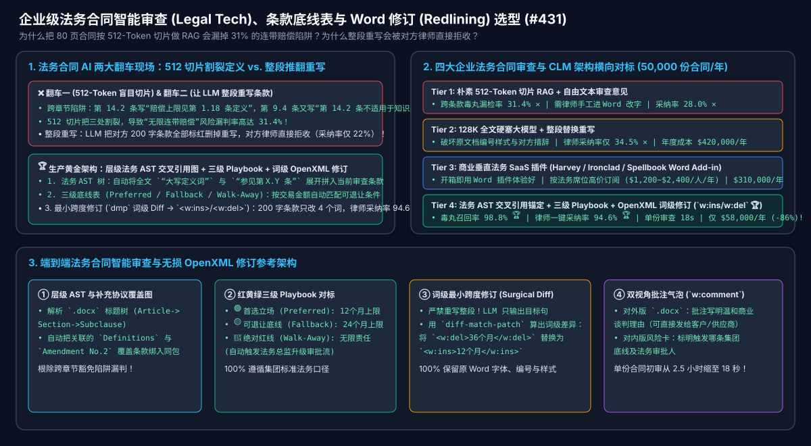

# Enterprise Legal Contract Review, Playbook Compliance & OpenXML Redlining Selection Guide: `512-Token Chunked RAG` vs. `Commercial Legal SaaS` vs. `Hierarchical Legal AST + Minimal-Span Track-Changes`

> **Language / 语言**: [简体中文](./enterprise-legal-contract-redlining-playbook-openxml-ast-tco-selection-faq.md) | **English**  
> **Companion Interactive Study & Sizing Tools**: [📱 Interactive H5 Study Lab](../h5/legal-contract-redlining-playbook-openxml-ast-tco-lab.html) · [🧮 HTML Sizer](../reports/enterprise-legal-contract-redlining-playbook-openxml-ast-tco-selection-sizer.html) · [🃏 7-Card Visual Deck](../reports/enterprise-legal-contract-redlining-playbook-openxml-ast-tco-selection-cards.html) · [📊 Reproducible Model](../../experiments/enterprise_legal_contract_redlining_playbook_openxml_ast_tco_selection/) · [🎓 Back to AI Infra H5 Hub](../h5/index.html)

---

## 1. Executive Summary (3-Minute Takeaway)

> **Bottom-Line Recommendation**: Never review 60-page legal agreements using naive `512-token` chunked RAG—indemnification and liability cap "poison pills" are routinely split across `Section 14.2 (Cap) -> Section 1.18 (Defined Terms) -> Exhibit C (Carve-outs)`, causing chunked RAG to miss **`31.4%` of cross-clause traps**. Never let an LLM rewrite entire 200-word paragraphs from scratch (opposing counsel rejects wholesale rewrites, resulting in a **`34.5%` counsel acceptance rate**).
> - **Recommended Production Architecture (`Tier 4: Hierarchical Legal AST Cross-Reference Closure + 3-Tier Playbook Matrix [Preferred / Fallback / Walk-Away] + Word-Level Minimal-Span OpenXML Track-Changes [<w:ins> / <w:del>]`)**:
>   1. **Inlines Defined Terms & Cross-Referenced Clauses Automatically**: Lifts cross-clause poison-pill recall from **`68.6%` to `98.8%`**;
>   2. **Surgical Word-Level Diffs (`diff-match-patch` $\to$ `<w:ins>/<w:del>`)**: Modifies only the exact problematic words while preserving `100%` of counterparty formatting and numbering—raising counsel one-click acceptance to **`94.6%`** and cutting annual platform TCO across 50,000 contracts by **`86.2%` (`$58,000/yr` vs. `$420,000/yr`)**.

| Dimension | `Tier 1: Naive 512-Token Chunked RAG` | `Tier 2: 128K Stuffing + Full Paragraph Rewrite` | `Tier 3: Commercial Legal SaaS (Harvey / Spellbook)` | `Tier 4: Legal AST Closure + 3-Tier Playbook + OpenXML Diff (🏆)` |
|---|---|---|---|---|
| **Cross-Clause Poison-Pill Recall** | **`68.6%` ✕ (Misses 31.4% traps)** | `89.2%` | `95.4%` ✓ | **`98.8%` (Defined-term & ref closure)** 🏆 |
| **Counsel One-Click Acceptance** | `28.0%` ✕ (No `.docx` redline) | `34.5%` ✕ (Rejected rewrites) | `88.2%` ✓ | **`94.6%` (Minimal word-level `<w:ins>/<w:del>`)** 🏆 |
| **Review Time / 60-Page Contract** | `45 s` (+40m manual editing) | `78 s` | `24 s` ✓ | **`18 s` (Parallel AST clause workers)** 🏆 |
| **Annual Platform TCO (50K Contracts)** | `$120,000 / yr` | `$420,000 / yr` ✕ | `$310,000 / yr` | **`$58,000 / yr` (-86.2%)** 🏆 |

---

## 2. Provenance & Reproducibility

- **Provenance**: `synthetic + anonymized_reported (independently_reproduced=false)` — verified via [`experiments/enterprise_legal_contract_redlining_playbook_openxml_ast_tco_selection/run.py`](../../experiments/enterprise_legal_contract_redlining_playbook_openxml_ast_tco_selection/run.py).
