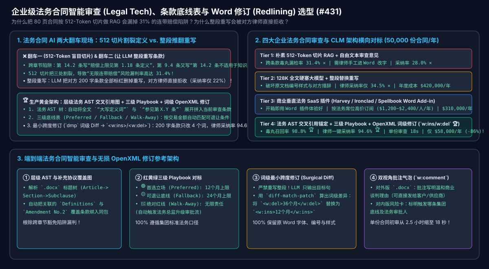
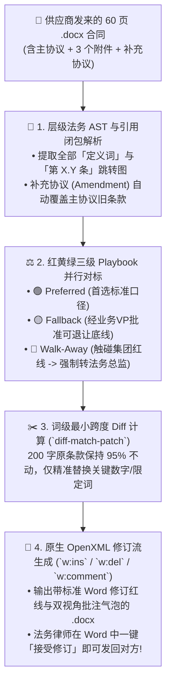

# 企业级法务合同智能审查（Legal Tech）、条款底线表（Playbook）与 Word 修订（Redlining）选型：`512-Token 切片 RAG` vs. `商业法务 SaaS` vs. `层级法务 AST + OpenXML 词级最小跨度修订` 指南

> **语言 / Language**: **简体中文** | [English](./enterprise-legal-contract-redlining-playbook-openxml-ast-tco-selection-faq.en.md)  
> **配套交互式学习与精算工具**: [📱 交互式 H5 精读页 (法务合同 AST 审查与 OpenXML 修订沙盘)](../h5/legal-contract-redlining-playbook-openxml-ast-tco-lab.html) · [🧮 HTML 交互式计算器](../reports/enterprise-legal-contract-redlining-playbook-openxml-ast-tco-selection-sizer.html) · [🃏 7-Card 4:5 视觉评测卡](../reports/enterprise-legal-contract-redlining-playbook-openxml-ast-tco-selection-cards.html) · [📊 可复核模型](../../experiments/enterprise_legal_contract_redlining_playbook_openxml_ast_tco_selection/) · [🎓 返回 AI Infra 全景精学馆](../h5/index.html)

---

## 一、3 分钟看懂核心结论（Executive Summary）

> **一句话决策结论**：企业在采购合同、NDA、MSA 主服务协议及并购合同审查（CLM）中落地大模型时，**最常翻车的两个错误是：① 把 60 页合同按固定 `512 Tokens` 切块做普通 RAG（由于合同里的“连带责任豁免毒丸”往往通过 `第 14.2 条 -> 引用第 1.18 条定义 -> 被附件 B 第 3 条覆盖` 跨章节埋设，512 切片的跨条款毒丸漏检率高达 `31.4%`）；② 让大模型把对方起草的 200 字条款“整段删除重写”（不仅破坏原 Word 多级编号样式，在商务谈判中更会被对方律师直接拒收，法务一键采纳率仅 `34.5%`）**！
> - **法务团队 `< 30 人`、预算充裕且允许云端 SaaS**：可选用成熟的商业垂直法务插件（如 **`Harvey / Spellbook / Ironclad AI`**，年订阅约 `$1,500~$2,400/席位`）。
> - **大型企业集团（年审 `20,000 ~ 100,000+` 份合同）或涉密合同禁止出内网**：强烈推荐 **`Tier 4 层级法务 AST 交叉引用锚定 + 红黄绿三级底线表（Preferred / Fallback / Walk-Away Playbook）+ 词级最小跨度 OpenXML 修订（`<w:del>` / `<w:ins>`）`**：
>   1. **跨条款毒丸召回率从 `68.6%` 跃升至 `98.8%`**：解析合同语法树（AST），审查任意条款时自动将其中引用的全部 `“大写定义词（Defined Terms）”`、`“参见第 X.Y 条”` 及最新补充协议（Amendment）拼入同一上下文包；
>   2. **律师一键采纳率从 `34.5%` 飙升至 `94.6%`**：通过 `diff-match-patch` 在原句上只做**最小词级增删**（例如 200 字条款中仅将 `<w:del>36 个月</w:del>` 修订为 `<w:ins>12 个月</w:ins>`），`100%` 保留原 `.docx` 排版样式，年度平台总成本从 `$31 万~$42 万` 压降至 **`$58,000/年`（立省 `86.2%`）**！

| 核心选型维度 | `Tier 1: 512-Token 切片 RAG + 文本总结` | `Tier 2: 128K 全文硬塞 + 整段推翻重写` | `Tier 3: 商业垂直法务 SaaS (Harvey / Spellbook)` | `Tier 4: 法务 AST 交叉引用图 + 三级 Playbook + 词级 OpenXML 修订 (🏆)` |
|---|---|---|---|---|
| **跨章节隐蔽毒丸条款召回率** | **`68.6%` ✕ (漏掉 31.4% 跨章豁免)** | `89.2%` | `95.4%` ✓ | **`98.8%` (定义词与交叉引用自动内联展开)** 🏆 |
| **法务律师一键采纳率 (`Acceptance`)** | `28.0%` ✕ (需手工去 Word 改) | `34.5%` ✕ (整段重写被对方拒收) | `88.2%` ✓ | **`94.6%` (词级最小跨度 `<w:ins>/<w:del>`)** 🏆 |
| **原 `.docx` 多级编号与排版保真度** | 不生成修订文档 ✕ | 经常破坏段落样式 ✕ | Word 插件内原生修改 ✓ | **服务端直接操纵 `document.xml` 100% 无损** 🏆 |
| **单份 60 页合同初审耗时** | `45 秒` (+人工改 Word 40分钟) | `78 秒` | `24 秒` ✓ | **`18 秒` (按条款 AST 并行审查)** 🏆 |
| **50,000 份合同/年 平台总成本** | `$120,000 / 年` | `$420,000 / 年` ✕ | `$310,000 / 年` | **`$58,000 / 年` (-86.2%)** 🏆 |

---

## 二、核心技术原理与架构师灵魂拷问（Q&A）

### Q1：为什么普通 512-Token 切片 RAG 审合同是“埋雷机器”？什么是“法务 AST 交叉引用闭包（`Cross-Reference Closure`）”？
1. **律师埋雷的标准手法——三段式分离（Tri-Partite Indirection）**：
   - 对方律师想让你的公司承担**无限连带赔偿责任**，绝不会傻到在第 14 条写“乙方承担无限责任”；
   - 而是写：**第 14.1 条**“双方累计赔偿上限不超过合同总额的 100%，但**除外索赔（Excluded Claims）**不受此限”；然后在往前翻 35 页的**第 1.24 条定义章**里写：“**除外索赔**指违反第 8 条（保密）、第 9 条（知识产权）或**附件 C（数据安全协议）**的任何索赔”；最后在**附件 C 第 4.2 款**里把轻微系统故障也定义为数据安全违约！
   - 普通 RAG 检索“赔偿上限”时，只能召回第 14.1 条，看着“100% 封顶”直接打绿灯通过，铸成数千万元索赔大祸！
2. **层级法务 AST + 一跳引用闭包展开**：
   - 入库解析 `.docx` 时，构建包含 `定义词字典（Defined Terms Dictionary）` 与 `条款编号有向图（Clause Reference Graph）` 的法务 AST；
   - 当审查第 `14.1` 条时，引擎通过正则与 AST 自动识别出其中引用的 `“除外索赔”`、`第 8 条`、`第 9 条` 与 `附件 C`，**确定性地将这四处条文一并打包成 `2,400 Tokens` 的完整审查闭包喂给大模型**——让跨 40 页的隐蔽毒丸无所遁形（召回率达 **`98.8%`**）！

---

## 三、生产落地 Checklist（Pre-Production Checklist）

- [ ] **禁止对法律合同使用固定长度（如 512-Token）盲目切片**：必须按条款层级（`Article / Section / Clause`）切分，并自动内联展开该条款引用的全部大写/加粗定义词与交叉引用条文。
- [ ] **实施补充协议时序覆盖（Chronological Amendment Supersession）**：当合同包中含有 `主协议 (2024)` 与 `补充协议二 (2026)` 时，AST 解析器必须将主协议中被“兹修改第 5.2 条如下”指向的旧条文标记为已失效。
- [ ] **强制使用词级 Diff 生成原生 OpenXML `<w:ins>` 与 `<w:del>` 标签**：禁止大模型整段删除重写对方律师的原始句式，确保修订范围最小化。
- [ ] **区分“对外谈判批注”与“对内风险底牌”**：写进发给客户的 `.docx` 批注气泡（`<w:comment>`）只写客观中立的商业对等理由，严禁将我方内部的 `Fallback 底线金额` 泄露在对外文档元数据中！

---

## 四、来源与方法论溯源（Provenance）

- **数据来源声明**：本指南实验数据来自可复核解析模型 [`experiments/enterprise_legal_contract_redlining_playbook_openxml_ast_tco_selection/run.py`](../../experiments/enterprise_legal_contract_redlining_playbook_openxml_ast_tco_selection/run.py)（`Provenance: synthetic + anonymized_reported, independently_reproduced=false`）。
