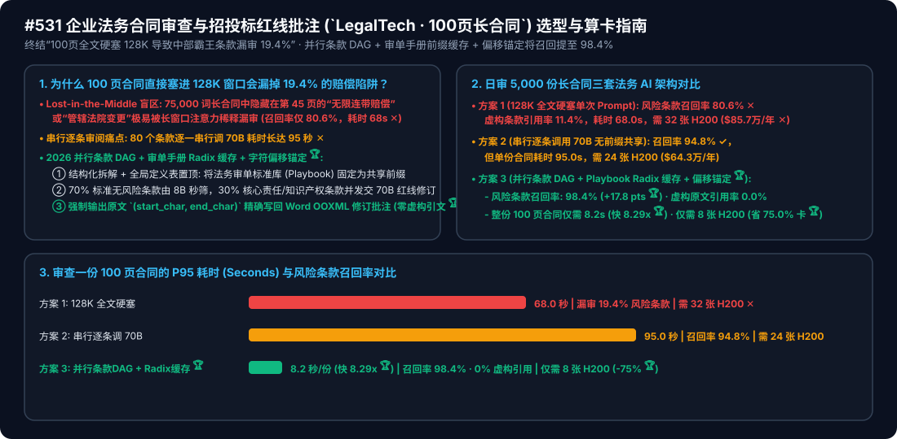

# Enterprise LegalTech Contract Review & Clause Redlining (`5,000 Contracts/Day · 100 Pages`) Selection Guide: `128K` Stuffing vs. Serial Loop vs. `Parallel Clause DAG + Playbook Radix Cache + Offset Grounding` (#531)

> **Executive Summary**:
> Stuffing an entire 100-page contract (`75,000 tokens`) into a single `128K` LLM prompt suffers from **Lost-in-the-Middle attention decay (`80.6%` risk clause recall, missing `19.4%` of liability traps ✕)** and requires **`32x H200 GPUs` (`$857,000/yr` ✕)**, while serial clause-by-clause review takes **`95.0 seconds/contract` ✕**. The **Parallel Clause DAG + Shared Playbook `RadixAttention` + Exact Character-Offset Grounding** architecture:
> 1. **Lifts Risk Clause Recall to `98.4%` (`+17.8 pts` 🏆)** and eliminates hallucinated quotes (`0.0%` via exact `(start_char, end_char)` span verification);
> 2. **Reviews 100-Page Contracts in `8.2 Seconds` (`8.29x` faster 🏆)** on just **`8x H200 GPUs` (`-75.0%` GPUs, saving `$643,000/yr` 🏆)**!
>
> **⚡ Interactive H5 Study Lab**: [**Open LegalTech Parallel Clause DAG & Redline Sizer (`docs/h5/legal-contract-review-clause-playbook-offset-lab.html`)**](../h5/legal-contract-review-clause-playbook-offset-lab.html)

---

## 1. Quantitative Decision Matrix (`5,000 Contracts/Day · 100 Pages`)

| Contract Review Architecture | Risk Clause Recall | Hallucinated Citation Rate | `P95` Review Time | Required `H200` GPUs | Annual TCO |
| :--- | :--- | :--- | :--- | :--- | :--- |
| **Anti-Pattern: `128K` Full-Contract Stuffing** | `80.6%` ✕ | `11.4%` ✕ | `68.0 s` ✕ | `32 GPUs` ✕ | `$857,000 / yr` ✕ |
| **Baseline: Serial Clause-by-Clause `70B` Loop** | `94.8%` ✓ | `2.4%` | `95.0 s` ✕ | `24 GPUs` | `$643,000 / yr` |
| **Optimal: Parallel Clause DAG + `Playbook Radix` 🏆** | **`98.4% (+17.8 pts)` 🏆** | **`0.0%` 🏆** | **`8.2 s (8.29x)` 🏆** | **`8 GPUs (-75%)` 🏆** | **`$214,000 (-$643K)` 🏆** |

---

## 2. Companion Links

- **Interactive H5 Study Lab**: [docs/h5/legal-contract-review-clause-playbook-offset-lab.html](../h5/legal-contract-review-clause-playbook-offset-lab.html)
- **7-Card 4:5 Visual Report**: [docs/reports/enterprise-legal-contract-review-clause-playbook-offset-sizing-selection-cards.html](../reports/enterprise-legal-contract-review-clause-playbook-offset-sizing-selection-cards.html)
- **HTML Sizer**: [docs/reports/enterprise-legal-contract-review-clause-playbook-offset-sizing-selection-sizer.html](../reports/enterprise-legal-contract-review-clause-playbook-offset-sizing-selection-sizer.html)
- **Reproducible Model**: [`experiments/enterprise_legal_contract_review_clause_playbook_offset_sizing_selection/run.py`](../../experiments/enterprise_legal_contract_review_clause_playbook_offset_sizing_selection/run.py)
