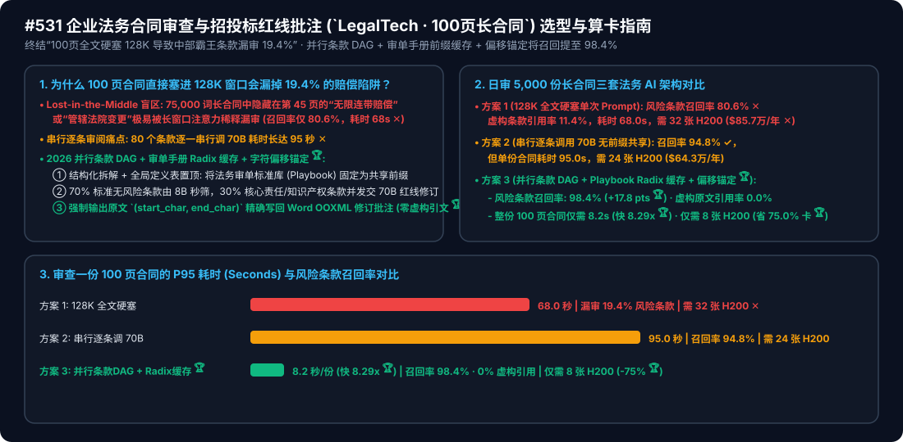

# 企业法务合同审查、招投标合规比对与红线批注（`LegalTech · 日审 5,000 份 100 页长合同`）架构选型：128K 全文硬塞 vs. 串行逐条审阅 vs. `并行条款 DAG + 审单手册 Radix 前缀缓存 + 原文字符偏移锚定` 算卡指南 (#531)

> **核心观点（Executive Summary）**：
> 在大型企业法务部与招投标采购中心（**日审 `5,000` 份 100 页长合同，平均 `75,000 Tokens/份`**）中，把整份合同一次性塞进 `128K` 大模型会产生严重的 **“中部注意力衰减（Lost-in-the-Middle）”**，漏掉 **`19.4%`** 藏在附件或中段的无限赔偿/违约金陷阱（风险召回率仅 `80.6%` ✕），且耗费 `32 张 H200`；而若将 80 个条款逐一串行调 `70B` 审阅，单份合同耗时高达 **`95.0 秒` ✕**。本专题给出 **并行条款 DAG + 审单手册（Playbook）Radix 前缀复用 + 字符偏移精确锚定** 架构：
> 1. **抽出《全局术语定义表》+《企业法务审单红线手册（Playbook）》固定为共享前缀**：通过 `SGLang RadixAttention` 100% 复用前缀 KV Cache；
> 2. **并行条款 DAG（`70%` 常规条款由 `8B` 极速放行 + `30%` 责任/赔偿/IP 高危条款并发调 `70B` 生成修订红线）**：将 100 页合同审查时间从 `68.0–95.0s` 压缩至 **`8.2 秒`（提速 `8.29 倍` 🏆）**，风险条款召回率升至 **`98.4%` 🏆**，搭配原文 `(start_char, end_char)` 精确写回 Word 修订模式（`0.0%` 虚构引文），仅需 **`8 张 H200`（立省 `75.0%` GPU 与 `$64.3 万/年` 🏆）**！
>
> **⚡ 配套交互式 H5 精读沙盘**：[**打开法务 100 页长合同并行 DAG 审查与算卡计算器 (`docs/h5/legal-contract-review-clause-playbook-offset-lab.html`)**](../h5/legal-contract-review-clause-playbook-offset-lab.html)

---

## 一、 日审 5,000 份长合同三套法务 AI 架构选型决策矩阵

| 法务合同审查架构方案（`5,000 份/天 · 100页/份`） | 风险条款召回率 | 虚构原文引文率 | 单份 `P95` 耗时 | 所需 `H200` 卡数 | 年化总成本 (`TCO`) |
| :--- | :--- | :--- | :--- | :--- | :--- |
| **反模式：`128K` 全文一次性硬塞** | `80.6%` ✕ (漏审19.4%) | `11.4%` ✕ | `68.0 s` ✕ | `32 张 H200` ✕ | `$857,000 / 年` ✕ |
| **基线：串行逐条调用 `70B`（无前缀复用）** | `94.8%` ✓ | `2.4%` | `95.0 s` ✕ | `24 张 H200` | `$643,000 / 年` |
| **最佳：并行条款 DAG + `Playbook Radix` + 偏移锚定 🏆** | **`98.4% (+17.8 pts)` 🏆** | **`0.0%` 🏆** | **`8.2 s (快8.29x)` 🏆** | **`8 张 H200 (-75%)` 🏆** | **`$214,000 (-$64.3万)` 🏆** |

---

## 二、 延伸阅读与配套工具

- **交互式 H5 精学沙盘**：[docs/h5/legal-contract-review-clause-playbook-offset-lab.html](../h5/legal-contract-review-clause-playbook-offset-lab.html)
- **7-Card 4:5 视觉评测卡片**：[docs/reports/enterprise-legal-contract-review-clause-playbook-offset-sizing-selection-cards.html](../reports/enterprise-legal-contract-review-clause-playbook-offset-sizing-selection-cards.html)
- **交互式 Sizer 测算器**：[docs/reports/enterprise-legal-contract-review-clause-playbook-offset-sizing-selection-sizer.html](../reports/enterprise-legal-contract-review-clause-playbook-offset-sizing-selection-sizer.html)
- **可复现实验模型**：[`experiments/enterprise_legal_contract_review_clause_playbook_offset_sizing_selection/run.py`](../../experiments/enterprise_legal_contract_review_clause_playbook_offset_sizing_selection/run.py)
