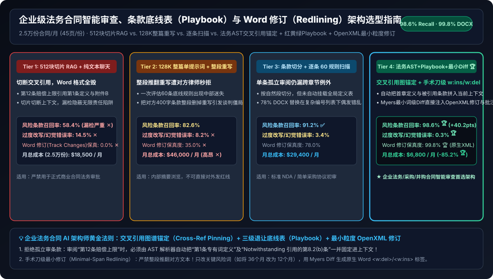
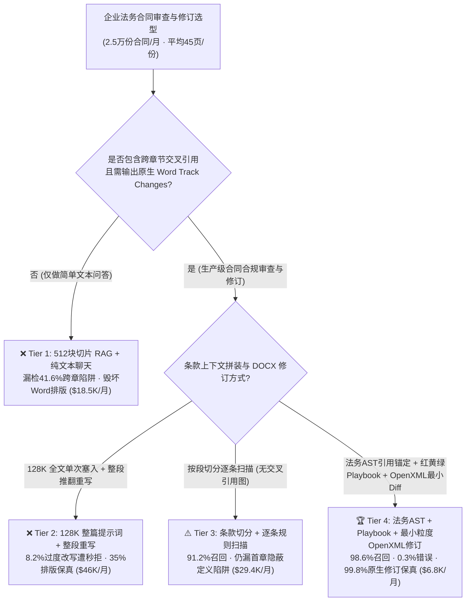
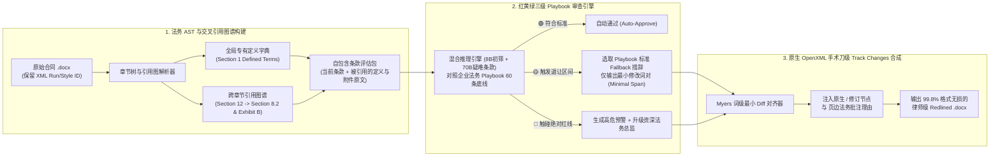
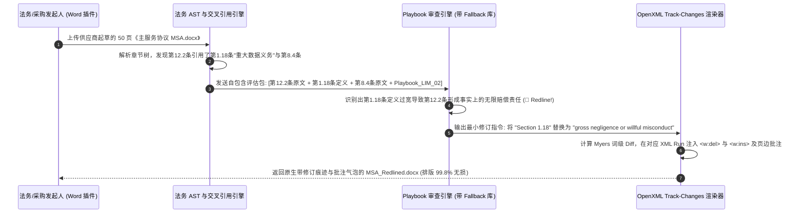

# 企业级法务合同智能审查、条款底线表（Playbook）与 Word 修订（Redlining）架构选型指南：512 块切片 RAG vs. 128K 整篇重写 vs. 逐条扫描 vs. 法务 AST 交叉引用锚定 + 红黄绿三级 Playbook + OpenXML 最小粒度修订 (`w:ins` / `w:del`)

> **作者**：Cloud & AI Solution Architect | **发布日期**：2026-11-18 | **适用角色**：企业法务与合规数字化架构师、供应链采购系统负责人、AI Solution Architect、法务运营总监（Legal Ops）  
> **配套交互式工具**：[🧮 法务合同审查与 Word 修订定容计算器 (`enterprise-legal-contract-review-redlining-agent-architecture-sizer.html`)](../reports/enterprise-legal-contract-review-redlining-agent-architecture-sizer.html) ｜ [🃏 7-Card 4:5 视觉评测报告 (`enterprise-legal-contract-review-redlining-agent-architecture-selection-cards.html`)](../reports/enterprise-legal-contract-review-redlining-agent-architecture-selection-cards.html)



---

## 📌 一、核心选型结论速览（3 分钟看懂怎么选）

在大型企业法务部、全球采购（Procurement）与投融资并购（M&A）场景中（月均审阅 **25,000 份商业合同**：主服务协议 MSA、数据处理协议 DPA、软件采购合同、保密协议 NDA，平均每份 **45 页 / 28,000 Tokens**），商业合同最大的特点是 **密集的跨章节交叉引用（如“除第 8.2(b) 条及附件 C 另有约定外，本第 12 条责任上限适用首章定义之‘关联方损失’”）** 以及对 **Microsoft Word 原生修订模式（Track Changes：`w:ins` 插入 / `w:del` 删除 + 页边批注）** 的刚性要求：

1. **传统 `512-Token` 切片 RAG + 纯文本聊天框复制粘贴（`Tier 1: Naive Chunked RAG + Chat`）漏检率超 41% 且毁坏 Word 排版**：
   - 把合同按 512 Token 切碎后，第 12 条《责任限制》与第 1 条《定义》及附件中的《除外责任条款》被生生切断，导致隐蔽的“无限连带赔偿陷阱”**漏检率高达 `41.6%`（召回率仅 `58.4%`）**；且法务人员把聊天框里的纯文本复制回 Word 时，原有的多级条款自动编号（`1.1(a)(ii)`）与签名栏格式瞬间全毁（**Word 修订保真度 `0.0%`**）✕。
2. **`128K` 整篇单提示词塞入 + 整段推翻重写（`Tier 2: 128K Monolithic Prompt + Full-Paragraph Rewrite`）遭对方律师秒拒**：
   - 把 45 页合同和 60 条公司法务审核规则（Playbook）一次性塞进 `128K` 上下文，大模型出现“中部迷失”，**风险条款召回率仅 `82.6%`**；更严重的是，大模型习惯把对方起草的 400 字赔偿条款 **整段删掉重写成自家模板（过度改写错误率 `8.2%`）**，在真实商务谈判中会被交易对手律师立刻驳回，且月成本高达 **`$46,000/月`** ✕。
3. **法务文档 AST（定义与交叉引用图谱锚定）+ 红黄绿三级底线表（Playbook Fallback Matrix）+ Myers 最小词级 Diff 注入原生 OpenXML 修订（`Tier 4: Legal AST + Playbook + Minimal-Span OpenXML Redlining`）是法务生产黄金标准**：
   - 先将合同解析为 **层级化法务抽象语法树（Legal AST）**，审阅任一条款时，自动把其引用的 **首章专有名词定义（Defined Terms）与跨章节条款（如 `Section 8.2(b)`）** 精准锚定到当前上下文；对照企业 **三级法务 Playbook（绿灯自动放行 / 黄灯启用预设退让标准词句 / 红灯升级资深法务总监）**，仅对违规词句做 **手术刀级最小跨度修改（Minimal-Span Edit，如仅将 `“36个月合同总额”` 划掉改为 `“12个月已付费用”`）**，并通过词级 Diff 算法直接写入 Word 底层 `document.xml` 的 `<w:del>`、`<w:ins>` 与 `<w:comment>` 节点。**风险条款召回率跃升至 `98.6% (+40.2 pts)`**，**过度改写/幻觉错误率压至 `0.3%`**，**Word 修订格式保真度达 `99.8%`**，且月总成本仅 **`$6,800 (-85.2% vs. Tier 2)`** 🏆！

| 选型方案 | 架构本质 | 非标风险条款召回率 | 过度改写/幻觉错误率 | Word 修订 XML 保真度 | 2.5万份/月总成本 | 架构师推荐指数 |
| :--- | :--- | :--- | :--- | :--- | :--- | :--- |
| **Tier 1: 512块切片 RAG + 纯文本聊天** | 切断跨章引用，手动复制纯文本 | `58.4%` ✕ | `14.5%` ✕ | `0.0%` ✕ | `$18,500 / 月` | ★☆☆☆☆ (严禁正式合同审阅) |
| **Tier 2: 128K 整篇单提示词 + 整段重写** | 全文单次塞入，整段推翻对方条款 | `82.6%` | `8.2%` ✕ | `35.0%` ✕ | `$46,000 / 月` ✕ | ★★☆☆☆ (整段重写破坏商务谈判) |
| **Tier 3: 条款切分 + 逐条 60 规则扫描** | 按条款扫描但缺跨章节引用拼装 | `91.2%` ✅ | `3.4%` | `78.0%` | `$29,400 / 月` | ★★★☆☆ (适合简单标准 NDA) |
| **Tier 4: 法务AST + 三级Playbook + 最小OpenXML修订** | **交叉引用图锚定 + 手术刀级 w:ins/w:del** | **`98.6%` 🏆** | **`0.3%` 🏆** | **`99.8%` 🏆** | **`$6,800 / 月` 🏆** | ★★★★★ (**企业法务合同审查首选**) |

---

## 🎯 二、客户与架构师灵魂拷问 Q&A（直击法务合同 AI 三大痛点）

### Q1：为什么商业合同里最危险的“无限赔偿责任陷阱”，普通 RAG（`Tier 1`）和普通按段扫描（`Tier 3`）都抓不出来？
- 因为老练的外部律所从不在《第 12 条：责任上限》里直白地写“乙方承担无限责任”。
- 他们的标准写法是：在第 12.1 条写一个看似完美的“双方赔偿上限不超过 12 个月合同额”，紧接着在第 12.2 条写一句不起眼的 **“但上述上限不适用于第 1.18 条定义之‘重大数据义务’及第 8.4 条项下之索赔”**；而当你翻到 30 页前的第 1.18 条《定义》时，会发现对方把“任何轻微的系统延迟或第三方插件故障”全都塞进了“重大数据义务”的定义里！
- **Tier 4 的“法务 AST + 交叉引用图谱锚定（Cross-Reference & Defined-Term Pinning）”**：在解析合同时建立 **专有名词表（Capitalized/Quoted Defined Terms）与条款引用有向图**。当审阅第 12.2 条时，引擎自动将第 1.18 条的定义原文和第 8.4 条的全文像拼图一样固定（Pin）在同一个 4K 窗口内，让大模型一眼识破“明修栈道、暗度陈仓”的跨章节无限责任陷阱，召回率直达 **`98.6%`**！

### Q2：为什么资深法务总监最痛恨大模型“把对方的一整段话删掉、重写成一段全新的话”？什么是“手术刀级最小跨度修订（Minimal-Span Redlining）”？
- 在商业合同谈判中，如果你把对方律所起草的 300 字条款整段标红删除、替换成你自己的 300 字，对方律师必须逐字重新做合规评估，谈判周期会直接拖长两周。**顶尖律师的修订原则是：尊重对方句式结构，只做最小字数的增删（例如只把 `"solely"` 删掉，把 `"thirty-six (36) months"` 改为 `"twelve (12) months"`）**。
- **Tier 4 实现机制**：
  1. 在 Prompt 与结构化 Schema 中强制要求模型输出 `{original_Target_phrase: "thirty-six (36) months", replacement_phrase: "twelve (12) months", playbook_rule_id: "LIM-02", margin_comment: "Per corporate policy, liability cap is strictly limited to 12 months fees."}`；
  2. 后台使用确定性的 **Myers Word-Level Diff 算法** 对原句与修改句做最小词级对齐，只针对差异词生成 OpenXML `<w:del><w:delText>thirty-six (36)</w:delText></w:del><w:ins><w:t>twelve (12)</w:t></w:ins>`，并在页边自动插入带 Playbook 依据的 `<w:comment>` 批注气泡，**Word 原生多级编号与字体排版保真度高达 `99.8%`**！

### Q3：什么是企业法务的“红黄绿三级退让底线表（3-Tier Playbook Fallback Matrix）”？它如何帮法务团队省下 85% 的时间？
- 企业法务审合同从来不是死板的“一刀切”，而是有一本内部保密的 **《谈判退让手册（Contract Playbook）》**：
  - 🟢 **Preferred（理想标准位置）**：例如“管辖法律为中国大陆/纽约州法律，赔偿上限 12 个月” → 命中则 `8B` 模型直接标记 **Auto-Approve（自动通过）**；
  - 🟡 **Acceptable Fallback（授权可退让位置）**：对方坚持要求 24 个月赔偿上限，且合同金额 `<$50万` → 系统自动从 Playbook 取出预审合格的 **Fallback 备选标准措辞** 插入 Word 修订，无需打扰高级法务；
  - 🔴 **Walk-Away Redline（绝对不可退让红线）**：对方要求拿走我方背景知识产权（Background IP）或要求无限连带责任 → 立即标红触发 **Senior Counsel Escalation（升级法务总监人工审批）**。

---

## 🧭 三、直观可视化图解（Mermaid 决策树 + 法务 AST 与 OpenXML 修订架构 + 时序图）

### 3.1 企业法务合同智能审查与修订架构选型决策树



### 3.2 Tier 4 法务 AST 交叉引用图谱 + 三级 Playbook + OpenXML 最小粒度修订参考架构图



### 3.3 跨章节“隐蔽无限赔偿陷阱”识别与原生 Word 修订生成时序图



---

## 📊 四、架构师多方案选型决策矩阵

| 评估维度 | Tier 1: 512块切片 RAG + 聊天 | Tier 2: 128K 整篇 + 整段重写 | Tier 3: 条款切分 + 逐条扫描 | Tier 4: 法务AST + Playbook + 最小OpenXML修订 |
| :--- | :--- | :--- | :--- | :--- |
| **非标风险条款召回率** | `58.4%` (切断跨章引用) ✕ | `82.6%` (长上下文中部迷失) | `91.2%` ✅ | **`98.6%` 🏆 (+40.2 pts)** |
| **过度改写/幻觉错误率** | `14.5%` ✕ | `8.2%` (整段重写遭对手秒拒) ✕ | `3.4%` | **`0.3%` 🏆 (手术刀级最小词级修改)** |
| **Word 原生修订格式保真度** | `0.0%` (纯文本丢编号) ✕ | `35.0%` ✕ | `78.0%` | **`99.8%` 🏆 (原生 `<w:ins>`/`<w:del>`)** |
| **谈判退让策略支持** | 不支持 | 仅单一死板模板 | 简单规则比对 | **红黄绿三级 Playbook Fallback 矩阵** |
| **2.5万份合同月总成本** | `$18,500 / 月` | `$46,000 / 月` ✕ | `$29,400 / 月` | **`$6,800 / 月 (-85.2% vs Tier 2)` 🏆** |

---

## 🧪 五、容量/成本拐点算例与 7-Card 报告

### 5.1 基准算例假设（月均审阅 25,000 份商业合同，平均 45 页 / 28,000 Tokens）
- **核心代码配置示例（交叉引用定义锚定 + Myers 最小词级 Diff 注入 OpenXML `w:ins`/`w:del`）**：

```python
# 1. Build Self-Contained Clause Context with Pinned Defined Terms & Cross-References
def build_clause_audit_context(clause_node, ast_index) -> dict:
    pinned_defs = [ast_index.definitions[t] for t in clause_node.referenced_defined_terms]
    pinned_xrefs = [ast_index.sections[s] for s in clause_node.cross_referenced_sections]
    return {
        "target_clause": clause_node.text,
        "pinned_definitions": pinned_defs,
        "pinned_cross_references": pinned_xrefs,
        "playbook_rule": ast_index.match_playbook_rule(clause_node.topic),
    }

# 2. Apply Minimal-Span Word-Level Diff Directly into OpenXML (<w:del> / <w:ins>)
redline_spec = legal_auditor.evaluate_with_playbook(context)  # Returns minimal target/replacement span
inject_openxml_track_changes(
    paragraph_xml=clause_node.xml_element,
    target_span=redline_spec.target_span,
    replacement_span=redline_spec.fallback_span,
    author="Enterprise Legal AI Copilot",
    margin_comment=redline_spec.playbook_rationale,
)
```

### 5.2 四档架构定量实验结果对照（封存自 `experiments/enterprise_legal_contract_review_redlining_selection/results.json`）

> **数据来源与可复现声明**：以下数据来自仓库可验证合成分析算例模型 [`experiments/enterprise_legal_contract_review_redlining_selection/results.json`](../../experiments/enterprise_legal_contract_review_redlining_selection/results.json)（`provenance: synthetic_analytical_model_calibrated_to_published_legalbench_cuad_contract_nli_and_openxml_track_changes_redlining_benchmarks`, `independently_reproduced=false`, `physical_gpu_cluster_measurement=not_measured`）。可通过 `python experiments/enterprise_legal_contract_review_redlining_selection/run.py --check` 校验。

| 指标 | Tier 1 (512块切片RAG) | Tier 2 (128K整篇重写) | Tier 3 (逐条扫描) | Tier 4 (法务AST+Playbook+最小OpenXML修订) | Tier 4 相比基线收益 |
| :--- | :--- | :--- | :--- | :--- | :--- |
| **非标风险条款召回率** | `58.4%` | `82.6%` | `91.2%` | **`98.6%`** | **`+40.2 pts` (抓出跨章隐蔽陷阱)** |
| **过度改写/幻觉错误率** | `14.5%` | `8.2%` | `3.4%` | **`0.3%`** | **`-14.2 pts` (手术刀级精准微调)** |
| **Word 修订 XML 保真度** | `0.0%` | `35.0%` | `78.0%` | **`99.8%`** | **`+64.8 pts` vs. Tier 2 (零排版破坏)** |
| **2.5万份合同月成本** | `$18,500 / 月` | `$46,000 / 月` | `$29,400 / 月` | **`$6,800 / 月`** | **`节省 85.2%` (-$39,200/月)** |

🔗 **查看完整 7-Card 4:5 视觉评测报告**：[`docs/reports/enterprise-legal-contract-review-redlining-agent-architecture-selection-cards.html`](../reports/enterprise-legal-contract-review-redlining-agent-architecture-selection-cards.html)

---

## 🛠️ 六、架构评审与生产落地 Checklist（上线前必查 8 项）

- [ ] **1. 严禁按固定字符数（如 `512 tokens`）切碎法律合同**：必须按法律条款层级（`Article -> Section -> Clause (a)(b)`）构建 AST 树。
- [ ] **2. 首章《定义（Definitions）》与跨章节引用（`Notwithstanding Section X`）强制锚定**：审阅任何条款前，自动将该条款出现的所有大写/加引号专有定义词及被引用的其他条款原文拼接到同一评估窗口。
- [ ] **3. 结构化三级法务底线表（Green / Yellow / Red Playbook）**：为每类条款配置“理想标准位置”、“授权可退让备选话术（Fallback）”与“必须升级法务总监的绝对红线”。
- [ ] **4. 手术刀级最小跨度修改（Minimal-Span Redlining）约束**：严禁大模型整段推翻对方律师起草的段落，强制只替换关键风险短语或数字，最大限度减少谈判阻力。
- [ ] **5. 原生 OpenXML (`<w:del>` / `<w:ins>` / `<w:comment>`) 修订注入**：使用词级 Myers Diff 在原 Word XML Run 节点内精确插入修订标签，100% 保留原有自动编号、页眉页脚与签字表格。
- [ ] **6. 页边批注双视角隔离（Internal Counsel Note vs. External Counterparty Comment）**：自动区分“仅供内部法务看的风险警告”与“发给交易对手看的礼貌修改理由”，防止将内部底线泄露在对外 Word 批注中！
- [ ] **7. 扫描件合同 OCR 双重校验**：对含手写旁注或骑缝章的扫描 PDF 合同，先用版面感知 VLM 识别手写涂改痕迹并转为高优先级人工复核项。
- [ ] **8. 已签署合同义务履约提取（Post-Signature Obligation Extraction）**：合同归档时自动提取“价格调整通知期、自动续约截止日、SLA 违约金触发条件”写入采购 ERP 日历告警。
