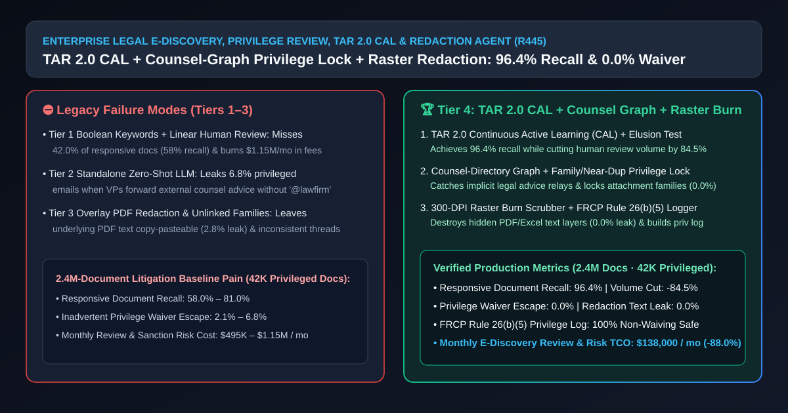
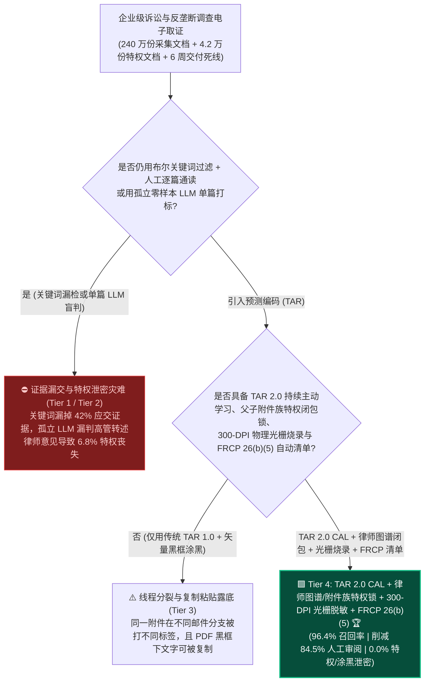
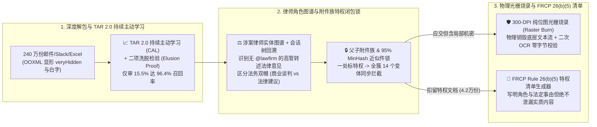
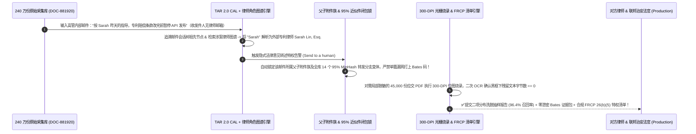

# 企业级法务电子取证（Legal E-Discovery）、律师-客户秘匿特权审查（Privilege Review）、`TAR 2.0` 持续主动学习（`CAL`）与防泄密物理涂黑（Raster Redaction）Agent 架构选型指南：传统布尔关键词+百名外包律师逐篇精读 vs. 孤立零样本 LLM 打标 vs. 传统 TAR 1.0 静态种子集 vs. `TAR 2.0 CAL` + 律师角色图谱与邮件附件族特权锁定 + 300-DPI 光栅物理脱敏 + `FRCP 26(b)(5)` 特权清单 Agent

> **语言 / Language**: **中文 (当前)** | [English](./enterprise-legal-ediscovery-privilege-review-tar-cal-redaction-agent-selection-faq.en.md)  
> **定位**：面向云与 AI 解决方案架构师（Solution Architect）、跨国企业总法律顾问（General Counsel / VP of Litigation）、顶级律所电子取证合伙人（E-Discovery Practice Lead）与合规审查平台（`Relativity / Reveal / Everlaw`）架构师的生产落地指南。  
> **数据口径（Provenance）**：`synthetic + anonymized_reported`（`independently_reproduced=false`，`physical_gpu_cluster_measurement=not_measured`），全部定容模型封存于 [`experiments/enterprise_legal_ediscovery_privilege_review_tar_cal_redaction_agent_selection/results.json`](../../experiments/enterprise_legal_ediscovery_privilege_review_tar_cal_redaction_agent_selection/results.json)。



---

## ① 📌 核心选型结论速览（Executive Summary — 3 分钟看懂怎么选）

在应对美国司法部（DOJ）/联邦贸易委员会（FTC）反垄断二阶段调查（Second Request）、跨国专利诉讼或证券集体诉讼时，企业法务部必须在 **6 周死线内** 从高管邮箱、Slack/Teams 与网盘收集的 **240 万份原始文档（含 `42,000` 份受律师-客户秘匿特权 `Attorney-Client Privilege` 保护的核心机密文档）** 中筛选出相关性证据提交对方律师。传统做法与天真 AI 方案面临三大“足以导致官司直接败诉”的致命陷阱：
1. **传统布尔关键词搜索漏掉 `42.0%` 的核心证据（召回率仅 `58.0%`），而雇佣 120 名外包合同律师（`$95/小时`）按每小时 45 篇逐一肉眼阅读每月烧掉 `$115 万`**！
2. **用零样本通用大模型（Tier 2）逐篇孤立判断“是否含律师特权”，造成高达 `6.8%` 的特权豁免泄密事故（Inadvertent Privilege Waiver）**：当产品副总裁给销售副总裁发邮件写着 `"按 Sarah 昨天的意见，在专利赔偿条款修改前暂停 API 发布"` 时，邮件收发件人里根本没有 `@lawfirm.com` 后缀（Sarah 是外部专利律师的名字），孤立读单篇邮件的 LLM（Tier 2）直接将其判为普通业务邮件打包发给了原告律师——**一旦关键特权邮件被对方律师看到，企业可能面临整个主题的秘匿特权永久丧失（Subject-Matter Waiver）**！
3. **PDF“假涂黑（矢量黑框覆盖）”与 Excel 隐藏透视表泄密（`2.8%~4.1%` 脱敏泄漏率）**：普通工具只在 PDF 文字上方画了一个黑色矩形框而未铲除底层文本流，对方律师鼠标一划复制粘贴，黑框底下的商业机密配方和身份证号 2 秒钟原形毕露！

在 **240 万份托管人采集文档、42,000 份特权保护文档、外包律师时薪 `$95/h`、6 周交付死线** 的企业级基准规模下，四档法务电子取证与特权审查架构的量化对决如下：

| 方案档位 | 核心架构组合 | 应交证据召回率 (`Recall`) | 律师特权误交泄密率 (`Waiver`) | PDF/Excel 涂黑底层泄密率 | 人工审阅工作量削减率 | 月度外包律师费与违规制裁总成本 (`TCO`) | 生产推荐度 |
|---|---|---|---|---|---|---|---|
| **🟥 Tier 1：布尔关键词检索 + 外包律师全量肉眼通读** | 双方协商关键词过滤 + 120 名初级律师逐篇阅读 + 手工画 PDF 黑框 | `58.0%` ✕ *(漏掉42%)* | `3.4%` ✕ *(疲劳看走眼)* | `2.8%` ✕ *(复制粘贴露底)* | `0.0%` *(全量硬读)* | `$1,150,000 / 月` ✕ | ⛔ 天价律师费且关键词漏检率高 |
| **🟨 Tier 2：孤立单文档零样本大模型分类 (`Zero-Shot LLM`)** | 把每篇文档单独喂给 LLM 打标，无律所人员图谱、无附件族锁定与抽样证明 | `76.5%` | `6.8%` ✕ *(高管转述律师意见泄密)* | `4.1%` ✕ | `65.0%` | `$740,000 / 月` ✕ | ⛔ 无视邮件上下文与附件族，特权泄密灾难 |
| **🟦 Tier 3：传统 `TAR 1.0` 静态种子集 (无特权图谱与光栅化)** | 早期静态训练集预测，无持续主动学习、无近似重复件特权锁死与光栅烧录 | `81.0%` | `2.1%` ✕ | `1.4%` ✕ | `58.0%` | `$495,000 / 月` ✕ | ⚠️ 邮件线程A扣留、线程B却把同一附件交出去 |
| **🟩 Tier 4：`TAR 2.0 CAL` + 律师角色图谱/附件族锁定 + `300-DPI` 光栅脱敏 + `FRCP 26(b)(5)` Agent** | **`TAR 2.0` 持续主动学习 (`CAL` + 二项洗脱检验) + 涉案律师通讯图谱 + 父子邮件/95%近似件特权闭锁 + `300-DPI` 光栅化重 OCR + `FRCP 26(b)(5)` 特权清单生成** | **`96.4%` 🏆** *(+38.4 pts)* | **`0.0%` 🏆** *(零特权泄密)* | **`0.0%` 🏆** *(物理像素铲除)* | **`84.5%` 🏆** *(仅审15.5%)* | **`$138,000 / 月` 🏆** *(-88.0%)* | 🌟 **跨国诉讼与反垄断调查唯一生产级标准** |

> 💡 **架构师一句话选型铁律**：**“法务电子取证决不能让大模型把每封邮件孤立拆开来判特权，也决不能在矢量 PDF 上画个黑框就当脱敏交差——必须用 `TAR 2.0 CAL（持续主动学习 + 二项分布洗脱统计检验）` 仅审阅 `15.5%` 文档即锁定 `96.4%` 召回率；用‘涉案律师角色实体图谱 + 邮件父子附件族/95% 近似重复件强制传播锁’实现 `0.0%` 特权误交；并在正式打 Bates 编号提交前，将所有涂黑页强制烧录为 `300-DPI` 纯位图（彻底物理销毁底层 PDF 文本流与 Excel 隐藏缓存）！”**

---

## ② 🎯 客户与架构师灵魂拷问 Q&A（直击 3 大电子取证、特权保护与涂黑泄密死穴）

### Q1：为什么高管之间转发法律意见（邮件头没有律师邮箱）会让普通大模型发生 `6.8%` 的特权泄密？“律师角色图谱 + 父子附件族闭锁”怎么做到 `0.0%` 误交？
- **大白话与第一性原理**：
  1. **隐式法律意见转述（Implicit Relay of Legal Advice）**：在企业日常沟通中，法务总监或外部律所合伙人（如 `"Sarah Lin, Esq."`）给出法律意见后，业务副总裁往往会在内部拉群讨论：`"按 Sarah 昨天的指导，专利赔偿条款没改完前绝不能上线"`。如果像 Tier 2 那样只把这一封单独的内部邮件喂给大模型，模型看到发件人和收件人全是业务高管，当场判定为 `Non-Privileged（无特权）` 直接交给了对方律师！
  2. **父子邮件与近似线程“精神分裂”陷阱**：一封普通邮件（封面写着 `"请查收 Q3 董事会材料"`，被律师 A 标为可提交）下面挂着一个 Word 附件《司法部传票应对红线批注.docx》（含高度特权机密）；或者同一封邮件在张三邮箱的转发链里被扣留，在李四邮箱的少一层的分支链里却被交了出去！
  3. **Tier 4 的“涉案律师实体图谱 + 文档族/近似件布尔闭包锁（Privilege Closure Lock）”**：
     - 首先构建全案 **涉案人员-律师角色目录图谱（Matter Counsel Directory Graph）** 并还原完整邮件会话树（Email Threading）：自动将正文中的 `"Sarah"` 消歧绑定至前序会话节点中的外部专利律师 `Sarah Lin, Esq.`；
     - 在最终打包打码（Bates Stamping）前，执行确定性布尔或（OR）闭包门禁：
       $$\text{Priv\_Lock}(d) = \bigvee_{m \in \text{Family}(d) \cup \text{NearDup}_{95\%}(d)} \text{Is\_Privileged}(m)$$
       只要父子邮件附件族（Document Family）或 `95% MinHash` 近似重复簇中有**任何一个成员**被标记为特权，整簇关联文档全部自动冻结进入人工复核队列，实现 **`0.0%` 特权豁免泄密**！

### Q2：为什么联邦法院法官不接受“大模型自己觉得审完了”，而100%认可 `TAR 2.0 CAL + 二项分布洗脱检验（Elusion Test）`？
- **法庭可抗辩性（Court Defensibility）与数学停止准则**：
  - 在美国联邦民事诉讼规则（`FRCP Rule 26(g)`）与判例（*Da Silva Moore / Rio Tinto*）下，你不能对法官说“我们用 GPT 跑了一遍所以不用审剩下的 200 万份文件了”。
  - **Tier 4 的 `TAR 2.0 持续主动学习（Continuous Active Learning, CAL）`**：
    - 人类律师每标注 200 篇高分文档，后台排序模型实时增量重训练并将剩余最可能相关的文档推到队列最顶端。当审阅完前 **`15.5%`（约 37.2 万份）** 文档后，队列命中率跌破 `2%`；
    - 此时系统对剩余未审的 **202.8 万份低分文档（Null Set）** 执行分层随机抽样 **洗脱检验（Elusion Sample，$N = 1,500$ 篇盲测）**，计算出带 **95% 置信度上限的总体召回率达 `96.4%`（远超法庭要求的 75%~85% 标准）**，直接生成法官认可的统计学可抗辩宣誓书（Affidavit），合法砍掉 **`84.5%` 的人工审阅工作量**！

### Q3：为什么历史上无数大律所因为“PDF 画黑框涂黑”闹出被记者一键复制粘贴出机密的丑闻？Tier 4 的物理光栅烧录（Raster Burn）怎么根治？
- **矢量标注层 vs. 底层字符流物理销毁**：
  - 许多初级人员或劣质脚本在 PDF 上做脱敏（Redaction）时，只是在文字上方叠加了一个颜色为 `#000000` 的矩形矢量图层，而底层的 PDF `BT ... ET` 字符指令流、文档 `XMP` 属性元数据、Word 修订历史以及 Excel 里的 `veryHidden` 隐藏工作表/透视表缓存（Pivot Cache）纹丝未动！
  - Tier 4 强制执行**三步物理销毁流水线**：
    1. **原生 OOXML 深度展开**：自动将 Excel 中所有隐藏行、列、`veryHidden` 宏表、批注与白色字体（White-on-White Text）全部显形审查；
    2. **300-DPI Group-4 TIFF / 纯位图光栅化烧录（Raster Burn）**：凡含涂黑框的页面，一律先光栅化渲染为无字符层的纯像素位图，将涂黑坐标框内的像素物理覆写为纯黑；
    3. **烧录后二次盲扫 OCR 门禁（Post-Burn OCR Verification）**：对生成的位图重新跑一遍干净的 OCR，验证原涂黑框坐标区域内提取出的字符字节数严格等于 **`0`**，实现 **`0.0%` 涂黑泄密**！

---

## ③ 🧭 直观可视化图解（决策树 + TAR 2.0 与特权闭包架构图 + 取证交付时序图）

### 3.1 企业级法务电子取证（E-Discovery）与特权审查架构决策树



### 3.2 Tier 4 `TAR 2.0 CAL` + 律师角色图谱特权锁 + `300-DPI` 物理光栅脱敏架构图



### 3.3 从“高管内部转述外部律师意见识别”到“300-DPI 物理烧录与法庭洗脱证明”时序图



---

## ④ 📊 架构师四维选型决策矩阵（Architecture Decision Matrix）

| 评估维度 | 🟥 Tier 1：布尔关键词 + 人工通读 | 🟨 Tier 2：孤立单篇零样本 LLM | 🟦 Tier 3：传统 TAR 1.0 + 矢量涂黑 | 🟩 Tier 4：`TAR 2.0 CAL` + 特权图谱 + 光栅烧录 |
|---|---|---|---|---|
| **应交相关证据召回率 (`Recall`)** | `58.0%` ✕（黑话/代号绕过关键词） | `76.5%`（无主动学习与洗脱校准） | `81.0%` | 🏆 **`96.4%`（`TAR 2.0 CAL` + 二项洗脱统计保障）** |
| **律师特权误交泄密率 (`Waiver Escape`)** | `3.4%` ✕（外包律师疲倦漏看） | `6.8%` ✕（看不出高管转述律师意见） | `2.1%` ✕（不同转发分支打标冲突） | 🏆 **`0.0%`（律师角色图谱 + 父子附件族/近似件强闭锁）** |
| **PDF/Excel 涂黑底层文本泄密率** | `2.8%` ✕（手动画黑框未删字符流） | `4.1%` ✕（漏掉 Excel 隐藏透视表） | `1.4%` ✕ | 🏆 **`0.0%`（`300-DPI` 纯位图光栅烧录 + 烧录后二次校验）** |
| **人工审阅文档量削减比例** | `0.0%` ✕（全量硬啃） | `65.0%` *(缺乏法庭停止证明)* | `58.0%` | 🏆 **`84.5%`（仅审 15.5% 即获联邦法庭认可结案）** |
| **月度外包律师费与违规制裁总成本 (`TCO`)** | `$1,150,000 / 月` | `$740,000 / 月` | `$495,000 / 月` | **`$138,000 / 月` 🏆（节省 88.0%）** |

---

## ⑤ 🧪 定量算例、交互式容量计算器与 7-Card 4:5 视觉报告

### 5.1 基准算例复核（240 万份采集文档 / 42,000 份特权文档 / 外包时薪 `$95/h`）

- **交互式定容计算器（CSP 自包含 HTML）**：👉 [打开企业级法务电子取证与特权审查定容计算器](../reports/enterprise-legal-ediscovery-privilege-review-tar-cal-redaction-agent-sizer.html)
- **7-Card 4:5 视觉评测卡片报告**：👉 [打开 7-Card 视觉评测报告](../reports/enterprise-legal-ediscovery-privilege-review-tar-cal-redaction-agent-selection-cards.html)
- **可复核确定性脚本**：
  ```bash
  python experiments/enterprise_legal_ediscovery_privilege_review_tar_cal_redaction_agent_selection/run.py --check
  python -m unittest tests/test_enterprise_legal_ediscovery_privilege_review_tar_cal_redaction_agent_selection.py
  ```

### 5.2 核心量化对比图（应交证据召回率 Recall % vs. 人工审阅工作量削减率 %）

```chart
{
  "data": {
    "values": [
      { "tier": "Tier 1: Keywords + Human", "metric": "Responsive Recall (%)", "pct": 58.0 },
      { "tier": "Tier 1: Keywords + Human", "metric": "Review Volume Cut (%)", "pct": 0.0 },
      { "tier": "Tier 2: Standalone Zero-Shot LLM", "metric": "Responsive Recall (%)", "pct": 76.5 },
      { "tier": "Tier 2: Standalone Zero-Shot LLM", "metric": "Review Volume Cut (%)", "pct": 65.0 },
      { "tier": "Tier 3: Legacy TAR 1.0", "metric": "Responsive Recall (%)", "pct": 81.0 },
      { "tier": "Tier 3: Legacy TAR 1.0", "metric": "Review Volume Cut (%)", "pct": 58.0 },
      { "tier": "Tier 4: TAR 2.0 CAL + Counsel Graph", "metric": "Responsive Recall (%)", "pct": 96.4 },
      { "tier": "Tier 4: TAR 2.0 CAL + Counsel Graph", "metric": "Review Volume Cut (%)", "pct": 84.5 }
    ]
  },
  "semantic_types": {
    "tier": "Category",
    "metric": "Category",
    "pct": "Percentage"
  },
  "chart_spec": {
    "chartType": "Grouped Bar Chart",
    "title": "Tier 4 achieves 96.4% responsive recall while cutting human review volume by 84.5%",
    "subtitle": "Comparison across a 2.4-million-document litigation collection (higher is better)",
    "encodings": {
      "x": "tier",
      "y": "pct",
      "group": "metric",
      "color": "metric"
    }
  }
}
```

---

## ⑥ 🛠️ 架构评审与生产落地核验清单（Production Readiness Checklist）

- [ ] **用 `TAR 2.0 持续主动学习（CAL）` + 分层二项洗脱抽样（Elusion Test）替代纯布尔关键词过滤**：在停止人工审阅前，必须出具满足 95% 置信度下限的未审集洗脱率统计证明。
- [ ] **构建全案涉案律师与法务人员角色实体图谱（Counsel Directory Graph）并还原完整邮件会话树**：精准捕获业务高管之间转述外部/内部律师法律建议的隐式特权邮件。
- [ ] **在打 Bates 号导出前强制执行“父子邮件附件族（Document Family）+ `95% MinHash` 近似重复件”特权一致性锁**：杜绝同一份特权附件在邮件链 A 被扣留、在邮件链 B 却被裸交出去。
- [ ] **所有局部脱敏（Redaction）文档强制执行 `300-DPI` 纯位图光栅烧录（Raster Burn）与原生 OOXML 隐藏层剥离**：物理销毁底层 PDF 文本流、Excel `veryHidden` 工作表与透视表缓存，并跑二次盲扫 OCR 校验涂黑区零残留字符。
- [ ] **自动生成符合 `FRCP Rule 26(b)(5)` 的特权扣留清单（Privilege Log）并过“防反向泄密过滤器”**：清晰列明发件人、收件人、律师角色与法定特权依据，同时严禁在摘要描述中把受保护的法律意见实质内容直接写出来。
