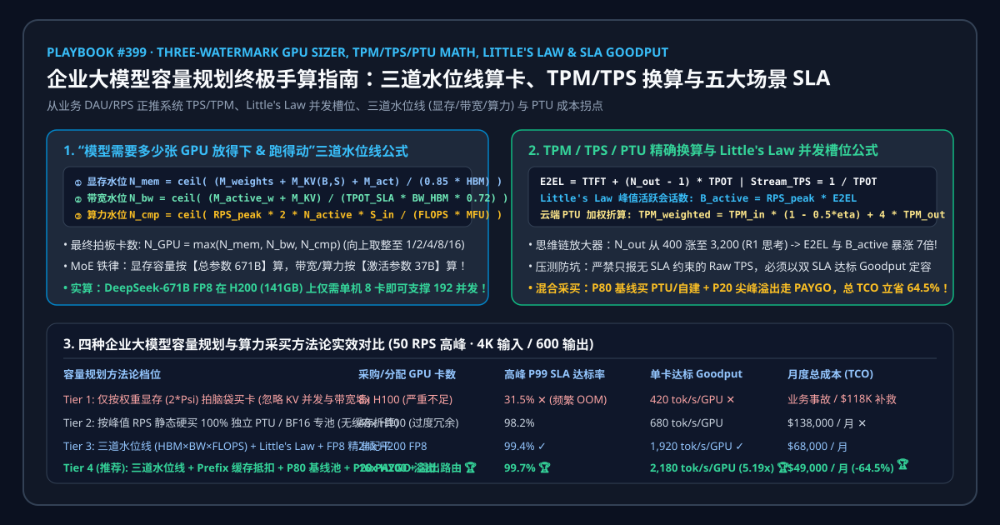
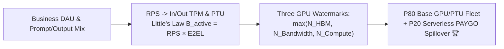

# Enterprise LLM Capacity Planning & Three-Watermark GPU Sizing Master Guide: From Business `QPS`, `TPM/TPS/PTU` Conversion, `Little's Law` Concurrency & `TTFT/TPOT/Goodput` SLAs to GPU Fleet & TCO Crossover

> **Language / 语言**: **English (Current)** | [中文](./enterprise-llm-capacity-planning-tpm-tps-three-watermarks-ptu-tco-sizing-selection-faq.md)  
> **Scope**: The definitive first-principles capacity sizing playbook for Cloud & AI Solution Architects—connecting **business `DAU / RPS` $\to$ `Input/Output TPS & TPM` $\to$ Cloud `PTU` weighted quota math $\to$ `Little's Law` active KV slots ($B_{\text{active}}$) $\to$ the Three GPU Sizing Watermarks ($\max[N_{\text{HBM}}, N_{\text{BW}}, N_{\text{Compute}}]$) $\to$ 5 business scenario SLAs (`TTFT`, `TPOT`, `ITL`, `E2EL`, `Goodput`, `$/1M Tokens`) and `P80/P20` hybrid TCO optimization**.  
> **Provenance**: Analytical sizing model synthesized from published hardware specifications and serving benchmarks (`provenance: synthetic + anonymized_reported`, `independently_reproduced=false`, `physical_gpu_cluster_measurement=not_measured`). See [`experiments/enterprise_llm_capacity_planning_tpm_tps_three_watermarks_ptu_tco_sizing_selection/results.json`](../../experiments/enterprise_llm_capacity_planning_tpm_tps_three_watermarks_ptu_tco_sizing_selection/results.json).

> 🔗 **Interactive H5 Learning Lab & Companion Tools (Zero External Dependencies)**:
> - 📱 **[Interactive H5 Study Page: 3-Watermark GPU Sizer, TPM/TPS/PTU Converter, Little's Law & 5-Scenario SLA Calculator (`docs/h5/gpu-capacity-tpm-tps-ptu-tco-calculator.html`)](../h5/gpu-capacity-tpm-tps-ptu-tco-calculator.html)**
> - 🎓 **[AI Infra Panorama H5 Learning Hub (`docs/h5/index.html`)](../h5/index.html)**
> - 🧮 **[Interactive Capacity Sizer (`enterprise-llm-capacity-planning-tpm-tps-three-watermarks-ptu-tco-sizing-selection-sizer.html`)](../reports/enterprise-llm-capacity-planning-tpm-tps-three-watermarks-ptu-tco-sizing-selection-sizer.html)**
> - 🃏 **[7-Card 4:5 Visual Report (`enterprise-llm-capacity-planning-tpm-tps-three-watermarks-ptu-tco-sizing-selection-cards.html`)](../reports/enterprise-llm-capacity-planning-tpm-tps-three-watermarks-ptu-tco-sizing-selection-cards.html)**

---

## 1. 📌 Executive Summary

> **Bottom Line**: **Sizing an enterprise GPU fleet by model weight footprint alone (`2Ψ` rule, Tier 1) ignores `Little's Law` active KV concurrency and the HBM memory-bandwidth wall, causing **`68.5%` P99 SLA failures** at peak load; conversely, statically provisioning 100% of peak traffic on uncached BF16 GPUs or dedicated PTUs (Tier 2) inflates monthly TCO to **`$138,000`** with `>55%` off-peak waste! Adopting **Tier 4 (Three-Watermark Sizing $\max[N_{\text{HBM}}, N_{\text{BW}}, N_{\text{Compute}}]$ + `Little's Law` Concurrency + `Block FP8 / MLA` + `60% Prefix Cache` Deduction + `P80` Base Fleet with `P20` Serverless PAYGO Spillover)** satisfies `50 Peak RPS` (`4K In / 600 Out`) with just **`16x H200 GPUs` + Spillover**, achieving **`99.7%` P99 SLA attainment**, **`2,180 Goodput tok/s/GPU` (`5.19x` Tier 1)**, and **`$49,000/month` TCO (`-64.5%` vs. Tier 2)**!**

| Sizing Methodology Tier (50 Peak RPS · 4K In / 600 Out) | Core Sizing Logic & Procurement Strategy | GPU Fleet | Peak P99 SLA Attainment | Goodput / GPU | Monthly TCO | Architect Verdict |
| :--- | :--- | :--- | :--- | :--- | :--- | :--- |
| **🟥 Tier 1: Weight-Only Naive Sizing (`2Ψ`)** | Sizes HBM for weights only; ignores active KV pool & bandwidth TPOT | `8x H100` ✕ | **`31.5%` ✕ (KV OOM)** | `420 tok/s/GPU` ✕ | `$118,000 / mo` | **Sizing Disaster**: Collapses under peak concurrency |
| **🟨 Tier 2: 100% Peak Uncached BF16 / PTU** | Provisions full peak on uncached BF16 / static PTUs | `48x H100` ✕ | `98.2%` | `680 tok/s/GPU` | **`$138,000 / mo` ✕** | Wastes `>55%` budget during off-peak hours |
| **🟦 Tier 3: 3-Watermark + Little's Law + FP8** | Sizes $\max(N_{\text{HBM}}, N_{\text{BW}}, N_{\text{Compute}})$ with FP8 | `24x H200` ✅ | `99.4%` ✅ | `1,920 tok/s/GPU` ✅ | `$68,000 / mo` ✅ | Standard for 100% air-gapped on-prem fleets |
| **🟩 Tier 4: 3-Watermark + Prefix Deduction + `P80/P20` Spillover (Recommended)** | **`16x H200` P80 Base + `60%` Prefix Hit + P20 PAYGO Spillover** | **`16x H200 + Spill` 🏆** | **`99.7%` 🏆** | **`2,180 tok/s/GPU` 🏆 (`5.19x`)** | **`$49,000 / mo` 🏆 (`-64.5%`)** | **Enterprise capacity & FinOps gold standard** |

---

## 2. 🎯 The 5-Step First-Principles Capacity Sizing Pipeline

### Step 1: User Evaluation Metrics (`TTFT`, `TPOT`, `ITL`, `E2EL`, `Goodput`)
$$\text{E2EL} = \text{TTFT} + (N_{\text{out}} - 1) \times \text{TPOT}, \qquad \text{Single-Stream TPS} = \frac{1}{\text{TPOT}}, \qquad \text{Goodput} = \text{TPS}_{\text{raw}} \times \mathbb{P}(\text{TTFT}_{P95} \le \text{SLA} \land \text{ITL}_{P99} \le \text{SLA})$$

### Step 2: `TPM / TPS` Conversion, Cloud `PTU` Weighting & `Little's Law` Concurrency
1. **Peak RPS & System TPS / TPM**:
   $$\text{RPS}_{\text{peak}} = \frac{\text{DAU} \times N_{\text{turns}} \times k_{\text{peak}}}{86,400}, \quad \text{TPS}_{\text{in}} = \text{RPS} \times \bar{S}_{\text{in}}, \quad \text{TPS}_{\text{out}} = \text{RPS} \times \bar{S}_{\text{out}}, \quad \text{TPM} = \text{TPS} \times 60$$
2. **Cloud Provisioned Throughput (`PTU / GSU`) Weighted TPM**:
   $$\text{TPM}_{\text{PTU\_weighted}} = \text{TPM}_{\text{in}} \times (1 - 0.5\eta_{\text{cache}}) + 4 \times \text{TPM}_{\text{out}}$$
3. **`Little's Law` Active Concurrent Sessions ($B_{\text{active}}$)**:
   $$B_{\text{active}} = \text{RPS}_{\text{peak}} \times \text{E2EL} = \text{RPS}_{\text{peak}} \times \left[\text{TTFT} + (\bar{S}_{\text{out}} - 1)\times \text{TPOT}\right]$$

### Step 3: The Three GPU Sizing Watermarks ($N_{\text{GPU}} = \max[N_{\text{mem}}, N_{\text{bw}}, N_{\text{compute}}]$)
1. **Watermark 1 (Fits in HBM Memory)**:
   $$M_{\text{total}} = \frac{M_{\text{weights}}(\Psi_{\text{total}}) + B_{\text{inst}} \cdot \bar{S} \cdot \text{KV}_{\text{bytes/tok}} + M_{\text{act\_graph}}}{0.85}, \qquad N_{\text{mem}} = \left\lceil \frac{M_{\text{total}}}{\text{HBM}_{\text{GPU}}} \right\rceil$$
   *(FP8 KV per token: `Llama-3.3-70B GQA-8 = 163.84 KB/tok`; `DeepSeek-671B MLA = 35.14 KB/tok`.)*
2. **Watermark 2 (Meets Streaming `TPOT` via HBM Bandwidth)**:
   $$N_{\text{bw}} = \left\lceil \frac{M_{\text{active\_weights}}(\Psi_{\text{active}}) + M_{\text{KV\_active}}}{\text{SLA}_{\text{TPOT}} \times \text{BW}_{\text{HBM}} \times 0.72} \right\rceil$$
3. **Watermark 3 (Meets Peak Prefill `TTFT` & Total Fleet Concurrency)**:
   $$N_{\text{compute}} = \left\lceil \frac{\text{RPS}_{\text{peak}} \times 2 \times \Psi_{\text{active}} \times \bar{S}_{\text{in}} \times (1 - \eta_{\text{cache}})}{\text{TFLOPS}_{\text{GPU}} \times \text{MFU}_{\text{prefill}}} \right\rceil$$

---

## 3. 🧭 Capacity Sizing Flow Diagram

---

## 4. 📊 Golden SLA Benchmark Matrix Across 5 Enterprise Scenarios

| Business Scenario | `P95 TTFT` SLA | `P99 TPOT / ITL` SLA | Min Stream Speed | `E2EL` Budget | Dominant Watermark | Recommended Architecture |
| :--- | :--- | :--- | :--- | :--- | :--- | :--- |
| **1. Real-Time Voice Agent (`WebRTC`)** | **`<= 250 ms`** | **`<= 18 ms` (P99 ITL)** | `>= 55 tok/s` | `< 450 ms` M2E | Latency & Jitter | `PD Disagg + Prefix Cache + MTP + Streaming TTS` |
| **2. IDE Code Completion (`Tab FIM`)** | **`<= 150 ms`** | **`<= 10 ms`** | `>= 100 tok/s` | **`<= 350 ms`** | Watermark 2 (HBM BW) | `7B/14B FP8 + TP=2/4 + EAGLE-3` |
| **3. Enterprise Knowledge RAG** | **`<= 800 ms`** | **`<= 25 ms`** | `>= 40 tok/s` | `<= 10 s` | Watermark 3 (Prefill FLOPS) | `H100/H200 FP8 + Radix Cache + PD Disagg` |
| **4. Deep Reasoning / Coding Agent** | **`<= 1,500 ms`** | **`<= 15 ms`** | `>= 65 tok/s` | `<= 40 s` | Watermark 1 (Little's Law KV) | `8x H200/B200 + DeepSeek MLA FP8 + MTP` |
| **5. Offline Document Batch ETL** | `< 30 s` | `< 80 ms` | Max Throughput | Overnight window | Max `Goodput/$` | `Length Bucketing + B=384 + Spot / Tidal Backfill` |

---

## 5. 🛠️ Production Readiness Checklist

- [ ] **Calculate All Three Watermarks**: Always document `N_HBM` (with `/0.85` headroom), `N_BW` (for target `TPOT`), and `N_Compute` (for peak `TTFT` and `Little's Law` slots).
- [ ] **Include `<think>` Tokens in `Little's Law`**: Multiply full CoT reasoning length by `TPOT` when sizing active KV concurrency $B_{\text{active}}$.
- [ ] **Benchmark Only SLA-Compliant `Goodput`**: Reject unconstrained `Raw TPS` numbers that violate `P95 TTFT` or `P99 ITL` cutoffs.
- [ ] **Adopt `P80/P20` Hybrid Capacity**: Provision base GPUs/PTUs for `P80` sustained traffic and route `P20` diurnal spikes to serverless PAYGO.
