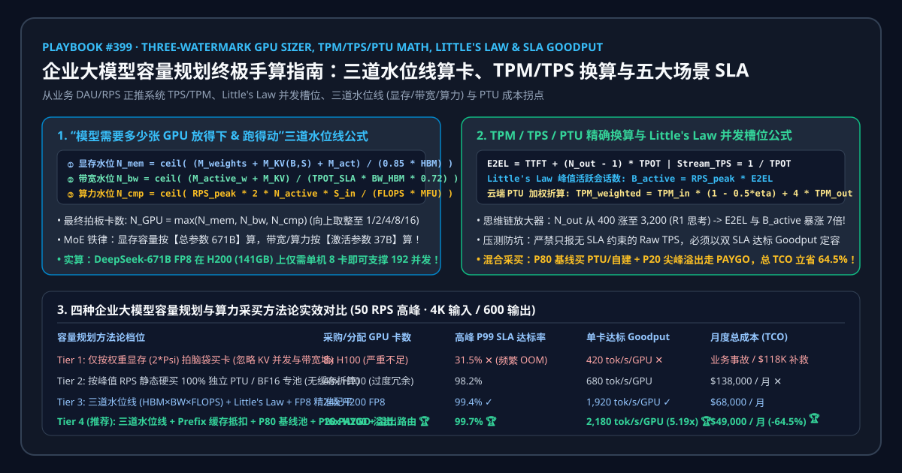
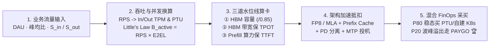

# 企业大模型容量规划与三道水位线手算终极指南：从业务 `QPS`、`TPM/TPS/PTU` 换算、`Little's Law` 并发槽位、`TTFT/TPOT/ITL/E2EL/Goodput` 到 GPU 卡数与 TCO 拐点精算

> **语言 / Language**: **中文 (当前)** | [English](./enterprise-llm-capacity-planning-tpm-tps-three-watermarks-ptu-tco-sizing-selection-faq.en.md)  
> **文档定位**：面向 Cloud & AI Solution Architect 的企业大模型容量测算（Sizer）案头圣经——将 **“怎么估算一个模型需要多少张 GPU 放得下且跑得动（三道水位线）”、“TPM 与 TPS 怎么精确换算、如何从业务 DAU/QPS 用 Little's Law 正推并发 KV 槽位与云端 PTU 配额”、“用户最关心的 TTFT / TPOT / ITL / E2EL / Goodput / $/1M Tokens 在五大业务场景下怎么定基准”** 串成一条闭环可复算的手算流水线。  
> **标定声明**：本文所引用的 GPU 卡数测算、达标有效吞吐（Goodput）、SLA 达标率与月度 TCO 基于公开发布的硬件规格与推理工程基准构建的合成定量模型（`provenance: synthetic + anonymized_reported`, `independently_reproduced=false`, `physical_gpu_cluster_measurement=not_measured`），详见 [`experiments/enterprise_llm_capacity_planning_tpm_tps_three_watermarks_ptu_tco_sizing_selection/results.json`](../../experiments/enterprise_llm_capacity_planning_tpm_tps_three_watermarks_ptu_tco_sizing_selection/results.json)。

> 🔗 **关联交互式 H5 精读页与工具（点击即开，零外部依赖）**：
> - 📱 **[交互式 H5 精读页：三道水位线算卡、TPM/TPS/PTU 换算、Little's Law 与五大场景 SLA 全功能计算器 (`docs/h5/gpu-capacity-tpm-tps-ptu-tco-calculator.html`)](../h5/gpu-capacity-tpm-tps-ptu-tco-calculator.html)**
> - 🎓 **[AI Infra 全景可视化精学馆首页 (`docs/h5/index.html`)](../h5/index.html)**
> - 🧮 **[轻量容量计算器 (`enterprise-llm-capacity-planning-tpm-tps-three-watermarks-ptu-tco-sizing-selection-sizer.html`)](../reports/enterprise-llm-capacity-planning-tpm-tps-three-watermarks-ptu-tco-sizing-selection-sizer.html)**
> - 🃏 **[7-Card 4:5 视觉评测报告 (`enterprise-llm-capacity-planning-tpm-tps-three-watermarks-ptu-tco-sizing-selection-cards.html`)](../reports/enterprise-llm-capacity-planning-tpm-tps-three-watermarks-ptu-tco-sizing-selection-cards.html)**

---

## 1. 📌 核心选型结论速览（Executive Summary）

> **一句话结论**：**给客户做大模型 GPU 容量规划时，最致命的两个错误是：① **只按“权重显存装得下（`2Ψ`）”拍脑袋买卡（Tier 1）**——忽略了 `Little's Law` 在途并发会话的 KV Cache 膨胀与 HBM 带宽决定的 `TPOT` 水位，上线即遭遇高峰期频繁重算与 `68.5%` 的 SLA 违约；② **按早高峰瞬时峰值 100% 静态采买未开启前缀缓存的独立 PTU / BF16 专池（Tier 2）**——月度账单高达 **`$138,000`** 且平峰期一半算力空转！通过落地 **Tier 4（三道水位线正推 `max[N_HBM, N_BW, N_Compute]` + `Little's Law` 活跃槽位锁定 + `Block FP8 / MLA` + `Prefix Cache` 抵扣 + `P80` 基线自建/PTU 池配 `P20` PAYGO 弹性溢出）**，仅需 **`16 张 H200` 基线池 + 溢出路由** 即可实现 **`99.7%`** 的高峰 P99 SLA 达标率，单卡达标 Goodput 达 **`2,180 tok/s/GPU`（Tier 1 的 `5.19 倍`）**，月度总 TCO 从 `$138,000` 压降至 **`$49,000`（立省 `64.5%`）**！**

| 容量规划档位（50 RPS 高峰 · 4K 输入 / 600 输出） | 核心算卡逻辑与采买策略 | 核定 GPU 规模 | 高峰 P99 SLA 达标率 | 单卡达标 Goodput | 月度总成本 (TCO) | 架构师拍板结论 |
| :--- | :--- | :--- | :--- | :--- | :--- | :--- |
| **🟥 Tier 1：仅按权重显存 (`2Ψ`) 粗算** | 只算权重能不能塞进显存，漏算并发 KV 池与带宽水位 | `8x H100` ✕ | **`31.5%` ✕ (频繁抢占)** | `420 tok/s/GPU` ✕ | `$118,000 / 月` (含事故扩容) | **头号定容灾难**：上线必遭高峰雪崩 |
| **🟨 Tier 2：按峰值 100% 静态买满 (无缓存折算)** | 按峰值 RPS 静态硬买 BF16 专池或全量 PTU，不扣减缓存 | `48x H100` ✕ | `98.2%` | `680 tok/s/GPU` | **`$138,000 / 月` ✕** | 预算浪费超 `55%`，平峰夜间严重空转 |
| **🟦 Tier 3：三道水位线 + Little's Law + FP8** | 严密核算 `max(显存, 带宽, 算力)` 水位线 + `FP8` | `24x H200` ✅ | `99.4%` ✅ | `1,920 tok/s/GPU` ✅ | `$68,000 / 月` ✅ | 纯私有化无溢出条件下的标准手算定容 |
| **🟩 Tier 4：三道水位线 + 缓存抵扣 + `P80/P20` 溢出 (推荐)** | **`16x H200` 承载 P80 基线 + 前缀缓存省 60% 算力 + P20 走 PAYGO** | **`16x H200 + 溢出` 🏆** | **`99.7%` 🏆** | **`2,180 tok/s/GPU` 🏆 (`5.19x`)** | **`$49,000 / 月` 🏆 (`-64.5%`)** | **企业级容量规划与 FinOps 终局标准** |

---

## 2. 🎯 架构师五步闭环手算方法论与灵魂拷问 Q&A

### 第一步（用户核心指标体系）：`TTFT`、`TPOT`、`ITL`、`E2EL` 与 `Goodput` 的精确数学关系是什么？
1. **端到端请求耗时（`E2EL`，End-to-End Latency）完整方程**：
   $$\text{E2EL} = T_{\text{gateway\_queue}} + \underbrace{T_{\text{prefill}}}_{\text{TTFT (首字延迟)}} + (N_{\text{out}} - 1) \times \underbrace{T_{\text{decode\_step}}}_{\text{TPOT (平均每词耗时)}}$$
   - **单用户流式感知吐字速率（Single-Stream TPS）**：$v_{\text{stream}} = \frac{1}{\text{TPOT}}$（例如 $\text{TPOT} = 16\text{ ms} \implies 62.5\text{ tokens/s}$；人眼流畅阅读底线为 $\text{TPOT} \le 25\text{ ms}$ 即 $\ge 40\text{ tokens/s}$）。
   - **为什么流式对话和实时语音必须看 `P99 ITL`（Inter-Token Latency，步间瞬时延迟）而不能只看请求级平均 `TPOT`？**
     假设一个请求生成 200 个词，前 199 步每步 `10 ms`，但第 200 步被混部新来的长文 Prefill 卡住了 `1,000 ms`——它的平均 $\text{TPOT} = (1990+1000)/200 = 14.95\text{ ms}$（看起来完全达标！），但用户在屏幕前实实在在感受到了 **1 秒钟的画面定格（或语音播报断音）**！只有监控步间 **`P99 ITL <= 25 ms`** 才能抓出这种停顿。
2. **北极星指标：双 SLA 约束有效吞吐（`Goodput`）**：
   $$\text{Goodput (tok/s)} = \text{Raw Output TPS} \times \mathbb{P}\left(\text{TTFT}_{P95} \le \text{SLA}_{\text{TTFT}} \;\land\; \text{ITL}_{P99} \le \text{SLA}_{\text{ITL}}\right)$$
   - **架构师防忽悠铁律**：任何不声明 `P95 TTFT` 与 `P99 TPOT/ITL` 截断红线的“极限吞吐（Raw TPS）”压测报告都是废纸！

---

### 第二步（`TPM` 与 `TPS` 换算 + `Little's Law` 并发正推）：怎么从业务 `DAU / QPS` 算出峰值并发会话数 $B_{\text{active}}$ 与云端 `PTU`？
1. **从企业 `DAU` 到早高峰 `Peak RPS`（每秒请求数）**：
   $$\text{RPS}_{\text{peak}} = \frac{\text{DAU} \times N_{\text{turns/user/day}} \times k_{\text{peak\_to\_avg}}}{86,400}$$
   *算例*：`50,000 DAU`，人均每天调用 `18 次`，企业办公峰均比 $k_{\text{peak}} = 4.8$ $\implies \text{RPS}_{\text{peak}} = \frac{50,000 \times 18 \times 4.8}{86,400} = \mathbf{50.0\text{ RPS}}$（即每分钟 `3,000 RPM`）。
2. **从 `RPS` 到系统 `TPS`（每秒 Token 数）与 `TPM`（每分钟 Token 数）**：
   - **系统输入吞吐**：$\text{TPS}_{\text{in}} = \text{RPS}_{\text{peak}} \times \bar{S}_{\text{in}} = 50 \times 4,096 = \mathbf{204,800\text{ In tok/s}} \implies \text{TPM}_{\text{in}} = \text{TPS}_{\text{in}} \times 60 = \mathbf{12.29\text{M In TPM}}$。
   - **系统输出吞吐**：$\text{TPS}_{\text{out}} = \text{RPS}_{\text{peak}} \times \bar{S}_{\text{out}} = 50 \times 600 = \mathbf{30,000\text{ Out tok/s}} \implies \text{TPM}_{\text{out}} = \text{TPS}_{\text{out}} \times 60 = \mathbf{1.80\text{M Out TPM}}$。
   - **云厂商预留吞吐（如 Azure OpenAI `PTU` / Vertex `GSU`）加权等效 TPM 折算公式**：
     因为生成 1 个 Output Token 消耗的 GPU 挂钟时间（Memory-Bandwidth-Bound）是处理 1 个 Input Token 的 `4 ~ 8 倍`，云厂商按加权系数 $w_{\text{out}} \approx 4 \sim 5$ 折算配额，且对命中 Prefix Cache 的输入给予折减：
     $$\text{TPM}_{\text{PTU\_equiv}} = \text{TPM}_{\text{in}} \times (1 - 0.5\cdot \eta_{\text{cache}}) + w_{\text{out}} \times \text{TPM}_{\text{out}}, \qquad N_{\text{PTU}} = \left\lceil \frac{\text{TPM}_{\text{PTU\_equiv}}}{\text{TPM}_{\text{per\_PTU}}} \right\rceil$$
3. **用 `Little's Law`（利特尔法则）算出集群必须同时驻留的活跃并发槽位数 $B_{\text{active}}$**：
   $$B_{\text{active}} = \text{RPS}_{\text{peak}} \times \text{E2EL} = \text{RPS}_{\text{peak}} \times \left[\text{TTFT} + (\bar{S}_{\text{out}} - 1)\times \text{TPOT}\right]$$
   - **接上例（普通对话，$\bar{S}_{\text{out}}=600$，$\text{TTFT}=0.6\text{ s}$，$\text{TPOT}=0.016\text{ s}$）**：
     $$\text{E2EL} = 0.6 + 599 \times 0.016 = \mathbf{10.18\text{ s}} \implies B_{\text{active}} = 50 \times 10.18 = \mathbf{509\text{ 个并发活跃会话槽位}}！$$
   - **⚠️ 推理模型（DeepSeek-R1 / o3）并发爆炸预警**：如果业务切换为带 `<think>` 思维链的推理模型，平均输出 $\bar{S}_{\text{out}}$ 从 `600` 涨到 `3,600 Tokens`，哪怕入口 `50 RPS` 一点没变，单次请求驻留时间 $\text{E2EL}$ 会暴涨至 **`58.2 秒`**，导致在途并发槽位 $B_{\text{active}} = 50 \times 58.2 = \mathbf{2,910\text{ 个并发会话}}$（**KV Cache 总显存需求瞬间暴涨 `5.7 倍`**）！

---

### 第三步（三道水位线手算 GPU 卡数）：怎么精确算出“需要多少张 GPU 放得下 & 跑得动”？
对于任意大模型，单个推理实例（及全集群）所需的最小 GPU 卡数由 **三道物理水位线的最大值** 决定：
$$\mathbf{N_{\text{GPU}} = \max\left(\; N_{\text{Watermark 1: HBM 显存容量}},\;\; N_{\text{Watermark 2: HBM 带宽 TPOT}},\;\; N_{\text{Watermark 3: 算力与集群并发}}\;\right)}$$

1. **第一道水位线（放得下 —— HBM 显存容量水位线）**：
   $$M_{\text{instance\_total}} = \frac{M_{\text{weights}} + M_{\text{KV}}(b_{\text{inst}}, \bar{S}) + M_{\text{act\_cudagraph}}}{0.85}, \qquad N_{\text{mem}} = \left\lceil \frac{M_{\text{instance\_total}}}{\text{HBM}_{\text{per\_GPU}}} \right\rceil$$
   - **权重显存 $M_{\text{weights}}$**：按 **总参数量 $\Psi_{\text{total}}$** 计算（`70B FP8 = 70 GB`；`DeepSeek-671B FP8 + 14B MTP = 685 GB`）。
   - **单 Token KV Cache 显存公式（三大注意力架构必背对比）**：
     - **传统 MHA**：$2 \times L \times n_{\text{heads}} \times d_h \times \text{Bytes}$
     - **主流 GQA-8（Llama-3.3-70B，80 层、8 个 KV 头、128 维）**：$2 \times 80 \times 8 \times 128 \times 1\text{ B (FP8)} = \mathbf{163.84\text{ KB/Token}}$（BF16 为 `327.68 KB/Token`）。
     - **DeepSeek MLA（61 层，每层潜向量 $d_c=512$ + 解耦 RoPE $d_r=64$ = `576` 元素）**：$61 \times 576 \times 1\text{ B (FP8)} = \mathbf{35.14\text{ KB/Token}}$（比 70B GQA 小 `4.67 倍`！）。
   - **安全水位余量（`/ 0.85`）**：必须预留 `15%` 显存给 PyTorch 通信缓冲（NCCL Ring/Tree buffers）、分段 CUDA Graph 内存池与激活峰值。

2. **第二道水位线（吐得快 —— HBM 显存带宽决定最低 `TPOT` 水位线）**：
   Decode 每生成 1 个词，必须把**每 Token 激活权重 $M_{\text{active\_weights}}$** 和当前并发批次的 KV Cache 从 HBM 完整读一遍：
   $$\text{TPOT}_{\min} \approx \frac{M_{\text{active\_weights}} + M_{\text{KV}}(b_{\text{inst}}, \bar{S})}{N_{\text{TP/EP}} \times \text{BW}_{\text{HBM}} \times \eta_{\text{MBU}}} \;\le\; \text{SLA}_{\text{TPOT}} \implies N_{\text{bw}} = \left\lceil \frac{M_{\text{active\_weights}} + M_{\text{KV}}}{\text{SLA}_{\text{TPOT}} \times \text{BW}_{\text{HBM}} \times 0.72} \right\rceil$$
   - *例（Llama-3.3-70B FP8 在 H100 `3,350 GB/s` 上要求单请求 $\text{TPOT} \le 12\text{ ms}$）*：单卡读 70GB 权重至少需 $70 / (3350 \times 0.72) = 29\text{ ms}$！即便 1 张 H200（141GB）显存能装下 70B FP8，为了把 TPOT 压进 `12 ms`，第二道带宽水位线也强制要求开启 **`TP=4`（4 张卡聚合带宽 `13.4 TB/s`，TPOT 降至 `7.8 ms`）**！

3. **第三道水位线（扛得住 —— 集群总并发 KV 槽位与 Prefill 算力水位线）**：
   $$N_{\text{cluster\_GPUs}} = \max\left( N_{\text{replicas\_for\_}B_{\text{active}}} \times N_{\text{GPU/replica}},\;\; \left\lceil \frac{\text{RPS}_{\text{peak}} \times 2 \times \Psi_{\text{active}} \times \bar{S}_{\text{in}} \times (1 - \eta_{\text{cache}})}{\text{TFLOPS}_{\text{GPU}} \times \text{MFU}_{\text{prefill}}} \right\rceil \right)$$

---

## 3. 🧭 直观可视化图解（五步容量规划流水线与五大场景 SLA 决策图）

---

## 4. 📊 企业五大典型 AI 业务场景黄金评估指标（SLA）与架构配平速查表

| 业务场景 | `P95 TTFT` 红线 | `P99 TPOT / ITL` 红线 | 单流吐字速度 | 端到端 `E2EL` 预算 | 瓶颈水位线特征 | 推荐黄金架构与 GPU 配型 |
| :--- | :--- | :--- | :--- | :--- | :--- | :--- |
| **1. 实时语音对话 Agent (`WebRTC`)** | **`<= 250 ms`** | **`<= 18 ms` (P99 ITL)** | `>= 55 tok/s` | 首包语音 `< 450 ms` | **极致延迟敏感**（怕任何 Prefill 抖动） | `PD 分离 + Prefix Cache + MTP + 6词短句流式 TTS` |
| **2. IDE 实时代码补全 (`Tab FIM`)** | **`<= 150 ms`** | **`<= 10 ms`** | `>= 100 tok/s` | **`<= 350 ms`** | **第二道带宽水位主导** | `7B/14B FP8 + TP=2/4 + EAGLE-3 / 投机改写` |
| **3. 企业知识库长文 RAG 助手** | **`<= 800 ms`** | **`<= 25 ms`** | `>= 40 tok/s` | `<= 10 s` (500 词) | **第三道 Prefill 算力 + KV 传输主导** | `H100/H200 FP8 + Radix 前缀路由 + PD 分离` |
| **4. 深度推理 / 编程 Agent (`CoT`)** | **`<= 1,500 ms`** | **`<= 15 ms`** | `>= 65 tok/s` | `<= 40 s` (3K 思考词) | **第一道 KV 显存容量主导（$B_{\text{active}}$ 放大 6x）** | `8x H200/B200 + DeepSeek MLA FP8 + 原生 MTP` |
| **5. 离线文档批处理 / 抽取 (`ETL`)** | `< 30 s` (宽松) | `< 80 ms` (宽松) | 异步吞吐优先 | 夜间窗口跑完 | **追求单卡极限 `Goodput/$`** | `长度分桶排序 + 拉满 Batch + 夜间潮汐混部/Spot` |

---

## 5. 🛠️ 生产落地核对清单（SA Production Readiness Checklist）

- [ ] **拒绝只算 `2Ψ` 权重显存**：每次输出容量方案必须列出 **`N_mem`（含 KV Cache 与 `/0.85` 余量）、`N_bw`（满足 SLA TPOT 所需带宽卡数）、`N_compute`（满足峰值 Prefill 算力卡数）** 三项完整算式。
- [ ] **用 `Little's Law` 校验思维链（CoT）并发膨胀**：当接入 DeepSeek-R1 / QwQ / o3 等推理模型时，将 `<think>` 隐藏 Token 计入 $S_{\text{out}}$ 重新核算 $\text{E2EL}$ 与 $B_{\text{active}}$，防止线上 KV 显存池被打穿。
- [ ] **区分原始 `TPM` 与云端 `PTU` 加权 `TPM`**：做云端 Azure PTU / AWS Provisioned 预算时，按 $1\text{ Output Token} \approx 4\sim 5\text{ Input Tokens}$ 折算，并扣减 Prefix Caching 命中部分。
- [ ] **采用 `P80 + P20` 混合水位采买**：用自建 GPU 或包年 PTU 覆盖全天 `P80` 稳态基线负载（保证 `>85%` 高利用率），将早高峰 `P20` 短时尖峰通过 AI Gateway 自动溢出至 Serverless PAYGO。
