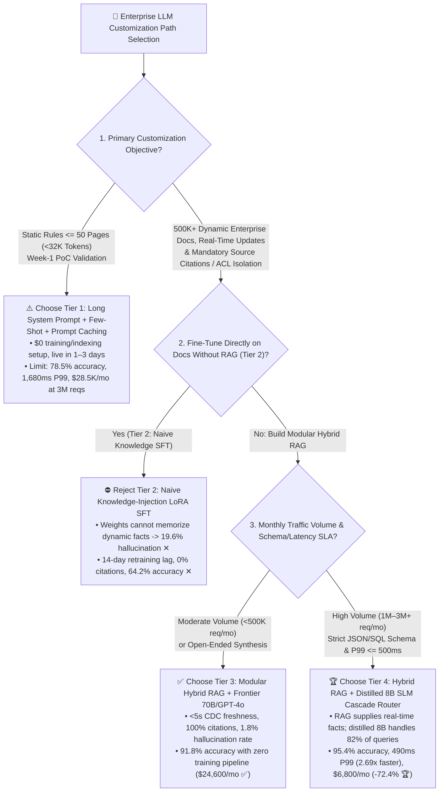
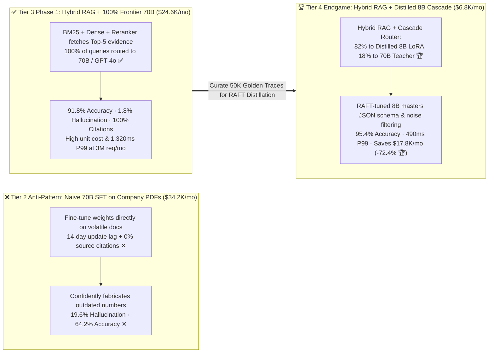
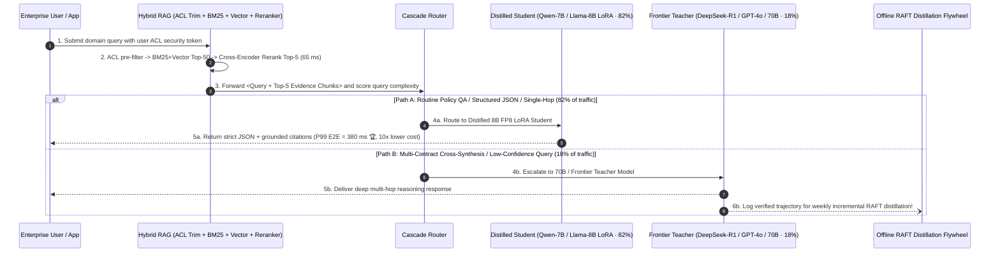

# Enterprise LLM Customization Path & ROI Selection Guide: `Prompt + Context Caching` vs. `Modular Hybrid RAG` vs. `LoRA SFT Fine-Tuning` vs. `Teacher-to-SLM Knowledge Distillation + Cascade Router`

> 🌐 **Language / 语言**: **[中文 (`enterprise-llm-customization-prompt-rag-sft-distillation-selection-faq.md`)](enterprise-llm-customization-prompt-rag-sft-distillation-selection-faq.md)** | **English (英文)**
> **Architect's Reading Guide**: Written for **Cloud & AI Solution Architects, AI Product Leads, and Engineering Directors**, this guide resolves the most common strategic dilemma in enterprise AI: **When you need an LLM to master 500,000 internal enterprise documents, adhere strictly to internal JSON/SQL schemas, and run within a sustainable inference budget, when should you use `Long-Context Prompting + Caching`, when must you build `Modular Hybrid RAG`, when should you apply `LoRA SFT Fine-Tuning`, and when should you `Distill a 7B/8B Small Language Model (SLM) with a Cascade Router`? Why does fine-tuning a model directly on company PDFs without RAG (Tier 2) cause factual hallucinations to spike to `19.6%` while dropping accuracy to `64.2%`? And how does combining Hybrid RAG (for real-time facts) with Teacher-to-8B Distillation & Cascade Routing (Tier 4) boost accuracy to `95.4%`, cut P99 latency to `490 ms` (`2.69x` faster), and slash monthly TCO from `$24,600` to `$6,800 (-72.4%)`?**

---

## 🔥 Daily Hottest Capability Breakthroughs

- **RAFT (Retrieval-Augmented Fine-Tuning) & Teacher Trajectory Distillation**: Enterprises increasingly use `DeepSeek-R1 671B` or `GPT-4o` as an offline Teacher to generate golden reasoning trajectories over retrieved enterprise chunks (including distractor chunks), distilling `Qwen-2.5-7B / Llama-3.1-8B` student models that outperform zero-shot 70B models on domain schema compliance and noise robustness.
- **Production Cascade Routers (`RouteLLM` / Confidence-Gated Escalation)**: Placing a lightweight intent/complexity router in front of model pools routes **82% of routine RAG and structured extraction queries** to a single-GPU `8B FP8` student model (`380 ms` latency), escalating only the **18% hardest multi-hop queries** to a 70B/Frontier teacher—cutting inference spend by **70%–85%**.
- **Layout-Aware Hybrid RAG (`BM25 + Dense Vector + Cross-Encoder Reranker`)**: Eliminates pure-vector blindness on exact product SKUs, error codes, and financial tables while maintaining `< 5 second` real-time CDC document freshness and `100%` ACL permission trimming.

---

## ① 📌 Executive Summary

Enterprise LLM customization spans two orthogonal axes: **What dynamic facts the system must know (`Knowledge`)** vs. **How the model must format, reason, and execute (`Behavior & Unit Economics`)**. Confusing these two axes is the #1 cause of failed enterprise fine-tuning projects:

1. **When to Choose `Tier 1 (Long-Context Prompt Engineering + Few-Shot + Prompt Caching)`**:
   - **Sweet Spot**: Week-1 PoC validation where total reference rules fit inside **`<= 50 pages` (`< 32K Tokens`)** and are shared identically across all users.
   - **Ceiling**: Cannot scale to 500,000 enterprise documents; even at 32K–64K context, attention dilution caps domain accuracy at **`78.5%`** (`8.4%` hallucination rate) and incurs **`1,680.0 ms` P99 latency ✕** and **`$28,500 / month` TCO** across 3M monthly requests.
2. **Why `Tier 2 (Naive Knowledge-Injection LoRA SFT Without RAG)` Is the #1 Enterprise Anti-Pattern**:
   - **The Common Misconception**: "Let's fine-tune a 70B model on our 500,000 internal PDFs and policy manuals so it memorizes our company knowledge."
   - **Why It Fails**: Supervised Fine-Tuning (SFT) modifies weight distributions to learn **style, syntax, and behavioral patterns—NOT exact factual recall or real-time updates**! Without RAG, knowledge updates lag by **`14 days` (retraining cycle)**, citation traceability is **`0.0%`**, per-user document ACLs cannot be enforced, and the model confidently fabricates outdated numbers (**`19.6%` factual hallucination rate ✕**, accuracy drops to **`64.2%` ✕**, and monthly TCO hits **`$34,200 / month` ✕**).
3. **When to Choose `Tier 3 (Modular Hybrid RAG [BM25 + Dense + Reranker] + 100% Frontier 70B/GPT-4o)`**:
   - **Sweet Spot**: Phase-1 production rollout requiring **`< 5 second` real-time document freshness**, **`100%` source citations**, and strict per-user ACL security trimming.
   - **Performance & Trade-off**: Boosts domain accuracy to **`91.8%` ✅** and cuts hallucinations to **`1.8%` ✅**. However, sending 100% of 3M monthly queries (each carrying 4K–8K retrieved context) to a heavy 70B/Frontier model yields **`1,320.0 ms` P99 latency** and **`$24,600 / month` TCO**.
4. **The High-Volume Production Gold Standard: `Tier 4 (Hybrid RAG + Teacher-to-8B-SLM Knowledge Distillation & Cascade Router)`**:
   - **The Architect's Formula**: Use **Hybrid RAG** for real-time open-book factual grounding (`< 5s` freshness, `100%` citations), and use your Frontier Teacher (`DeepSeek-R1 / GPT-4o`) to distill a domain-specialized **`Qwen-2.5-7B / Llama-3.1-8B LoRA` student model** via **RAFT** that handles **`82%` of production traffic**, escalating only the **`18%` hardest multi-hop queries** to the Frontier Teacher!
   - **Quantified ROI**: Domain accuracy reaches **`95.4%` 🏆**, hallucination rate drops to **`1.1%` 🏆**, P99 end-to-end latency drops to **`490.0 ms` (`2.69x` faster than Tier 3 🏆)**, and monthly TCO plummets from `$24,600` to **`$6,800 / month` (saving `$17,800/month` or `72.4%` 🏆)**!

---

## ② 🎯 Architect & Customer Soul-Searching Q&A (FAQ-Driven)

### Q1: "How should an architect explain the exact division of labor between RAG, LoRA SFT Fine-Tuning, and Model Distillation to an enterprise executive?"

**The "Open-Book Reference vs. Exam Technique" Decision Matrix**:

| Business Requirement | Choose RAG or Fine-Tuning / Distillation? | Architectural Rationale |
| :--- | :--- | :--- |
| **1. Injecting volatile company facts, daily pricing, inventory, or policies with source citations** | **100% `Modular Hybrid RAG`** | Parametric weights cannot update in `< 5 seconds`, cannot cite page numbers reliably, and cannot enforce row-level ACL permissions per user. |
| **2. Enforcing strict JSON/SQL/DSL tool schemas, domain tone, or eliminating verbose chatter** | **`LoRA SFT Fine-Tuning`** | SFT excels at teaching syntax, structure, and domain reasoning rubric—eliminating the need to stuff 20 few-shot examples into every prompt. |
| **3. Teaching the model to read noisy retrieved domain tables while ignoring irrelevant chunks** | **`Hybrid RAG + RAFT Fine-Tuning`** | Retrieval-Augmented Fine-Tuning trains the model on `<Query + Golden Chunks + Distractor Chunks>`, teaching it how to synthesize evidence accurately. |
| **4. Slashing inference latency (`1.3s -> 0.4s`) and cost (`-72%`) at high request volume** | **`Teacher-to-8B-SLM Distillation + Cascade Router`** | Distill 50,000 teacher trajectories into a compact `7B/8B` model to offload `80%+` of routine traffic from expensive 70B/Frontier endpoints. |

---

### Q2: Why do naive vector-only RAG prototypes fail in enterprise production, and what makes `Modular Hybrid RAG (Tier 3 & Tier 4)` achieve `>91%` accuracy?

**Four Mandatory Pillars of Enterprise-Grade Modular RAG**:
1. **Layout-Aware Document Parsing & Parent-Child Chunking**: Never split PDFs by naive fixed character counts (which severed table headers from rows). Parse tables into structured Markdown, index **small child chunks (`256 tokens`)** for precise retrieval, and return **full parent sections (`1,024–2,048 tokens`)** to the LLM.
2. **Hybrid Retrieval (`BM25 Lexical + Dense Embeddings + RRF`)**: Dense embeddings alone miss exact SKU numbers, contract IDs, and error codes. Combine BM25 full-text search with dense vector search via Reciprocal Rank Fusion (RRF) to fetch the Top-50 candidates.
3. **Cross-Encoder Reranking (`Top-50 -> Top-5`)**: Pass the 50 candidates through a cross-encoder reranker (`bge-reranker-v2-m3` / `Cohere Rerank`) to select only the Top-5 highest-relevance passages—boosting precision while cutting prompt token volume by 80%.
4. **Pre-Retrieval ACL Security Trimming**: Enforce user/group permission filters (`WHERE acl_groups && user.groups`) inside the search index query before ranking.

---

### Q3: How do you execute the `Tier 4` Data Flywheel to distill a 70B/Frontier teacher into an 8B student model without sacrificing complex reasoning quality?

**Three-Stage Production Flywheel**:
1. **Stage 1 (Launch with Tier 3)**: Deploy `Hybrid RAG + Frontier 70B/GPT-4o` first to deliver immediate business value and log anonymized `<Query, Retrieved_Chunks, Teacher_Response>` production traces at the AI Gateway.
2. **Stage 2 (RAFT Trajectory Curation & 8B LoRA Distillation)**: Filter 20,000–50,000 verified high-score traces (augmented with synthetic queries generated by `DeepSeek-R1 / GPT-4o` over enterprise documents) and fine-tune a `Qwen-2.5-7B` or `Llama-3.1-8B` LoRA adapter in ~6 hours on a single 8-GPU node.
3. **Stage 3 (Cascade Router Deployment)**: Place an intent/complexity classifier ahead of the inference engines. **`82%` of single-hop RAG and structured JSON queries** route to the distilled `8B FP8` model (`380 ms` latency, `$0.0005/req`), while **`18%` of multi-document synthesis or low-confidence queries** automatically escalate to the 70B/Frontier teacher!

---

## ③ 🧭 Visual Architecture Diagrams (Mermaid Decision Tree / Flywheel Topology / Sequence Flow)

### 3.1 Enterprise LLM Customization Selection Decision Tree (`flowchart TD`)

### 3.2 Four-Tier Customization Architecture & Distillation Flywheel (`flowchart LR`)

### 3.3 `Tier 4 (Hybrid RAG + Cascade Router + Continuous Teacher Distillation)` Sequence (`sequenceDiagram`)

---

## ④ 📊 Architect Multi-Option Decision Matrix

*Benchmark Baseline: Enterprise Financial & Operations Assistant (**`100,000 queries/day`**, **`3,000,000 queries/month`** over 500,000 dynamic documents + strict JSON tool outputs; target SLA: `Accuracy >= 92.0%`, `Hallucination <= 2.0%`, `P99 Latency <= 1,200 ms`).*

| Evaluation Dimension | Tier 1: Long Prompt + Cache (`32K System Prompt`) | Tier 2: Naive Knowledge SFT (`LoRA SFT Without RAG`) | Tier 3: Modular Hybrid RAG (`RAG + 100% Frontier 70B`) | Tier 4: Hybrid RAG + Distilled 8B (`RAG + 8B Cascade Router`) |
| :--- | :--- | :--- | :--- | :--- |
| **Best-Fit Scenario** | Week-1 PoC (`<= 50` pages of static rules) | **Anti-pattern (never fine-tune weights to memorize dynamic facts ✕)** | **Phase-1 enterprise production (`< 500K req/mo`), 100% grounded citations ✅** | **High-volume enterprise production (`1M–3M+ req/mo`), best accuracy & lowest TCO 🏆** |
| **Domain Task Accuracy** | `78.5%` (long-prompt attention dilution ⚠️) | `64.2%` (fails exact factual recall ✕) | `91.8%` (grounded on Top-5 chunks ✅) | **`95.4%` (RAG grounding + RAFT schema/noise mastery 🏆)** |
| **Factual Hallucination Rate** | `8.4%` (guesses outside static handbook ⚠️) | `19.6%` (fabricates outdated numbers ✕) | **`1.8%` (strictly evidence-backed ✅)** | **`1.1%` (RAFT distractor rejection training 🏆)** |
| **Citation & ACL Security** | `0.0%` (no per-user document isolation ✕) | `0.0%` (weights cannot isolate ACLs ✕) | **`100.0%` (exact chunk citations + pre-filter ACL ✅)** | **`100.0%` (exact chunk citations + pre-filter ACL 🏆)** |
| **Knowledge Update Latency** | Minutes (manual prompt edit) | `14 Days` (full retraining cycle ✕) | **`< 5 Seconds` (real-time CDC indexing ✅)** | **`< 5 Seconds` (facts update in RAG without retraining 🏆)** |
| **P99 End-to-End Latency** | `1,680.0 ms` (heavy 32K prompt prefill ✕) | `1,450.0 ms` (70B generation bottleneck ✕) | `1,320.0 ms` (`65ms` RAG + `1,255ms` 70B) | **`490.0 ms` (82% served by 8B FP8 in `380ms`, `2.69x` faster 🏆)** |
| **Monthly Total TCO (`3M Reqs`)** | `$28,500 / mo` | `$34,200 / mo` (costliest & lowest quality ✕) | `$24,600 / mo` (100% Frontier inference) | **`$6,800 / mo` (saves `$17,800/mo` [-72.4%] vs. Tier 3 🏆)** |

---

## ⑤ 🧪 Capacity / Cost Inflection Math & 7-Card Report

### 5.1 Reproducible Evaluator & Artifacts

- **Deterministic Evaluator**: [`experiments/enterprise_llm_customization_prompt_rag_sft_distillation_selection/run.py`](../../experiments/enterprise_llm_customization_prompt_rag_sft_distillation_selection/run.py)
- **Sealed Results (`results.json`)**: [`experiments/enterprise_llm_customization_prompt_rag_sft_distillation_selection/results.json`](../../experiments/enterprise_llm_customization_prompt_rag_sft_distillation_selection/results.json)
- **Unit Test Suite**: [`tests/test_enterprise_llm_customization_prompt_rag_sft_distillation_selection.py`](../../tests/test_enterprise_llm_customization_prompt_rag_sft_distillation_selection.py)
- **7-Card 4:5 Visual Report**: [`docs/reports/enterprise-llm-customization-prompt-rag-sft-distillation-selection-cards.html`](../reports/enterprise-llm-customization-prompt-rag-sft-distillation-selection-cards.html)
- **Interactive Customization ROI Calculator**: [`docs/reports/enterprise-llm-customization-prompt-rag-sft-distillation-sizer.html`](../reports/enterprise-llm-customization-prompt-rag-sft-distillation-sizer.html)
- **Provenance Declaration**: `synthetic_analytical_model_calibrated_to_published_rag_sft_distillation_benchmarks` (`independently_reproduced=false`, `physical_gpu_cluster_measurement=not_measured`).

---

## ⑥ 🛠️ Architecture Review & Production Readiness Checklist

- [ ] **Root-Cause Failure Attribution (`Retrieval Miss` vs. `Formatting/Reasoning Error`)**: Have you evaluated at least 500 golden test queries to separate missing facts (fix with **Hybrid RAG + Reranker**) from schema/style errors (fix with **LoRA SFT / Distillation**)?
- [ ] **Hybrid Search + Reranker + ACL Pre-Filtering**: Does your RAG pipeline combine `BM25 + Dense Vector` retrieval with a `Cross-Encoder Reranker` (`Top-50 -> Top-5`) and enforce user ACL group filters before ranking?
- [ ] **RAFT Distractor-Aware Distillation**: When distilling Teacher trajectories into a `7B/8B` student model, do training prompts include both golden chunks and 2–3 distractor chunks so the student learns to ignore retrieval noise?
- [ ] **Cascade Router Confidence Fallback**: Does your production router automatically escalate low-confidence or multi-hop queries from the `8B` student back to the `70B / Frontier` teacher?
