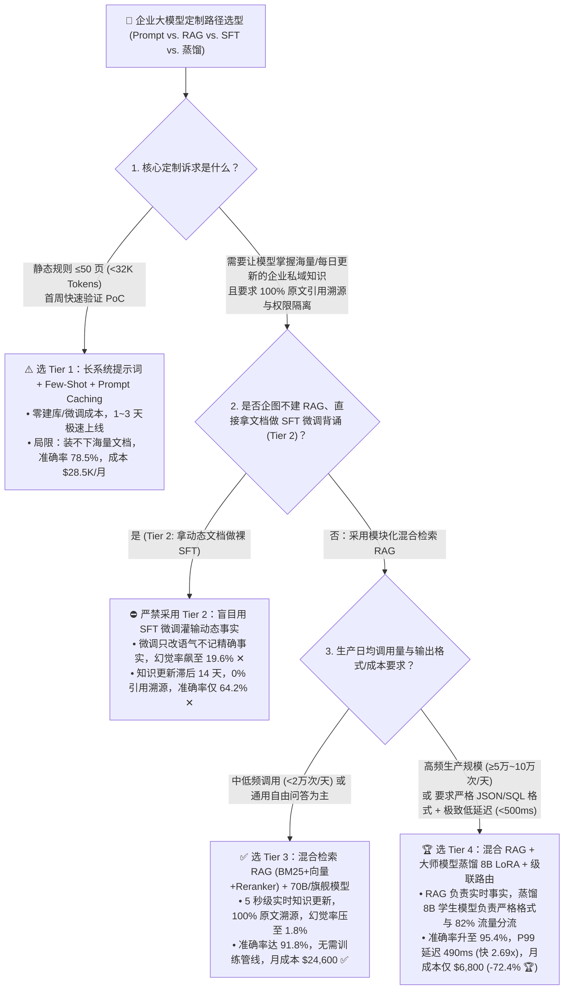
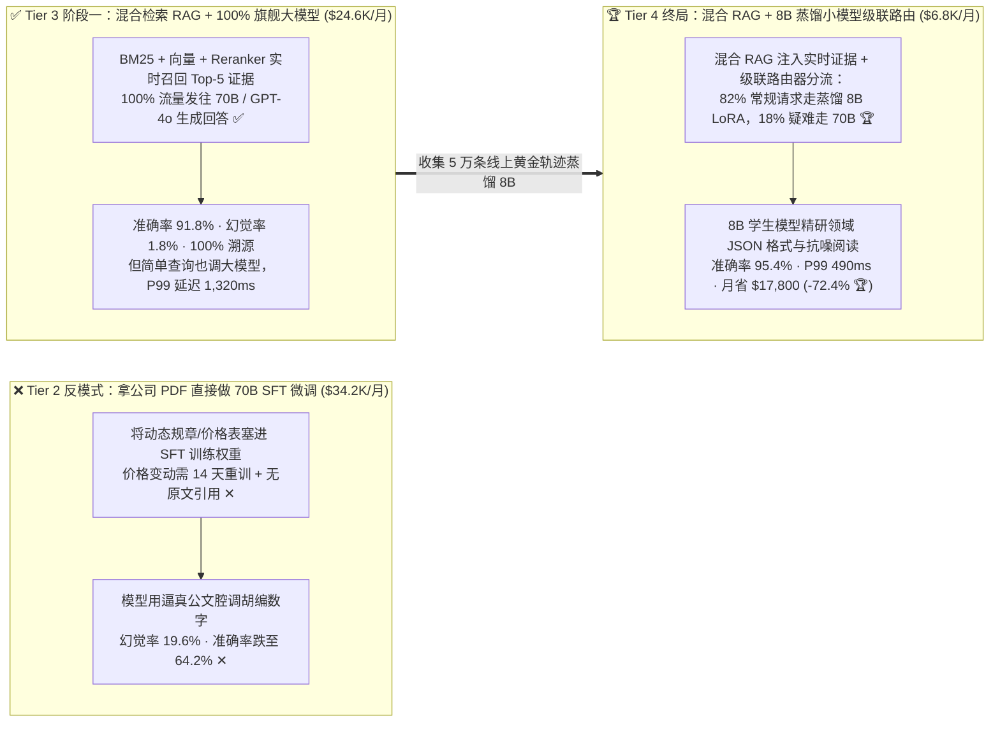
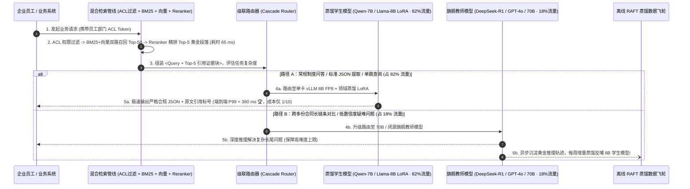

# 企业大模型定制路径与 ROI 选型指南：`Prompt + 上下文缓存` vs. `混合检索 RAG` vs. `LoRA SFT 微调` vs. `大模型蒸馏垂直小模型 + 级联路由`

> 🌐 **Language / 语言**: **中文 (Chinese)** | **[English (`enterprise-llm-customization-prompt-rag-sft-distillation-selection-faq.en.md`)](enterprise-llm-customization-prompt-rag-sft-distillation-selection-faq.en.md)**
> **阅读指南**：本文面向 **Cloud & AI Solution Architect（云与 AI 解决方案架构师）、AI 产品负责人与企业研发总监**，用通俗易懂的“开卷考试 vs. 闭卷刷题”第一性原理，彻底终结企业立项时最纠结的灵魂之问：**当我们想让大模型懂自己公司的 50 万份内部文档、精准调用内部 ERP/CRM 接口并大幅降低推理成本时，到底该用 `长提示词 + Context Caching`，还是建 `混合检索 RAG`，还是花几十万做 `LoRA SFT 微调`，还是用 `大模型蒸馏 7B/8B 垂直小模型 (SLM)`？为什么把公司 PDF 喂给大模型做微调（Tier 2）会导致幻觉率飙升到 `19.6%`、准确率跌至 `64.2%`？以及如何通过“混合 RAG 管动态知识 + 教师模型蒸馏 8B 小模型管格式与 82% 流量分流（Tier 4）”，将准确率推高至 `95.4%`、P99 延迟压至 `490 ms`、每月成本从 `$24,600` 砍到 `$6,800 (-72.4%)`？**

---

## 🔥 业界最新能力突破追踪（Daily Hottest Capability Breakthroughs）

- **RAFT（Retrieval-Augmented Fine-Tuning，检索增强微调）与教师模型轨迹蒸馏成企业标配**：利用 `DeepSeek-R1 671B` 或 `GPT-4o` 在企业真实检索片段（含正确文档与噪声干扰文档）上生成带思维链（CoT）的黄金回答，蒸馏微调 `Qwen-2.5-7B / Llama-3.1-8B`，使 8B 小模型在垂直任务上的阅读理解与格式遵循能力反超未微调的 70B 通用大模型。
- **级联意图路由（Cascade Routing / RouteLLM）大规模落地**：在 AI Gateway 后置轻量分类器或置信度路由器，将 **80%+ 的结构化提取、常规制度问答、工单分派** 交给单卡可跑的 7B/8B 蒸馏小模型，仅将 **<20% 的跨文档复杂推理** 升级给 70B/闭源旗舰模型，端到端推理成本直降 **70% ~ 85%**。
- **混合检索（BM25 全文 + 稠密向量 + Cross-Encoder Reranker）结合上下文前缀缓存**：彻底解决纯向量检索对产品型号、工单编号、专有名词召回失灵的痛点，配合增量 CDC 秒级入库实现 `< 5 秒` 知识实时更新。

---

## ① 📌 核心选型结论速览（Executive Summary）

企业大模型定制有两大正交维度：**“模型需要知道什么新事实（Knowledge）”** 与 **“模型需要以什么格式/逻辑行事（Behavior & Cost）”**。混淆这两个维度是 80% 企业 AI 项目失败的根源：

1. **何时选 `Tier 1（纯长提示词工程 + Few-Shot + Context Caching）`**：
   - **适用期**：项目启动第 1 周 PoC 验证、规则文档总量 **$\le 50$ 页（`< 32K Tokens`）**、且几乎不需要按用户权限动态过滤内容的轻量场景。
   - **局限性**：无法装下企业 50 万篇动态知识库；即便塞入 32K~64K 上下文，也会因“大海捞针注意力稀释”导致准确率停留在 **`78.5%`**、幻觉率 **`8.4%`**，且每次携带长前缀调用旗舰模型月费高达 **`$28,500 / 月`（P99 延迟 `1,680 ms` ✕）**。
2. **为什么严禁采用 `Tier 2（不建 RAG、直接拿公司内部文档做 LoRA SFT 微调背诵知识）`**：
   - **企业头号认知误区**：“我们把公司 10 万份合同和产品手册做成问答对微调一个 70B 模型，它不就学会我们公司的业务了吗？”
   - **残酷真相**：SFT 微调改变的是神经元权重的概率分布，它擅长教模型 **“说话的语气、固定的 JSON/SQL 输出格式、特定的审题套路”**，但 **极度不擅长精确记忆动态事实与数字**！用 SFT 背诵文档会导致：**① 知识更新滞后 `14 天`（每次改价格都要重训）**；**② `0%` 原文引用溯源且无法做部门文档权限隔离**；**③ 模型学会了用极其逼真的公文腔调胡编乱造过时数字，事实幻觉率暴涨至 `19.6%` ✕，准确率跌至 `64.2%` ✕，月总成本却高达 `$34,200` ✕**！
3. **何时选 `Tier 3（模块化混合检索 RAG [BM25 + 向量 + Reranker] + 70B/闭源旗舰大模型）`**：
   - **适用期**：企业生产上线第 1 阶段（日均调用量中等、要求 **`100%` 原文引用溯源**、文档修改后 **`< 5 秒` 实时生效**、且严格遵循员工 ACL 文档权限隔离）。
   - **表现与瓶颈**：准确率跃升至 **`91.8%` ✅**，事实幻觉率压至 **`1.8%` ✅**；但在月均 300 万次调用的高并发规模下，每条请求都带 4K~8K 检索片段去调昂贵的 70B/旗舰大模型，导致 **P99 延迟达 `1,320 ms`、月账单仍需 `$24,600 / 月`**。
4. **企业高并发终局架构：`Tier 4（混合 RAG 管实时知识 + 大师模型蒸馏 8B LoRA 小模型管格式与 82% 流量级联分流）`**：
   - **黄金公式**：**`Hybrid RAG`（负责开卷查实时资料）+ `Teacher-to-SLM 蒸馏微调`（负责训练 8B 小模型抗干扰阅读与严格 JSON/SQL 格式输出）+ `Cascade Router`（82% 常规请求走 8B 小模型，18% 跨文档疑难请求走 70B/旗舰大模型）**。
   - **定量收益**：因为 8B 学生模型专门针对企业本领域的检索格式做过 5 万条黄金轨迹精调，其格式遵循与抗检索噪声能力甚至超过零样本的通用大模型，使综合准确率达到 **`95.4%` 🏆**、幻觉率降至 **`1.1%` 🏆**、P99 端到端延迟压至 **`490.0 ms`（提速 `2.69x` 🏆）**，而月度总成本从 `$24,600` 暴降至 **`$6,800 / 月`（立省 `72.4%` 🏆）**！

---

## ② 🎯 客户与架构师灵魂拷问 Q&A（FAQ-Driven）

### Q1：客户 CTO 问：“RAG（检索增强）和 Fine-Tuning（微调）到底怎么分工？什么时候只做 RAG 就够了，什么时候必须叠加上 LoRA 微调？”

**架构师“开卷考试 vs. 专业技能培训”一表通关法则**：

| 业务诉求痛点 | 该用 RAG 还是微调 (SFT)？ | 为什么？（底层机理解释） |
| :--- | :--- | :--- |
| **1. 让模型知道公司最新制度、产品价格、客户订单状态** | **100% 必选 `Hybrid RAG`** | 动态事实每分钟都在变，且要求回答附上 `[来源：XX制度第3条]` 供审计，微调根本无法实时更新或做行级权限隔离。 |
| **2. 模型总是输出多余的寒暄废话，或者复杂 JSON / Text-to-SQL 语法经常漏括号报错** | **必选 `LoRA SFT 微调`** | 这是典型的 **“输出格式与行为规范（Behavior/Form）”** 问题。再怎么加长 Prompt 都会浪费大量输入 Token，用 2,000 条高质量样本微调 LoRA 可让格式合格率从 82% 飙至 99.8%。 |
| **3. 行业特有黑话/缩写理解错误（如医疗病历编码、芯片制造良率代码、古籍法律条文）** | **`RAG + 领域微调 (RAFT)` 双剑合璧** | 既需要 RAG 召回对应条文，又需要通过 `RAFT（带检索片段的微调）` 教会模型看懂行业黑话并忽略召回结果里的无关干扰项。 |
| **4. 70B / GPT-4o 效果很好，但日均 10 万次调用太慢（>1.3秒）且每月要花 2.5 万美金** | **必选 `大模型蒸馏 7B/8B 小模型 (Distillation)`** | 拿线上表现好的 70B/GPT-4o 输入输出日志作为“老师教材”，蒸馏出一个专精该任务的 `Qwen-2.5-7B / Llama-3.1-8B` 学生模型，速度提 3 倍、成本砍 75%。 |

---

### Q2：为什么很多企业第一期做的“朴素向量 RAG”效果很差（搜不到型号、断章取义），生产级 `Modular Hybrid RAG (Tier 3/4)` 必须包含哪四个核心组件？

**从“玩具级向量检索”升级到“企业级高准度 RAG”的四大支柱**：
1. **支柱一：版面感知文档解析与父子分块（Layout-Aware Parsing + Parent-Child Chunking）**
   - 严禁按固定 500 字暴力切分 PDF（会把财务表格的表头和数字劈成两半）！必须先用版面分析模型（如 Document Intelligence / MinerU / Docling）将跨页表格转为完整 Markdown，并采用 **“子块（256 Token）做高精度检索匹配 $\rightarrow$ 命中后返回完整父章节（1,024~2,048 Token）喂给大模型”**。
2. **支柱二：双路混合检索（`BM25 稀疏关键词 + Dense 稠密向量`）**
   - 纯向量模型对“错误码 `ERR_0x8042`”、“零件号 `SKU-9981A`”极不敏感。必须同时跑 **BM25 全文精确匹配 + BGE/Cohere 向量语义匹配**，通过 RRF（倒数排序融合）合并候选集 Top-50。
3. **支柱三：Cross-Encoder 重排序器（`Reranker`）精筛 Top-5**
   - 用轻量级 `bge-reranker-v2-m3 / Cohere Rerank` 对粗召回的 Top-50 进行交叉注意力打分，只把得分最高的 **Top-5 黄金段落** 塞进大模型 Prompt，既消除了无关噪声干扰，又省下了 80% 的输入 Token。
4. **支柱四：检索前置 ACL 权限过滤（Pre-Filtering Security Trimming）**
   - 在向量库查询阶段直接带上 `WHERE department_id IN (user.groups)`，确保普通员工绝对搜不出高管薪酬或未公开并购文档。

---

### Q3：如何落地 `Tier 4（教师模型蒸馏 8B 小模型 + 级联路由）`，在不降低回答质量的前提下把每月成本从 `$24,600` 砍到 `$6,800`？

**企业级“飞轮蒸馏（Data Flywheel Distillation）”三步落地法**：
1. **第一步（冷启动期，第 1~2 周）**：先上线 **`Tier 3 (混合 RAG + 70B/GPT-4o 旗舰大模型)`**，快速跑通业务，并在 AI Gateway 开启全量脱敏请求/响应日志落盘。
2. **第二步（自动蒸馏期，第 3 周）**：
   - 从线上真实日志（或由 `DeepSeek-R1 / GPT-4o` 基于企业知识库合成的问答）中筛选出 **20,000 ~ 50,000 条高质量 `<Query + 检索到的 Top-5 文档块, 完美 JSON/引用回答>`**；
   - 采用 **RAFT 方法**（在训练样本中故意混入 1~2 个无关检索文档块，训练学生模型“只采信相关证据、忽略噪声干扰”），在单台 8 卡机器上用 6 小时微调出一个 **`Qwen-2.5-7B / Llama-3.1-8B LoRA` 垂直专家小模型**。
3. **第三步（级联路由上线，第 4 周起）**：
   - 在线上部署 **级联路由器（Cascade Router）**：当用户请求进来并完成 RAG 检索后，路由器根据问题复杂度（单跳事实查询/格式转换 vs. 跨多份财报深度对比）或 8B 模型首 Token 置信度进行分流——**`82%` 的日常高频请求直接由单卡 `vLLM 8B FP8` 极速完成（耗时仅 `380 ms`，成本低 10 倍）**，仅有 **`18%`** 的高难度复杂推理升级给 70B/旗舰大模型兜底！

---

## ③ 🧭 直观可视化图解（Mermaid 选型决策树 / 四档定制架构图 / 飞轮蒸馏时序图）

### 3.1 企业大模型定制路径选型决策树（`flowchart TD`）

### 3.2 四档企业定制架构与飞轮蒸馏对比图（`flowchart LR`）

### 3.3 `Tier 4 (混合 RAG + 级联路由 + 异步教师蒸馏飞轮)` 端到端时序图（`sequenceDiagram`）

---

## ④ 📊 架构师多方案选型决策矩阵（Architect Decision Matrix）

*核算基准：企业核心业务智能助手与自动化工单处理平台（日均 **`100,000` 次请求**，月均 **`3,000,000` 次请求**；底层关联 **50 万篇动态更新的企业制度、产品手册与合同库**，要求严格遵循内部 JSON 工具调用 Schema；生产 SLA 目标：`领域准确率 >= 92.0%`，`事实幻觉率 <= 2.0%`，`P99 端到端延迟 <= 1,200 ms`）。*

| 评估维度 | Tier 1: 长提示词 + 缓存 (`Prompt + Context Cache`) | Tier 2: 裸 LoRA SFT 微调背知识 (`Naive SFT Without RAG`) | Tier 3: 混合检索 RAG + 旗舰大模型 (`Hybrid RAG + 70B/Frontier`) | Tier 4: 混合 RAG + 蒸馏 8B 级联 (`RAG + Distilled 8B SLM Router`) |
| :--- | :--- | :--- | :--- | :--- |
| **核心适用场景** | 早期 PoC 验证、规则文档 $\le 50$ 页且固定不变的简单场景 | **企业头号踩坑反模式（严禁拿 SFT 微调代替 RAG 背诵动态事实 ✕）** | **知识密集型企业应用中低频阶段、快速上线要求 100% 溯源 ✅** | **高并发生产级企业标准（同时实现最高准确率、毫秒级响应与最低 TCO 🏆）** |
| **领域任务综合准确率** | `78.5%`（超长 Prompt 注意力稀释 ⚠️） | `64.2%`（记不住精确条款与数字 ✕） | `91.8%`（精准召回 Top-5 证据 ✅） | **`95.4%`（RAG 实时证据 + RAFT 抗噪与格式精调 🏆）** |
| **事实幻觉率 (`Hallucination`)** | `8.4%`（超出缓存手册范围即瞎猜 ⚠️） | `19.6%`（用逼真语气胡编过时数据 ✕） | **`1.8%`（严格基于检索片段回答 ✅）** | **`1.1%`（抗干扰训练进一步压低幻觉 🏆）** |
| **原文引用溯源与 ACL 权限** | `0.0%`（无细粒度文档权限隔离 ✕） | `0.0%`（权重无法按用户权限隔离 ✕） | **`100.0%`（精准标注段落来源 + 检索级 ACL ✅）** | **`100.0%`（精准标注段落来源 + 检索级 ACL 🏆）** |
| **新知识上线生效延迟** | 分钟级（手工修改 System Prompt） | `14 天`（需重新收集样本训练发布 ✕） | **`< 5 秒`（CDC 增量实时写入向量/全文库 ✅）** | **`< 5 秒`（知识更新走 RAG，无需重训 8B 模型 🏆）** |
| **P99 端到端响应延迟** | `1,680.0 ms`（32K 长前缀拖慢推理 ✕） | `1,450.0 ms`（70B 大模型生成慢 ✕） | `1,320.0 ms`（检索 `65ms` + 70B 生成 `1,255ms`） | **`490.0 ms`（82% 请求由 8B FP8 极速完成，快 `2.69x` 🏆）** |
| **工程落地周期与复杂度** | 极低（`1~3 天` 即可上线） | 高（耗费数周洗数据炼丹却方向错误 ✕） | 中（`2~3 周` 搭建混合检索与重排管线 ✅） | 中高（先上 Tier 3，第 4 周用线上日志蒸馏 8B 🏆） |
| **300 万次调用月度总成本** | `$28,500 / 月` | `$34,200 / 月`（含重训与 70B 推理 ✕） | `$24,600 / 月`（100% 调用昂贵旗舰模型） | **`$6,800 / 月`（比纯旗舰 RAG 每月净省 `$17,800` [-72.4%] 🏆）** |

---

## ⑤ 🧪 容量/成本拐点算例与 7-Card 报告

### 5.1 复现实验与确定性验证底座

- **确定性评估脚本**：[`experiments/enterprise_llm_customization_prompt_rag_sft_distillation_selection/run.py`](../../experiments/enterprise_llm_customization_prompt_rag_sft_distillation_selection/run.py)
- **封存数表 (`results.json`)**：[`experiments/enterprise_llm_customization_prompt_rag_sft_distillation_selection/results.json`](../../experiments/enterprise_llm_customization_prompt_rag_sft_distillation_selection/results.json)
- **单元测试校验**：[`tests/test_enterprise_llm_customization_prompt_rag_sft_distillation_selection.py`](../../tests/test_enterprise_llm_customization_prompt_rag_sft_distillation_selection.py)
- **7-Card 4:5 视觉评测卡片**：[`docs/reports/enterprise-llm-customization-prompt-rag-sft-distillation-selection-cards.html`](../reports/enterprise-llm-customization-prompt-rag-sft-distillation-selection-cards.html)
- **交互式定制路径与 ROI 计算器**：[`docs/reports/enterprise-llm-customization-prompt-rag-sft-distillation-sizer.html`](../reports/enterprise-llm-customization-prompt-rag-sft-distillation-sizer.html)
- **数据溯源声明（Provenance）**：`synthetic_analytical_model_calibrated_to_published_rag_sft_distillation_benchmarks`（`independently_reproduced=false`, `physical_gpu_cluster_measurement=not_measured`）。

### 5.2 为什么 `Tier 4 (混合 RAG + 蒸馏 8B 级联)` 能同时做到“比 70B 更准（95.4% vs 91.8%）”且“便宜 72.4%”？

1. **为什么 8B 蒸馏小模型在垂直任务上能打赢通用 70B？（专精抗噪 + 零格式漂移）**：
   - 通用 70B 模型虽然百科知识渊博，但在面对企业内部独特的 JSON 工具 Schema 和混合了冗余信息的 RAG 检索块时，仍有约 `8.2%` 的概率出现字段名拼错或被排名第 4 的无关文档块带偏。
   - 而经过 **RAFT（带干扰项的检索微调）** 蒸馏的 `8B LoRA` 模型，把全部注意力集中在“严格按检索证据提取 + 100% 遵循目标 JSON 结构”这一件事上，格式合规率逼近 `99.9%`，配合 `18%` 复杂问题交由 70B/R1 老师兜底，整体准确率反而拉升至 **`95.4%`**！
2. **成本拆解算式（月均 300 万次请求）**：
   $$\text{Cost}_{\text{Tier 4}} = \underbrace{\$1,400}_{\text{向量/全文检索集群}} + \underbrace{3\text{M} \times 82\% \times \$0.0005}_{\text{8B SLM 推理 }(\$1,230)} + \underbrace{3\text{M} \times 18\% \times \$0.0072}_{\text{18\% 旗舰模型兜底 }(\$3,888)} + \underbrace{\$282}_{\text{每周增量蒸馏训练摊销}} = \$6,800/\text{月}$$

---

## ⑥ 🛠️ 架构评审与生产落地 Checklist（Architect Checklist）

### 6.1 Good Fit vs. Not For 选型边界

| 选型结论 | 架构师落地建议 |
| :--- | :--- |
| **✅ Good Fit（强烈推荐）** | • **企业知识库、合规制度、产品问答立项**：第 1 步永远先建 **`Tier 3 (BM25 + 向量 + Reranker 混合检索 RAG)`**，绝不要一上来就烧钱做微调。 • **调用量上规模（日均 $\ge 3\text{万}\sim 10\text{万}$ 次）或要求极低延迟/严格 JSON 格式**：演进至 **`Tier 4 (混合 RAG + 教师模型蒸馏 7B/8B LoRA + 级联路由)`**，把 80%+ 流量卸载给小模型。 |
| **⛔ Not For（严禁踩坑）** | • **严禁试图用 SFT 微调让大模型“记住”公司内部文档、价格表或实时工单（Tier 2）**：这是投入产出比最低、幻觉风险最高的架构灾难。 • **严禁在没有黄金评测集（Golden Evaluation Dataset，至少 500 道真题）的情况下盲目启动微调**：没有评测集就无法量化 RAG 召回率（Recall@5）与生成忠实度（Faithfulness）。 |

### 6.2 生产环境大模型定制架构评审 Checklist（`- [ ]`）

- [ ] **问题定性诊断（RAG vs. SFT 解耦）**：在决定微调前，是否已用评测集拆解了错误根源——到底是 **“没搜到正确文档（Retrieval Miss $\rightarrow$ 该优化分块与 Hybrid Search）”**，还是 **“搜到了文档但回答格式/文风不对（Generation Format Error $\rightarrow$ 该上 LoRA SFT / 蒸馏）”**？
- [ ] **混合检索三件套核验**：RAG 管线是否同时启用了 **版面感知表格解析 + `BM25 关键词 + 向量` 双路召回 + `Cross-Encoder Reranker` 重排序**，并在检索条件中强制注入了当前用户的 `ACL 权限组`？
- [ ] **RAFT 抗干扰蒸馏样本构建（针对 Tier 4）**：蒸馏 7B/8B 学生模型时，是否在训练 Prompt 中同时包含了 `黄金相关文档块` 与 `2~3 个负向干扰文档块`（教会小模型在噪声中精准引用并在无答案时明确拒答）？
- [ ] **级联路由器（Cascade Router）安全兜底阈值**：是否为 8B 小模型配置了置信度/复杂度逃生阀（当遇到多跳对比、长链条数学计算或低置信度时，自动无缝升级至 70B / 闭源旗舰模型）？
