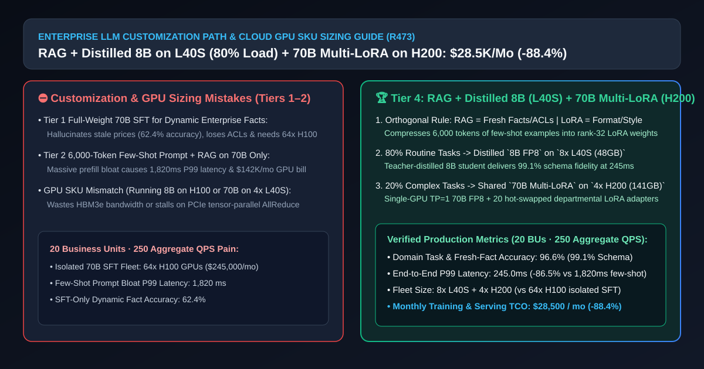
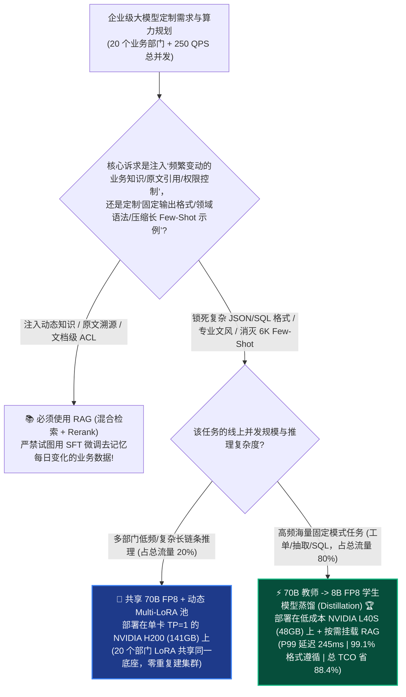
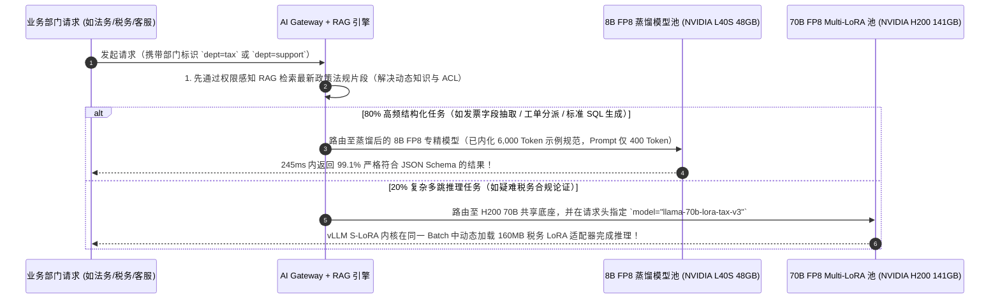

# 企业级大模型定制路径（`Prompt + RAG` vs. `SFT / Multi-LoRA 微调` vs. `大小模型蒸馏`）与主流云端 GPU 机型（`H200 / H100 / A100 / L40S`）容量选型指南

> **语言 / Language**: **中文 (当前)** | [English](./enterprise-llm-customization-rag-sft-lora-distillation-gpu-sizer-selection-faq.en.md)  
> **定位**：面向云与 AI 解决方案架构师（Solution Architect）、企业大模型平台负责人与算力规划团队的“模型定制技术路径拍板 + 多部门共享部署 + 云端 GPU 车型容量估算（Sizer）”全景指南。  
> **数据口径（Provenance）**：`synthetic + anonymized_reported`（`independently_reproduced=false`，`physical_gpu_cluster_measurement=not_measured`），全部定容模型封存于 [`experiments/enterprise_llm_customization_rag_sft_lora_distillation_gpu_sizer_selection/results.json`](../../experiments/enterprise_llm_customization_rag_sft_lora_distillation_gpu_sizer_selection/results.json)。



---

## ① 📌 核心选型结论速览（Executive Summary — 3 分钟看懂怎么选）

当企业拥有 **20 个业务部门（法务、财务、客服、HR、研发等）、总并发高达 `250 QPS`（其中 `80%` 是工单分类/JSON 抽取/SQL 转换等结构化高频任务，`20%` 是复杂跨文档推理）** 时，客户和业务方最常问架构师的两个问题是：**“我们该做 RAG 还是做 SFT 微调？”** 以及 **“云上到底该买 H200、H100、A100 还是 L40S？”** 实践中三大典型误区会导致百万美元级的算力浪费：
1. **误区一：企图通过全量微调（`70B SFT`）让大模型“记住公司每天都在变的知识库与价格表”（Tier 1，动态事实准确率仅 `62.4%`，且需要 `64 张 H100`）**：微调本质是调整概率分布，不仅记不住昨天刚改的产品价格、无法提供原文引用，更无法执行“张三能看、李四不能看”的文档级权限控制（`ACL`）；更糟的是，如果为 20 个部门各自部署一套独立的 70B 全量微调模型集群，每月算力账单高达 **`$245,000 / 月`**！
2. **误区二：坚决不做微调/蒸馏，把 6,000 个 Token 的 Few-Shot 示例规范硬塞进每一次 70B Prompt 里（Tier 2，P99 延迟高达 `1,820ms`，月烧 `$142,000`）**：为了教大模型输出复杂的公司内部 JSON 格式或专有 SQL 方言，每次请求都附带 6,000 Token 的示例，导致 Prefill 算力被白白吃光，需要 `32 张 H100` 才能扛住 250 QPS！
3. **误区三：GPU 车型乱配（用 H100 跑低并发 8B 小模型，或者用 4 张 PCIe L40S 跨卡硬跑 70B 大模型）**：完全忽略了显存容量（VRAM）与显存带宽拐点。

在 **20 个业务部门、总吞吐 250 QPS** 的企业基准下，四档定制路径与 GPU 部署架构的量化对决如下：

| 方案档位 | 核心定制与部署组合 | 领域任务与最新事实准确率 | 结构化 JSON/语法遵循率 | 端到端 P99 延迟 | 所需云端 GPU 集群规模 (`250 QPS`) | 月度训练与推理总成本 (`TCO`) | 架构师核心选型结论 |
|---|---|---|---|---|---|---|---|
| **🟥 Tier 1：全量微调记知识 + 部门独立建集群 (`20x 70B SFT`)** | 试图把动态文档微调进权重 + 20 个部门各起一套 70B 集群 | `62.4%` ✕ *(事实过期/无ACL)* | `94.0%` | `1,480 ms` | `64x H100 (80GB)` ✕ | `$245,000 / 月` ✕ | ⛔ 头号定制反模式，既不准又极贵 |
| **🟨 Tier 2：超长 Few-Shot 提示词 + RAG (`6K Few-Shot + 70B`)** | 不做微调，每次请求硬塞 6,000 Token 示例 + 4,000 Token RAG | `89.5%` | `84.2%` ✕ *(复杂格式偶发破损)* | `1,820 ms` ✕ *(Prefill 算力爆炸)* | `32x H100 (80GB)` | `$142,000 / 月` ✕ | ⚠️ 仅适合日调用量极低的早期 PoC 验证 |
| **🟦 Tier 3：`RAG` + 单一共享底座动态 `Multi-LoRA` (`70B + 20 LoRAs`)** | RAG 管知识 + 20 个部门的 LoRA 适配器共享同一个 70B 底座 | `95.8%` | `98.5%` | `640 ms` | `8x H200 (141GB)` | `$54,000 / 月` | ✔️ 解决了多部门共享底座与 Few-Shot 压缩 |
| **🟩 Tier 4：`RAG` + 蒸馏 `8B` 学生模型 (`L40S`) + 共享 `70B Multi-LoRA` (`H200`)** | **RAG 管动态知识 + `80%` 高频任务蒸馏至 `8B (8x L40S)` + `20%` 复杂推理走 `70B Multi-LoRA (4x H200)`** | **`96.6%` 🏆** | **`99.1%` 🏆** *(权重内化格式)* | **`245 ms` 🏆** *(-86.5%)* | **`8x L40S + 4x H200` 🏆** | **`$28,500 / 月` 🏆** *(-88.4%)* | 🌟 **企业级大模型定制与算力定容终极范式** |

> 💡 **架构师一句话选型铁律**：**“谨记正交定制第一定律：‘`RAG` 负责注入动态外部知识与权限隔离（What to know），`LoRA 微调 / 模型蒸馏` 负责锁死输出格式、领域语法并消灭 6,000 Token 的 Few-Shot 提示词膨胀（How to act）’！把 80% 的高频结构化任务用 70B 教师模型蒸馏到跑在 `L40S (48GB)` 上的 `8B FP8` 学生模型，仅留 20% 复杂推理跑在 `H200 (141GB)` 的 `70B Multi-LoRA` 共享池上！”**

---

## ② 🎯 客户与架构师灵魂拷问 Q&A（直击 3 大定制路线分歧与 GPU 机型选型痛点）

### Q1：到底什么时候该用 `Prompt + RAG`，什么时候必须上 `LoRA SFT 微调`，什么时候又该做 `大小模型蒸馏（Distillation）`？
- **大白话三步演进法则**：
  1. **第一步（Day 1 上线用 `Prompt + RAG`）**：只要业务需求是“根据公司最新制度、产品手册或客户档案回答问题，且必须带原文引用角标、遵守行级权限 ACL”，**100% 必须用 RAG**！绝不要试图用微调去灌输经常变动的业务事实。
  2. **第二步（当 Few-Shot 示例超过 2,000 Token 或格式要求极严时，上 `LoRA SFT + Multi-LoRA 共享部署`）**：当你发现为了教大模型写出符合公司规范的专有 SQL、老旧 COBOL 接口转换或包含 40 个字段的严苛 JSON Schema，不得不在每个 Prompt 里塞入 6,000 Token 的 Few-Shot 示例时，用 2,000~5,000 条高质量样本训练一个 **Rank-32 的 `LoRA` 适配器（仅 ~160 MB）**，即可把 6,000 Token 的示例直接“内化”进权重，输入长度瞬间砍掉 **93%**！且借助 `vLLM / SGLang` 的 **动态 Multi-LoRA（S-LoRA）技术**，20 个部门的 20 个 LoRA 可以共享同一组 `70B` 基础模型显存并在同一个 Batch 里并发推理，无需买 20 套集群！
  3. **第三步（当单一任务并发 `> 30 QPS` 时，做 `70B/GPT-4o 教师 -> 8B 学生蒸馏`）**：利用线上 70B 或 GPT-4o 跑出来的 2 万条优质输入输出轨迹（含校验通过的思维链与 JSON），微调蒸馏出一个专精该任务的 **`Llama-3.1-8B / Qwen2.5-7B FP8` 小模型**。在特定垂直任务上，蒸馏后的 8B 模型不仅结构化准确率反超通用大模型（**`99.1%`**），而且推理成本只有 70B 的 **1/8**！

### Q2：主流云端 GPU 机型（`H200 141GB` vs. `H100 80GB` vs. `A100 80GB` vs. `L40S 48GB`）到底该怎么按参数量与并发 SLA 选型？
- **架构师硬件选型速查法则（基于显存容量 `VRAM`、显存带宽 `TB/s` 与原生 `FP8` 支持）**：
  1. **`8B ~ 14B` 模型（蒸馏小模型、护栏模型、Docling 解析、Reranker）👉 首选 `NVIDIA L40S (48GB GDDR6, 864 GB/s)`**：
     - `8B FP8` 权重仅占 `~8.5 GB` 显存，单张 `48GB L40S` 还能留出 **`~36 GB` 显存给 KV Cache**，单卡即可支撑高并发且支持原生 Ada FP8 Tensor Core，性价比远超用昂贵的 H100 跑小模型（比 A10G 24GB 显存翻倍、算力高 2.5 倍）。
  2. **`70B ~ 72B FP8` 模型（高并发 / 长上下文 / Multi-LoRA 共享底座）👉 首选 `NVIDIA H200 (141GB HBM3e, 4.8 TB/s)`（次选 `2x H100 80GB`）**：
     - **为什么单卡 `H200 (141GB)` 对 `70B FP8` 是降维打击？**：`70B FP8` 模型权重约占 **`72 GB`**。在 `80 GB` 的 H100 或 A100 上，扣掉 72 GB 权重后只剩不到 6 GB 给 KV Cache，根本跑不了并发，因此必须用 **2 张 H100 做张量并行（`TP=2`）**，每层计算都要承受跨卡通信开销；而一张 **`141 GB H200`** 装下 72 GB 权重后，**单卡内部还剩整整 `60 GB+` HBM3e 显存装 KV Cache 和 20 个 LoRA 适配器（实现 `TP=1` 单卡零跨卡通信，单卡吞吐直接提升 `+28%`）**！
  3. **`A100 (80GB)` 的定位**：不支持原生硬件 `FP8`（只能跑 BF16/FP16 或 W4A16 量化），显存带宽（`2.0 TB/s`）不到 H200 的一半；仅在云区缺乏 Hopper 库存或跑存量 INT4/AWQ 离线批处理时作为备选。

---

## ③ 🧭 直观可视化图解（定制路径决策树 + 大小模型协同 Multi-LoRA 架构图 + 蒸馏/推理时序图）

### 3.1 企业级大模型定制路径（RAG vs. LoRA SFT vs. 蒸馏）与 GPU 车型选型决策树



### 3.2 Tier 4 `RAG` + `L40S 8B 蒸馏池` + `H200 70B Multi-LoRA 共享池` 端到端参考架构图

```mermaid
flowchart LR
    subgraph Gateway["1. AI 网关与 RAG 动态知识层"]
        Req["20 个部门请求 (250 QPS)"] --> RAG["🔍 权限感知 RAG 检索<br/>注入实时价格/制度事实"]
        RAG --> Router["🧭 任务复杂度路由器<br/>80% 常规任务 vs 20% 深度推理"]
    end

    subgraph Serving["2. 异构 GPU 黄金配比推理池"]
        Router -->|80% 高频抽取/分类/SQL (200 QPS)| L40S["⚡ 8x NVIDIA L40S (48GB) 集群<br/>运行蒸馏后 8B FP8 学生模型<br/>(免除 6K Few-Shot | P99 245ms)"]
        Router -->|20% 跨文档复杂推理 (50 QPS)| H200["🚀 4x NVIDIA H200 (141GB) 集群<br/>单卡 TP=1 运行 70B FP8 共享底座<br/>+ 动态热挂载 20 个部门 LoRA 适配器"]
    end

    subgraph DistillLoop["3. 飞轮蒸馏闭环"]
        H200 -.->|沉淀高分黄金轨迹 (Gold Traces)| Distill["🧪 离线蒸馏/LoRA 微调流水线"]
        Distill -.->|持续更新 8B 学生与 LoRA 权重| L40S
    end
```

### 3.3 从“线上采集 70B 黄金样本蒸馏 8B”到“动态 Multi-LoRA 共享推理”时序图



---

## ④ 📊 主流云端 GPU 机型选型与四档定制架构决策矩阵

### 4.1 主流云端推理 GPU 机型（`H200` vs. `H100` vs. `A100` vs. `L40S`）架构师定容表

| GPU 机型 | 单卡显存 (`VRAM`) | 显存带宽 (`TB/s`) | 原生 `FP8` | 最佳适用模型与业务场景 | 架构师避坑提示 |
|---|---|---|---|---|---|
| **`NVIDIA H200 SXM`** | **`141 GB HBM3e`** | **`4.8 TB/s`** | ✅ 支持 | 🏆 **`70B~72B FP8` 单卡 `TP=1` 部署**、长上下文 (`32K~128K`)、高并发动态 `Multi-LoRA` 底座、或 8 卡跑 `DeepSeek-R1/V3 671B FP8` | 单卡装下 72GB 权重后还剩 60GB+ KV Cache，彻底消除 70B 双卡通信开销 |
| **`NVIDIA H100 SXM`** | `80 GB HBM3` | `3.35 TB/s` | ✅ 支持 | **`32B FP8` 单卡部署**，或 **`2x H100 (TP=2)` 跑 `70B FP8`** 高吞吐在线服务 | 单张 80GB 跑 70B FP8 只剩 <6GB KV Cache，生产必须至少 2 卡 `TP=2` |
| **`NVIDIA A100 SXM`** | `80 GB HBM2e` | `2.0 TB/s` | ❌ 不支持 | 存量 `8B~32B BF16/INT4` 离线批处理，或 Hopper 缺货时的替补机型 | 无原生 FP8 Tensor Core，跑 70B 性价比显著低于 H100/H200 |
| **`NVIDIA L40S PCIe`** | **`48 GB GDDR6`** | `0.86 TB/s` | ✅ 支持 | 🏆 **`8B~14B FP8` 蒸馏学生模型**、`Docling/MinerU` 文档解析、`BGE/DeBERTa` 护栏与 Reranker | 严禁用 4 张 L40S 跨 PCIe 跑 70B 在线服务（跨卡通信与带宽双重瓶颈） |

### 4.2 四档定制与部署方案综合对比表（20 个业务部门 / 250 QPS）

| 评估维度 | 🟥 Tier 1：20 套独立 `70B SFT` 集群 | 🟨 Tier 2：`6K Few-Shot + RAG` (`70B`) | 🟦 Tier 3：`RAG + 70B Multi-LoRA` | 🟩 Tier 4：`RAG` + `8B 蒸馏 (L40S)` + `70B Multi-LoRA (H200)` |
|---|---|---|---|---|
| **领域任务与最新事实准确率** | `62.4%` ✕（微调记不住动态事实） | `89.5%` | `95.8%` | 🏆 **`96.6%`（RAG 供最新事实 + 权重内化领域推理）** |
| **结构化 JSON / 语法遵循率** | `94.0%` | `84.2%` ✕ | `98.5%` | 🏆 **`99.1%`（蒸馏与 LoRA 锁死输出 Schema）** |
| **端到端 P99 响应延迟** | `1,480 ms` | `1,820 ms` ✕（6K 示例拖慢 Prefill） | `640 ms` | 🏆 **`245 ms`（砍掉 93% Few-Shot Token + 8B 极速解码）** |
| **250 QPS 所需 GPU 规模** | `64x H100` ✕（部门烟囱隔离） | `32x H100` | `8x H200` | 🏆 **`8x L40S (48GB) + 4x H200 (141GB)`** |
| **月度训练与推理总成本 (`TCO`)** | `$245,000 / 月` | `$142,000 / 月` | `$54,000 / 月` | **`$28,500 / 月` 🏆（节省 88.4%，年省 $259 万）** |

---

## ⑤ 🧪 定量算例、交互式容量计算器与 7-Card 4:5 视觉报告

### 5.1 基准算例复核（20 个部门 / 250 QPS / 80% 常规任务 + 20% 复杂推理）

- **交互式定容计算器（CSP 自包含 HTML）**：👉 [打开企业级大模型定制路径（RAG vs SFT vs 蒸馏）与 GPU 车型定容计算器](../reports/enterprise-llm-customization-rag-sft-lora-distillation-gpu-sizer.html)
- **7-Card 4:5 视觉评测卡片报告**：👉 [打开 7-Card 视觉评测报告](../reports/enterprise-llm-customization-rag-sft-lora-distillation-gpu-sizer-selection-cards.html)
- **可复核确定性脚本**：
  ```bash
  python experiments/enterprise_llm_customization_rag_sft_lora_distillation_gpu_sizer_selection/run.py --check
  python -m unittest tests/test_enterprise_llm_customization_rag_sft_lora_distillation_gpu_sizer_selection.py
  ```

### 5.2 核心量化对比图（领域与最新事实准确率 % vs. 结构化 Schema 遵循率 %）

```chart
{
  "data": {
    "values": [
      { "tier": "Tier 1: Isolated 70B SFT (No RAG)", "metric": "Domain & Fresh-Fact Accuracy (%)", "pct": 62.4 },
      { "tier": "Tier 1: Isolated 70B SFT (No RAG)", "metric": "Structured Schema Adherence (%)", "pct": 94.0 },
      { "tier": "Tier 2: 6K Few-Shot + RAG on 70B", "metric": "Domain & Fresh-Fact Accuracy (%)", "pct": 89.5 },
      { "tier": "Tier 2: 6K Few-Shot + RAG on 70B", "metric": "Structured Schema Adherence (%)", "pct": 84.2 },
      { "tier": "Tier 3: RAG + 70B Multi-LoRA", "metric": "Domain & Fresh-Fact Accuracy (%)", "pct": 95.8 },
      { "tier": "Tier 3: RAG + 70B Multi-LoRA", "metric": "Structured Schema Adherence (%)", "pct": 98.5 },
      { "tier": "Tier 4: RAG + 8B Distill + 70B LoRA", "metric": "Domain & Fresh-Fact Accuracy (%)", "pct": 96.6 },
      { "tier": "Tier 4: RAG + 8B Distill + 70B LoRA", "metric": "Structured Schema Adherence (%)", "pct": 99.1 }
    ]
  },
  "semantic_types": {
    "tier": "Category",
    "metric": "Category",
    "pct": "Percentage"
  },
  "chart_spec": {
    "chartType": "Grouped Bar Chart",
    "title": "Tier 4 achieves 96.6% fact accuracy and 99.1% schema adherence at $28.5K/mo",
    "subtitle": "Comparison across 20 enterprise business units at 250 QPS aggregate throughput (higher is better)",
    "encodings": {
      "x": "tier",
      "y": "pct",
      "group": "metric",
      "color": "metric"
    }
  }
}
```

---

## ⑥ 🛠️ 架构评审与生产落地核验清单（Production Readiness Checklist）

- [ ] **严格执行“RAG 管动态事实与权限，LoRA/蒸馏管格式与技能”的正交分工**：严禁把每日更新的产品手册、价格表或受 ACL 保护的机密文档直接烘烤进模型全量权重。
- [ ] **禁止为每个业务部门的微调模型单独部署一套专属 70B GPU 集群**：统一使用 `vLLM / SGLang` 的动态 `Multi-LoRA` 能力，在同一个共享 70B 底座上按请求动态挂载各部门的 LoRA 适配器。
- [ ] **当 Prompt 中的 Few-Shot 示例超过 1,500 Token 或单任务并发 `> 30 QPS` 时，启动 `70B/GPT-4o -> 8B` 教师学生蒸馏飞轮**：将高频分类、实体抽取与 SQL 生成卸载到 `NVIDIA L40S (48GB)` 上的 `8B FP8` 学生模型。
- [ ] **按显存容量与带宽拐点精准匹配云端 GPU 车型**：`8B~14B FP8` 选单卡 `L40S 48GB`；`70B FP8` 优先选单卡 `H200 141GB (TP=1)` 或双卡 `H100 80GB (TP=2)`，避免用多张低带宽 PCIe 小卡跨卡拼凑跑大模型。
