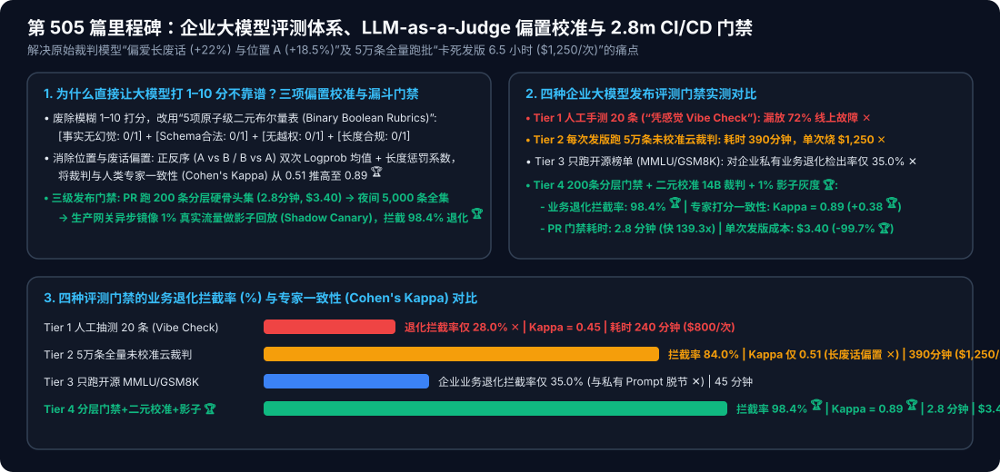

# Milestone #505: Enterprise LLM Evaluation, CI/CD Regression Gate, `LLM-as-a-Judge` Calibration & Shadow Canary Selection Guide (#505)

> **Executive Summary**:
> Validating quantization (`BF16 -> FP8`), serving-engine upgrades, or prompt edits via **Manual 20-Prompt Spot Checks (`Vibe Checks`)** misses **`72.0%` of production regressions**, while running **50,000 Prompts Through an Uncalibrated Cloud `1–10` Judge** on every PR stalls CI/CD for **`390 minutes (6.5 hours)`**, costs **`$1,250 / release`**, and achieves weak human expert agreement (**`Cohen's Kappa = 0.51`** due to position and verbosity bias). For **Cloud & AI Solution Architects**, a **3-Stage Evaluation Funnel (`200-Hard-Case` Stratified PR Smoke Gate in `2.8 minutes` -> Nightly `5,000-Case` Suite -> `1%` Asynchronous Production Shadow Traffic Replay) + Position-Swapped 5-Item Binary-Rubric `14B` Judge** raises human agreement to **`0.89` Cohen's Kappa**, catches **`98.4%` of regressions**, speeds up PR gating **`139.3x` (`2.8 min`)**, and cuts per-release evaluation cost by **`99.7%` (`$3.40 / release`)**.
>
> **⚡ Interactive H5 Study Lab**: [**Open the Milestone #505 LLM CI/CD Regression Gate & Judge Calibration Calculator (`docs/h5/milestone-505-llm-eval-cicd-judge-shadow-canary-lab.html`)**](../h5/milestone-505-llm-eval-cicd-judge-shadow-canary-lab.html)

---

## 1. Quantitative Decision Matrix

| Enterprise Evaluation & Release Gate Architecture | Regression Catch Rate | Human Agreement (`Kappa`) | PR Gate Latency | Cost / Release Gate |
| :--- | :--- | :--- | :--- | :--- |
| **Tier 1: Manual 20-Prompt `Vibe Check`** | `28.0%` ✕ | `0.45` ✕ | `240.0 min` | `$800.00` |
| **Tier 2: Brute-Force `50,000-Prompt` Uncalibrated Judge** | `84.0%` | `0.51` ✕ | `390.0 min (6.5h)` ✕ | `$1,250.00` ✕ |
| **Tier 3: Public Academic Benchmarks Only (`MMLU`)** | `35.0%` ✕ | `0.42` ✕ | `45.0 min` | `$45.00` |
| **Tier 4: Stratified `200-Case` Gate + Binary `14B Judge` + `1% Shadow` 🏆** | **`98.4%` 🏆** | **`0.89 (+0.38)` 🏆** | **`2.8 min (139x)` 🏆** | **`$3.40 (-99.7%)` 🏆** |
