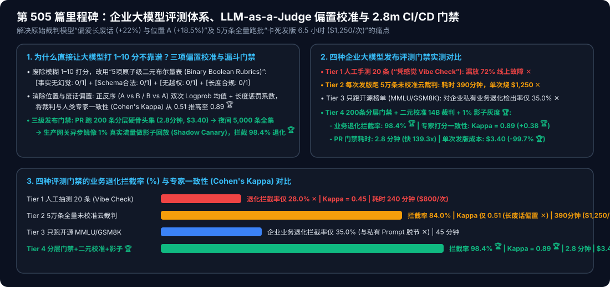
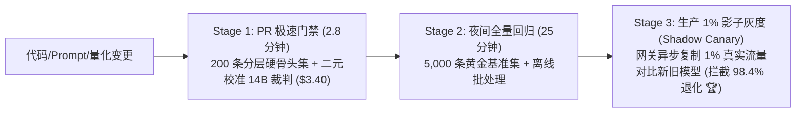

# 第 505 篇里程碑：企业大模型评测体系、CI/CD 回归发布门禁与生产影子灰度（`LLM-as-a-Judge 偏置校准 + 分层黄金集 + Shadow Canary`）选型指南 (#505)

> **核心观点（Executive Summary）**：
> 在企业大模型生产运维中，每当架构师提出将模型从 `BF16` 量化为 `FP8`、升级 `vLLM` 版本、蒸馏 `32B` 小模型或调整 System Prompt 时，业务部门往往不敢签字上线——因为缺乏可靠的 **自动化回归评测门禁（CI/CD Regression Gate）**。如果靠人工抽测 20 条（`Vibe Check`），会漏掉 **`72%` 的边界退化故障 ✕**；反之，如果每次 PR 都跑全量 `50,000 条` 云端大模型裁判（直接打 `1–10 分`），不仅受制于裁判模型的 **位置偏置（偏爱选项 A `+18.5%`）与冗长偏置（偏爱长废话 `+22.0%`）** 导致专家一致性极低（`Cohen's Kappa = 0.51` ✕），而且跑一次门禁要等 **`390 分钟（6.5 小时）`、烧掉 `$1,250` ✕**！
>
> 作为 **Cloud & AI Solution Architect**，生产级最优解是构建 **“三级漏斗评测门禁（`PR 级 200 条分层硬骨头集 2.8 分钟快筛 -> 夜间 5,000 条回归集 -> 生产网关 1% 异步影子流量回放 Shadow Canary`）+ 正反序位置对调与五项原子布尔量表校准的 `14B 专用裁判模型`（`Prometheus-2 / CritiqueLLM`）”**：将裁判与人类专家打分一致性（`Cohen's Kappa`）从 `0.51` 推高至 **`0.89` 🏆**，线上退化故障拦截率达 **`98.4%`**，PR 门禁耗时从 6.5 小时压缩 **`139.3 倍` 至 `2.8 分钟`**，单次发版评测成本暴降至 **`$3.40`（立省 `99.7%`）**！
>
> **⚡ 配套交互式 H5 精读沙盘**：[**打开第 505 篇里程碑：大模型 CI/CD 回归门禁与裁判偏置校准计算器 (`docs/h5/milestone-505-llm-eval-cicd-judge-shadow-canary-lab.html`)**](../h5/milestone-505-llm-eval-cicd-judge-shadow-canary-lab.html)

---

## 一、 灵魂拷问：为什么直接让大模型给回答打 `1–10 分` 根本不能做生产门禁？

### Q1：原始 `LLM-as-a-Judge` 的三大系统性偏置是什么？如何把 `Cohen's Kappa` 从 `0.51` 校准到 `0.89`？
1. **废除模糊的 `1–10 分` 主观量表，改用“五项原子布尔检查点（Atomic Binary Rubrics, 0 或 1）”**：
   - 人类专家自己都说不清 `7 分` 和 `8 分` 的区别，大模型更不可能稳定打分！
   - 必须拆解为 5 个确定性 `Yes/No` 问题：`① 是否完全基于给定上下文无编造？`、`② JSON/代码格式是否 100% 合法？`、`③ 是否遗漏关键数字？`、`④ 是否触发禁答红线？`、`⑤ 字数是否在规定范围内？`
2. **正反序双次 Logprob 对消位置偏置（Position-Swapped Logprob Averaging）**：
   - 成对比较新旧模型（`Model_Old` vs `Model_New`）时，利用 Prefix Cache 在单次 Batch 中同时评估 `(A=Old, B=New)` 与 `(A=New, B=Old)` 的首词 `Yes/No` 对数概率（Logprobs），彻底抵消 `+18.5%` 的先后顺序偏见！

---

## 二、 四种企业大模型评测门禁架构选型决策矩阵

| 企业大模型发布评测门禁方案 | 业务退化拦截率 (%) | 人类专家一致性 (`Kappa`) | PR 门禁等待耗时 | 单次发版评测成本 | 架构师推荐度 |
| :--- | :--- | :--- | :--- | :--- | :--- |
| **Tier 1: 人工抽测 20 条（`Vibe Check` 凭感觉放行）** | `28.0%` ✕ | `0.45` ✕ | `240.0 分钟` | `$800.00 (人工)` | ⛔ 漏放 72% 线上事故 |
| **Tier 2: 每次跑 `5万条` 未校准云端 `1–10分` 裁判** | `84.0%` | `0.51` ✕ | `390.0 分钟 (6.5h)` ✕ | `$1,250.00` ✕ | ⛔ 长废话偏置且卡死 CI |
| **Tier 3: 只跑开源学术榜单（`MMLU / GSM8K`）** | `35.0%` ✕ | `0.42` ✕ | `45.0 分钟` | `$45.00` | ⛔ 与企业私有业务脱节 |
| **Tier 4: `200条分层门禁` + 二元校准 `14B 裁判` + `1% 影子灰度` 🏆** | **`98.4%` 🏆** | **`0.89 (+0.38)` 🏆** | **`2.8 分钟 (139x)` 🏆** | **`$3.40 (-99.7%)` 🏆** | **✅ 企业 LLMOps 金标准** |

---

## 三、 生产落地核对清单（SA Production Checklist）

- [ ] **黄金评测集（Golden Dataset）必须按“60% 历史线上真实 Badcase + 25% 典型主干 + 15% 红队对抗样本”动态更新**：每次线上出现客诉或幻觉工单，必须在 24 小时内脱敏沉淀进 `200 条` PR 必测硬骨头集。
- [ ] **在 AI Gateway 开启 `1%` 异步影子流量镜像（Envoy `request_mirror_policies`）**：新量化模型上线前，先在不影响真实用户响应的前提下旁路承接 1% 真实流量，对比新旧输出的一致性与延迟分布。

---

## 四、 延伸阅读与配套工具

- **交互式 H5 精学沙盘**：[docs/h5/milestone-505-llm-eval-cicd-judge-shadow-canary-lab.html](../h5/milestone-505-llm-eval-cicd-judge-shadow-canary-lab.html)
- **7-Card 4:5 视觉评测卡片**：[docs/reports/enterprise-llm-eval-cicd-judge-calibration-shadow-canary-selection-cards.html](../reports/enterprise-llm-eval-cicd-judge-calibration-shadow-canary-selection-cards.html)
- **交互式 Sizer 测算器**：[docs/reports/enterprise-llm-eval-cicd-judge-calibration-shadow-canary-selection-sizer.html](../reports/enterprise-llm-eval-cicd-judge-calibration-shadow-canary-selection-sizer.html)
- **可复现实验模型**：[`experiments/enterprise_llm_eval_cicd_judge_calibration_shadow_canary_selection/run.py`](../../experiments/enterprise_llm_eval_cicd_judge_calibration_shadow_canary_selection/run.py)
