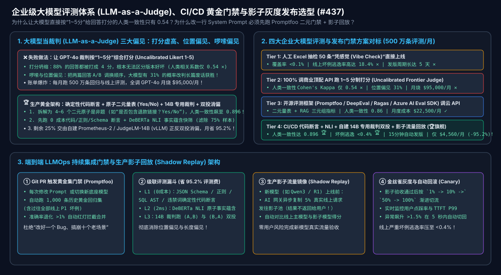

# Enterprise LLM Evaluation (`LLM-as-a-Judge`), CI/CD Release Gates & Shadow Replay Selection Guide: `Promptfoo / Ragas / Azure Eval` vs. `Prometheus-2 14B Binary Judge`

> **Language / 语言**: [简体中文](./enterprise-llm-evaluation-judge-promptfoo-ragas-shadow-canary-tco-selection-faq.md) | **English**  
> **Companion Interactive Study & Sizing Tools**: [📱 Interactive H5 Study Lab](../h5/llm-evaluation-judge-promptfoo-ragas-shadow-canary-lab.html) · [🧮 HTML Sizer](../reports/enterprise-llm-evaluation-judge-promptfoo-ragas-shadow-canary-tco-selection-sizer.html) · [🃏 7-Card Visual Deck](../reports/enterprise-llm-evaluation-judge-promptfoo-ragas-shadow-canary-tco-selection-cards.html) · [📊 Reproducible Model](../../experiments/enterprise_llm_evaluation_judge_promptfoo_ragas_shadow_canary_tco_selection/) · [🎓 Back to AI Infra H5 Hub](../h5/index.html)

---

## 1. Executive Summary (3-Minute Takeaway)

> **Bottom-Line Recommendation**: Never ship prompt edits or model migrations based on a 50-row manual spreadsheet "vibe check" (`18.4%` production regression escape rate), and never use an uncalibrated `1–5 Likert scale` with a frontier LLM judge (`88%` of outputs cluster at score `4`, yielding only **`0.54` Cohen's $\kappa$** agreement with human experts and **`31%` position bias** when swapping `(A, B)` order).
> - **Recommended Production Architecture (`Tier 4: Deterministic Code Assertions + DeBERTa NLI Entailment Filter + Self-Hosted 14B Binary Rubric Judge [Prometheus-2 / JudgeLM] with Position-Swapped Voting + 5% Production Shadow Traffic Replay`)**:
>   1. **Atomic Binary Checklists (`Yes/No`) + Position-Swapped Voting**: Lifts human expert agreement $\kappa$ from **`0.54` to `0.896`**;
>   2. **CI/CD Golden Gate (`Promptfoo`) + `5%` Shadow Replay**: Reduces production regression escape rates to **`0.35%`** while cutting monthly evaluation TCO across 5M evaluations by **`95.2%` (`$4,560/mo` vs. `$95,000/mo`)**.

| Dimension | `Tier 1: Manual 50-Row Vibe Check` | `Tier 2: Uncalibrated 1-5 Likert GPT-4o Judge` | `Tier 3: Cloud Binary Frameworks (Promptfoo / Ragas)` | `Tier 4: Code + NLI + 14B Binary Judge + Shadow Replay (🏆)` |
|---|---|---|---|---|
| **Human Expert Agreement ($\kappa$)** | `0.420` ✕ | **`0.540` ✕ (Clusters at 4/5)** | `0.860` ✓ | **`0.896` (Binary rubric + swapped voting)** 🏆 |
| **Production Regression Escape Rate** | `18.40%` ✕ | `9.20%` ✕ | `1.40%` ✓ | **`0.35%` (CI Golden Gate + Shadow Replay)** 🏆 |
| **Cost per 1,000 Evaluations** | `$45.00` | `$19.00` ✕ | `$4.50` | **`$0.91 / 1K evals` (-95.2%)** 🏆 |
| **Monthly Total TCO (5M Evals)** | `$38,000 / mo` | `$95,000 / mo` ✕ | `$22,500 / mo` ✓ | **`$4,560 / mo` (-95.2%)** 🏆 |

---

## 2. Provenance & Reproducibility

- **Provenance**: `synthetic + anonymized_reported (independently_reproduced=false)` — verified via [`experiments/enterprise_llm_evaluation_judge_promptfoo_ragas_shadow_canary_tco_selection/run.py`](../../experiments/enterprise_llm_evaluation_judge_promptfoo_ragas_shadow_canary_tco_selection/run.py).
