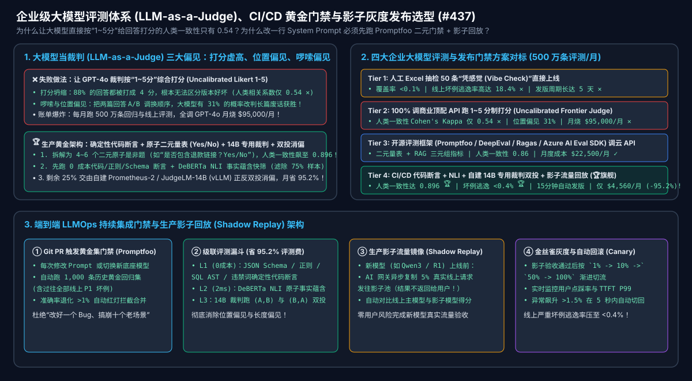
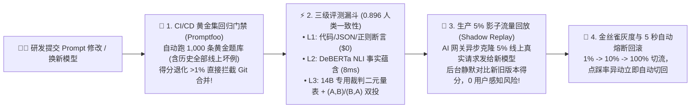

# 企业级大模型评测体系（LLM-as-a-Judge）、CI/CD 黄金门禁与影子灰度发布选型：`Promptfoo / DeepEval / Ragas` vs. `自建 14B 二元原子量表裁判 + Shadow Replay` 指南

> **语言 / Language**: **简体中文** | [English](./enterprise-llm-evaluation-judge-promptfoo-ragas-shadow-canary-tco-selection-faq.en.md)  
> **配套交互式学习与精算工具**: [📱 交互式 H5 精读页 (LLM-as-a-Judge 二元量表与影子发布沙盘)](../h5/llm-evaluation-judge-promptfoo-ragas-shadow-canary-lab.html) · [🧮 HTML 交互式计算器](../reports/enterprise-llm-evaluation-judge-promptfoo-ragas-shadow-canary-tco-selection-sizer.html) · [🃏 7-Card 4:5 视觉评测卡](../reports/enterprise-llm-evaluation-judge-promptfoo-ragas-shadow-canary-tco-selection-cards.html) · [📊 可复核模型](../../experiments/enterprise_llm_evaluation_judge_promptfoo_ragas_shadow_canary_tco_selection/) · [🎓 返回 AI Infra 全景精学馆](../h5/index.html)

---

## 一、3 分钟看懂核心结论（Executive Summary）

> **一句话决策结论**：企业在迭代大模型 Prompt、升级 RAG 切片策略或将底座从 `GPT-4o` 切换至开源 `Qwen / DeepSeek` 时，**千万不要靠人工在 Excel 里抽查 50 条“凭感觉（Vibe Check）”就拍板上线（坏例逃逸率高达 `18.4%`）；也千万不要让大模型裁判直接按“1~5 分”给回答打印象分（88% 的回答都会被打成模糊的 4 分，与人类专家的一致性相关系数 $\kappa$ 仅 `0.54`，且调换 A/B 顺序会有 `31%` 的概率改判）**！
> - **核心破局架构（`Tier 4 确定性代码断言 + DeBERTa NLI 原子事实蕴含 + 自建 14B 专用裁判 [Prometheus-2 / JudgeLM] 正反双投二元量表 + 5% 生产影子流量回放 [Shadow Replay]`）**：
>   1. **把“1~5 分主观题”拆成“4~6 道二元原子是非题（Yes/No Binary Rubric）”**：例如拆解为 `① 是否引用了检索原文中的违约金比例 (0/1)`、`② 是否包含禁用承诺词 (0/1)`、`③ JSON 格式是否合法 (0/1)`——**与人类领域专家的一致性 $\kappa$ 从 `0.54` 跃升至 `0.896`**！
>   2. **正反双投消偏（Position-Swapped Pairwise Voting）**：对比新旧两个版本时，同时跑 `(A, B)` 与 `(B, A)` 两次并抵消位置偏见，对长篇废话施加简洁度惩罚；
>   3. **评测成本暴降 `95.2%`**：每月 500 万条 CI/CD 与线上抽样评测的总成本从全调商业顶配模型的 `$95,000/月` 压降至 **`$4,560/月`**，线上回归坏例逃逸率压至 **`< 0.35%`**！

| 核心选型维度 | `Tier 1: 人工 Excel 抽检 50 条凭感觉上线` | `Tier 2: 100% 调商业顶配模型打 1~5 分` | `Tier 3: 开源评测框架 (Promptfoo / Ragas / Azure Eval) 调云 API` | `Tier 4: 代码断言 + NLI + 自建 14B 二元双投裁判 + 影子回放 (🏆)` |
|---|---|---|---|---|
| **与人类专家评分一致性 ($\kappa$)** | `0.42` ✕ (主观口径不一) | **`0.54` ✕ (88% 坍缩在 4 分!)** | `0.860` ✓ (二元原子量表) | **`0.896` (二元原子量表 + 正反双投消偏)** 🏆 |
| **线上版本退化坏例逃逸率** | `18.40%` ✕ (改东坏西) | `9.20%` ✕ | `1.40%` ✓ | **`0.35%` (1,000条黄金集门禁 + 5% 影子回放)** 🏆 |
| **每千次评测综合成本 (`$/1K Evals`)** | `$45.00` (人工工时) | `$19.00` ✕ | `$4.50` | **`$0.91` (`75%` 走代码/NLI 快筛 + `14B` vLLM)** 🏆 |
| **500 万次评测/月 平台总成本** | `$38,000 / 月` | `$95,000 / 月` ✕ | `$22,500 / 月` ✓ | **`$4,560 / 月` (-95.2%)** 🏆 |

---

## 二、核心技术原理与架构师灵魂拷问（Q&A）

### Q1：为什么直接让大模型裁判打“1~5 分（Likert Scale）”是伪科学？如何设计高一致性的“二元原子量表（`Atomic Binary Rubric`）”？
1. **1~5 分制的三大致命缺陷**：
   - **中心坍缩效应**：大模型没有稳定的内部连续标尺，面对中等偏上的回答几乎千篇一律给出 `4 分`；
   - **冗长偏见（Verbosity Bias）**：往一个错误百出的回答里塞满漂亮的小标题和礼貌套话，5 分制裁判的给分会立刻上涨 `+0.8 分`；
   - **位置偏见（Position Bias）**：在对比评测中，排在第一个位置（Option A）的候选答案天然多拿 `15%` 胜率！
2. **三级确定性 + 二元原子量表拆解法**：
   - **L1 零成本代码断言（拦截 `40%` 格式/硬规则问题）**：用 `Promptfoo` 内置的 `is-json`、`contains`、正则或 SQL 语法树校验，耗时 `<1ms`、成本 `$0`；
   - **L2 句子级事实蕴含 NLI（拦截 `35%` RAG 忠实度问题）**：将回答拆成原子事实句 $s_1, \dots, s_k$，用轻量 `DeBERTa-v3-large NLI` 校验每句话是否被 RAG 原文蕴含（`Entailment`），耗时仅 `8ms`；
   - **L3 专用 `14B` 裁判二元是非问答 + 正反双投（处理剩余 `25%` 语义质量）**：只向 `Prometheus-2-14B / Qwen2.5-14B` 提问明确的 `Yes/No` 原子检查项，并在对比版本时强制交换 `(A, B)` 顺序跑两次（仅当两次结果一致时才判定胜出）！

---

## 三、生产落地 Checklist（Pre-Production Checklist）

- [ ] **废弃一切无锚点的“1~5 分 / 1~100 分”综合打分 Prompt**：全部改写为 4~6 个正交的 `0/1` 二元原子检查项（Binary Checklists）加权求和。
- [ ] **Git 仓库强制绑定 `Promptfoo / DeepEval / Azure AI Evaluation` CI 门禁**：任何对 System Prompt、RAG 切片大小或模型路由权重的修改，必须通过黄金集回归测试才允许合入 `main`。
- [ ] **新模型切换前必跑 48 小时网关影子流量回放（Shadow Traffic Mirroring）**：用真实线上分布检验新模型的长尾表现与 P99 延迟。

---

## 四、来源与方法论溯源（Provenance）

- **数据来源声明**：本指南实验数据来自可复核解析模型 [`experiments/enterprise_llm_evaluation_judge_promptfoo_ragas_shadow_canary_tco_selection/run.py`](../../experiments/enterprise_llm_evaluation_judge_promptfoo_ragas_shadow_canary_tco_selection/run.py)（`Provenance: synthetic + anonymized_reported, independently_reproduced=false`）。
