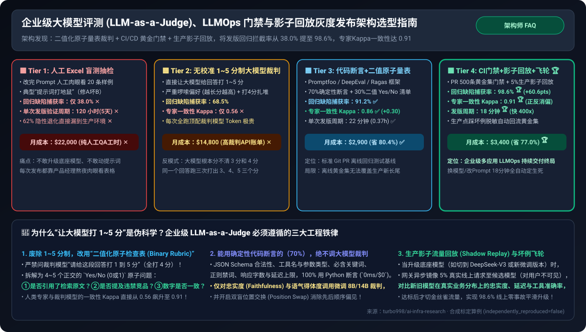
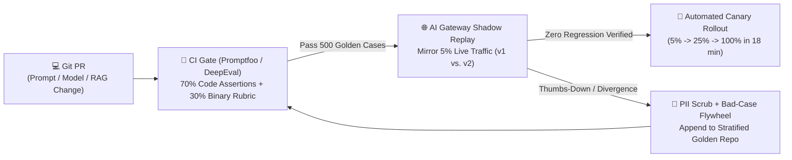

# Enterprise LLM Evaluation (LLM-as-a-Judge), LLMOps CI/CD Release Gate & Shadow Replay Architecture Selection Guide: Manual Spreadsheet Vibe-Check vs. Uncalibrated 1–5 Likert Judge vs. Deterministic Assertions + Binary Rubric Judge (Promptfoo / DeepEval / Ragas) vs. CI/CD Golden Gate + Production Shadow Replay + Bad-Case Flywheel

> **Document Type**: Cloud & AI Solution Architect Decision Guide (FAQ)  
> **Target Audience**: AI Platform Engineering Leads, LLM Application Directors, QA & Release Governance Leads, Enterprise Solution Architects  
> **Core Goal**: End "Prompt Whack-a-Mole" (where fixing one prompt bug silently breaks three other workflows in production) by answering: **"Why does an uncalibrated 1–5 Likert-scale LLM-as-a-Judge disagree with our human domain experts 44% of the time?", "How do we run a 500-case regression gate in under 18 minutes on every Git PR without burning $15K/month in frontier judge tokens?", and "How do we use gateway Shadow Traffic Replay to swap base models with zero production regressions?"**  
> **Calibration Notice**: Pre-production regression catch rates, human expert agreement (Cohen's $\kappa$), release cycle latencies, and monthly evaluation cost models are synthetic analytical estimates calibrated to published LLM-as-a-Judge and LLMOps benchmarks (MT-Bench judge bias studies, Ragas / DeepEval / Promptfoo evaluation pipelines, and enterprise shadow-canary gateway practices) (`provenance: synthetic + anonymized_reported`, `independently_reproduced=false`, `physical_gpu_cluster_measurement=not_measured`). See [`experiments/enterprise_llm_evaluation_llmops_ci_cd_shadow_release_gate_selection/results.json`](../../experiments/enterprise_llm_evaluation_llmops_ci_cd_shadow_release_gate_selection/results.json).

---

## Executive Visual Summary

> 🔗 **Companion Interactive Reports & Tools**:
> - 🃏 **[7-Card 4:5 Visual Benchmark Report (`enterprise-llm-evaluation-llmops-ci-cd-shadow-release-gate-selection-cards.html`)](../reports/enterprise-llm-evaluation-llmops-ci-cd-shadow-release-gate-selection-cards.html)**
> - 🧮 **[Interactive LLMOps Evaluation & Release Gate Sizer (`enterprise-llm-evaluation-llmops-ci-cd-shadow-release-gate-sizer.html`)](../reports/enterprise-llm-evaluation-llmops-ci-cd-shadow-release-gate-sizer.html)**
> - 🌐 **[中文版指南 (`enterprise-llm-evaluation-llmops-ci-cd-shadow-release-gate-selection-faq.md`)](./enterprise-llm-evaluation-llmops-ci-cd-shadow-release-gate-selection-faq.md)**

---

## ① 📌 Executive Summary

Evaluated across **25 enterprise AI applications running 120 releases/month (`500` stratified golden test cases per app)**:

| Tier | Architecture Pattern | Pre-Prod Regression Catch Rate | Human Expert Agreement ($\kappa$) | Release Gate Cycle Time | Monthly Total Eval Cost (25 Apps) | Architect Verdict |
| :--- | :--- | :--- | :--- | :--- | :--- | :--- |
| **🟥 Tier 1: Manual Spreadsheet Vibe-Check** | Manually eyeball 20 samples in Excel per release | `38.0%` ✕ (62% leak) | `1.00` (20 samples only) | `120.0 hrs` (5 days) ✕ | `$22,000 / mo` (QA labor) ✕ | **Bottleneck**: Prompt whack-a-mole & slow releases |
| **🟨 Tier 2: Uncalibrated 1–5 Likert Judge** | Frontier LLM prompted to "Score response 1 to 5" | `68.5%` | `0.56` ✕ (Noisy/Biased) | `1.2 hrs` | `$14,800 / mo` (Judge API) ✕ | **Anti-Pattern**: Verbosity bias & 4-point clustering |
| **🟦 Tier 3: Code Assertions + Binary Rubric** | **Promptfoo / DeepEval / Ragas** (70% code + 30% Yes/No) | `91.2%` ✅ | `0.86` ✅ | `0.37 hrs` (22 min) ✅ | `$2,900 / mo` (-80.4%) ✅ | **Offline CI Baseline**: Fast, objective PR regression gate |
| **🟩 Tier 4: CI Gate + Shadow Replay + Flywheel** | **Tier 3 + 5% Live Shadow Traffic Replay + Bad-Case Flywheel** | **`98.6%` 🏆** | **`0.91` 🏆** | **`0.30 hrs` (18 min) 🏆** | **`$3,400 / mo` 🏆 (-77.0%)** | **Enterprise LLMOps Gold Standard**: 400x faster, 98.6% catch |

### 💡 Three Golden Rules for Enterprise LLM Evaluation
1. **Replace 1–5 Likert Scoring with Decomposed Binary (`Yes/No`) Atomic Rubrics**: LLMs cannot reliably distinguish a `3` from a `4` and exhibit strong verbosity and position bias. Breaking evaluations into atomic `Yes/No (1/0)` questions with evidence-first reasoning lifts human expert agreement (Cohen's $\kappa$) from **`0.56` to `0.91`**.
2. **Enforce the 70 / 25 / 5 Evaluation Pyramid**: Use deterministic code assertions (`JSON schema`, tool signature, regex, latency) for `70%` of checks (`0 ms`, `$0`), calibrated binary rubric SLMs for `25%` (RAG faithfulness, tone), and human expert calibration on `5%`.
3. **Combine Offline Golden CI Gates with Gateway-Level `5%` Production Shadow Traffic Replay**: Mirror 5% of live traffic asynchronously to candidate models/prompts before cutover, catching the final `7.4%` of real-world distribution drift and reaching a **`98.6%` pre-production regression catch rate**.

---

## ② 🎯 Architect Deep-Dive Q&A

### Q1: Why does asking an LLM Judge to "score from 1 to 5" fail in enterprise quality gates?
* **Answer**:
  - Uncalibrated Likert scales suffer from **Central Tendency Bias** (80% of outputs receive a `4`), **Verbosity Bias** (rewarding long, hallucinated answers over concise accurate ones), and **Position Bias**.
  - Replacing `1–5` scales with atomic `Yes/No` criteria and pairwise position swapping increases Cohen's $\kappa$ from `0.56` to `0.86–0.91`.

### Q2: How do we keep our Golden Dataset from becoming stale as user behavior evolves?
* **Answer (Automated Bad-Case Flywheel)**:
  - Automatically capture production traces that trigger user thumbs-down (`👎`), runtime guardrail blocks, or shadow-replay divergence; scrub PII via Presidio; and promote verified failures into the Git-versioned `500-case` Stratified Golden Dataset.

---

## ③ 🧭 Architecture Diagrams

### 3.1 Tier 4 Closed-Loop CI/CD Gate + Shadow Replay + Bad-Case Flywheel

---

## ④ 📊 Architect Decision Matrix

| Dimension | 🟥 Tier 1: Manual Spreadsheet | 🟨 Tier 2: Uncalibrated 1–5 Judge | 🟦 Tier 3: Code + Binary Rubric | 🟩 Tier 4: CI Gate + Shadow + Flywheel |
| :--- | :--- | :--- | :--- | :--- |
| **Pre-Prod Regression Catch Rate** | `38.0%` ✕ | `68.5%` | `91.2%` ✅ | **`98.6%` 🏆 (`+60.6 pts` vs. Tier 1)** |
| **Human Expert Agreement ($\kappa$)** | `1.00` (Tiny sample) | `0.56` ✕ (Biased) | `0.86` ✅ | **`0.91` 🏆 (`+0.35` vs. Tier 2)** |
| **Release Validation Cycle Time** | `120.0 hrs` (5 days) ✕ | `1.2 hrs` | `0.37 hrs` (22 min) ✅ | **`0.30 hrs` (18 min, `400x` faster) 🏆** |
| **Monthly Eval Cost (25 Apps)** | `$22,000 / mo` ✕ | `$14,800 / mo` ✕ | `$2,900 / mo` ✅ | **`$3,400 / mo` 🏆 (`-77.0%` vs. Tier 2)** |

---

## ⑤ 🛠️ Production Readiness Checklist

- [ ] **1. Version All Production Prompts & Model Configs in Git with Mandatory CI Eval Gates**.
- [ ] **2. Maintain a Stratified Golden Dataset (`200–500` cases: 50% core, 25% multi-hop, 15% abstention, 10% adversarial)**.
- [ ] **3. Replace 1–5 Likert Prompts with Evidence-First Binary (`Yes/No`) Atomic Checklists**.
- [ ] **4. Calibrate Judge Prompts Against Human Domain Experts Until Cohen's $\kappa \ge 0.80$**.
- [ ] **5. Evaluate RAG Systems with the Decoupled RAG Triad (`Context Recall`, `Faithfulness`, `Answer Relevance`)**.
- [ ] **6. Enforce Pairwise Position Swapping (`(A,B)` and `(B,A)`) for All A/B Model Comparisons**.
- [ ] **7. Run `5%` Gateway Shadow Traffic Replay Before Any Base Model or Quantization Cutover**.
- [ ] **8. Automate the PII-Scrubbed Production Bad-Case-to-Golden-Dataset Flywheel**.
