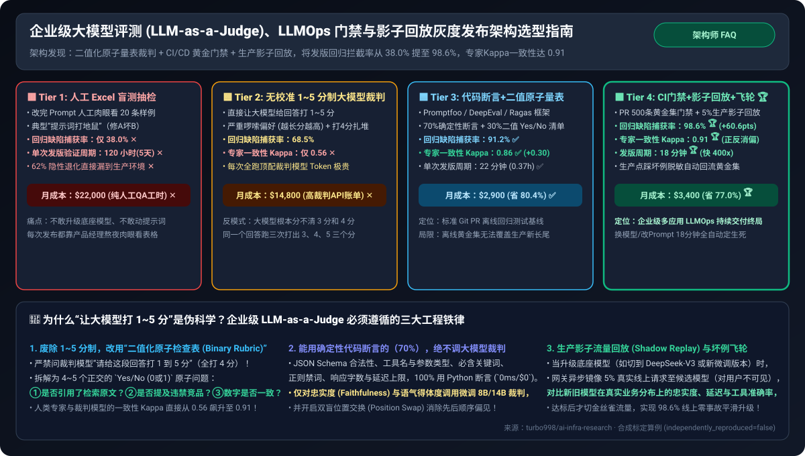
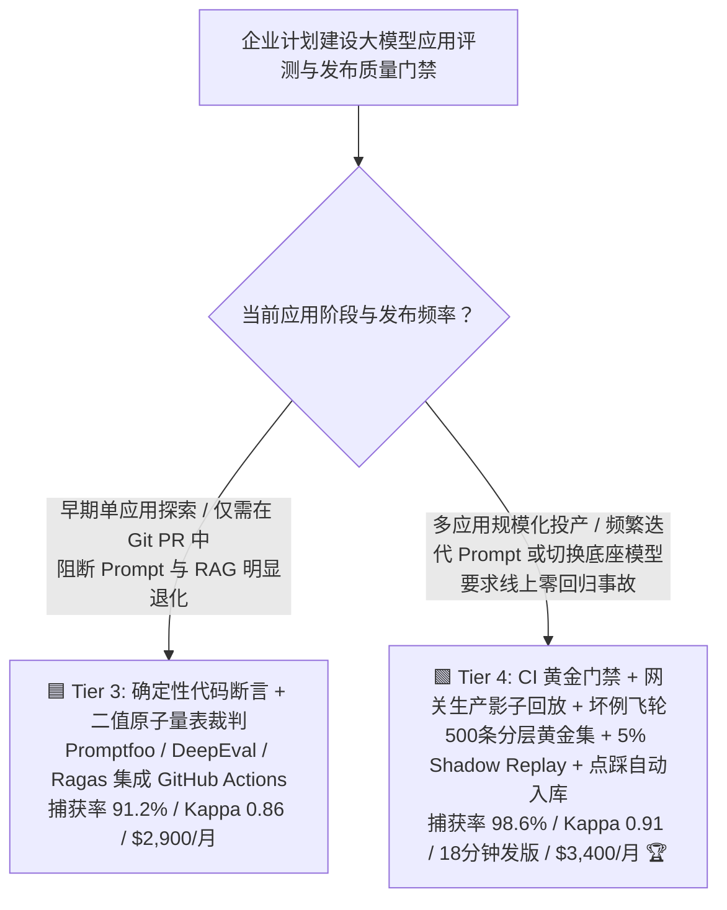
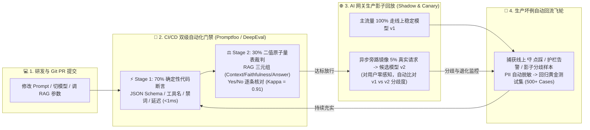
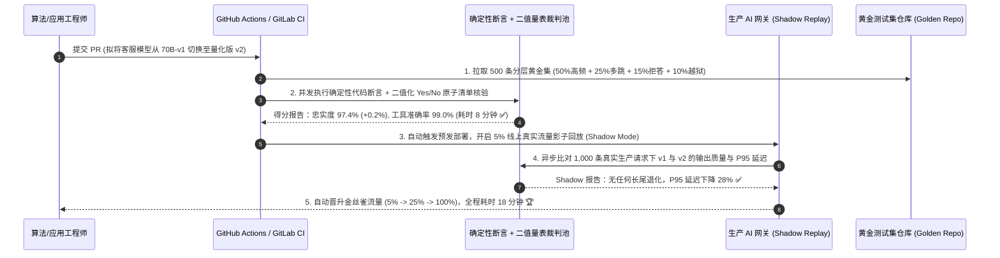

# 企业级大模型评测体系（LLM-as-a-Judge）、LLMOps 持续集成门禁与灰度发布架构选型指南：人工 Excel 盲测抽检 vs. 无校准 1~5 分制大模型裁判 vs. 确定性代码断言 + 二值化原子量表（Promptfoo / DeepEval / Ragas）vs. CI/CD 黄金集回归门禁 + 生产影子流量回放（Shadow Replay）+ 坏例自动飞轮架构

> **文档类型**：企业级 AI 工程化（LLMOps）与平台解决方案架构师（Cloud & AI Solution Architect）选型决策指南（FAQ）  
> **适用读者**：AI 平台工程负责人、大模型应用研发总监、质量保障（QA）负责人、首席架构师  
> **核心目标**：用通俗、可落地的架构语言终结企业大模型应用开发中最痛苦的“提示词打地鼠（Prompt Whack-a-Mole，改好一个 Bug 却暗中弄坏三个老功能）”——系统回答：**“为什么让 GPT-4o / 70B 给回答打 1~5 分（LLM-as-a-Judge）跟人类业务专家的判断完全对不上？”、“怎么在不消耗天价裁判 Token 的前提下，让每次 Git 提交在 18 分钟内跑完 500 条黄金测试集？”、“当我们要把线上模型从闭源 API 切换到开源自托管模型时，怎么通过网关影子流量回放（Shadow Replay）确保 100% 平滑切换？”**。  
> **标定声明**：本文所引用的发版前回归缺陷捕获率、人类专家一致性（Cohen's $\kappa$）、单次发版验证周期与月度评测成本模型基于公开发布的企业级 LLMOps 与评测基准（MT-Bench 裁判偏见分析、Ragas / DeepEval / Promptfoo 评测框架及阿里/字节/微软生产级灰度网关实践）构建的合成分析模型（`provenance: synthetic + anonymized_reported`, `independently_reproduced=false`, `physical_gpu_cluster_measurement=not_measured`），详见 [`experiments/enterprise_llm_evaluation_llmops_ci_cd_shadow_release_gate_selection/results.json`](../../experiments/enterprise_llm_evaluation_llmops_ci_cd_shadow_release_gate_selection/results.json)。

---

## 一图流总结（Executive Visual Summary）



> 🔗 **关联可交互报告与工具**：
> - 🃏 **[7-Card 4:5 视觉评测报告 (`enterprise-llm-evaluation-llmops-ci-cd-shadow-release-gate-selection-cards.html`)](../reports/enterprise-llm-evaluation-llmops-ci-cd-shadow-release-gate-selection-cards.html)**
> - 🧮 **[交互式 LLMOps 评测门禁与成本计算器 (`enterprise-llm-evaluation-llmops-ci-cd-shadow-release-gate-sizer.html`)](../reports/enterprise-llm-evaluation-llmops-ci-cd-shadow-release-gate-sizer.html)**
> - 🌐 **[English Version (`enterprise-llm-evaluation-llmops-ci-cd-shadow-release-gate-selection-faq.en.md`)](./enterprise-llm-evaluation-llmops-ci-cd-shadow-release-gate-selection-faq.en.md)**

---

## ① 📌 核心选型结论速览（Executive Summary）

没有自动化评测门禁的 AI 团队，90% 的时间都陷在**“不敢改 Prompt、不敢升级底座模型、每次发版靠产品经理肉眼看 20 行 Excel 凭感觉上线（Vibe-Checking）”**的泥潭里。

基于 **企业内 25 个 AI 应用、每月共计 120 次 Prompt/RAG/模型发版、每个应用 500 条分层黄金测试集（Golden Dataset）** 的基准测算，四档评测与发布架构对比如下：

| 架构档位 | 核心架构组合 | 发版前回归缺陷捕获率 | 与人类专家一致性 ($\kappa$) | 单次发版验证周期 | 月均评测总成本 (25个应用) | 架构师拍板结论 |
| :--- | :--- | :--- | :--- | :--- | :--- | :--- |
| **🟥 Tier 1：人工 Excel 盲测抽检** | 每次发版人工肉眼抽看 20 条样例（Vibe-Check） | `38.0%` ✕ (62%漏测) | `1.00` (仅限抽到的20条) | `120.0 小时` (5天) ✕ | `$22,000 / 月` (人工工时) ✕ | **小作坊死穴**：严重拖慢迭代，改东坏西打地鼠 |
| **🟨 Tier 2：无校准 1~5 分制大模型裁判** | 直接调顶配大模型 Prompt：“请给回答打 1~5 分” | `68.5%` | `0.56` ✕ (严重偏见) | `1.2 小时` | `$14,800 / 月` (API账单) ✕ | **伪科学陷阱**：全打 4 分、越啰嗦分越高、账单昂贵 |
| **🟦 Tier 3：确定性代码断言 + 二值原子量表** | **Promptfoo / DeepEval / Ragas**（70%代码断言 + 30% Yes/No） | `91.2%` ✅ | `0.86` ✅ | `0.37 小时` (22分钟) ✅ | `$2,900 / 月` (-80.4%) ✅ | **标准离线 CI 基线**：每次 Git PR 必跑的客观准绳 |
| **🟩 Tier 4：CI 黄金门禁 + 影子回放 + 坏例飞轮** | **Tier 3 + 网关 5% 生产影子流量回放 + 线上坏例自动入库** | **`98.6%` 🏆** | **`0.91` 🏆** | **`0.30 小时` (18分钟) 🏆** | **`$3,400 / 月` 🏆 (-77.0%)** | **企业级 LLMOps 终局标准**：快 400 倍、零事故切换模型 |

### 💡 架构师三句话选型铁律
1. **立即废除“让大模型打 1~5 分（Likert Scale）”的裁判写法，全面改为“二值化原子检查表（Binary Yes/No Rubric）”**：大模型根本无法稳定区分 3 分和 4 分的边界，且天然喜欢长篇废话（Verbosity Bias）；把评分拆解为 4~5 个具体的 `Pass/Fail (1/0)` 事实核对项，人类专家一致性（Cohen's $\kappa$）直接从 **`0.56` 飙升至 `0.91`**！
2. **评测金字塔必须遵循“70% 确定性代码断言 + 25% 轻量二值小裁判 + 5% 人工盲审校准”**：JSON 格式合法性、工具调用参数、必含数字、正则禁词、P95 延迟等 70% 指标必须用零成本、零方差的 Python 确定性断言（`< 1 ms`）；只有检索忠实度（Faithfulness）和语气合规才调用大模型裁判。
3. **跨代模型升级或重构 RAG 时，单靠离线黄金集不够，必须开启网关层“5% 生产流量影子回放（Shadow Traffic Replay）”**：由 AI 网关异步克隆 5% 的真实线上请求发给新候选模型（结果不返回给用户，只落库对比），在真实生产长尾分布上验证通过后再切金丝雀流量，将线上回归事故拦截率推至 **`98.6%`**。

---

## ② 🎯 客户与架构师灵魂拷问 Q&A（Architect Deep-Dive Q&A）

### Q1：为什么我们用最贵的顶配大模型做 `LLM-as-a-Judge` 打 1~5 分（Tier 2），业务专家看完后却说“AI 打高分的全是废话，真正一针见血的简短回答反而被打低分”？
* **真相剖析（无校准大模型裁判的四大固有偏见）**：
  1. **冗长偏见（Verbosity Bias）**：未经校准的大模型裁判天生认为“字数越多、排版越长、套话越多的回答越好”，哪怕里面包含了编造的幻觉细节！
  2. **中心趋势扎堆（Central Tendency Bias）**：让模型打 1~5 分时，高达 `80%` 的样本都会被打成 `4 分`，导致版本 A（平均 `4.08 分`）和版本 B（平均 `4.12 分`）根本拉不开统计显著性差距。
  3. **位置偏见（Position Bias）**：在做 A/B 双模型胜率对比时，大模型显著偏爱排在第一个位置（Response A）的回答。
  4. **自恋偏见（Self-Preference Bias）**：同家族模型（如用 GPT-4 评 GPT-4 生成的结果）会给自己的文风额外加分。
* **怎么彻底治好（Tier 3/4 二值化原子量表 + 双向消偏）**：
  - **第一步：废除 1~5 连续打分，拆解为原子级 `Yes/No` 布尔题**：
    - ❌ 错误 Prompt：`“请从准确性、完整性、语气给以下客服回答打 1~5 分。”`
    - ✅ 正确原子 Rubric：
      - `Q1 [事实忠实度]: 回答中的每个金额和日期是否都能在检索上下文中找到原文依据？(Yes=1 / No=0)`
      - `Q2 [核心诉求解决]: 是否明确回答了用户的退货运费承担方？(Yes=1 / No=0)`
      - `Q3 [简洁无废话]: 回答是否控制在 150 字以内且未出现内部错误码？(Yes=1 / No=0)`
  - **第二步：强制要求“先提取原文证据引用，再输出布尔结论（Evidence-First Chain-of-Thought）”**，并在 A/B 对比时自动执行 **`(A, B)` 与 `(B, A)` 双次位置互换调用**（只有两次都赢才算赢）。

### Q2：每次改一行 Prompt 都要跑 500 条测试集，如果全调顶配大模型做裁判，既要等半小时又极其烧钱，怎么提速降本？
* **真相剖析（三层漏斗式 CI/CD 极速门禁设计）**：
  - **第 1 层（PR 提交级 Smoke Gate，耗时 `< 90 秒`，成本 `$0.15`）**：
    - 运行 **50 条核心红线用例（Blocker Suite）** + **100% 确定性代码断言**（JSON Schema、工具名校验、正则红线、延迟阈值）。只要破红线直接秒级挂掉 PR！
  - **第 2 层（Merge 合并级 Full Golden Gate，耗时 `8~15 分钟`，成本 `$2.50`）**：
    - 并发运行全部 **500 条分层黄金测试集**（涵盖正常高频 50%、多跳复杂 25%、缺省拒答 15%、红队攻击 10%），使用经过人类专家标注样本校准过的 **专用 8B/14B 评估模型（如 Prometheus-2 / 自微调 Judge SLM）或 Batch 异步评测 API**，成本比调顶配大模型直降 **`80%+`**！
  - **第 3 层（预发准入级 Shadow Replay Gate，耗时 `18 分钟`）**：
    - 网关开启 `5%` 实时生产流量影子旁路复制，验证真实线上流量无退化后自动推进金丝雀发布。

### Q3：黄金测试集（Golden Dataset）刚建好时很有用，但过了三个月业务变了、用户问法也变了，测试集怎么保持鲜活？
* **真相剖析（Tier 4 生产坏例自动回流飞轮，Bad-Case Flywheel）**：
  - 静态测试集一定会出现“应试过拟合（Goodhart's Law）”。
  - **全自动回流闭环**：当线上生产环境发生以下三类信号之一时——① 用户点击了“👎 点踩”或追问“你答错了”；② 线上安全/忠实度护栏触发了拦截或重写；③ 影子回放发现新旧模型结论出现严重分歧——后台流水线自动拉取该条 OpenTelemetry Trace，经 **Presidio PII 脱敏** 与 **专家一键确认（或大模型合成难例扩充）** 后，自动追加进 Git 仓库的 `golden_dataset_vX.jsonl` 中，让测试集越用越聪明！

---

## ③ 🧭 直观可视化图解（Mermaid 决策树、三层评测金字塔与影子回放时序图）

### 3.1 企业级大模型评测与发布门禁选型决策树



### 3.2 Tier 4 全链路 LLMOps“离线 CI 门禁 + 线上影子回放 + 坏例飞轮”架构图



### 3.3 PR 提交到影子金丝雀发布的端到端门禁时序图（Sequence Diagram）



---

## ④ 📊 架构师多方案选型决策矩阵（Architect Decision Matrix）

| 评估维度 | 🟥 Tier 1：人工 Excel 盲测抽检 | 🟨 Tier 2：无校准 1~5 分制大模型裁判 | 🟦 Tier 3：代码断言 + 二值原子量表 | 🟩 Tier 4：CI 门禁 + 影子回放 + 坏例飞轮 |
| :--- | :--- | :--- | :--- | :--- |
| **发版前回归缺陷捕获率** | `38.0%` ✕（62% 隐性 Bug 漏到线上） | `68.5%` | `91.2%` ✅ | **`98.6%` 🏆（比人工盲测高 `+60.6 pts`）** |
| **与人类专家一致性 ($\kappa$)** | `1.00`（仅限抽看的 20 条，无代表性） | **`0.56` ✕（啰嗦偏见 + 4分扎堆）** | `0.86` ✅（二值化 Yes/No 消偏） | **`0.91` 🏆（原子清单 + 位置互换校准）** |
| **单次发版验证周期** | `120.0 小时`（5 天人工排队）✕ | `1.2 小时` | `0.37 小时`（22 分钟）✅ | **`0.30 小时`（18 分钟，快 `400x`）🏆** |
| **线上真实分布漂移覆盖** | ✕ 完全无感知 | ✕ 仅跑死板的旧离线样本 | ⚠️ 仅静态离线黄金集 | **🏆 5% 实时影子流量回放 + 坏例自动入库** |
| **25 个应用月评测总成本** | `$22,000 / 月`（昂贵工程师肉眼工时）✕ | `$14,800 / 月`（顶配裁判 API 账单）✕ | `$2,900 / 月` ✅ | **`$3,400 / 月` 🏆（比 Tier 2 省 `77.0%`）** |

---

## ⑤ 🧪 容量/成本拐点算例与 7-Card 报告（Quantitative Sizer & 7-Card Deck）

### 5.1 基准算例假设（25 个企业 AI 应用 · 每月 120 次发版 · 每应用 500 条黄金用例）
- **为什么 Tier 4 能将发版前缺陷捕获率做到 `98.6%`，同时月成本仅 `$3,400`（比无校准顶配裁判省 `77.0%`）？**
  1. **70% 指标由零成本代码断言拦截**：JSON 格式、字段枚举、工具参数、字数、正则、耗时等指标完全不需要调大模型裁判，直接省去 70% 的裁判 Token 调用；
  2. **二值化原子量表让 8B/14B 专用小裁判媲美顶配大模型**：当评分标准被拆解为极其明确的 `Yes/No` 事实核对题时，经过少量专家标注样本校准的轻量模型（或 Batch 半价评测通道）即可达到 **`0.91` 的 Cohen's $\kappa$ 一致性**；
  3. **5% 影子流量回放补齐最后 `7.4%` 的真实世界盲区**：离线黄金集永远猜不到用户今天突然问出的新网络热词或新商品编码，影子回放在对用户零打扰的前提下提前捕获线上分布退化。

```chart
{
  "data": {
    "values": [
      { "Tier": "1. 人工Excel抽检", "回归缺陷捕获率(%)": 38.0, "专家Kappa一致性(×100)": 50.0, "月评测总成本($K)": 22.0 },
      { "Tier": "2. 无校准1-5分裁判", "回归缺陷捕获率(%)": 68.5, "专家Kappa一致性(×100)": 56.0, "月评测总成本($K)": 14.8 },
      { "Tier": "3. 代码断言+二值量表", "回归缺陷捕获率(%)": 91.2, "专家Kappa一致性(×100)": 86.0, "月评测总成本($K)": 2.9 },
      { "Tier": "4. CI门禁+影子回放+飞轮", "回归缺陷捕获率(%)": 98.6, "专家Kappa一致性(×100)": 91.0, "月评测总成本($K)": 3.4 }
    ]
  },
  "semantic_types": {
    "Tier": "Category",
    "回归缺陷捕获率(%)": "Percentage",
    "专家Kappa一致性(×100)": "Score",
    "月评测总成本($K)": "Amount"
  },
  "chart_spec": {
    "chartType": "Grouped Bar Chart",
    "title": "CI 二值量表门禁 + 生产影子回放 (Tier 4) 将回归捕获率提至 98.6%，专家 Kappa 达 0.91 且月省 77%",
    "subtitle": "25个企业AI应用 (120次发版/月) 下的缺陷捕获率 (%)、专家一致性 (Kappa×100) 与月成本 ($K)",
    "encodings": {
      "x": "Tier",
      "y": ["回归缺陷捕获率(%)", "专家Kappa一致性(×100)", "月评测总成本($K)"]
    }
  }
}
```

---

## ⑥ 🛠️ 架构评审与生产落地 Checklist（Production Readiness Checklist）

在企业建立 LLMOps 自动化评测与发布流水线前，架构师必须逐项核对以下 8 条铁律：

- [ ] **1. 严禁无自动化测试集裸改生产 System Prompt**：所有生产 Prompt 模板必须纳入 Git 版本管理，任何修改必须触发 CI 自动评测流水线（Promptfoo / DeepEval / Ragas）。
- [ ] **2. 每个生产应用必须维护至少 `200~500` 条分层黄金测试集（Stratified Golden Dataset）**：严格按 **50% 高频常规问答 + 25% 复杂多步/多跳推理 + 15% 知识库外拒答（防幻觉）+ 10% 红队对抗越狱** 的比例构建。
- [ ] **3. 全面废除无锚点的 `1~5 分` 主观打分，改为 `Yes/No (0/1)` 二值原子检查表**：每项主观指标拆解为 3~5 个可客观证伪的布尔问题，并强制裁判模型“先输出原文证据片段，再给布尔结论”。
- [ ] **4. 裁判模型上线前必须与人类领域专家做“对齐校准（Judge Calibration）”**：抽取 100 条样本由业务专家盲评，调优裁判 Prompt 直至模型与专家的 **Cohen's $\kappa \ge 0.80$** 后才允许作为自动化门禁准绳。
- [ ] **5. 对 RAG 应用实施“检索与生成解耦三元组评测（RAG Triad）”**：分别独立测量 **Context Recall（检索召回率）**、**Faithfulness（回答对检索原文的忠实度）** 与 **Answer Relevance（回答切题度）**，精准定位到底是检索出了问题还是生成出了问题。
- [ ] **6. A/B 模型对比评测强制开启“双盲位置交换（Pairwise Position Swap）”**：每道题自动评测 `(A, B)` 与 `(B, A)` 两次，抵消大模型对第一个选项的位置偏见。
- [ ] **7. 网关层内置“生产影子流量旁路镜像（Shadow Traffic Mirroring）”**：切换底层大模型或量化精度前，先异步复制 1%~5% 线上真实流量至新模型跑满 24 小时比对。
- [ ] **8. 打通“线上点踩/护栏拦截 $\rightarrow$ PII 脱敏 $\rightarrow$ 黄金集自动扩充”数据飞轮**：每周自动将生产环境真实暴露的 Bad Cases 转化为回归测试用例，确保同一个坑绝不跌倒第二次。
