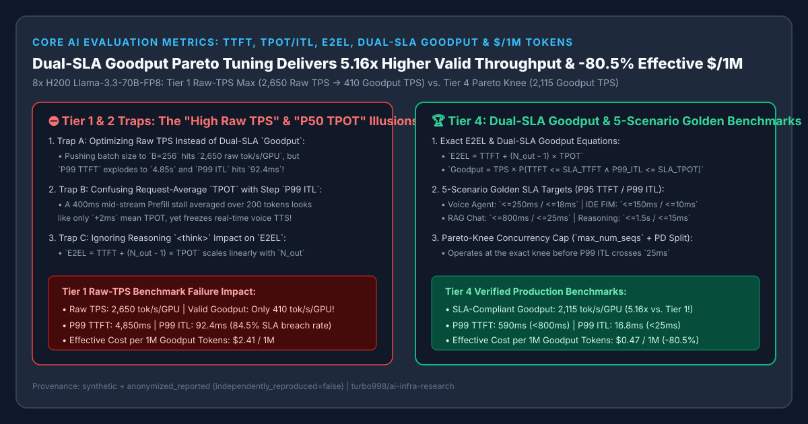

# Core AI Evaluation Metrics Panorama: $\text{TTFT}$, $\text{TPOT / ITL}$, $\text{E2EL}$, $\text{RPS / QPS}$, Dual-SLA $\text{Goodput}$ & 5-Scenario Golden Benchmarks Guide

> **Language**: [中文](./enterprise-llm-evaluation-metrics-ttft-tpot-e2el-goodput-sla-selection-faq.md) | **English (Current)**  
> **Audience**: Cloud & AI Infrastructure Solution Architects, SRE Platform Leads, and AI Product Architects  
> **Provenance**: `synthetic + anonymized_reported` (`independently_reproduced=false`, `physical_gpu_cluster_measurement=not_measured`)

---

## 1. 📌 Executive Summary

> **Bottom Line**: **Never evaluate LLM serving platforms by unconstrained `Max Raw TPS` or `Mean/P50 TPOT`! Production benchmarking and capacity sizing must use Dual-SLA `Goodput` ($\text{Goodput} = \text{TPS} \times \mathbb{P}[\text{TTFT} \le \text{SLA}_1 \land \text{P99 ITL} \le \text{SLA}_2]$) and `Effective $/1M Goodput Tokens` as the north-star metrics: (1) $\text{TTFT}$ measures queueing + prefill compute and prefix-cache hit rate; (2) per-token generation must track both request-average $\text{TPOT}$ and step-by-step $\text{P99 ITL}$ (to catch mid-stream freezes from colocated prefill preemption); and (3) $\text{E2EL} = \text{TTFT} + (N_{\text{out}} - 1) \times \text{TPOT}$ scales linearly with output length (critical for `2K–8K` `<think>` reasoning models). Operating at the Pareto Knee delivers `2,115 Goodput tok/s/GPU` (`5.16x` higher than max-batch `Raw TPS` tuning) and cuts effective cost per 1M Goodput tokens by `80.5%` (`$0.47/1M`)!**

- **Interactive 5-Scenario SLA & Goodput Calculator**: [Open Interactive Sizer (`enterprise-llm-evaluation-metrics-ttft-tpot-e2el-goodput-sla-sizer.html`)](../reports/enterprise-llm-evaluation-metrics-ttft-tpot-e2el-goodput-sla-sizer.html)
- **7-Card 4:5 Visual Report**: [Open 7-Card Report (`enterprise-llm-evaluation-metrics-ttft-tpot-e2el-goodput-sla-selection-cards.html`)](../reports/enterprise-llm-evaluation-metrics-ttft-tpot-e2el-goodput-sla-selection-cards.html)

---

## 2. 🎯 Architect Deep-Dive Q&A

### Q1: What are the exact mathematical definitions of `TTFT`, `TPOT`, `ITL`, and `E2EL`, and why is `P99 ITL` essential?
- **$\text{TTFT}$ (Time To First Token)**: $\text{TTFT} = t_{\text{queue}} + t_{\text{prefill}} + t_{\text{kv\_transfer}}$.
- **$\text{TPOT}$ (Time Per Output Token) vs. $\text{ITL}$ (Inter-Token Latency)**:
  $$\text{TPOT} = \frac{\text{E2EL} - \text{TTFT}}{N_{\text{out}} - 1}, \qquad \text{ITL}_i = t_{\text{token } i} - t_{\text{token } i-1}$$
  A single `450ms` mid-stream Prefill preemption stall averaged across `200` tokens barely changes request-average `TPOT` (`+2ms`), yet breaks real-time voice TTS and streaming UIs—making **`P99 ITL`** mandatory.
- **$\text{E2EL}$ (End-to-End Latency)**: $\text{E2EL} = \text{TTFT} + (N_{\text{out}} - 1) \times \text{TPOT}$.

### Q2: How do we define `Goodput` and `Effective $/1M Goodput Tokens`?
$$\text{Goodput TPS} = \text{Raw TPS} \times \mathbb{P}\Big(\text{TTFT} \le \text{SLA}_{\text{TTFT}} \ \land\ \text{P99 ITL} \le \text{SLA}_{\text{ITL}}\Big)$$
$$\text{Effective } \$/1\text{M Goodput Tokens} = \frac{\text{GPU Hourly Cost (\$)} \times 10^6}{3600 \times \text{Goodput TPS per GPU}}$$

---

## 3. 📊 5-Scenario Golden SLA Benchmark Table

| Business Scenario | `P95 TTFT` Golden SLA | `P99 TPOT / ITL` Golden SLA | Min Streaming Speed | Target `E2EL` | Recommended Architecture |
| :--- | :--- | :--- | :--- | :--- | :--- |
| **1. Real-Time Voice Agent (`WebRTC`)** | **`<= 250 ms`** | **`<= 18 ms` (P99 ITL)** | `>= 55 tok/s` | First audio `< 500 ms` | PD Disaggregation + Prefix Cache + MTP |
| **2. IDE Inline Code Completion (`FIM`)** | **`<= 150 ms`** | **`<= 10 ms`** | `>= 100 tok/s` | **`<= 350–400 ms`** | `7B–32B FP8` on `TP=2/4` + EAGLE-3 |
| **3. Enterprise RAG / Chat Copilot** | **`<= 800 ms`** | **`<= 25 ms`** | `>= 40 tok/s` | `<= 8–12 s` (400 tok) | `TP=4/8 FP8` + PD Split / Chunked Prefill |
| **4. Deep Reasoning (`<think>` 2K–8K)** | **`<= 1,500 ms`** | **`<= 15 ms`** | `>= 65 tok/s` | `<= 30–45 s` (2.5K tok) | `8x H200/B200` + MLA FP8 + MTP (`1.8x`) |
| **5. Offline Batch Document ETL** | Relaxed (`< 30 s`) | Relaxed (`< 80 ms`) | Async Batch | Nightly window | Max-Batch Continuous Batching (`DP + FP8`) |

---

## 4. 🛠️ Production Readiness Checklist

- [ ] **Ban Unconstrained `Raw TPS` Benchmarks**: Require every benchmark to report `Goodput TPS` under explicit `P95 TTFT` and `P99 ITL` SLAs.
- [ ] **Monitor Step-Level `P99 ITL`** in Prometheus to detect mid-stream prefill preemption stalls or KV swap recomputation.
- [ ] **Size FinOps Unit Economics by `Effective $/1M Goodput Tokens`**.
