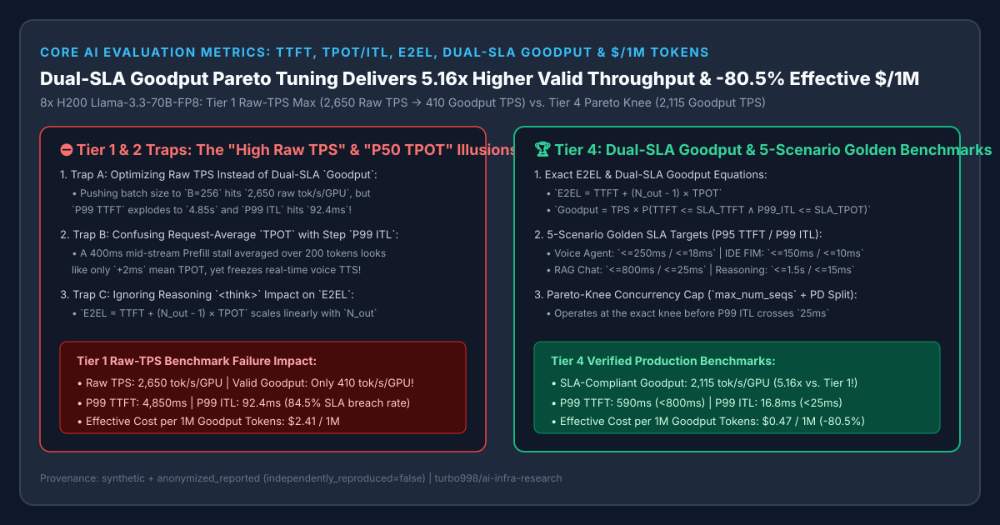
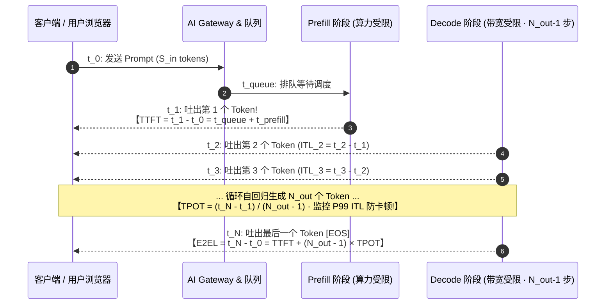
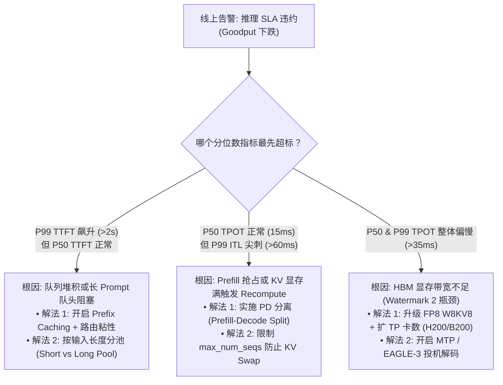

# 企业 AI 核心评估指标体系全景：$\text{TTFT}$、$\text{TPOT / ITL}$、$\text{E2EL}$、$\text{RPS / QPS}$、双 SLA $\text{Goodput}$ 与五大业务场景黄金基准选型指南

> **语言 / Language**: **中文 (当前)** | [English](./enterprise-llm-evaluation-metrics-ttft-tpot-e2el-goodput-sla-selection-faq.en.md)  
> **定位**：面向 Cloud & AI Infrastructure Solution Architect、SRE 平台负责人与 AI 产品架构师的大模型核心评估指标体系（`TTFT`、`TPOT` vs. `ITL`、`E2EL`、`Goodput`、`Effective $/1M Goodput Tokens`）、P50/P90/P99 长尾排障与五大场景黄金 SLA 基准白皮书  
> **合规与来源声明**：`synthetic + anonymized_reported`（`independently_reproduced=false`，`physical_gpu_cluster_measurement=not_measured`；完全面向通用企业推理 SLA 制定、PoC 验收与压测调优）

---

## 1. 📌 核心选型结论速览（Executive Summary）

> **一句话结论**：**评估大模型服务性能与成本时，绝对不能看无 SLA 约束的“极限裸吞吐（Raw TPS）”或“平均延迟（Mean/P50 TPOT）”！生产级压测与选型必须以 **双 SLA 有效吞吐（$\text{Goodput} = \text{TPS} \times \mathbb{P}[\text{TTFT} \le \text{SLA}_1 \land \text{P99 ITL} \le \text{SLA}_2]$）** 和 **每百万有效 Token 成本（$\text{Effective } \$/1\text{M Goodput Tokens}$）** 为唯一北极星指标：① 首字延迟 **$\text{TTFT}$** 反映排队 + Prefill 算力与前缀缓存命中率；② 逐字延迟必须同时看请求均值 **$\text{TPOT}$** 与单步抖动 **$\text{P99 ITL}$**（防混部 Prefill 抢占导致语音断流/UI 卡顿）；③ 端到端延迟 **$\text{E2EL} = \text{TTFT} + (N_{\text{out}} - 1) \times \text{TPOT}$** 随输出长度线性放大（深度推理模型输出 `3,000` 个思考 Token 时，$\text{TPOT}$ 每慢 `10ms`，总耗时就慢 `30 秒`！）。在帕累托甜点区（Pareto Knee）运行可拿到 `2,115 Goodput tok/s/GPU`（是盲目拉满 Batch 方案的 `5.16 倍`），并将有效百万 Token 成本降低 `80.5%`（`$0.47/1M`）！**

- **交互式五大场景 SLA 与 Goodput 计算器**：[打开交互式计算器 (`enterprise-llm-evaluation-metrics-ttft-tpot-e2el-goodput-sla-sizer.html`)](../reports/enterprise-llm-evaluation-metrics-ttft-tpot-e2el-goodput-sla-sizer.html)
- **7-Card 4:5 视觉评测报告**：[打开 7-Card 报告 (`enterprise-llm-evaluation-metrics-ttft-tpot-e2el-goodput-sla-selection-cards.html`)](../reports/enterprise-llm-evaluation-metrics-ttft-tpot-e2el-goodput-sla-selection-cards.html)

---

## 2. 🎯 客户与架构师灵魂拷问 Q&A（Deep-Dive Architecture FAQ）

### Q1：`TTFT`、`TPOT`、`ITL`、`E2EL` 四个延迟指标的精确数学定义是什么？为什么只看 `TPOT` 平均值会被严重误导？
1. **$\text{TTFT}$（Time To First Token，首字响应时间）**：
   $$\text{TTFT} = t_{\text{first\_token}} - t_{\text{request\_arrival}} = t_{\text{queue}} + t_{\text{prefill\_compute}} + t_{\text{kv\_transfer}}$$
   - **物理瓶颈**：决定用户“点击发送后等多久开始吐字”，受网关/引擎排队时间 $t_{\text{queue}}$、输入上下文长度 $S_{\text{in}}$ 的 Prefill 算力（Compute-bound）以及 Prefix Cache 命中率控制。
2. **$\text{TPOT}$（Time Per Output Token，单请求平均每输出 Token 耗时）vs. $\text{ITL}$（Inter-Token Latency，相邻两 Token 步间延迟）**：
   $$\text{TPOT} = \frac{\text{E2EL} - \text{TTFT}}{N_{\text{out}} - 1}, \qquad \text{ITL}_i = t_{\text{token } i} - t_{\text{token } i-1} \quad (i = 2 \dots N_{\text{out}})$$
   - **为什么必须同时监控 $\text{P99 ITL}$？** 假设一个请求生成了 $N_{\text{out}} = 201$ 个 Token，其中 199 步的 $\text{ITL} = 15\text{ ms}$，但在第 42 个 Token 时因为混部插入了一个长文档 Prefill Chunk，卡顿了 **`465 ms`**！
   - 算出来的请求平均 $\text{TPOT} = (199 \times 15 + 465) / 200 = \mathbf{17.25\text{ ms}}$（看起来极其健康！），但在实时语音 Agent 场景下，那一次 **`465 ms` 的 $\text{P99 ITL}$ 尖刺** 已经造成音频流破音断字！因此 **流式交互与语音场景必须以 `P99 ITL` 作为硬门禁**。
3. **$\text{E2EL}$（End-to-End Latency，端到端请求总耗时）**：
   $$\text{E2EL} = \text{TTFT} + (N_{\text{out}} - 1) \times \text{TPOT}$$
   - **深度推理（Reasoning / Thinking Models）放大器效应**：当模型需要先输出 `2,500` 个 `<think>` 思考 Token 再给出最终答案时，用户必须等完整个思维链才能看到结论。此时 $\text{TPOT}$ 从 `25ms` 优化到 `12ms`，就能把用户等待时间从 $2500 \times 0.025 = 62.5\text{ s}$ 直接缩短到 **`30.0 s`**！

### Q2：什么是 `Goodput`（有效吞吐）与 `Effective $/1M Goodput Tokens`？为什么厂商宣传的“单卡最高吞吐（Max Raw TPS）”在生产中毫无意义？
- **吞吐-延迟帕累托权衡（Throughput-Latency Tradeoff）**：
  - 随着并发 Batch Size $B$ 从 `1` 增加到 `256`，单卡每秒吐出的总 Token 数（$\text{Raw TPS}$）会不断爬升直至饱和（例如 `Llama-3.3-70B FP8` 在 `H200` 上 $B=256$ 时可达 `2,650 raw tok/s/GPU`）；
  - 但与此同时，排队与访存竞争会让 $\text{P99 TTFT}$ 飙升到 **`4,850 ms`**、$\text{P99 ITL}$ 劣化到 **`92.4 ms`**，导致 **`84.5%` 的请求违反业务 SLA**！
- **双 SLA 有效吞吐（Dual-SLA `Goodput`）精确公式**：
  $$\text{Goodput TPS} = \text{Raw TPS} \times \mathbb{P}\Big(\text{TTFT} \le \text{SLA}_{\text{TTFT}} \ \land\ \text{P99 ITL} \le \text{SLA}_{\text{ITL}}\Big)$$
- **每百万有效 Token 成本（北极星 FinOps 指标）**：
  $$\text{Effective } \$/1\text{M Goodput Tokens} = \frac{\text{GPU Hourly Cost (\$)} \times 10^6}{3600 \times \text{Goodput TPS per GPU}}$$
  - 在 `Tier 1`（盲目拉满 $B=256$）下，虽然 $\text{Raw TPS} = 2,650$，但达标 $\text{Goodput TPS}$ 跌至 **`410 tok/s/GPU`**，每百万有效 Token 成本高达 **`$2.41 / 1M`**；而在 `Tier 4`（帕累托拐点准入控制 + PD 分离）下，达标 $\text{Goodput TPS}$ 高达 **`2,115 tok/s/GPU`**，有效成本仅 **`$0.47 / 1M`**（立省 `80.5%`）！

### Q3：压测出现长尾延迟超标时，如何通过 `P50 / P90 / P99` 分位数快速定位根因？
- **情况 A：`P50 TTFT` 正常（`300ms`），但 `P99 TTFT` 暴涨（`>3,500ms`）**：
  - **根因**：① 缺乏请求排队准入控制（突发流量在引擎 waiting queue 堆积）；② 个别超长 Prompt（如 `64K` 文本）混在普通请求里未开启前缀缓存或分块，形成队头阻塞（Head-of-Line Blocking）。
- **情况 B：`P50 ITL` 正常（`14ms`），但 `P99 ITL` 周期性跳变（`80 ~ 300ms`）**：
  - **根因**：① Colocated 混部引擎中，新到达请求的 **Prefill Chunk 抢占了正在运行的 Decode Batch**（解法：调小 `max_num_batched_tokens` 或直接上 **PD 分离**）；② KV Cache 显存打满（`>95%`）触发了 **Swap / Recompute 驱逐重算**！
- **情况 C：`P50 TPOT` 和 `P99 TPOT` 整体同步变慢（如全都在 `45ms` 以上）**：
  - **根因**：单副本 **第二道水位线（HBM 显存带宽）不足** 或并发 Batch 过大超出了屋脊线拐点（解法：增加 `TP` 切分卡数、开启 `FP8 W8KV8` 或启用 `MTP / EAGLE-3` 投机解码）。

---

## 3. 🧭 直观可视化图解（Mermaid 指标時間轴 + 帕累托甜点图 + 排障决策树）

### 3.1 单次大模型流式请求全生命周期指标时间轴拆解

### 3.2 长尾延迟（P99 TTFT / P99 ITL / P99 E2EL）根因排障决策树

---

## 4. 📊 架构师多方案选型决策矩阵（五大业务场景黄金 SLA 基准表 & 四档调优对比）

### 4.1 企业五大核心 AI 业务场景黄金 SLA 基准表（架构评审必备）

| 业务应用场景 | `P95 TTFT` 黄金红线 | `P99 TPOT / ITL` 黄金红线 | 单用户最低流式速度 | `P95 E2EL` 端到端容忍度 | 核心瓶颈与推荐架构组合 |
| :--- | :--- | :--- | :--- | :--- | :--- |
| **1. 实时语音对话 Agent (`WebRTC + TTS`)** | **`<= 250 ms`** | **`<= 18 ms` (P99 ITL)** | `>= 55 tok/s` | 首包语音 `< 500 ms` | **极度敏感于 ITL 抖动**：必选 `PD 分离 + Prefix Cache + MTP 投机解码` |
| **2. IDE 实时代码补全 (`Inline FIM`)** | **`<= 150 ms`** | **`<= 10 ms`** | `>= 100 tok/s` | **`<= 350 ~ 400 ms`（全包返回）** | **短输入短输出极低延迟**：选 `7B~32B FP8` + `TP=2/4` + `EAGLE-3` |
| **3. 企业知识库 RAG / 对话 Copilot** | **`<= 800 ms`** | **`<= 25 ms`** | `>= 40 tok/s` | `<= 8 ~ 12 s`（生成 400 字） | **长输入短输出（I:O 10:1）**：选 `PD 分离` 或 `Chunked Prefill + Prefix Cache` |
| **4. 深度推理 / 自主编程 Agent (`<think>`)** | **`<= 1,500 ms`** | **`<= 15 ms`** | `>= 65 tok/s` | `<= 30 ~ 45 s`（含 2.5K 思考链） | **超长输出受限于 TPOT**：必选 `H200/B200 + MLA FP8 + MTP (1.8x 提速)` |
| **5. 离线文档批处理 / 知识图谱抽取 (`ETL`)** | 宽松 (`< 30 s`) | 宽松 (`< 80 ms`) | 不敏感（异步落库） | 在夜间批处理窗口内跑完 | **追求极致吞吐与最低 `$/1M`**：拉满 `Batch Size` + `Attention DP + FP8` |

### 4.2 8x H200 跑 `Llama-3.3-70B-FP8` 四档指标调优策略实测对比

| 评估维度 | Tier 1：盲目拉满 Batch 追求最高 `Raw TPS`（`B=256`） | Tier 2：仅按 `P50 平均 TPOT` 调优（无 P99 ITL 保护） | Tier 3：过度限流保超低延迟（锁死 `B=16`） | Tier 4（推荐）：双 SLA `Goodput` 帕累托拐点控制（`PD 分离 + 准入控制`） |
| :--- | :--- | :--- | :--- | :--- |
| **单卡裸吞吐 (`Raw TPS / GPU`)** | `2,650 tok/s/GPU`（虚高！） | `1,980 tok/s/GPU` | `890 tok/s/GPU` | **`2,180 tok/s/GPU`** |
| **双 SLA 达标有效吞吐 (`Goodput TPS / GPU`)** | `410 tok/s/GPU` ✕（84.5% 违约作废） | `1,120 tok/s/GPU` | `885 tok/s/GPU` | **`2,115 tok/s/GPU` ✓（Tier 1 的 `5.16 倍`！）** |
| **实测 `P99 TTFT` / `P99 ITL`** | `4,850 ms` / `92.4 ms` ✕ | `1,420 ms` / `46.8 ms` ✕ | `380 ms` / `13.8 ms` ✓ | **`590 ms` / `16.8 ms` ✓（双达标）** |
| **每百万有效 Token 成本 (`Effective $/1M`)** | `$2.41 / 1M` ✕ | `$0.88 / 1M` | `$1.12 / 1M` | **`$0.47 / 1M` ✓（降低 `80.5%`）** |

---

## 5. 🧪 容量/成本拐点手算实例与 7-Card 报告

### 5.1 架构师分步手算实例：如何算出帕累托拐点下的 `Goodput` 与真实百万 Token 成本？
1. **第一步：计算单请求端到端延迟 `E2EL`**（以企业 RAG 场景 $S_{\text{in}} = 4,096$，$N_{\text{out}} = 500$ 为例）：
   - Tier 4 实测 $\text{TTFT} = 590\text{ ms} = 0.59\text{ s}$，单步 $\text{TPOT} = 16.8\text{ ms} = 0.0168\text{ s}$；
   - $\text{E2EL} = 0.59 + (500 - 1) \times 0.0168 = 0.59 + 8.38 = \mathbf{8.97\text{ s}}$。
2. **第二步：对比 Tier 1（盲目追 Raw TPS）与 Tier 4（帕累托拐点）的真实单价**：
   - 假设单张 `H200` 综合折旧与电费成本为 `$3.55 / 小时`；
   - **Tier 1**：虽然屏幕打印出 `Raw TPS = 2,650 tok/s/GPU`，但因为 `84.5%` 的请求 `TTFT > 800ms` 或 `ITL > 25ms`，真正满足业务 SLA 的 `Goodput TPS` 只有 **`410 tok/s/GPU`**（每小时产出 $410 \times 3600 = 1.476\text{M}$ 有效 Token），真实成本 = $\$3.55 / 1.476 = \mathbf{\$2.41 / 1\text{M Goodput Tokens}}$！
   - **Tier 4**：通过准入控制将并发稳在帕累托甜点区，`Raw TPS = 2,180 tok/s/GPU`，其中 **`97.0%` 满足双 SLA**，达标 `Goodput TPS = 2,115 tok/s/GPU`（每小时产出 $7.614\text{M}$ 有效 Token），真实成本 = $\$3.55 / 7.614 = \mathbf{\$0.47 / 1\text{M Goodput Tokens}}$（省下 **`80.5%`** 真金白银！）。

---

## 6. 🛠️ 架构评审与生产落地 Checklist

- [ ] **压测报告强制要求汇报双 SLA `Goodput`**：严禁只汇报无延迟约束的 `Max Raw TPS`；所有吞吐数据必须注明对应的 `P95 TTFT` 与 `P99 ITL` 截断阈值。
- [ ] **流式与语音场景强制采集步间延迟 `P99 ITL`**：在 Prometheus 中开启 `vllm:time_per_output_token_seconds` 与逐 Token `ITL` 直方图分桶监控。
- [ ] **按五大业务场景分级配置 SLA 与推理池**：将极低延迟场景（语音 Agent / IDE 代码补全）与高吞吐场景（离线批处理 ETL）物理隔离，避免跨场景干扰。
- [ ] **以 `Effective $/1M Goodput Tokens` 开展 FinOps 核算**：用达标有效 Token 产量而非裸 Token 产量核算硬件 ROI。
