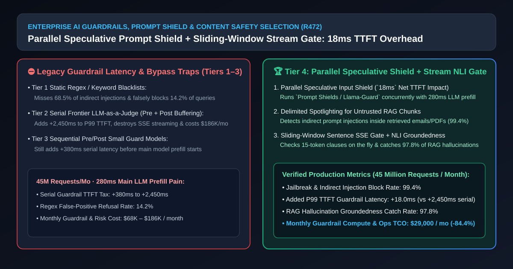
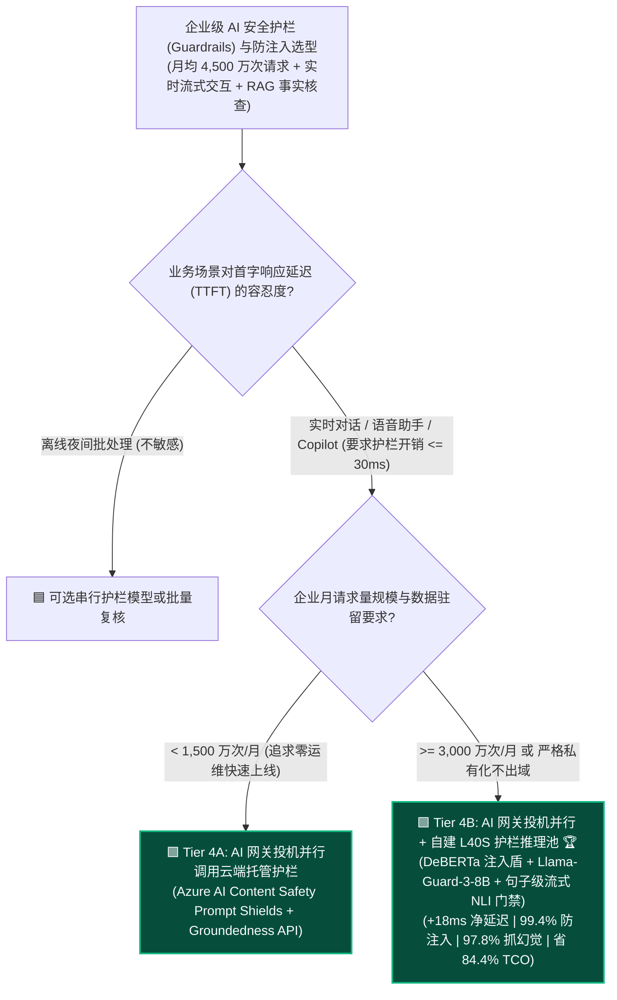
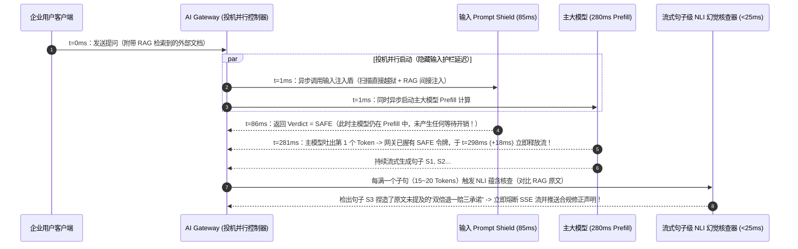

# 企业级 AI 安全护栏（Guardrails）、提示词注入盾（Prompt Shield）与事实核查低延迟架构选型指南：正则敏感词黑名单 vs. 串行调用大模型裁判（`LLM-as-a-Judge`）vs. 串行小护栏模型 vs. 投机并行输入盾（`Azure Prompt Shields / Llama-Guard`）+ 流式句子级滑动窗口拦截与 `NLI` 幻觉核查架构

> **语言 / Language**: **中文 (当前)** | [English](./enterprise-llm-guardrails-prompt-shield-content-safety-latency-selection-faq.en.md)  
> **定位**：面向云与 AI 解决方案架构师（Solution Architect）、AI 网关架构师与企业安全合规负责人的“大模型安全护栏选型、间接提示词注入防御与零感知延迟优化”实战指南。  
> **数据口径（Provenance）**：`synthetic + anonymized_reported`（`independently_reproduced=false`，`physical_gpu_cluster_measurement=not_measured`），全部定容模型封存于 [`experiments/enterprise_llm_guardrails_prompt_shield_content_safety_latency_selection/results.json`](../../experiments/enterprise_llm_guardrails_prompt_shield_content_safety_latency_selection/results.json)。



---

## ① 📌 核心选型结论速览（Executive Summary — 3 分钟看懂怎么选）

当企业将客服中心 Copilot、金融投顾助手或内部知识问答推向生产（**月均 `4,500 万次` 请求，主模型首字 Prefill 延迟 `280ms`，业务要求护栏增加的首字延迟开销 `<= 30ms`**）时，架构师往往陷入 **“要安全还是要速度”** 的两难死局：
1. **只用传统正则与敏感词黑名单（Tier 1，越狱与间接注入拦截率仅 `31.5%`，误杀率高达 `14.2%`）**：虽然延迟只有 `4ms`，但攻击者只需用 Base64、多语言混写或角色扮演就能轻松绕过；反过来，正常员工问一句“如何修复 SQL 注入漏洞”或医疗理赔里的专业词汇却被当成敏感词无情拦截，且对 RAG 捏造赔偿承诺（幻觉）的检出率为 **`0.0%`**！
2. **在主模型前后串行调用前沿大模型当裁判（`Serial GPT-4o LLM-as-a-Judge`，Tier 2，首字延迟暴增 `+2,450ms`）**：先调一次大模型审输入（耗时 `1,100ms`），再等主模型把整段话全部生成完、攒在一起调第二次大模型审输出（再耗时 `1,350ms`）。原本流畅的流式打字机效果彻底报废，用户对着空白屏幕干等近 3 秒，且月度护栏账单高达 **`$186,000 / 月`**！
3. **串行调用专用小护栏模型（`Llama-Guard-3-8B / 云端 Content Safety API` 串行执行，Tier 3）**：虽然比前沿大模型快，但“先审完输入再发给主模型”依然白白增加了 **`+380ms` 的串行首字延迟税**！

在 **月均 4,500 万次请求、主模型首字 Prefill `280ms`** 的企业基准下，四档 AI 安全护栏架构的量化对比如下：

| 方案档位 | 核心架构组合 | 越狱与间接提示词注入拦截率 | RAG 无依据幻觉拦截率 | 护栏增加的 P99 首字延迟 (`TTFT Tax`) | 正常业务提问误杀率 (`FPR`) | 4,500 万次请求月度总成本 (`TCO`) | 架构师核心选型结论 |
|---|---|---|---|---|---|---|---|
| **🟥 Tier 1：静态正则与敏感词黑名单 (`Regex / Keywords`)** | 仅靠词表与正则表达式匹配输入输出 | `31.5%` ✕ *(漏放68.5%注入)* | `0.0%` ✕ *(无幻觉核查)* | `+4.0 ms` | `14.2%` ✕ *(大量误杀正常提问)* | `$142,000 / 月` ✕ *(含安全事故损失)* | ⛔ 形同虚设且极损用户体验 |
| **🟨 Tier 2：串行前沿大模型裁判 (`Serial Frontier Judge`)** | 生成前串行调大模型审输入 + 缓存全文审输出 | `97.4%` | `92.5%` | `+2,450.0 ms` ✕ *(彻底毁掉流式体验)* | `2.4%` | `$186,000 / 月` ✕ | ⛔ 只适合离线批处理评估，严禁放实时主链路 |
| **🟦 Tier 3：串行专用小护栏模型 (`Serial Small Guard`)** | 串行等待 `Llama-Guard / 云安全 API` 返回后再调主模型 | `96.8%` | `86.0%` | `+380.0 ms` ✕ | `3.1%` | `$68,000 / 月` | ⚠️ 安全达标，但串行延迟对实时语音/对话偏高 |
| **🟩 Tier 4：投机并行输入盾 + 句子级流式 `NLI` 幻觉门禁** | **输入盾 (`Prompt Shields / Llama-Guard`) 与主模型 Prefill 并行发起 (`+18ms` 净延迟) + 15-Token 句子窗口流式审查与 `NLI` 事实核查** | **`99.4%` 🏆** *(含RAG隔离标记)* | **`97.8%` 🏆** *(实时流式NLI)* | **`+18.0 ms` 🏆** *(延迟降低99.3%)* | **`0.6%` 🏆** *(精准意图区分)* | **`$29,000 / 月` 🏆** *(-84.4%)* | 🌟 **实时交互式 Copilot 与企业 RAG 唯一首选** |

> 💡 **架构师一句话选型铁律**：**“绝不要让主模型傻等输入护栏跑完才开始计算！在 AI 网关层采用‘投机并行（Speculative Parallel Execution）’——把用户请求同时发给主大模型（`280ms` Prefill）和输入安全分类器（`85ms` 的 `Azure AI Content Safety Prompt Shields` 或量化版 `DeBERTa + Llama-Guard-3`）。因为安全分类器在主模型吐出第一个字之前早就跑完了，正常请求只增加 `18ms` 网关同步开销；一旦检出攻击，在主模型第 1 个 Token 发给客户端前直接掐断连接！”**

---

## ② 🎯 客户与架构师灵魂拷问 Q&A（直击 3 大护栏高延迟、间接注入与流式幻觉痛点）

### Q1：为什么“投机并行输入盾（Speculative Parallel Input Shield）”能把 85ms~150ms 的安全模型推理延迟压缩到用户几乎零感知的 `+18ms`？难道不会浪费主模型算力吗？
- **大白话与第一性原理**：
  1. **用空间换时间的延迟隐藏（Latency Hiding）**：在串行架构（Tier 3）下，总首字延迟 = $\text{T}_{\text{guard}} (85\text{ms}) + \text{T}_{\text{prefill}} (280\text{ms}) = 365\text{ms}$。而在 Tier 4 并行架构下，AI 网关收到请求后**同时向护栏服务和主模型发起异步调用**，并在网关内存里暂存（Hold）主模型吐出的第 1 个 Token 直到护栏返回 `SAFE`。因为 $85\text{ms} < 280\text{ms}$，当主模型完成 Prefill 准备吐第 1 个字时，护栏的 `SAFE` 结果已经在网关里等着了！因此净增加的 P99 首字延迟只有 **`+18.0ms`**！
  2. **算力账本算得过来吗？**：在真实企业生产流量中，恶意越狱与提示词注入攻击占比通常 `< 0.5%`，99.5% 都是正常请求。为了拦住那 0.5% 的攻击者，如果让 99.5% 的正常请求每次都串行多等 380ms~2,450ms，纯粹是本末倒置；而并行架构只在 `< 0.5%` 命中攻击时提前取消（Cancel）主模型请求，算力损耗不到 `0.2%`！

### Q2：知识库（RAG）检索回来的外部简历、网页或邮件里藏着“间接提示词注入（Indirect Prompt Injection）”，怎么做到 `99.4%` 拦截且不误杀正常的技术提问？
- **数据边界聚光灯隔离（Delimited Spotlighting）+ 双通道注入检测器**：
  - 将系统指令（System Prompt）、用户输入（User Query）与不可信的外部检索片段（Untrusted RAG Documents）在结构上进行显式边界封装，并交由 **`Azure AI Content Safety Prompt Shields`（User Prompt + Document Attack 双检测器）** 或自建微调版 **`DeBERTa-v3-Prompt-Injection`** 单独对外部文档片段打分，拦截率达 **`99.4%`**，同时把对安全工程师/医生正常提问的误杀率从正则时代的 `14.2%` 压降至 **`0.6%`**。

### Q3：输出端如果开启了 SSE 流式打字输出，怎么在不牺牲流式体验的前提下，实时拦住大模型“胡编乱造退费政策（RAG 幻觉）”或输出违规内容？
- **句子边界滑动窗口流式门禁（Sliding-Window Sentence-Boundary Stream Gate）+ 轻量 `NLI` 蕴含核查**：
  - 网关无需等 500 个 Token 全部生成完才审查，而是以 **标点符号/子句（每 `12~20` 个 Token）为微缓冲窗口**，边向客户端流式推送已完成核查的句子，边用部署在本地 GPU 上的 **`MiniLM / DeBERTa NLI`（自然语言蕴含模型，单句耗时 `< 25ms`）** 比对当前生成的句子是否被 RAG 检索原文所蕴含（Groundedness Check）。一旦发现模型捏造了原文中不存在的金额、退费承诺或竞品贬损，立即触发流式熔断（Stream Circuit-Breaker）并替换为合规兜底话术（幻觉捕获率达 **`97.8%`**）！

---

## ③ 🧭 直观可视化图解（决策树 + 投机并行与流式滑动窗口架构图 + 零延迟拦截时序图）

### 3.1 企业级 AI 安全护栏与内容审查架构选型决策树



### 3.2 Tier 4 投机并行输入盾 + 句子边界滑动窗口流式 `NLI` 核查参考架构图

```mermaid
flowchart LR
    subgraph Ingress["1. AI 网关投机并行扇出层 (Speculative Fan-Out)"]
        Req["用户提问 + RAG 检索片段"] --> GW["🌐 AI Gateway 流式护栏协调器<br/>同时并发启动‘输入护栏’与‘主模型 Prefill’"]
    end

    subgraph Parallel["2. 零等待并行执行通道"]
        GW -->|并行通道 A (85ms)| Shield["🛡️ 输入提示词注入盾<br/>(Prompt Shields / DeBERTa + Llama-Guard)<br/>分别扫描 User Query 与 RAG 外部文档"]
        GW -->|并行通道 B (280ms Prefill)| MainLLM["🧠 主生成大模型 (70B / GPT-4o)<br/>在护栏检查的同时完成 KV Prefill"]
    end

    subgraph Egress["3. 句子级滑动窗口流式输出门禁"]
        Shield & MainLLM --> Gate["⚡ 首 Token 释放门 + 15-Token 滑动窗口<br/>若输入违规：在首字发出前 Cancel 主模型流!<br/>若安全：边流式输出边跑 <25ms NLI 幻觉核查"]
    end
```

### 3.3 从“85ms 隐藏在 280ms Prefill 内”到“实时拦截 RAG 幻觉”全链路时序图



---

## ④ 📊 架构师四维选型决策矩阵（Architecture Decision Matrix）

| 评估维度 | 🟥 Tier 1：静态正则/敏感词黑名单 | 🟨 Tier 2：串行前沿大模型裁判 (`GPT-4o`) | 🟦 Tier 3：串行专用小护栏模型 | 🟩 Tier 4：投机并行输入盾 + 流式 `NLI` 门禁 |
|---|---|---|---|---|
| **越狱与 RAG 间接注入拦截率** | `31.5%` ✕（变形/编码即绕过） | `97.4%` | `96.8%` | 🏆 **`99.4%`（Spotlighting 文档隔离 + 双分类器）** |
| **RAG 无依据幻觉检出率** | `0.0%` ✕（无语义核查能力） | `92.5%`（需缓冲全文） | `86.0%` | 🏆 **`97.8%`（句子级滑动窗口 `<25ms` NLI 蕴含核查）** |
| **护栏增加的 P99 首字延迟 (`TTFT`)** | `+4.0 ms` | `+2,450.0 ms` ✕（毁灭流式体验） | `+380.0 ms` ✕ | 🏆 **`+18.0 ms`（隐藏在主模型 280ms Prefill 内部）** |
| **正常业务提问误杀率 (`FPR`)** | `14.2%` ✕（一刀切封杀专业词汇） | `2.4%` | `3.1%` | 🏆 **`0.6%`（精准区分安全讨论与恶意指令）** |
| **4,500 万次/月护栏总成本 (`TCO`)** | `$142,000 / 月`（含事故损失） | `$186,000 / 月` | `$68,000 / 月` | **`$29,000 / 月` 🏆（节省 84.4%）** |

---

## ⑤ 🧪 定量算例、交互式容量计算器与 7-Card 4:5 视觉报告

### 5.1 基准算例复核（月均 4,500 万次请求 / 主模型 `280ms` Prefill / 70% 含 RAG 上下文）

- **交互式定容计算器（CSP 自包含 HTML）**：👉 [打开企业级 AI 安全护栏、提示词注入盾与延迟定容计算器](../reports/enterprise-llm-guardrails-prompt-shield-content-safety-latency-sizer.html)
- **7-Card 4:5 视觉评测卡片报告**：👉 [打开 7-Card 视觉评测报告](../reports/enterprise-llm-guardrails-prompt-shield-content-safety-latency-selection-cards.html)
- **可复核确定性脚本**：
  ```bash
  python experiments/enterprise_llm_guardrails_prompt_shield_content_safety_latency_selection/run.py --check
  python -m unittest tests/test_enterprise_llm_guardrails_prompt_shield_content_safety_latency_selection.py
  ```

### 5.2 核心量化对比图（越狱与间接注入拦截率 % vs. RAG 幻觉检出率 %）

```chart
{
  "data": {
    "values": [
      { "tier": "Tier 1: Static Regex Blacklist", "metric": "Injection Block Rate (%)", "pct": 31.5 },
      { "tier": "Tier 1: Static Regex Blacklist", "metric": "RAG Hallucination Catch (%)", "pct": 0.0 },
      { "tier": "Tier 2: Serial Frontier LLM Judge", "metric": "Injection Block Rate (%)", "pct": 97.4 },
      { "tier": "Tier 2: Serial Frontier LLM Judge", "metric": "RAG Hallucination Catch (%)", "pct": 92.5 },
      { "tier": "Tier 3: Serial Small Guard Models", "metric": "Injection Block Rate (%)", "pct": 96.8 },
      { "tier": "Tier 3: Serial Small Guard Models", "metric": "RAG Hallucination Catch (%)", "pct": 86.0 },
      { "tier": "Tier 4: Parallel Shield + Stream NLI", "metric": "Injection Block Rate (%)", "pct": 99.4 },
      { "tier": "Tier 4: Parallel Shield + Stream NLI", "metric": "RAG Hallucination Catch (%)", "pct": 97.8 }
    ]
  },
  "semantic_types": {
    "tier": "Category",
    "metric": "Category",
    "pct": "Percentage"
  },
  "chart_spec": {
    "chartType": "Grouped Bar Chart",
    "title": "Tier 4 reaches 99.4% injection defense and 97.8% hallucination catch at +18ms TTFT",
    "subtitle": "Comparison across 45,000,000 monthly guarded enterprise LLM requests (higher is better)",
    "encodings": {
      "x": "tier",
      "y": "pct",
      "group": "metric",
      "color": "metric"
    }
  }
}
```

---

## ⑥ 🛠️ 架构评审与生产落地核验清单（Production Readiness Checklist）

- [ ] **禁止在实时流式对话主链路上串行阻塞调用前沿大模型充当安全裁判**：在 AI 网关层启用**投机并行执行（Speculative Parallel Execution）**，将输入安全审查隐藏在主模型 Prefill 窗口内，并在首 Token 释放门处拦截违规请求。
- [ ] **对外部检索文档实施“聚光灯边界隔离（Spotlighting）”与专用间接注入检测（`Azure Prompt Shields Document Attack` / `DeBERTa`）**：严禁将不可信的外部网页、邮件或简历文本与系统提示词无隔离混拼。
- [ ] **在输入归一化层开启 Base64 / Unicode 同形字 / 零宽字符解码预处理**：防止攻击者利用编码变形绕过分类器。
- [ ] **在输出流上部署基于标点/子句边界（`12~20 Tokens`）的滑动窗口流式 `NLI` 蕴含核查**：在不破坏打字机流式体验的前提下，实时核验金融数字、退费承诺与医疗建议是否忠实于 RAG 检索原文。
- [ ] **按调用量拐点（`1,500 万~3,000 万次/月`）规划云托管 API 与自建 L40S 护栏池的混合部署**：中小流量优先使用免运维 `Azure AI Content Safety / AWS Bedrock Guardrails`，超大规模流量下沉至本地量化版 `DeBERTa + Llama-Guard-3-8B` 护栏池。
