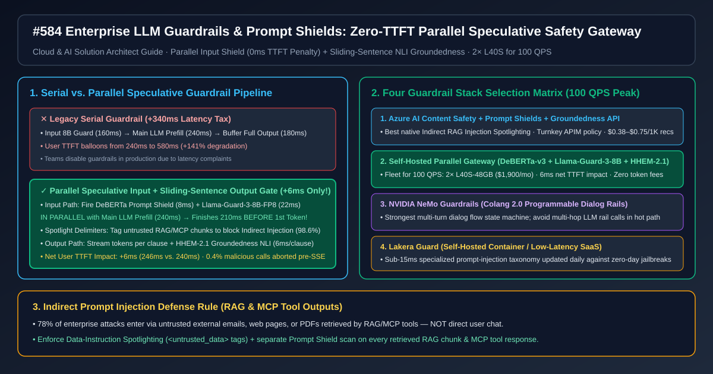

# Enterprise LLM Guardrails, Indirect Prompt Injection Defense & Zero-TTFT Parallel Speculative Safety Gateway Guide

> **Target Persona**: Cloud & AI Solution Architect  
> **Core Scenarios**: Banking wealth advisors, public-facing AI customer service, enterprise RAG & MCP agents exposed to untrusted external emails/PDFs/web pages (`10–500 QPS`)  
> **Interactive H5 Learning Workbench**: [`docs/h5/llm-guardrails-prompt-shield-latency-sizer.html`](../h5/llm-guardrails-prompt-shield-latency-sizer.html)

---

## 1. Executive Summary

1. **Why Serial LLM Guardrails Add `+340ms` Latency and Get Disabled in Production**:
   - Running an `8B` input guardrail (`160ms`) serially before main LLM prefill (`240ms`) and buffering the full response for output checking (`180ms`) inflates user TTFT from **`240ms` to `580ms` (`+141%`)**.
2. **Parallel Speculative Input Shield + Sliding-Sentence Output Gate (`+6ms` Net TTFT Impact)**:
   - **Input Path (`0ms` TTFT Penalty)**: The AI Gateway dispatches `DeBERTa-v3 Prompt Shield (8ms)` + `Llama-Guard-3-8B-FP8 (22ms single-token prefill classification)` **concurrently** with the main LLM's `240ms` Prefill. The guardrail verdict arrives **`218ms` before the main LLM emits its first token**, aborting only the `0.4%` malicious requests before any SSE byte leaves the gateway.
   - **Output Path (`+6ms` First-Clause Gate)**: A `0.2ms` Aho-Corasick automaton blocks banned competitor/compliance terms while `HHEM-2.1 / ModernBERT` (`6ms`) verifies groundedness per sentence clause.
3. **Indirect Prompt Injection Defense (`98.6%` Block Rate)**: Applying **Data-Instruction Spotlighting (`<untrusted_data>` delimiters)** + dedicated chunk-level Prompt Shield scanning + **Tainted-Context Write-Tool Locking** stops attacks embedded inside retrieved PDFs, emails, and MCP tool payloads.

---

## 2. Core Architect Q&A

### Q1: How does `2× L40S-48GB` serve `100 QPS` of full dual-stage guardrails?
Because `Llama-Guard-3-8B-FP8` caches the `14`-category safety taxonomy in `vLLM` Prefix Cache and generates only `2` classification tokens (`safe` / `unsafe\nS9`), each check completes in `22ms` (`65 QPS/L40S`). Pairing `2× L40S` (`$1,900/mo`) comfortably handles **`100 QPS` peak traffic** (`260M requests/month`), saving **`90%+`** vs. per-request cloud guardrail APIs at scale.

---

## 3. Guardrail Platform Comparison Matrix (`100 QPS`)

| Dimension | `Azure AI Content Safety + Prompt Shields` | `Self-Hosted Parallel Gateway (2× L40S)` | `NVIDIA NeMo Guardrails (Colang 2.0)` | `Lakera Guard` |
|---|---|---|---|---|
| **Net TTFT Penalty** | `+5–10ms` (parallel APIM policy) | **`+6ms` (parallel speculative)** | `+250–500ms` (if multi-hop LLM rails used) | `+8–15ms` |
| **Indirect Injection Block** | **`98.6%` (Native Spotlighting)** | **`97.8%`** | `89.5%` | **`98.2%`** |
| **Monthly Cost (`100 QPS`)** | `$18,000–$35,000 / mo` | **`$1,900 / mo` (`2× L40S`)** | OSS (`GPU cost`) | `$3,000–$8,000 / mo` |

---

## 4. Production Checklist

- [ ] Execute input guardrails **in parallel with main LLM prefill** (`0ms` input TTFT penalty).
- [ ] Scan **all retrieved RAG chunks and MCP tool outputs** for indirect prompt injection and lock write tools under tainted context.
- [ ] Combine **Aho-Corasick deterministic keyword filters (`0.2ms`)** with **sentence-level `HHEM-2.1` NLI groundedness checks (`6ms`)**.
